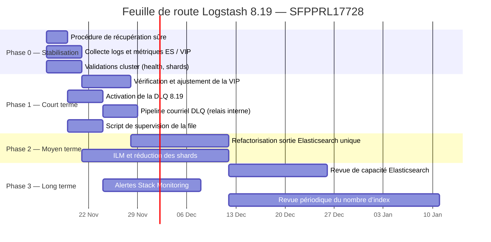

# Feuille de route — file d’attente persistante Logstash 8.19

**Hôte :** SFPPRL17728  
**Produit :** Logstash 8.19  
**Incident de référence :** ingestion bloquée, file persistante qui grossit, déblocage uniquement par vidage de la file et redémarrage  
**Fuseau :** America/Toronto (UTC−5)  
**Statut du document :** proposition opérationnelle, à valider  
**Dernière mise à jour :** 16 novembre 2026

Ce document définit l’ordre d’exécution des correctifs. Les détails techniques sont dans [03-solutions.md](03-solutions.md). Les décisions d’architecture sont dans les [ADR](adr/).

## Légende

| Champ | Valeurs |
| --- | --- |
| Priorité | P0 (cette semaine), P1 (court terme), P2 (moyen terme), P3 (long terme) |
| Dépendances | Travaux à terminer avant de commencer l’item |
| ADR | Décision liée, ou « — » si l’item est purement opérationnel |
| Critère de validation | Preuve objective que l’item est terminé |
| Propriétaire / date cible | À remplir par l’équipe |

Les items marqués **EN ATTENTE** dépendent encore de données non collectées (santé du cluster ES, journaux ES vers 02:00, réglages de la VIP).

## Vue d’ensemble des phases

| Phase | Horizon | Objectif | Livrables principaux |
| --- | --- | --- | --- |
| Phase 0 | Cette semaine | Stabiliser et cesser de perdre des événements à chaque incident | Procédure de récupération sûre, collectes ES/VIP, plus de `rm` de la file |
| Phase 1 | Court terme | Voir le problème plus tôt et isoler les documents invalides | Réglages VIP, DLQ + courriel, script d’alerte sur la file |
| Phase 2 | Moyen terme | Réduire la charge qui fait expirer les requêtes `_bulk` | Une seule sortie Elasticsearch (+ traces), ILM / moins de shards |
| Phase 3 | Long terme | Tenir la charge et détecter la régression automatiquement | Capacité ES, alertes Stack Monitoring, revue périodique des index |

Les dates du diagramme sont des **placeholders**. Remplacer les dates cibles ci-dessous une fois les propriétaires assignés.

---

## Phase 0 — Stabilisation immédiate (cette semaine)

Objectif : au prochain blocage, préserver les preuves, ne plus jeter la file comme premier geste, et obtenir les mesures encore manquantes.

### 0.1 Adopter la procédure de récupération sûre

| | |
| --- | --- |
| **Priorité** | P0 |
| **Dépendances** | Aucune |
| **ADR** | — (procédure dans [03-solutions.md](03-solutions.md#procédure-de-récupération-sûre)) |
| **Propriétaire** | \[propriétaire\] |
| **Date cible** | \[date cible\] |
| **Critère de validation** | L’équipe a une procédure écrite affichée (copie `cp -a` de `path.queue`, arrêt propre, `bin/pqcheck` puis `bin/pqrepair` au besoin, redémarrage). Le vidage manuel de la file n’est plus le geste par défaut. |

### 0.2 Collecter les preuves de l’incident du 16 novembre 2026 vers 02:00 (UTC−5)

| | |
| --- | --- |
| **Priorité** | P0 |
| **Dépendances** | Aucune, mais la file a déjà été vidée : travailler uniquement avec les journaux et le monitoring encore disponibles |
| **ADR** | — (commandes dans [02-probleme.md](02-probleme.md#validations-en-attente)) |
| **Propriétaire** | \[propriétaire\] |
| **Date cible** | \[date cible\] |
| **Critère de validation** | Archive contenant : extraits `logstash-plain.log` (déjà en main), journaux Elasticsearch du ou des nœuds derrière `es-prod.gestion` autour de 02:00, `journalctl` de Logstash/ES, et captures Stack Monitoring / Metricbeat si elles existent. Les éléments introuvables sont notés comme tels. |

**EN ATTENTE :** journaux ES, `journalctl`, graphes de monitoring.

### 0.3 Exécuter les commandes de validation du cluster Elasticsearch

| | |
| --- | --- |
| **Priorité** | P0 |
| **Dépendances** | Accès authentifié à `https://es-prod.gestion:9200` (utilisateur `revenu`) |
| **ADR** | Alimente [ADR-003](adr/ADR-003-reduction-shards-ilm.md) et [ADR-004](adr/ADR-004-configuration-vip-load-balancer.md) |
| **Propriétaire** | \[propriétaire\] |
| **Date cible** | \[date cible\] |
| **Critère de validation** | Sorties conservées et jointes au dossier d’incident pour : `_cluster/health`, `_cat/nodes`, `_cat/allocation`, `_cat/thread_pool/write`, `_cat/shards` (dénombrement), `_all/_settings/index.blocks*`, et comparaison de latence VIP versus un nœud data en direct. |

**EN ATTENTE :** toutes ces sorties.

### 0.4 Consigne d’exploitation jusqu’à la Phase 1

| | |
| --- | --- |
| **Priorité** | P0 |
| **Dépendances** | 0.1 |
| **ADR** | — |
| **Propriétaire** | \[propriétaire\] |
| **Date cible** | \[date cible\] |
| **Critère de validation** | En cas de nouveau blocage, une copie de la file est faite **avant** toute réparation ou tout vidage, et les métriques `localhost:9600/_node/stats/pipelines` sont capturées pendant l’incident. |

---

## Phase 1 — Court terme (VIP, DLQ, supervision)

Objectif : corriger le chemin d’écriture s’il est coupé par la VIP, mettre de côté les erreurs 400/404, et recevoir un courriel quand la file grossit (cas que la DLQ ne couvre pas : délais d’attente, 429, 5xx).

### 1.1 Vérifier et ajuster la VIP `es-prod.gestion`

| | |
| --- | --- |
| **Priorité** | P1 |
| **Dépendances** | 0.3 (latence VIP vs nœud) fortement recommandée |
| **ADR** | [ADR-004](adr/ADR-004-configuration-vip-load-balancer.md) |
| **Propriétaire** | \[propriétaire\] |
| **Date cible** | \[date cible\] |
| **Critère de validation** | Les quatre points suivants sont documentés et corrigés au besoin : délai d’inactivité ou de réponse de la VIP **strictement supérieur** au `timeout` Logstash (120 s) avec une marge ; persistance de session (sticky) désactivée ou justifiée ; health check HTTP sur Elasticsearch, pas seulement TCP ; limites de connexions par client suffisantes pour le nombre de sorties actuel. Un `_bulk` de taille représentative réussit via la VIP dans le délai. |

**EN ATTENTE :** les réglages actuels de la VIP ne sont pas encore connus.

### 1.2 Activer la dead letter queue (DLQ) de Logstash 8.19

| | |
| --- | --- |
| **Priorité** | P1 |
| **Dépendances** | 0.1 (espace disque sous `path.data`) |
| **ADR** | [ADR-002](adr/ADR-002-activation-dlq.md) |
| **Propriétaire** | \[propriétaire\] |
| **Date cible** | \[date cible\] |
| **Critère de validation** | `dead_letter_queue.enable: true` est actif pour le pipeline principal, le répertoire `/var/lib/logstash/data2/dead_letter_queue/main` existe après rechargement, et un document volontairement invalide (erreur 400) apparaît dans la DLQ au lieu d’être perdu. Les codes 429 et 5xx ne sont **pas** attendus dans la DLQ (comportement officiel). |

### 1.3 Mettre en place le pipeline d’alerte courriel sur la DLQ

| | |
| --- | --- |
| **Priorité** | P1 |
| **Dépendances** | 1.2 ; relais SMTP interne joignable (remplacer le marqueur `smtp.interne.local:25`) ; destinataires confirmés |
| **ADR** | [ADR-002](adr/ADR-002-activation-dlq.md) |
| **Propriétaire** | \[propriétaire\] |
| **Date cible** | \[date cible\] |
| **Critère de validation** | Un événement de test dans la DLQ produit **un courriel résumé** (index visé, message d’erreur, nombre d’événements), et non un courriel par document. Le relais utilisé est le relais interne. |

### 1.4 Déployer le script de supervision de la file persistante

| | |
| --- | --- |
| **Priorité** | P1 |
| **Dépendances** | 0.1 ; relais SMTP interne (même marqueur que 1.3) |
| **ADR** | [ADR-005](adr/ADR-005-supervision-file-persistante.md) |
| **Propriétaire** | \[propriétaire\] |
| **Date cible** | \[date cible\] |
| **Critère de validation** | Le script interroge `http://localhost:9600/_node/stats/pipelines`, envoie un courriel lorsque la file dépasse le seuil (par ex. 70 % de `queue.max_bytes` = 4096mb) ou lorsque le journal contient `SocketTimeout` / `no living connections`, et un test volontaire (seuil temporairement abaissé) produit bien le courriel. |

---

## Phase 2 — Moyen terme (sortie unique, ILM / réduction des shards)

Objectif : réduire le nombre de flux `_bulk` concurrents et le nombre de shards, causes probables de la lenteur d’écriture côté Elasticsearch.

### 2.1 Refactoriser `pipeline.global.conf` vers une sortie unique

| | |
| --- | --- |
| **Priorité** | P2 |
| **Dépendances** | 1.1 recommandée (VIP stable) ; 1.2 recommandée (DLQ déjà en place pour les 400) ; relecture du `pipeline.global.conf` actuel pour confirmer les préfixes d’index encore partiellement transcrits |
| **ADR** | [ADR-001](adr/ADR-001-sortie-elasticsearch-unique.md) |
| **Propriétaire** | \[propriétaire\] |
| **Date cible** | \[date cible\] |
| **Critère de validation** | Le routage et les noms d’index restent identiques (y compris `document_id` pour les traces GX). Il ne reste **qu’une** sortie `elasticsearch { }` générique et **une** sortie pour les traces avec `document_id`. Après bascule, l’ingestion reprend sans trou et le nombre de pools de connexions vers la VIP baisse nettement (métriques plugin / connexions VIP). |

Les préfixes d’index non entièrement lus dans les captures doivent être recopiés depuis le fichier en production avant la bascule. Voir les marqueurs **À CONFIRMER** dans [03-solutions.md](03-solutions.md).

### 2.2 Réduire le nombre de shards (ILM ou index mensuels)

| | |
| --- | --- |
| **Priorité** | P2 |
| **Dépendances** | 0.3 (dénombrement réel des shards et taille des index) **obligatoire** avant de choisir le rollover |
| **ADR** | [ADR-003](adr/ADR-003-reduction-shards-ilm.md) |
| **Propriétaire** | \[propriétaire\] |
| **Date cible** | \[date cible\] |
| **Critère de validation** | Politique appliquée : 1 shard primaire pour les petits flux ; index mensuels ou gérés par ILM là où les index quotidiens par client et par `indexname` sont trop petits. Le nombre total de shards du cluster baisse, et les `_bulk` restent sous le `timeout` de 120 s aux heures autrefois problématiques (autour de 02:00). |

**EN ATTENTE :** le nombre actuel de shards n’a pas encore été mesuré. C’est une cause classique, pas un fait déjà prouvé sur ce cluster.

---

## Phase 3 — Long terme (capacité, alertes Stack Monitoring)

Objectif : traiter la lenteur d’Elasticsearch à la source et détecter une régression sans attendre que la file de 4 Go se remplisse.

### 3.1 Revue de capacité d’Elasticsearch

| | |
| --- | --- |
| **Priorité** | P3 |
| **Dépendances** | 0.2 et 0.3 (journaux ES, heap, `thread_pool/write`, disque, réallocations, ILM, snapshots vers 02:00) ; 2.1 et 2.2 pour isoler la capacité résiduelle une fois la charge Logstash réduite |
| **ADR** | Complète [ADR-003](adr/ADR-003-reduction-shards-ilm.md) et [ADR-004](adr/ADR-004-configuration-vip-load-balancer.md) |
| **Propriétaire** | \[propriétaire\] |
| **Date cible** | \[date cible\] |
| **Critère de validation** | Les causes de lenteur observées (GC, rejets du pool d’écriture, watermark disque, relocalisation de shards, snapshot, tâche planifiée, etc.) sont identifiées ou formellement écartées, et les actions de capacité correspondantes sont planifiées ou terminées. |

### 3.2 Alertes Stack Monitoring (ou Metricbeat)

| | |
| --- | --- |
| **Priorité** | P3 |
| **Dépendances** | 1.4 (le script local peut rester en place comme filet de sécurité) ; Stack Monitoring ou Metricbeat déjà évoqués, disponibilité **à confirmer** |
| **ADR** | [ADR-005](adr/ADR-005-supervision-file-persistante.md) |
| **Propriétaire** | \[propriétaire\] |
| **Date cible** | \[date cible\] |
| **Critère de validation** | Des alertes existent au minimum sur : taille de la file persistante, `queue_backpressure` / croissance de la file, `SocketTimeout` ou nœud ES injoignable, taille de la DLQ, et rejets `thread_pool/write` côté ES. Un test produit bien une alerte. |

### 3.3 Revue périodique du nombre d’index et de shards

| | |
| --- | --- |
| **Priorité** | P3 |
| **Dépendances** | 2.2 |
| **ADR** | [ADR-003](adr/ADR-003-reduction-shards-ilm.md) |
| **Propriétaire** | \[propriétaire\] |
| **Date cible** | \[date cible\] (récurrent, p. ex. mensuel) |
| **Critère de validation** | Un contrôle récurrent (commande `_cat/indices` / dénombrement des shards) est calendrier, avec un seuil d’alerte défini après la mesure initiale de la Phase 0. |

---

## Liste de suivi (à remplir)

| ID | Item | Phase | Priorité | ADR | Propriétaire | Date cible | État |
| --- | --- | --- | --- | --- | --- | --- | --- |
| 0.1 | Procédure de récupération sûre | 0 | P0 | — | \[propriétaire\] | \[date cible\] | À faire |
| 0.2 | Collecte preuves 16 nov. 02:00 | 0 | P0 | — | \[propriétaire\] | \[date cible\] | Partiel (logs Logstash seulement) |
| 0.3 | Validations cluster ES et latence VIP | 0 | P0 | ADR-003, ADR-004 | \[propriétaire\] | \[date cible\] | EN ATTENTE |
| 0.4 | Consigne d’exploitation (copie avant flush) | 0 | P0 | — | \[propriétaire\] | \[date cible\] | À faire |
| 1.1 | Vérification / ajustement VIP | 1 | P1 | ADR-004 | \[propriétaire\] | \[date cible\] | EN ATTENTE (réglages inconnus) |
| 1.2 | Activation DLQ 8.19 | 1 | P1 | ADR-002 | \[propriétaire\] | \[date cible\] | À faire |
| 1.3 | Courriel résumé DLQ | 1 | P1 | ADR-002 | \[propriétaire\] | \[date cible\] | À faire |
| 1.4 | Script supervision file persistante | 1 | P1 | ADR-005 | \[propriétaire\] | \[date cible\] | À faire |
| 2.1 | Sortie Elasticsearch unique | 2 | P2 | ADR-001 | \[propriétaire\] | \[date cible\] | À faire (préfixes à confirmer) |
| 2.2 | ILM / réduction des shards | 2 | P2 | ADR-003 | \[propriétaire\] | \[date cible\] | EN ATTENTE (compte de shards) |
| 3.1 | Revue de capacité ES | 3 | P3 | ADR-003, ADR-004 | \[propriétaire\] | \[date cible\] | EN ATTENTE |
| 3.2 | Alertes Stack Monitoring | 3 | P3 | ADR-005 | \[propriétaire\] | \[date cible\] | À confirmer (outil en place ?) |
| 3.3 | Revue périodique index / shards | 3 | P3 | ADR-003 | \[propriétaire\] | \[date cible\] | À faire après 2.2 |

## Ordre recommandé, en une phrase

Cette semaine : procéder sans vider la file, et mesurer Elasticsearch et la VIP. Ensuite : alerter (DLQ + taille de file) et corriger la VIP. Puis : une seule sortie et moins de shards. Enfin : capacité et alertes de plateforme.
