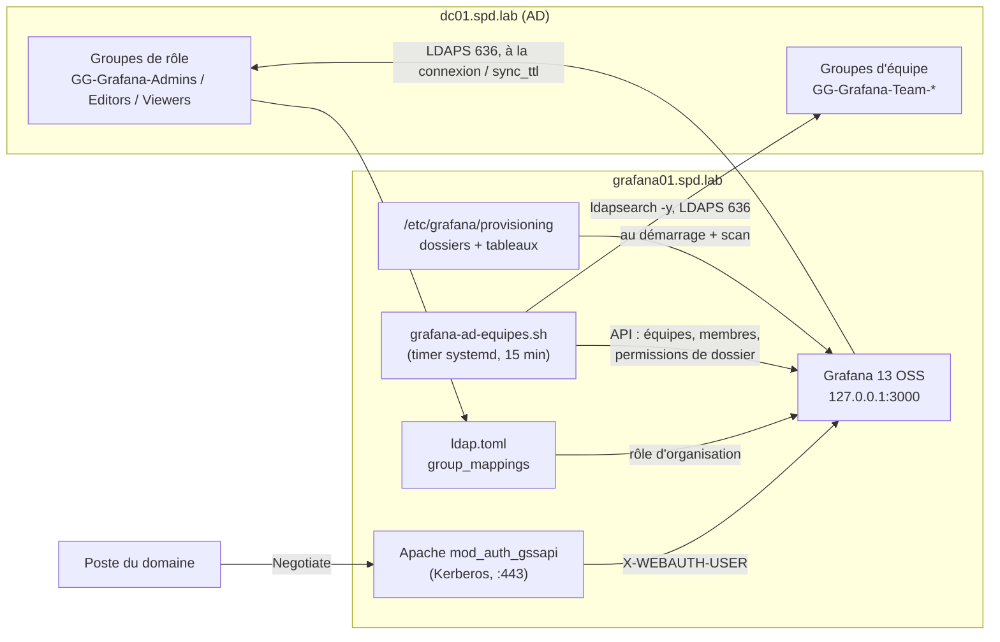
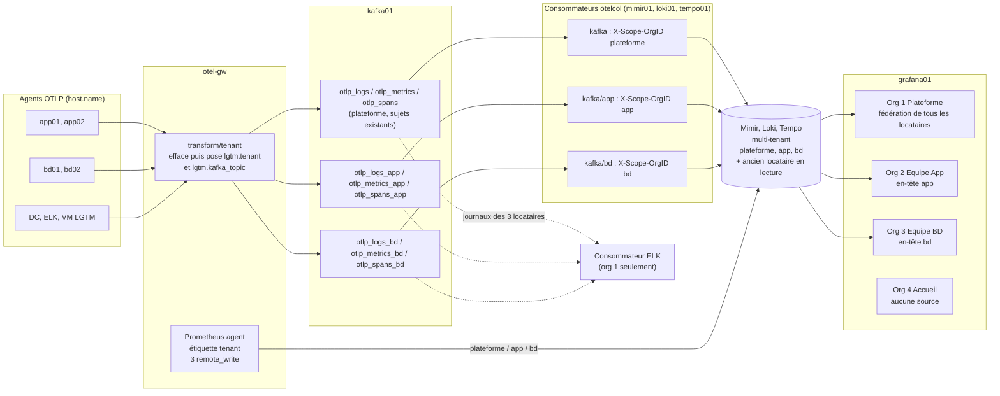

# Grafana OSS – dossiers, tableaux de bord et droits par groupe AD

Ce runbook complète le runbook LGTM (`Runbook_LGTM_Kafka_Offline_Debian13_DNS-Simple.md`, §5.6 et §8). Les §1 à §10 ne modifient rien de ce qui est déjà en place : sources de données, LDAP vers `dc01.spd.lab`, SSO Kerberos via Apache. Le §11 (cloisonnement par équipe) modifie **volontairement** la chaîne d'ingestion, les stockages, les sources de données et `ldap.toml`, avec sauvegardes et checkpoints.

**Ce que tu vas mettre en place :**

1. des **dossiers** par domaine (Plateforme, Systèmes, Journaux, Applications), créés par **provisioning fichier** avec des UID fixes ;
2. des **tableaux de bord de départ** (santé LGTM, Kafka, nœuds, journaux), plus l'import hors ligne du tableau grafana.com **1860** ;
3. des **droits par groupe AD** qui fonctionnent en **Grafana OSS** :
   - le rôle d'organisation vient de `group_mappings` (déjà en place au §8.1) ;
   - les **équipes** (*Teams*) sont alimentées par un **script** lancé par un timer systemd, puisque Team Sync n'existe pas en OSS ;
   - les **permissions de dossier** sont données aux équipes par l'API ;
4. un **cloisonnement réel des données** par équipe et groupe de serveurs (§11) : un locataire par équipe dans Mimir, Loki et Tempo, et une organisation Grafana par équipe.

**Légende.** « **non testé** » = rédigé d'après la documentation officielle, sans avoir tourné sur ton lab. Le script de synchronisation a été testé (`bash -n`, `shellcheck`, et un test fonctionnel contre une **simulation** de l'API Grafana et de `ldapsearch`). Il n'a **pas** tourné contre un vrai Grafana 13 ni contre dc01 : sur le lab, il reste **non testé**.

**Règles de sécurité appliquées partout :**

- aucun secret à l'écran, aucun mot de passe ni jeton en argument de commande ;
- le jeton du compte de service est saisi avec `read -rsp`, puis stocké dans un fichier `0600` ;
- le mot de passe LDAP est lu par `ldapsearch -y` depuis un fichier `0600` ;
- si un secret apparaît à l'écran, dans un journal ou sur une photo, **fais-le tourner** (nouveau jeton, nouveau mot de passe).

---

## 1. Verdict OSS ou Enterprise : ce qui est possible

| Besoin | Grafana OSS 13 | Source officielle |
|---|---|---|
| Rôle d'organisation (Viewer, Editor, Admin) d'après un groupe LDAP : `group_mappings` avec `org_role`, `grafana_admin`, `org_id` | **Oui** | [Configure LDAP authentication](https://grafana.com/docs/grafana/latest/setup-grafana/configure-access/configure-authentication/ldap/) |
| **Team Sync** : appartenance aux équipes d'après les groupes LDAP | **Non**, la page indique « *Available in Grafana Enterprise and Grafana Cloud* » | [Configure team sync](https://grafana.com/docs/grafana/latest/setup-grafana/configure-access/configure-team-sync/) |
| Synchronisation LDAP **en arrière-plan** (Enhanced LDAP) | **Non** (Enterprise / Cloud). En OSS, LDAP met à jour l'utilisateur **à la connexion** | [Enhanced LDAP integration](https://grafana.com/docs/grafana/latest/setup-grafana/configure-access/configure-authentication/enhanced-ldap/) |
| En-tête `Groups` de l'auth proxy (`X-WEBAUTH-GROUPS`) vers les équipes | **Non** (section « Team Sync » de la page auth proxy, Enterprise) | [Auth proxy](https://grafana.com/docs/grafana/latest/setup-grafana/configure-access/configure-authentication/auth-proxy/) |
| Équipes, membres, permissions de **dossier** par équipe, via l'interface ou l'API | **Oui** | [Team HTTP API](https://grafana.com/docs/grafana/latest/developer-resources/api-reference/http-api/api-legacy/team/), [Folder permissions HTTP API](https://grafana.com/docs/grafana/latest/developer-resources/api-reference/http-api/api-legacy/folder_permissions/) |
| Comptes de service et jetons | **Oui** | [Service accounts](https://grafana.com/docs/grafana/latest/administration/service-accounts/) |
| Permissions **par source de données** (qui peut interroger Mimir, Loki, `elk`…) | **Non** (« *Available in Grafana Enterprise and Grafana Cloud* ») | [Data source management](https://grafana.com/docs/grafana/latest/administration/data-source-management/) |

**En clair :** en OSS, LDAP ne sait donner qu'un **rôle** (un seul par organisation : le premier `group_mappings` qui correspond, en partant du haut). Pour « le groupe AD X voit le dossier Y », il faut des **équipes** alimentées par un **script**. C'est l'objet des §5 à §7.

> **Limite importante (OSS).** Une permission de dossier masque des **tableaux de bord**, pas des **données**. La documentation l'écrit : « *By default, any user in an organization can query the data sources in that organization. For example, a user with the Viewer role can issue any possible query to a data source* ». Si une équipe ne doit pas voir certains journaux ou certaines métriques, l'isolation se fait **à la source** (voir §9) avec **une organisation par groupe** (§10). La mise en œuvre complète et testée est au **§11**.

---

## 2. Vue d'ensemble



Flux :

1. Le navigateur s'authentifie en Kerberos auprès d'Apache. Apache transmet `X-WEBAUTH-USER` à Grafana, qui crée l'utilisateur à la première visite (`auto_sign_up`).
2. LDAP (`group_mappings`) attribue le **rôle** d'organisation.
3. Le script lit les **groupes d'équipe** dans l'AD et met à jour les **équipes** Grafana, puis les **permissions des dossiers**.
4. Le provisioning crée les **dossiers** (UID fixes) et les **tableaux de bord** de départ.

---

## 3. Prérequis

### 3.1 Déjà en place (runbook LGTM)

- Grafana 13.2.4 OSS sur grafana01 (systemd), sources de données provisionnées dans `/etc/grafana/provisioning/datasources/lgtm.yaml`. Les UID sont `mimir` (par défaut), `mimir-am`, `loki`, `tempo` et `elk`. Ce runbook **réutilise** ces UID et ne crée **aucune** autre source de données.
- LDAP vers dc01 (LDAPS 636, `use_ssl = true`, `start_tls = false`), avec `group_mappings` vers GG-Grafana-Admins / Editors / Viewers (§8.1).
- SSO Kerberos via Apache, en-tête `X-WEBAUTH-USER`, Grafana sur `127.0.0.1:3000` (§8.2, validé).
- Métriques déjà collectées par l'agent Prometheus (§5.5) :
  - job `node` (étiquette `vm`) ;
  - job `windows` (dc) ;
  - job `lgtm-self` (étiquettes `vm` et `service`) ;
  - métriques Kafka du récepteur `kafkametrics`.
- Journaux dans Loki, avec les étiquettes `service_name` et `service_namespace`.

> Si tes noms de job ou d'étiquettes diffèrent, adapte les requêtes des tableaux (§4.4) avant de les déposer.

### 3.2 Paquets hors ligne sur grafana01 (`jq`, `curl`, `ldap-utils`)

Le script a besoin de `curl`, `jq`, `ldapsearch` (paquet `ldap-utils`, déjà prévu au §8.5 du runbook LGTM), `flock` et `base64`. Ces deux derniers viennent de `util-linux` et `coreutils`, toujours présents.

D'abord, vérifie ce qui manque :

```bash
# Sur grafana01
for c in curl jq ldapsearch flock base64; do command -v "$c" >/dev/null && echo "OK  $c" || echo "MANQUE $c"; done
```

Pour chaque paquet manquant, suis la même méthode que le §8.5 du runbook LGTM :

1. Ouvre la page `https://packages.debian.org/trixie/amd64/<paquet>/download` sur le poste Windows.
2. Télécharge le paquet et vérifie son SHA-256 avec `Get-FileHash`.
3. Transfère-le par SFTP sur grafana01.
4. Installe avec `dpkg -i`, les dépendances **en premier**.

Dépendances relevées dans l'index Debian 13 « trixie » (`Packages`, le 16 nov. 2026). Lis les versions sur la page du paquet au moment du téléchargement :

| Paquet | Dépendances directes à prévoir si elles sont absentes |
|---|---|
| `jq` | `libjq1`, `libonig5` |
| `curl` | `libcurl4t64`, puis selon l'installation : `libbrotli1`, `libldap2`, `libnghttp2-14`, `libnghttp3-9`, `libpsl5t64`, `librtmp1`, `libsasl2-2`, `libsasl2-modules-db`, `libssh2-1t64` |
| `ldap-utils` | `libldap2`, `libsasl2-2`, `libsasl2-modules-db` |

```bash
# Sur grafana01, dans le dossier où tu as déposé les .deb
sudo dpkg --dry-run -i ./*.deb     # doit ne plus signaler de dépendance manquante
sudo dpkg -i ./*.deb
jq --version; curl --version | head -1; ldapsearch -VV 2>&1 | head -1
```

---

## 4. Dossiers et tableaux de bord par provisioning

### 4.1 Plan des dossiers

| Dossier (titre) | UID fixe | Contenu | Équipes (exemple, §7) |
|---|---|---|---|
| Plateforme | `lab-plateforme` | Santé Mimir / Loki / Tempo, Kafka | Equipe-Plateforme : Edit · Equipe-Systemes : View |
| Systèmes | `lab-systemes` | Nœuds (node_exporter), 1860 importé | Equipe-Systemes : Edit · Equipe-Plateforme : View |
| Journaux | `lab-journaux` | Journaux Loki par service | rôles Viewer et Editor : View (tout le monde) |
| Applications | `lab-applications` | Tableaux des équipes, page d'accueil | Equipe-Applications : Edit · rôles Viewer et Editor : View |

**Pourquoi des UID fixes ?** Le script de permissions (§7) vise les dossiers par leur UID. Avec `folderUid` renseigné, l'UID ne change pas d'une réinstallation à l'autre. La documentation dit que l'UID est « *automatically generated if not specified* ».

**Pourquoi un fournisseur par dossier ?** Le mode `foldersFromFilesStructure` crée les dossiers d'après l'arborescence, mais il impose de **laisser vides** `folder` et `folderUid` (documentation [Provisioning](https://grafana.com/docs/grafana/latest/administration/provisioning/)). Les UID ne sont alors pas choisis. Un fournisseur par dossier garde la maîtrise des UID.

Les tableaux provisionnés sont en **lecture seule** dans l'interface (`allowUiUpdates: false`). La documentation précise : « *If you set allowUiUpdates to false, you can't save changes to a provisioned dashboard* ». Pour adapter un tableau, l'utilisateur fait *Save as* dans un dossier où il a **Edit**. La permission Edit sur Plateforme ou Systèmes sert donc à **créer** de nouveaux tableaux dans ce dossier, pas à modifier ceux du provisioning.

### 4.2 Arborescence et fichier du fournisseur

```bash
# Sur grafana01
sudo install -d -m 0750 -o root -g grafana /etc/grafana/dashboards
for d in lab-plateforme lab-systemes lab-journaux lab-applications; do
  sudo install -d -m 0750 -o root -g grafana "/etc/grafana/dashboards/$d"
done

sudo tee /etc/grafana/provisioning/dashboards/lab-dossiers.yaml >/dev/null <<'EOF'
# Un fournisseur par dossier : UID de dossier fixes, visés par grafana-ad-equipes.sh
apiVersion: 1
providers:
  - name: lab-plateforme
    orgId: 1
    folder: Plateforme
    folderUid: lab-plateforme
    type: file
    disableDeletion: false
    updateIntervalSeconds: 30
    allowUiUpdates: false
    options:
      path: /etc/grafana/dashboards/lab-plateforme
  - name: lab-systemes
    orgId: 1
    folder: Systèmes
    folderUid: lab-systemes
    type: file
    disableDeletion: false
    updateIntervalSeconds: 30
    allowUiUpdates: false
    options:
      path: /etc/grafana/dashboards/lab-systemes
  - name: lab-journaux
    orgId: 1
    folder: Journaux
    folderUid: lab-journaux
    type: file
    disableDeletion: false
    updateIntervalSeconds: 30
    allowUiUpdates: false
    options:
      path: /etc/grafana/dashboards/lab-journaux
  - name: lab-applications
    orgId: 1
    folder: Applications
    folderUid: lab-applications
    type: file
    disableDeletion: false
    updateIntervalSeconds: 30
    allowUiUpdates: false
    options:
      path: /etc/grafana/dashboards/lab-applications
EOF
sudo chown root:grafana /etc/grafana/provisioning/dashboards/lab-dossiers.yaml
sudo chmod 0640 /etc/grafana/provisioning/dashboards/lab-dossiers.yaml
```

Notes sur les clés (toutes tirées de l'exemple officiel de la page Provisioning) :

- `updateIntervalSeconds: 30` : Grafana relit les fichiers toutes les 30 s. La documentation indique qu'une valeur de 10 ou moins utilise la surveillance du système de fichiers, et qu'une valeur plus grande force un balayage périodique.
- `disableDeletion: false` : si tu supprimes un fichier JSON, le tableau disparaît de Grafana.
- `orgId: 1` : organisation principale.

Ne touche pas à `/etc/grafana/provisioning/datasources/lgtm.yaml`, les sources de données y sont déjà.

### 4.3 Tableaux de bord de départ

Les tableaux ci-dessous ont été écrits pour ce lab :

- leur JSON a été validé avec `jq` ;
- les 19 requêtes PromQL ont été validées **syntaxiquement** avec `promtool check rules` (Prometheus 3.16) ;
- les requêtes LogQL n'ont **pas** été validées.

Les **noms de métriques** viennent du code source de Mimir, Loki et Tempo (branche principale) et des jobs du §5.5. Leur présence sur tes versions (Mimir 3.2.3, Loki 3.7.9, Tempo 3.1.1) est **non testée** : vérifie chaque requête dans *Explore* (§12).

| Fichier | UID | Contenu |
|---|---|---|
| `lab-plateforme/lgtm-sante.json` | `lab-lgtm-sante` | `up` des services `lgtm-self`, requêtes/s et 5xx/s par route (`*_request_duration_seconds_count`), ingestion (échantillons Mimir, lignes Loki, spans Tempo), mémoire et CPU par service |
| `lab-plateforme/kafka-consommateurs.json` | `lab-kafka-conso` | `kafka_consumer_group_lag`, `kafka_consumer_group_members`, débit `kafka_partition_current_offset` |
| `lab-systemes/noeuds-apercu.json` | `lab-noeuds` | `up` (node + windows), CPU, mémoire, disque par `vm` (variable `$vm`) |
| `lab-journaux/journaux-services.json` | `lab-journaux` | volume par `service_name` et panneau de journaux, variables `$service` et `$filtre` |
| `lab-applications/accueil.json` | `lab-accueil` | page texte « mode d'emploi » |

Copie chaque bloc tel quel. Les délimiteurs des blocs (`<<'JSON_EOF'`) sont entre guillemets : le shell ne remplace pas les `$` des requêtes.

#### Santé LGTM — `lab-plateforme/lgtm-sante.json`

```bash
# Sur grafana01
sudo tee /etc/grafana/dashboards/lab-plateforme/lgtm-sante.json >/dev/null <<'JSON_EOF'
{
  "uid": "lab-lgtm-sante",
  "title": "LGTM – santé des services",
  "tags": [
    "lab",
    "lgtm"
  ],
  "editable": false,
  "schemaVersion": 39,
  "version": 1,
  "time": {
    "from": "now-6h",
    "to": "now"
  },
  "refresh": "1m",
  "timezone": "browser",
  "templating": {
    "list": []
  },
  "annotations": {
    "list": []
  },
  "panels": [
    {
      "id": 1,
      "type": "stat",
      "title": "Services LGTM joignables (up)",
      "datasource": {
        "type": "prometheus",
        "uid": "mimir"
      },
      "gridPos": {
        "x": 0,
        "y": 0,
        "w": 24,
        "h": 5
      },
      "fieldConfig": {
        "defaults": {
          "unit": "short",
          "mappings": [
            {
              "type": "value",
              "options": {
                "0": {
                  "text": "DOWN",
                  "color": "red"
                },
                "1": {
                  "text": "UP",
                  "color": "green"
                }
              }
            }
          ],
          "thresholds": {
            "mode": "absolute",
            "steps": [
              {
                "color": "red",
                "value": null
              },
              {
                "color": "green",
                "value": 1
              }
            ]
          }
        },
        "overrides": []
      },
      "options": {
        "colorMode": "background",
        "reduceOptions": {
          "calcs": [
            "lastNotNull"
          ]
        },
        "textMode": "value_and_name"
      },
      "targets": [
        {
          "refId": "A",
          "datasource": {
            "type": "prometheus",
            "uid": "mimir"
          },
          "expr": "up{job=\"lgtm-self\"}",
          "legendFormat": "{{service}}"
        }
      ]
    },
    {
      "id": 2,
      "type": "timeseries",
      "title": "Requêtes/s par route (Mimir, Loki, Tempo)",
      "datasource": {
        "type": "prometheus",
        "uid": "mimir"
      },
      "gridPos": {
        "x": 0,
        "y": 5,
        "w": 12,
        "h": 8
      },
      "fieldConfig": {
        "defaults": {
          "unit": "reqps"
        },
        "overrides": []
      },
      "options": {},
      "targets": [
        {
          "refId": "A",
          "datasource": {
            "type": "prometheus",
            "uid": "mimir"
          },
          "expr": "sum by (route) (rate(cortex_request_duration_seconds_count{job=\"lgtm-self\"}[$__rate_interval]))",
          "legendFormat": "mimir {{route}}"
        },
        {
          "refId": "B",
          "datasource": {
            "type": "prometheus",
            "uid": "mimir"
          },
          "expr": "sum by (route) (rate(loki_request_duration_seconds_count{job=\"lgtm-self\"}[$__rate_interval]))",
          "legendFormat": "loki {{route}}"
        },
        {
          "refId": "C",
          "datasource": {
            "type": "prometheus",
            "uid": "mimir"
          },
          "expr": "sum by (route) (rate(tempo_request_duration_seconds_count{job=\"lgtm-self\"}[$__rate_interval]))",
          "legendFormat": "tempo {{route}}"
        }
      ]
    },
    {
      "id": 3,
      "type": "timeseries",
      "title": "Erreurs 5xx/s par route",
      "datasource": {
        "type": "prometheus",
        "uid": "mimir"
      },
      "gridPos": {
        "x": 12,
        "y": 5,
        "w": 12,
        "h": 8
      },
      "fieldConfig": {
        "defaults": {
          "unit": "reqps"
        },
        "overrides": []
      },
      "options": {},
      "targets": [
        {
          "refId": "A",
          "datasource": {
            "type": "prometheus",
            "uid": "mimir"
          },
          "expr": "sum by (route) (rate(cortex_request_duration_seconds_count{job=\"lgtm-self\", status_code=~\"5..|error\"}[$__rate_interval]))",
          "legendFormat": "mimir {{route}}"
        },
        {
          "refId": "B",
          "datasource": {
            "type": "prometheus",
            "uid": "mimir"
          },
          "expr": "sum by (route) (rate(loki_request_duration_seconds_count{job=\"lgtm-self\", status_code=~\"5..|error\"}[$__rate_interval]))",
          "legendFormat": "loki {{route}}"
        },
        {
          "refId": "C",
          "datasource": {
            "type": "prometheus",
            "uid": "mimir"
          },
          "expr": "sum by (route) (rate(tempo_request_duration_seconds_count{job=\"lgtm-self\", status_code=~\"5..|error\"}[$__rate_interval]))",
          "legendFormat": "tempo {{route}}"
        }
      ]
    },
    {
      "id": 4,
      "type": "timeseries",
      "title": "Ingestion",
      "datasource": {
        "type": "prometheus",
        "uid": "mimir"
      },
      "gridPos": {
        "x": 0,
        "y": 13,
        "w": 12,
        "h": 8
      },
      "fieldConfig": {
        "defaults": {
          "unit": "short"
        },
        "overrides": []
      },
      "options": {},
      "targets": [
        {
          "refId": "A",
          "datasource": {
            "type": "prometheus",
            "uid": "mimir"
          },
          "expr": "sum(rate(cortex_distributor_received_samples_total{job=\"lgtm-self\"}[$__rate_interval]))",
          "legendFormat": "Mimir échantillons/s"
        },
        {
          "refId": "B",
          "datasource": {
            "type": "prometheus",
            "uid": "mimir"
          },
          "expr": "sum(rate(loki_distributor_lines_received_total{job=\"lgtm-self\"}[$__rate_interval]))",
          "legendFormat": "Loki lignes/s"
        },
        {
          "refId": "C",
          "datasource": {
            "type": "prometheus",
            "uid": "mimir"
          },
          "expr": "sum(rate(tempo_distributor_spans_received_total{job=\"lgtm-self\"}[$__rate_interval]))",
          "legendFormat": "Tempo spans/s"
        }
      ]
    },
    {
      "id": 5,
      "type": "timeseries",
      "title": "Mémoire résidente par service",
      "datasource": {
        "type": "prometheus",
        "uid": "mimir"
      },
      "gridPos": {
        "x": 12,
        "y": 13,
        "w": 12,
        "h": 8
      },
      "fieldConfig": {
        "defaults": {
          "unit": "bytes"
        },
        "overrides": []
      },
      "options": {},
      "targets": [
        {
          "refId": "A",
          "datasource": {
            "type": "prometheus",
            "uid": "mimir"
          },
          "expr": "process_resident_memory_bytes{job=\"lgtm-self\"}",
          "legendFormat": "{{service}}"
        }
      ]
    },
    {
      "id": 6,
      "type": "timeseries",
      "title": "CPU par service (cœurs)",
      "datasource": {
        "type": "prometheus",
        "uid": "mimir"
      },
      "gridPos": {
        "x": 0,
        "y": 21,
        "w": 24,
        "h": 8
      },
      "fieldConfig": {
        "defaults": {
          "unit": "short"
        },
        "overrides": []
      },
      "options": {},
      "targets": [
        {
          "refId": "A",
          "datasource": {
            "type": "prometheus",
            "uid": "mimir"
          },
          "expr": "rate(process_cpu_seconds_total{job=\"lgtm-self\"}[$__rate_interval])",
          "legendFormat": "{{service}}"
        }
      ]
    }
  ]
}
JSON_EOF
```

#### Kafka – groupes de consommateurs — `lab-plateforme/kafka-consommateurs.json`

```bash
# Sur grafana01
sudo tee /etc/grafana/dashboards/lab-plateforme/kafka-consommateurs.json >/dev/null <<'JSON_EOF'
{
  "uid": "lab-kafka-conso",
  "title": "Kafka – groupes de consommateurs",
  "tags": [
    "lab",
    "kafka"
  ],
  "editable": false,
  "schemaVersion": 39,
  "version": 1,
  "time": {
    "from": "now-6h",
    "to": "now"
  },
  "refresh": "1m",
  "timezone": "browser",
  "templating": {
    "list": []
  },
  "annotations": {
    "list": []
  },
  "panels": [
    {
      "id": 1,
      "type": "timeseries",
      "title": "Retard (lag) par groupe et topic",
      "datasource": {
        "type": "prometheus",
        "uid": "mimir"
      },
      "gridPos": {
        "x": 0,
        "y": 0,
        "w": 24,
        "h": 8
      },
      "fieldConfig": {
        "defaults": {
          "unit": "short"
        },
        "overrides": []
      },
      "options": {},
      "targets": [
        {
          "refId": "A",
          "datasource": {
            "type": "prometheus",
            "uid": "mimir"
          },
          "expr": "sum by (group, topic) (kafka_consumer_group_lag)",
          "legendFormat": "{{group}} / {{topic}}"
        }
      ]
    },
    {
      "id": 2,
      "type": "timeseries",
      "title": "Membres par groupe",
      "datasource": {
        "type": "prometheus",
        "uid": "mimir"
      },
      "gridPos": {
        "x": 0,
        "y": 8,
        "w": 12,
        "h": 8
      },
      "fieldConfig": {
        "defaults": {
          "unit": "short"
        },
        "overrides": []
      },
      "options": {},
      "targets": [
        {
          "refId": "A",
          "datasource": {
            "type": "prometheus",
            "uid": "mimir"
          },
          "expr": "max by (group) (kafka_consumer_group_members)",
          "legendFormat": "{{group}}"
        }
      ]
    },
    {
      "id": 3,
      "type": "timeseries",
      "title": "Messages produits/s par topic",
      "datasource": {
        "type": "prometheus",
        "uid": "mimir"
      },
      "gridPos": {
        "x": 12,
        "y": 8,
        "w": 12,
        "h": 8
      },
      "fieldConfig": {
        "defaults": {
          "unit": "short"
        },
        "overrides": []
      },
      "options": {},
      "targets": [
        {
          "refId": "A",
          "datasource": {
            "type": "prometheus",
            "uid": "mimir"
          },
          "expr": "sum by (topic) (rate(kafka_partition_current_offset[$__rate_interval]))",
          "legendFormat": "{{topic}}"
        }
      ]
    }
  ]
}
JSON_EOF
```

#### Nœuds – aperçu — `lab-systemes/noeuds-apercu.json`

```bash
# Sur grafana01
sudo tee /etc/grafana/dashboards/lab-systemes/noeuds-apercu.json >/dev/null <<'JSON_EOF'
{
  "uid": "lab-noeuds",
  "title": "Nœuds – aperçu (node_exporter)",
  "tags": [
    "lab",
    "node"
  ],
  "editable": false,
  "schemaVersion": 39,
  "version": 1,
  "time": {
    "from": "now-6h",
    "to": "now"
  },
  "refresh": "1m",
  "timezone": "browser",
  "templating": {
    "list": [
      {
        "name": "vm",
        "label": "vm",
        "type": "query",
        "datasource": {
          "type": "prometheus",
          "uid": "mimir"
        },
        "query": {
          "query": "label_values(up{job=\"node\"}, vm)",
          "refId": "PrometheusVariableQueryEditor-VariableQuery"
        },
        "definition": "label_values(up{job=\"node\"}, vm)",
        "refresh": 2,
        "includeAll": true,
        "multi": true,
        "current": {
          "text": "All",
          "value": "$__all"
        },
        "sort": 1
      }
    ]
  },
  "annotations": {
    "list": []
  },
  "panels": [
    {
      "id": 1,
      "type": "stat",
      "title": "Cibles joignables (node + windows)",
      "datasource": {
        "type": "prometheus",
        "uid": "mimir"
      },
      "gridPos": {
        "x": 0,
        "y": 0,
        "w": 24,
        "h": 5
      },
      "fieldConfig": {
        "defaults": {
          "unit": "short"
        },
        "overrides": []
      },
      "options": {},
      "targets": [
        {
          "refId": "A",
          "datasource": {
            "type": "prometheus",
            "uid": "mimir"
          },
          "expr": "up{job=~\"node|windows\"}",
          "legendFormat": "{{vm}}"
        }
      ]
    },
    {
      "id": 2,
      "type": "timeseries",
      "title": "CPU utilisé",
      "datasource": {
        "type": "prometheus",
        "uid": "mimir"
      },
      "gridPos": {
        "x": 0,
        "y": 5,
        "w": 12,
        "h": 8
      },
      "fieldConfig": {
        "defaults": {
          "unit": "percentunit"
        },
        "overrides": []
      },
      "options": {},
      "targets": [
        {
          "refId": "A",
          "datasource": {
            "type": "prometheus",
            "uid": "mimir"
          },
          "expr": "1 - avg by (vm) (rate(node_cpu_seconds_total{job=\"node\", vm=~\"$vm\", mode=\"idle\"}[$__rate_interval]))",
          "legendFormat": "{{vm}}"
        }
      ]
    },
    {
      "id": 3,
      "type": "timeseries",
      "title": "Mémoire utilisée",
      "datasource": {
        "type": "prometheus",
        "uid": "mimir"
      },
      "gridPos": {
        "x": 12,
        "y": 5,
        "w": 12,
        "h": 8
      },
      "fieldConfig": {
        "defaults": {
          "unit": "percentunit"
        },
        "overrides": []
      },
      "options": {},
      "targets": [
        {
          "refId": "A",
          "datasource": {
            "type": "prometheus",
            "uid": "mimir"
          },
          "expr": "1 - (node_memory_MemAvailable_bytes{job=\"node\", vm=~\"$vm\"} / node_memory_MemTotal_bytes{job=\"node\", vm=~\"$vm\"})",
          "legendFormat": "{{vm}}"
        }
      ]
    },
    {
      "id": 4,
      "type": "timeseries",
      "title": "Espace disque utilisé",
      "datasource": {
        "type": "prometheus",
        "uid": "mimir"
      },
      "gridPos": {
        "x": 0,
        "y": 18,
        "w": 24,
        "h": 8
      },
      "fieldConfig": {
        "defaults": {
          "unit": "percentunit"
        },
        "overrides": []
      },
      "options": {},
      "targets": [
        {
          "refId": "A",
          "datasource": {
            "type": "prometheus",
            "uid": "mimir"
          },
          "expr": "1 - (node_filesystem_avail_bytes{job=\"node\", vm=~\"$vm\", fstype!~\"tmpfs|ramfs|overlay|squashfs\"} / node_filesystem_size_bytes{job=\"node\", vm=~\"$vm\", fstype!~\"tmpfs|ramfs|overlay|squashfs\"})",
          "legendFormat": "{{vm}} {{mountpoint}}"
        }
      ]
    }
  ]
}
JSON_EOF
```

#### Journaux par service — `lab-journaux/journaux-services.json`

```bash
# Sur grafana01
sudo tee /etc/grafana/dashboards/lab-journaux/journaux-services.json >/dev/null <<'JSON_EOF'
{
  "uid": "lab-journaux",
  "title": "Journaux – par service (Loki)",
  "tags": [
    "lab",
    "loki"
  ],
  "editable": false,
  "schemaVersion": 39,
  "version": 1,
  "time": {
    "from": "now-1h",
    "to": "now"
  },
  "refresh": "",
  "timezone": "browser",
  "templating": {
    "list": [
      {
        "name": "service",
        "label": "service",
        "type": "query",
        "datasource": {
          "type": "loki",
          "uid": "loki"
        },
        "query": "label_values(service_name)",
        "definition": "label_values(service_name)",
        "refresh": 2,
        "includeAll": true,
        "multi": true,
        "current": {
          "text": "All",
          "value": "$__all"
        },
        "sort": 1,
        "allValue": ".+"
      },
      {
        "name": "filtre",
        "label": "texte recherché",
        "type": "textbox",
        "query": "",
        "current": {
          "text": "",
          "value": ""
        }
      }
    ]
  },
  "annotations": {
    "list": []
  },
  "panels": [
    {
      "id": 1,
      "type": "timeseries",
      "title": "Volume de lignes par service",
      "datasource": {
        "type": "loki",
        "uid": "loki"
      },
      "gridPos": {
        "x": 0,
        "y": 0,
        "w": 24,
        "h": 7
      },
      "fieldConfig": {
        "defaults": {
          "unit": "short",
          "custom": {
            "drawStyle": "bars",
            "stacking": {
              "mode": "normal"
            }
          }
        },
        "overrides": []
      },
      "options": {},
      "targets": [
        {
          "refId": "A",
          "datasource": {
            "type": "loki",
            "uid": "loki"
          },
          "expr": "sum by (service_name) (count_over_time({service_name=~\"$service\"} |= \"$filtre\" [$__interval]))",
          "legendFormat": "{{service_name}}"
        }
      ]
    },
    {
      "id": 2,
      "type": "logs",
      "title": "Journaux",
      "datasource": {
        "type": "loki",
        "uid": "loki"
      },
      "gridPos": {
        "x": 0,
        "y": 7,
        "w": 24,
        "h": 16
      },
      "options": {
        "showTime": true,
        "wrapLogMessage": true,
        "sortOrder": "Descending",
        "enableLogDetails": true
      },
      "targets": [
        {
          "refId": "A",
          "datasource": {
            "type": "loki",
            "uid": "loki"
          },
          "expr": "{service_name=~\"$service\"} |= \"$filtre\"",
          "maxLines": 500
        }
      ]
    }
  ]
}
JSON_EOF
```

#### Accueil du dossier Applications — `lab-applications/accueil.json`

```bash
# Sur grafana01
sudo tee /etc/grafana/dashboards/lab-applications/accueil.json >/dev/null <<'JSON_EOF'
{
  "uid": "lab-accueil",
  "title": "Accueil – mode d'emploi",
  "tags": [
    "lab"
  ],
  "editable": false,
  "schemaVersion": 39,
  "version": 1,
  "time": {
    "from": "now-6h",
    "to": "now"
  },
  "refresh": "",
  "timezone": "browser",
  "templating": {
    "list": []
  },
  "annotations": {
    "list": []
  },
  "panels": [
    {
      "id": 1,
      "type": "text",
      "title": "",
      "gridPos": {
        "x": 0,
        "y": 0,
        "w": 24,
        "h": 9
      },
      "options": {
        "mode": "markdown",
        "content": "## Dossier Applications\n\nCe dossier accueille les tableaux de bord des équipes.\n\n* Les tableaux **provisionnés** (dossiers *Plateforme*, *Systèmes*, *Journaux*) sont en lecture seule : copie-les (*Save as*) ici pour les adapter.\n* Les droits de ce dossier sont gérés par le script `grafana-ad-equipes.sh` à partir des groupes AD.\n* Données : `mimir` (métriques), `loki` (journaux), `tempo` (traces), `elk` (Elasticsearch)."
      }
    }
  ]
}
JSON_EOF
```

Droits et rechargement :

```bash
# Sur grafana01
sudo chown -R root:grafana /etc/grafana/dashboards
sudo find /etc/grafana/dashboards -type d -exec chmod 0750 {} +
sudo find /etc/grafana/dashboards -type f -name '*.json' -exec chmod 0640 {} +
for f in /etc/grafana/dashboards/*/*.json; do jq -e .uid "$f" >/dev/null && echo "JSON OK $f" || echo "JSON KO $f"; done
sudo systemctl restart grafana-server      # nécessaire pour un NOUVEAU fichier de fournisseur
sudo journalctl -u grafana-server -n 80 --no-pager | grep -i provisioning
```

Tu attends : aucune ligne `level=error` liée au provisioning. Les quatre dossiers apparaissent dans *Dashboards*. **Non testé.**

### 4.4 Adapter les requêtes à ton lab

- **Santé LGTM.** Si le panneau « Requêtes/s » est vide pour un composant, ouvre *Explore* (source `mimir`) et tape `{job="lgtm-self", __name__=~".*request_duration_seconds.*"}` pour voir les noms réellement exposés. Selon la configuration des histogrammes, seule la série native (sans `_count`) peut exister. Dans ce cas, remplace `rate(x_count[…])` par `histogram_count(rate(x[…]))`. **Non testé.**
- **Kafka.** Les noms d'étiquettes (`group`, `topic`) viennent du récepteur `kafkametrics` d'otelcol-contrib. Vérifie-les dans *Explore* avec `kafka_consumer_group_lag`. **Non testé.**
- **Journaux.** Si `service_name` n'existe pas dans Loki, remplace-le par l'étiquette que tu vois dans *Explore* → Loki → *Label browser*. **Non testé.**

### 4.5 Import hors ligne d'un tableau grafana.com (1860 « Node Exporter Full »)

Identifiants vérifiés le 16 nov. 2026 sur l'API publique `https://grafana.com/api/dashboards/<id>` :

| ID | Nom | Auteur | Révision au 16 nov. 2026 | Intérêt sur ce lab |
|---|---|---|---|---|
| **1860** | Node Exporter Full | rfraile | 46 (mise à jour le 31 oct. 2026) | **Recommandé** : correspond au job `node` |
| 17607 | Mimir / Overview | Grafana Labs (mixin Mimir) | — | **Déconseillé ici** : ses variables lisent `cortex_build_info` par `cluster` et `namespace`, et ses requêtes filtrent `job=~"($namespace)/…"`. Ton job s'appelle `lgtm-self`, sans étiquette `cluster` : les panneaux resteraient vides sans adaptation |
| 16026 / 16016 | Mimir / Writes, Mimir / Reads | Grafana Labs (mixin Mimir) | — | Même remarque que 17607 |

Pour Loki, Tempo et le récepteur Kafka d'OpenTelemetry, je n'ai trouvé **aucun** tableau grafana.com qui corresponde à ce déploiement monolithique sans adaptation. D'où les tableaux maison du §4.3.

**Sur le poste Windows (PowerShell) :**

```powershell
# Révision « latest » (renvoie la dernière révision publiée)
$out = "$env:USERPROFILE\Downloads\node-exporter-full-1860.json"
curl.exe -fL -o $out "https://grafana.com/api/dashboards/1860/revisions/latest/download"
# Ou une révision figée, pour un import reproductible :
#   https://grafana.com/api/dashboards/1860/revisions/46/download
Get-FileHash -Algorithm SHA256 $out     # note l'empreinte, compare-la après le transfert
(Get-Content $out -Raw | ConvertFrom-Json).title    # attendu : Node Exporter Full
```

Transfère le fichier par SFTP vers grafana01 (par exemple dans `/tmp`), puis :

```bash
# Sur grafana01
sha256sum /tmp/node-exporter-full-1860.json      # même empreinte que sur Windows
jq -r '.title, .uid, (.__inputs // "pas de __inputs")' /tmp/node-exporter-full-1860.json
jq -r '.templating.list[] | select(.type=="datasource") | .name + " -> " + .query' /tmp/node-exporter-full-1860.json
sudo install -m 0640 -o root -g grafana /tmp/node-exporter-full-1860.json \
  /etc/grafana/dashboards/lab-systemes/node-exporter-full-1860.json
rm -f /tmp/node-exporter-full-1860.json
```

La révision 46 (inspectée le 16 nov. 2026) n'a **pas** de section `__inputs`. Elle utilise une variable de type *datasource* nommée `ds_prometheus` (type `prometheus`), que Grafana renseigne avec la source Prometheus **par défaut**, ici `mimir` (`isDefault: true`). Aucune substitution n'est donc nécessaire pour le provisioning. Grafana le prend en compte en 30 s au plus, sans redémarrage. **Non testé.**

> **Si une autre révision contient `__inputs`** (variables `${DS_PROMETHEUS}`), le provisioning ne les résout pas. Remplace-les par l'UID `mimir` :
> `sed -i 's/\${DS_PROMETHEUS}/mimir/g' fichier.json`. Vérifie ensuite avec `grep -c 'DS_PROMETHEUS' fichier.json`, qui doit donner 0. **Non testé.**
>
> Autre voie, sans provisioning : *Dashboards* → *New* → *Import* → *Upload dashboard JSON file*, dans le dossier voulu. Le tableau est alors modifiable dans l'interface, mais il n'est plus géré par fichier.

---

## 5. Rôles par groupe AD : `group_mappings` (OSS, déjà en place)

Le §8.1.10 du runbook LGTM a déjà configuré ceci dans `/etc/grafana/ldap.toml` :

| Groupe AD | `org_role` | Autre |
|---|---|---|
| `CN=GG-Grafana-Admins,CN=Users,DC=spd,DC=lab` | `Admin` | `grafana_admin = true` |
| `CN=GG-Grafana-Editors,CN=Users,DC=spd,DC=lab` | `Editor` | |
| `CN=GG-Grafana-Viewers,CN=Users,DC=spd,DC=lab` | `Viewer` | |

Règles utiles, toutes tirées de la documentation LDAP :

- « *The first group mapping that an LDAP user is matched to will be used* ». Garde l'ordre **Admins → Editors → Viewers**.
- `group_dn = "*"` est un joker. En dernière position, il donnerait un rôle par défaut (par exemple Viewer) à tout utilisateur LDAP. Ne l'ajoute que si c'est voulu.
- `org_id` permet d'attribuer un rôle dans une **autre** organisation (cloisonnement du §11).

**Recommandation :** chaque personne d'un groupe d'équipe de dossiers (`GG-Grafana-Team-*`, organisation 1) doit aussi être dans **un** groupe de rôle. Ce n'est **pas** le cas des groupes d'organisation du §11 (`GG-Grafana-Equipe-*`) : leurs membres ne doivent être dans **aucun** groupe de rôle de l'organisation 1.

**Utilisateur sans aucun `group_mappings` :** testé sur la machine de rédaction (Grafana 13.2.4, annuaire simulé par GLAuth), la connexion est acceptée et l'utilisateur arrive dans l'organisation `[users] auto_assign_org_id` (1 par défaut) avec le rôle `auto_assign_org_role` (Viewer). Avec le §11, cette organisation devient « Accueil », vide (§11.12.3). Sur ton lab : **non testé**.

> **Ne modifie pas `ldap.toml` pour les équipes.** En OSS, il n'existe pas de clé `ldap.toml` qui remplisse les équipes. Le script s'en charge.

---

## 6. Groupes d'équipe, compte de service et secrets

### 6.1 Groupes AD d'équipe (PowerShell sur dc01)

Les noms ci-dessous sont des **exemples**. Adapte-les à tes équipes réelles. Aucun mot de passe n'est créé ici.

```powershell
# Sur dc01, PowerShell en administrateur du domaine
Import-Module ActiveDirectory
$equipes = 'GG-Grafana-Team-Plateforme','GG-Grafana-Team-Systemes','GG-Grafana-Team-Applications'
foreach ($n in $equipes) {
  if (-not (Get-ADGroup -Filter "Name -eq '$n'")) {
    New-ADGroup -Name $n -GroupScope Global -GroupCategory Security `
      -Path 'CN=Users,DC=spd,DC=lab' -Description 'Équipe Grafana (synchro grafana-ad-equipes)'
  }
}
# Membres de test (utilisateurs du §8.1.9 du runbook LGTM)
Add-ADGroupMember -Identity 'GG-Grafana-Team-Plateforme'   -Members 'gf-admin','gf-editor'
Add-ADGroupMember -Identity 'GG-Grafana-Team-Systemes'     -Members 'gf-viewer'
Add-ADGroupMember -Identity 'GG-Grafana-Team-Applications' -Members 'gf-editor'
# DN exacts à reporter dans equipes.conf (§6.5)
Get-ADGroup -Filter "Name -like 'GG-Grafana-Team-*'" | Select-Object Name, DistinguishedName
```

**Groupes imbriqués.** Par défaut, le script ne prend que les membres **directs** (`memberOf=<DN>`). Avec `GROUPES_IMBRIQUES=1`, il utilise la règle AD `LDAP_MATCHING_RULE_IN_CHAIN` (OID `1.2.840.113556.1.4.1941`, [documentation Microsoft](https://learn.microsoft.com/en-us/windows/win32/adsi/search-filter-syntax)), qui inclut les membres indirects. Cette option est **non testée** sur le lab.

### 6.2 Compte système local sur grafana01

```bash
# Sur grafana01
sudo useradd --system --home-dir /nonexistent --no-create-home \
  --shell /usr/sbin/nologin grafana-adsync
sudo install -d -m 0700 -o grafana-adsync -g grafana-adsync /etc/grafana-ad-equipes
```

### 6.3 Compte de service Grafana et jeton (lu avec `read -rsp`)

Les comptes de service sont disponibles en OSS ([Service accounts](https://grafana.com/docs/grafana/latest/administration/service-accounts/)). Le script a besoin du rôle d'organisation **Admin** pour trois raisons :

- créer des équipes et gérer leurs membres (l'administrateur d'organisation gère toutes les équipes) ;
- modifier les permissions des dossiers (`folders.permissions:write`) ;
- lister les utilisateurs de l'organisation (`GET /api/org/users`, action `org.users:read`).

Les API `/api/users…` exigent un **administrateur de serveur** avec authentification *basic* : un compte de service ne peut pas les appeler. Le script ne s'en sert donc pas.

1. Connecte-toi à Grafana avec un compte **Admin** (par exemple `gf-admin`).
2. Ouvre **Administration → Users and access → Service accounts → Add service account**. Les libellés peuvent varier légèrement selon la version.
   - *Display name* : `grafana-ad-equipes`
   - *Role* : **Admin**
3. Sur ce compte, clique **Add service account token**. Donne-lui un nom et une **date d'expiration** (par exemple 90 jours, à noter dans ton agenda), puis **Generate token**.
4. Le jeton n'est affiché **qu'une fois**. Copie-le, puis colle-le **uniquement** dans l'invite `read -rsp` ci-dessous. Ne le colle jamais dans une commande, un ticket ou un message.

```bash
# Sur grafana01 — le jeton n'apparaît ni à l'écran, ni dans l'historique, ni dans ps
sudo install -m 0600 -o grafana-adsync -g grafana-adsync /dev/null /etc/grafana-ad-equipes/grafana.token
read -rsp 'Jeton du compte de service Grafana : ' GF_TOKEN; echo
printf '%s' "$GF_TOKEN" | sudo tee /etc/grafana-ad-equipes/grafana.token >/dev/null
unset GF_TOKEN
sudo stat -c '%a %U:%G %s octets' /etc/grafana-ad-equipes/grafana.token   # attendu : 600 grafana-adsync:grafana-adsync, taille > 0
```

`printf` est une commande interne de bash : le jeton ne passe pas dans les arguments d'un processus. `tee` écrit dans le fichier déjà créé en `0600`. Le script refuse de démarrer si ce fichier n'est pas en `0600` ou `0400`.

### 6.4 Mot de passe de liaison LDAP pour `ldapsearch -y`

Le script lit l'AD avec le compte **en lecture seule** `svc-grafana-ldap`, celui du §8.1. Si tu préfères un compte dédié (par exemple `svc-grafana-adsync`), c'est possible : remplace alors `LDAP_BIND_DN` au §6.5.

`ldapsearch -y` lit le fichier **en entier** comme mot de passe. Il ne doit donc contenir **aucun saut de ligne** final, d'où `printf '%s'`.

```bash
# Sur grafana01
sudo install -m 0600 -o grafana-adsync -g grafana-adsync /dev/null /etc/grafana-ad-equipes/ldap-bind.pwd
read -rsp 'Mot de passe de svc-grafana-ldap : ' LDAP_PWD; echo
printf '%s' "$LDAP_PWD" | sudo tee /etc/grafana-ad-equipes/ldap-bind.pwd >/dev/null
unset LDAP_PWD
```

> **Rotation :** ce mot de passe est aussi dans `/etc/grafana/ldap-bind.env` (§8.1.10 du runbook LGTM). Si tu le changes dans l'AD, mets à jour **les deux** fichiers, puis redémarre `grafana-server`.

Test de lecture d'un groupe, sous le compte du service :

```bash
# Sur grafana01 — affiche des sAMAccountName, aucun secret
sudo -u grafana-adsync ldapsearch -LLL -o ldif-wrap=no -H ldaps://dc01.spd.lab:636 -x \
  -D 'CN=svc-grafana-ldap,CN=Users,DC=spd,DC=lab' -y /etc/grafana-ad-equipes/ldap-bind.pwd \
  -b 'DC=spd,DC=lab' '(&(objectCategory=person)(objectClass=user)(memberOf=CN=GG-Grafana-Team-Plateforme,CN=Users,DC=spd,DC=lab))' \
  sAMAccountName
```

Tu attends `sAMAccountName: gf-admin` et `sAMAccountName: gf-editor`. Code 49 = mauvais mot de passe ou mauvais DN. Une erreur de certificat renvoie au §8.1.7 et §8.1.8 du runbook LGTM.

### 6.5 Fichiers de configuration du script

```bash
# Sur grafana01 — paramètres NON secrets
sudo tee /etc/grafana-ad-equipes/ad-equipes.env >/dev/null <<'EOF'
GRAFANA_URL=http://127.0.0.1:3000
LDAP_URI=ldaps://dc01.spd.lab:636
LDAP_BIND_DN=CN=svc-grafana-ldap,CN=Users,DC=spd,DC=lab
LDAP_BASE=DC=spd,DC=lab
# 1 = inclure les membres des groupes imbriqués (non testé)
GROUPES_IMBRIQUES=0
# 1 = retirer de l'équipe ceux qui ne sont plus dans le groupe AD (mode « l'AD fait foi »)
RETIRER_MEMBRES=1
EOF

# Équipe Grafana ; DN EXACT du groupe AD (Get-ADGroup … DistinguishedName)
sudo tee /etc/grafana-ad-equipes/equipes.conf >/dev/null <<'EOF'
# Equipe Grafana;DN exact du groupe AD (exemples, à adapter)
Equipe-Plateforme;CN=GG-Grafana-Team-Plateforme,CN=Users,DC=spd,DC=lab
Equipe-Systemes;CN=GG-Grafana-Team-Systemes,CN=Users,DC=spd,DC=lab
Equipe-Applications;CN=GG-Grafana-Team-Applications,CN=Users,DC=spd,DC=lab
EOF

# uid_dossier ; team|role ; nom de l'équipe ou Viewer|Editor ; 1=View 2=Edit 4=Admin
sudo tee /etc/grafana-ad-equipes/dossiers.conf >/dev/null <<'EOF'
# uid_dossier;team|role;nom;permission  (1=View 2=Edit 4=Admin)
# Plateforme : réservé aux équipes (pas de ligne role)
lab-plateforme;team;Equipe-Plateforme;2
lab-plateforme;team;Equipe-Systemes;1
# Systèmes : réservé aux équipes
lab-systemes;team;Equipe-Systemes;2
lab-systemes;team;Equipe-Plateforme;1
# Journaux : lecture pour tous les rôles
lab-journaux;role;Viewer;1
lab-journaux;role;Editor;1
# Applications : l'équipe Applications modifie, tout le monde lit
lab-applications;team;Equipe-Applications;2
lab-applications;role;Viewer;1
lab-applications;role;Editor;1
EOF
sudo chown grafana-adsync:grafana-adsync /etc/grafana-ad-equipes/*
sudo chmod 0600 /etc/grafana-ad-equipes/*
```

**Règles de `dossiers.conf`** (API [Folder permissions](https://grafana.com/docs/grafana/latest/developer-resources/api-reference/http-api/api-legacy/folder_permissions/)) :

- pour un dossier listé, le script envoie **toutes** ses lignes en une seule requête `POST /api/folders/:uid/permissions`. La documentation précise que cette requête « *will remove existing permissions if they're not included in the request* » ;
- un dossier **absent** du fichier n'est pas touché ;
- une modification faite à la main dans l'interface sur un dossier listé est **écrasée** au passage suivant : c'est voulu, l'AD et ce fichier font foi ;
- par défaut, un dossier donne `Viewer: View` et `Editor: Edit` à tous. Pour réserver un dossier à des équipes, ne mets **pas** de ligne `role` pour ce dossier ;
- les administrateurs d'organisation voient toujours tout ;
- valeurs : `1` = View, `2` = Edit, `4` = Admin. Les rôles acceptés sont `Viewer` et `Editor`.

---

## 7. Script de synchronisation AD → équipes et timer systemd

### 7.1 Ce que fait le script

1. Il lit les utilisateurs de l'organisation : `GET /api/org/users`, qui donne `userId` et `login`.
2. Pour chaque ligne de `equipes.conf` :
   - il cherche l'équipe (`GET /api/teams/search?name=…`) et la crée si elle n'existe pas (`POST /api/teams`) ;
   - il lit les membres AD du groupe (`ldapsearch -y`) et compare leur `sAMAccountName` en minuscules au `login` Grafana ;
   - il ajoute les membres manquants (`POST /api/teams/:id/members`) et retire ceux qui ne sont plus dans le groupe (`DELETE /api/teams/:id/members/:userId`).
3. Il applique `dossiers.conf` : `POST /api/folders/:uid/permissions` pour chaque dossier listé.

Une personne qui est dans le groupe AD mais **ne s'est jamais connectée** n'a pas encore d'utilisateur Grafana. Le script la signale et l'ignore pour ce passage. Elle est ajoutée au passage qui suit sa première connexion (§8).

Garde-fous :

- `--simulation` : affiche les actions sans rien écrire ;
- un seul passage à la fois (`flock`) ;
- refus de démarrer si le jeton ou le mot de passe n'est pas en `0600` ;
- si l'AD renvoie un groupe **vide** alors que l'équipe a des membres (DN mal saisi, droit de lecture manquant), **aucun retrait**, et le passage sort en erreur. Pour vider volontairement une équipe, relance avec `FORCER_VIDE=1` ;
- si la lecture AD échoue (`ldapsearch` en erreur), l'équipe est laissée telle quelle ;
- le jeton est passé à `curl` par `-K -` (configuration lue sur l'entrée standard), jamais en argument : il n'apparaît pas dans `ps`.

Endpoints utilisés (documentation Grafana, API « legacy » `/api`, toujours servie par Grafana 13) : [Team](https://grafana.com/docs/grafana/latest/developer-resources/api-reference/http-api/api-legacy/team/), [Folder permissions](https://grafana.com/docs/grafana/latest/developer-resources/api-reference/http-api/api-legacy/folder_permissions/), [Organization](https://grafana.com/docs/grafana/latest/developer-resources/api-reference/http-api/api-legacy/org/).

**Tests effectués sur ce script :**

- `bash -n` et `shellcheck` : **aucune remarque** ;
- test fonctionnel contre une **simulation** : un faux serveur d'API Grafana qui vérifie le jeton *Bearer*, plus un faux `ldapsearch` qui refuse `-w` et exige `-y`. Résultats :
  - la simulation n'a fait aucune écriture ;
  - création d'équipe, ajout et retrait de membres : OK ;
  - un login AD en majuscules et un `sAMAccountName::` encodé en base64 sont bien reconnus ;
  - un deuxième passage ne change rien (idempotent) ;
  - un jeton en `0644` est refusé ;
  - une erreur LDAP 49, un dossier inconnu (404), une équipe inconnue ou une permission invalide sont signalés et donnent le code de sortie 1 ;
  - le verrou est respecté ;
  - le garde-fou « groupe vide » fonctionne ;
  - aucun secret ne figure dans les arguments ni dans les journaux.
- Contre **ton** Grafana 13.2.4 et **ton** dc01 : **non testé**.

### 7.2 Le script

```bash
# Sur grafana01
sudo tee /usr/local/sbin/grafana-ad-equipes.sh >/dev/null <<'SCRIPT_EOF'
#!/usr/bin/env bash
# /usr/local/sbin/grafana-ad-equipes.sh
# Synchronise des groupes AD (dc01.spd.lab) vers des équipes Grafana OSS,
# puis applique les permissions des dossiers. Grafana OSS n'a pas Team Sync
# (fonction Enterprise / Cloud) : ce script le remplace, à intervalle fixe.
#
#   grafana-ad-equipes.sh              # applique
#   grafana-ad-equipes.sh --simulation # affiche ce qui serait fait, n'écrit rien
#
# Fichiers (propriétaire grafana-adsync, 0600 pour les secrets) :
#   /etc/grafana-ad-equipes/equipes.conf    Equipe;DN du groupe AD
#   /etc/grafana-ad-equipes/dossiers.conf   uid_dossier;team|role;nom;1|2|4
#   /etc/grafana-ad-equipes/grafana.token   jeton du compte de service (0600)
#   /etc/grafana-ad-equipes/ldap-bind.pwd   mot de passe de svc-grafana-ldap (0600)
#   /etc/grafana-ad-equipes/ad-equipes.env  paramètres non secrets (facultatif)
set -euo pipefail
umask 077

CONF_DIR="${CONF_DIR:-/etc/grafana-ad-equipes}"
# shellcheck source=/dev/null
[[ -r "${CONF_DIR}/ad-equipes.env" ]] && . "${CONF_DIR}/ad-equipes.env"

GRAFANA_URL="${GRAFANA_URL:-http://127.0.0.1:3000}"
LDAP_URI="${LDAP_URI:-ldaps://dc01.spd.lab:636}"
LDAP_BIND_DN="${LDAP_BIND_DN:-CN=svc-grafana-ldap,CN=Users,DC=spd,DC=lab}"
LDAP_BASE="${LDAP_BASE:-DC=spd,DC=lab}"
GROUPES_IMBRIQUES="${GROUPES_IMBRIQUES:-0}"   # 1 = membres indirects (LDAP_MATCHING_RULE_IN_CHAIN)
RETIRER_MEMBRES="${RETIRER_MEMBRES:-1}"       # 1 = retirer de l'équipe ceux qui ne sont plus dans le groupe
TOKEN_FILE="${TOKEN_FILE:-${CONF_DIR}/grafana.token}"
LDAP_PWD_FILE="${LDAP_PWD_FILE:-${CONF_DIR}/ldap-bind.pwd}"
EQUIPES_CONF="${EQUIPES_CONF:-${CONF_DIR}/equipes.conf}"
DOSSIERS_CONF="${DOSSIERS_CONF:-${CONF_DIR}/dossiers.conf}"

SIMULATION=0
[[ "${1:-}" == "--simulation" ]] && SIMULATION=1

log()  { printf '%s\n' "$*"; }
err()  { printf 'ERREUR : %s\n' "$*" >&2; }

for c in curl jq ldapsearch flock; do
  command -v "$c" >/dev/null 2>&1 || { err "commande absente : $c"; exit 2; }
done
for f in "$TOKEN_FILE" "$LDAP_PWD_FILE" "$EQUIPES_CONF"; do
  [[ -r "$f" ]] || { err "fichier illisible : $f"; exit 2; }
done
# Refuser un fichier secret lisible par d'autres (groupe ou autres)
for f in "$TOKEN_FILE" "$LDAP_PWD_FILE"; do
  mode=$(stat -c '%a' "$f")
  [[ "$mode" == "600" || "$mode" == "400" ]] || { err "$f doit être en 0600 (actuel : $mode)"; exit 2; }
done

# Un seul passage à la fois
exec 9>"${RUN_LOCK:-/run/lock/grafana-ad-equipes.lock}"
flock -n 9 || { log "Un passage est déjà en cours, abandon."; exit 0; }

# --- Appel de l'API Grafana : le jeton passe par un fichier de config curl
#     lu sur l'entrée standard (jamais dans les arguments, donc invisible dans ps).
api() {
  local methode="$1" chemin="$2" corps="${3:-}"
  local -a opts=(-sS -K - -X "$methode" -H 'Accept: application/json'
                 -w '\n%{http_code}' "${GRAFANA_URL}${chemin}")
  [[ -n "$corps" ]] && opts+=(-H 'Content-Type: application/json' --data-binary "$corps")
  local sortie code
  sortie=$(printf 'header = "Authorization: Bearer %s"\n' "$(tr -d '\r\n' < "$TOKEN_FILE")" \
           | curl "${opts[@]}") || { err "curl $methode $chemin"; return 1; }
  code="${sortie##*$'\n'}"
  sortie="${sortie%$'\n'*}"
  if [[ "$code" != 2* ]]; then
    err "$methode $chemin -> HTTP $code : $(printf '%s' "$sortie" | head -c 300)"
    return 1
  fi
  printf '%s' "$sortie"
}

# Échappement d'une valeur dans un filtre LDAP (RFC 4515)
ldap_echappe() {
  local v="$1"
  v="${v//\\/\\5c}"; v="${v//\*/\\2a}"; v="${v//(/\\28}"; v="${v//)/\\29}"
  printf '%s' "$v"
}

# Membres (sAMAccountName, en minuscules) d'un groupe AD
membres_ad() {
  local dn filtre
  dn=$(ldap_echappe "$1")
  if [[ "$GROUPES_IMBRIQUES" == "1" ]]; then
    filtre="(&(objectCategory=person)(objectClass=user)(memberOf:1.2.840.113556.1.4.1941:=${dn}))"
  else
    filtre="(&(objectCategory=person)(objectClass=user)(memberOf=${dn}))"
  fi
  ldapsearch -LLL -o ldif-wrap=no -H "$LDAP_URI" -x -D "$LDAP_BIND_DN" -y "$LDAP_PWD_FILE" \
    -b "$LDAP_BASE" -E pr=500/noprompt "$filtre" sAMAccountName </dev/null \
  | while IFS= read -r ligne; do
      case "$ligne" in
        "sAMAccountName:: "*) printf '%s' "${ligne#sAMAccountName:: }" | base64 -d; echo ;;
        "sAMAccountName: "*)  printf '%s\n' "${ligne#sAMAccountName: }" ;;
      esac
    done | tr '[:upper:]' '[:lower:]' | sort -u
}

# --- Utilisateurs de l'organisation : login (minuscules) -> userId
UTILISATEURS=$(api GET /api/org/users) || exit 1
declare -A UID_PAR_LOGIN=()
while IFS=$'\t' read -r login id; do
  [[ -n "$login" ]] && UID_PAR_LOGIN["$login"]="$id"
done < <(printf '%s' "$UTILISATEURS" | jq -r '.[] | [(.login | ascii_downcase), (.userId|tostring)] | @tsv')
log "Utilisateurs Grafana dans l'organisation : ${#UID_PAR_LOGIN[@]}"

declare -A TEAM_ID=()
erreurs=0

# --- Équipes et membres
while IFS=';' read -r equipe groupe_dn || [[ -n "${equipe:-}" ]]; do
  [[ -z "${equipe// /}" || "$equipe" == \#* ]] && continue
  equipe="${equipe%"${equipe##*[![:space:]]}"}"
  log "== Équipe « $equipe » <- $groupe_dn"

  q=$(jq -rn --arg n "$equipe" '$n|@uri')
  res=$(api GET "/api/teams/search?name=${q}") || { erreurs=$((erreurs+1)); continue; }
  id=$(printf '%s' "$res" | jq -r --arg n "$equipe" '.teams[] | select(.name==$n) | .id' | head -n1)
  if [[ -z "$id" ]]; then
    if (( SIMULATION )); then
      log "  [simulation] création de l'équipe"; id="simulation"
    else
      corps=$(jq -cn --arg n "$equipe" '{name:$n}')
      id=$(api POST /api/teams "$corps" | jq -r '.teamId') || { erreurs=$((erreurs+1)); continue; }
      log "  équipe créée (id $id)"
    fi
  fi
  TEAM_ID["$equipe"]="$id"

  if ! voulus=$(membres_ad "$groupe_dn"); then
    err "  lecture AD impossible pour $groupe_dn : équipe laissée telle quelle"
    erreurs=$((erreurs+1)); continue
  fi
  declare -A voulu_ids=()
  while IFS= read -r login; do
    [[ -z "$login" ]] && continue
    if [[ -n "${UID_PAR_LOGIN[$login]:-}" ]]; then
      voulu_ids["${UID_PAR_LOGIN[$login]}"]="$login"
    else
      log "  $login : pas encore d'utilisateur Grafana (créé à sa première connexion), ignoré pour ce passage"
    fi
  done <<< "$voulus"

  declare -A actuels=()
  if [[ "$id" != "simulation" ]]; then
    while IFS=$'\t' read -r uidm loginm; do
      [[ -n "$uidm" ]] && actuels["$uidm"]="$loginm"
    done < <(api GET "/api/teams/${id}/members" | jq -r '.[] | [(.userId|tostring), .login] | @tsv')
  fi

  for u in "${!voulu_ids[@]}"; do
    [[ -n "${actuels[$u]:-}" ]] && continue
    if (( SIMULATION )); then log "  [simulation] ajout de ${voulu_ids[$u]}"
    else api POST "/api/teams/${id}/members" "{\"userId\":${u}}" >/dev/null \
           && log "  ajout de ${voulu_ids[$u]}" || erreurs=$((erreurs+1))
    fi
  done
  # Garde-fou : un groupe AD vu vide (DN mal saisi, droit de lecture manquant)
  # ne doit pas vider une équipe existante. FORCER_VIDE=1 pour l'autoriser.
  if [[ ${#voulu_ids[@]} -eq 0 && ${#actuels[@]} -gt 0 && "${FORCER_VIDE:-0}" != "1" ]]; then
    err "  groupe AD vu vide alors que l'équipe a ${#actuels[@]} membre(s) : aucun retrait (FORCER_VIDE=1 pour forcer)"
    erreurs=$((erreurs+1)); unset voulu_ids actuels; continue
  fi
  if [[ "$RETIRER_MEMBRES" == "1" ]]; then
    for u in "${!actuels[@]}"; do
      [[ -n "${voulu_ids[$u]:-}" ]] && continue
      if (( SIMULATION )); then log "  [simulation] retrait de ${actuels[$u]}"
      else api DELETE "/api/teams/${id}/members/${u}" >/dev/null \
             && log "  retrait de ${actuels[$u]}" || erreurs=$((erreurs+1))
      fi
    done
  fi
  unset voulu_ids actuels
done < "$EQUIPES_CONF"

# --- Permissions des dossiers (la requête REMPLACE toutes les permissions du dossier)
if [[ -r "$DOSSIERS_CONF" ]]; then
  declare -A ITEMS=()
  while IFS=';' read -r dossier type nom perm || [[ -n "${dossier:-}" ]]; do
    [[ -z "${dossier// /}" || "$dossier" == \#* ]] && continue
    case "$perm" in 1|2|4) ;; *) err "permission invalide « $perm » pour $dossier"; erreurs=$((erreurs+1)); continue ;; esac
    case "$type" in
      team)
        tid="${TEAM_ID[$nom]:-}"
        if [[ -z "$tid" ]]; then
          q=$(jq -rn --arg n "$nom" '$n|@uri')
          tid=$(api GET "/api/teams/search?name=${q}" | jq -r --arg n "$nom" '.teams[] | select(.name==$n) | .id' | head -n1) || tid=""
        fi
        [[ -z "$tid" ]] && { err "équipe inconnue « $nom » (dossier $dossier)"; erreurs=$((erreurs+1)); continue; }
        [[ "$tid" == "simulation" ]] && tid=0
        item=$(jq -cn --argjson t "$tid" --argjson p "$perm" '{teamId:$t, permission:$p}') ;;
      role)
        case "$nom" in Viewer|Editor) ;; *) err "rôle invalide « $nom »"; erreurs=$((erreurs+1)); continue ;; esac
        item=$(jq -cn --arg r "$nom" --argjson p "$perm" '{role:$r, permission:$p}') ;;
      *) err "type invalide « $type » (team ou role)"; erreurs=$((erreurs+1)); continue ;;
    esac
    ITEMS["$dossier"]+="${item}"$'\n'
  done < "$DOSSIERS_CONF"

  for dossier in "${!ITEMS[@]}"; do
    corps=$(printf '%s' "${ITEMS[$dossier]}" | jq -cs '{items: .}')
    if (( SIMULATION )); then
      log "== [simulation] dossier $dossier : $corps"
    else
      api POST "/api/folders/${dossier}/permissions" "$corps" >/dev/null \
        && log "== dossier $dossier : permissions appliquées" || erreurs=$((erreurs+1))
    fi
  done
fi

if (( erreurs > 0 )); then
  err "$erreurs erreur(s) pendant le passage"
  exit 1
fi
log "Passage terminé sans erreur."
SCRIPT_EOF
sudo chown root:root /usr/local/sbin/grafana-ad-equipes.sh
sudo chmod 0755 /usr/local/sbin/grafana-ad-equipes.sh
bash -n /usr/local/sbin/grafana-ad-equipes.sh && echo "syntaxe OK"
```

### 7.3 Premier passage, à la main, en simulation

```bash
# Sur grafana01
sudo -u grafana-adsync RUN_LOCK=/tmp/grafana-ad-equipes.lock /usr/local/sbin/grafana-ad-equipes.sh --simulation
```

Tu attends :

- `Utilisateurs Grafana dans l'organisation : N` ;
- pour chaque équipe, des lignes `[simulation] création…`, `ajout…` ou `retrait…` ;
- puis le JSON prévu pour chaque dossier, et `Passage terminé sans erreur.`

Si c'est conforme, lance le passage réel :

```bash
sudo -u grafana-adsync RUN_LOCK=/tmp/grafana-ad-equipes.lock /usr/local/sbin/grafana-ad-equipes.sh
```

### 7.4 Service et timer systemd

```bash
# Sur grafana01
sudo tee /etc/systemd/system/grafana-ad-equipes.service >/dev/null <<'EOF'
[Unit]
Description=Synchronisation groupes AD -> équipes Grafana (OSS)
Documentation=file:///usr/local/sbin/grafana-ad-equipes.sh
Wants=network-online.target
After=network-online.target grafana-server.service

[Service]
Type=oneshot
User=grafana-adsync
Group=grafana-adsync
RuntimeDirectory=grafana-ad-equipes
RuntimeDirectoryMode=0700
Environment=RUN_LOCK=/run/grafana-ad-equipes/verrou
ExecStart=/usr/local/sbin/grafana-ad-equipes.sh
TimeoutStartSec=5min
# Durcissement
NoNewPrivileges=yes
PrivateTmp=yes
ProtectSystem=strict
ProtectHome=yes
ProtectKernelTunables=yes
ProtectKernelModules=yes
ProtectControlGroups=yes
RestrictAddressFamilies=AF_INET AF_INET6 AF_UNIX
RestrictSUIDSGID=yes
LockPersonality=yes
MemoryDenyWriteExecute=yes
CapabilityBoundingSet=
EOF
sudo tee /etc/systemd/system/grafana-ad-equipes.timer >/dev/null <<'EOF'
[Unit]
Description=Synchronisation AD -> équipes Grafana toutes les 15 minutes

[Timer]
OnBootSec=5min
OnUnitActiveSec=15min
RandomizedDelaySec=60
Persistent=false

[Install]
WantedBy=timers.target
EOF
sudo systemd-analyze verify /etc/systemd/system/grafana-ad-equipes.service /etc/systemd/system/grafana-ad-equipes.timer
sudo systemctl daemon-reload
sudo systemctl start grafana-ad-equipes.service     # un passage tout de suite
sudo systemctl status grafana-ad-equipes.service --no-pager
sudo journalctl -u grafana-ad-equipes.service -n 50 --no-pager
sudo systemctl enable --now grafana-ad-equipes.timer
systemctl list-timers grafana-ad-equipes.timer --no-pager
```

Sur la machine de rédaction, `systemd-analyze verify` n'a signalé qu'une chose : le script était absent de `/usr/local/sbin`. Le durcissement (`ProtectSystem=strict`, etc.) est **non testé** sur grafana01. Si le service échoue avec « Permission denied » ou « Read-only file system », commente une option de durcissement à la fois pour trouver la coupable.

---

## 8. Interaction avec l'auth proxy (Kerberos) et LDAP

Documentation : [Auth proxy](https://grafana.com/docs/grafana/latest/setup-grafana/configure-access/configure-authentication/auth-proxy/).

- **Création de l'utilisateur.** Avec `auto_sign_up = true`, Grafana crée l'utilisateur à sa **première** requête via Apache, avec le login de `X-WEBAUTH-USER` (`header_property = username`). Avant cette première visite, il n'existe pas : le script ne peut pas l'ajouter à une équipe et le signale (§7.1).
- **Rôle via LDAP.** La documentation de `sync_ttl` dit : « *Define cache time to live in minutes. If combined with Grafana LDAP integration it is also the sync interval. Set to 0 to always fetch and sync the latest user data* ». Avec `sync_ttl = 15` (§8.2.5) et LDAP actif, le rôle issu de `group_mappings` serait rafraîchi au plus toutes les 15 minutes, lors d'une requête de l'utilisateur. **Non testé.**
- **Équipes via le script.** L'appartenance aux équipes ne dépend ni de l'auth proxy ni de LDAP. Elle suit le timer (15 min). Délai maximal entre l'ajout dans un groupe AD et l'accès au dossier : environ **15 min + 1 min** (aléa du timer). Si la personne ne s'était jamais connectée, ajoute le délai jusqu'à sa première visite plus le passage suivant. Pour accélérer : `sudo systemctl start grafana-ad-equipes.service`.
- **Retrait.** Une personne retirée du groupe d'équipe perd l'accès au dossier au passage suivant du script. Retirée d'un groupe de **rôle**, elle perd son rôle au prochain rafraîchissement LDAP (`sync_ttl`). **Non testé.**
- **Utilisateur supprimé de Grafana.** La documentation indique : « *If the user is deleted from Grafana, the user will be not be able to login and resync until after the sync_ttl has expired* ». Après une suppression, attends `sync_ttl` (15 min) avant que la personne puisse revenir. Elle aura alors un **nouvel** `userId` et le script la remettra dans ses équipes au passage suivant.
- **Login identique.** Le script compare le `sAMAccountName` (AD, en minuscules) au `login` Grafana (en minuscules). Il faut donc que le login créé par l'auth proxy soit bien le `sAMAccountName` sans `@SPD.LAB`, ce que vise `GssapiLocalName On` (§8.2.5). Contrôle-le dans *Administration → Users*.
- **En-tête `X-WEBAUTH-GROUPS`.** N'ajoute pas `headers = Groups:…` pour remplir les équipes : c'est la section Team Sync de la page auth proxy, réservée à Enterprise.

---

## 9. Isolation des données : ce que les permissions de dossier ne font pas

- **Les sources de données sont interrogeables par tous.** En OSS, il n'existe pas de permission par source de données (Enterprise / Cloud). Un Viewer peut interroger `mimir`, `loki`, `tempo` ou `elk` par l'API, même sans voir aucun tableau.
- **Explore.** Par défaut, il est réservé aux Editors et Admins. L'option `viewers_can_edit` (par défaut `false`, marquée obsolète dans la documentation de configuration) l'ouvrirait aux Viewers. Laisse-la à `false`.
- **Elasticsearch (`elk`).** La source utilise **une seule** clé d'API (en-tête `ApiKey` lu par `$__file{…}`). ReadonlyREST sur elk01 ne voit donc **qu'une** identité, quelle que soit la personne connectée à Grafana. Pour isoler des index par équipe, il faut une source par périmètre, chacune avec sa clé limitée côté ReadonlyREST, et donc une **organisation par périmètre** (§10), puisque l'OSS ne restreint pas l'accès à une source. Rappel : une clé d'API ES exposée se révoque et se recrée avec `"expiration": "90d"`.
- **Loki, Mimir et Tempo.** Même logique : en mono-tenant, tout est visible. L'isolation passe par des locataires (`X-Scope-OrgID`) et une source par locataire, dans des organisations séparées : c'est le **§11**.

Conclusion : les **dossiers par équipe** conviennent pour **ranger et alléger** l'interface et limiter qui **modifie** quoi. Ce ne sont **pas** une frontière de sécurité sur les données.

---

## 10. Une organisation par groupe AD : principe

Principe (OSS) : `group_mappings` avec `org_id` place chaque groupe AD dans **son** organisation, avec un rôle. La documentation LDAP précise que `org_id` « *allows for multiple group_dn's to be assigned to the same org_role provided the org_id differs* ». Une organisation n'interroge que **ses** sources de données : c'est la seule frontière de données disponible en OSS.

**Avantages :**

- isolation réelle des sources de données, à condition que chaque source ne lise que le périmètre de l'équipe (locataire Mimir/Loki/Tempo, clé ES limitée…) ;
- pas de script : LDAP fait tout, en OSS.

**Limites :**

- il faut **créer** les organisations à l'avance (*Administration → Organizations* ou `POST /api/orgs` en *basic*, administrateur du serveur). Les comptes de service sont limités à **une** organisation ;
- sources de données et tableaux sont à **provisionner par organisation** (`orgId:` dans les YAML) : **duplication** ;
- aucun tableau ni dossier partagé entre organisations. L'utilisateur membre de plusieurs organisations **change** d'organisation dans l'interface ;
- alerting, contact points, comptes de service et jetons sont **par organisation** ;
- la règle « premier mapping qui correspond » s'applique **par organisation** : relis l'ordre des blocs ;
- un utilisateur sans groupe arrive dans `auto_assign_org_id` (1 par défaut) : il faut une organisation d'accueil vide (testé, §11.12.3).

Recommandation pour ce lab : garde **une organisation + équipes + dossiers** (§4 à §7) pour ranger les tableaux et répartir l'édition au sein de la plateforme. Dès qu'une équipe ne doit **pas** voir les données d'une autre, applique le **§11** (un locataire et une organisation par équipe), qui met ce principe en œuvre de bout en bout.

---

## 11. Cloisonnement par équipe et groupe de serveurs

> **Périmètre : le lab uniquement.** La préproduction et la production feront l'objet d'un jalon séparé.

### 11.1 Besoin et principe retenu

Chaque équipe ne doit voir **que** les données de **ses** serveurs : métriques, journaux et traces. Ça doit tenir dans les tableaux de bord, mais aussi dans *Explore*, par l'API Grafana et par le proxy des sources de données. Les noms ci-dessous sont des **exemples** à remplacer par tes équipes et tes serveurs réels :

| Équipe (exemple) | Serveurs (exemple) | Locataire (*tenant*) | Organisation Grafana |
|---|---|---|---|
| Plateforme / administrateurs | tout le reste (DC, ELK, VM LGTM…) + **lecture de tout** | `plateforme` (écriture), fédération `anonymous\|plateforme\|app\|bd` (lecture) | 1 (existante) |
| Equipe App | `app01`, `app02` | `app` | 2 « Equipe App » |
| Equipe BD | `bd01`, `bd02` | `bd` | 3 « Equipe BD » |
| Utilisateur sans groupe d'équipe | — | aucun | 4 « Accueil » (vide) |

Principe : **le locataire est décidé à l'ingestion, sur otel-gw**, d'après le serveur d'origine (`host.name` pour l'OTLP, étiquette `tenant` pour Prometheus). Chaque locataire est stocké à part dans Mimir, Loki et Tempo (`X-Scope-OrgID`). Grafana lit chaque locataire **depuis une organisation dédiée**, avec des sources de données dont l'en-tête est **fixe** et **non modifiable** par les membres de l'équipe.

### 11.2 Comparaison des options

| Option | Isolation réelle des données ? | Disponible en OSS ? | Verdict |
|---|---|---|---|
| **a) Dossiers et tableaux filtrés** (variable `vm`, permissions de dossier, §4–§7) | **Non.** Un tableau filtré n'empêche pas d'écrire une autre requête. La doc l'écrit : « *a user with the Viewer role can issue any possible query to a data source* ». *Explore* (Editor) et `/api/ds/query` lisent toute la source. | Oui | Rangement et confort seulement, **pas** une frontière de sécurité. |
| **b) Une organisation par équipe** (`group_mappings` + `org_id`) **et** un locataire par équipe dans Mimir/Loki/Tempo, sources avec `X-Scope-OrgID` fixe | **Oui**, côté Grafana : une organisation ne voit que ses sources ; l'en-tête est stocké chiffré dans la source et un membre non Admin ne peut ni le lire ni le changer. Testé (§11.3). | Oui (LDAP `org_id`, provisioning `orgId`, multi-tenant Mimir/Loki/Tempo) | **Retenue.** C'est la seule voie OSS qui couvre les trois signaux, *Explore* compris. |
| **c) prom-label-proxy** devant Mimir | Partielle : impose une étiquette dans les requêtes PromQL (et l'API Alertmanager), mais **sans authentification** (le README demande un proxy d'authentification devant lui), sans Loki ni Tempo. | Oui (projet prometheus-community) | Écartée : ne couvre que les métriques et ajoute une brique sans identité. |
| **d) LBAC / permissions par source de données** | Oui | **Non** : Grafana Enterprise / Cloud | Mention seulement. |

**Conclusion honnête sur b).** Ton intuition est juste : b) est l'option OSS la plus robuste, à **trois conditions** qui ne sont pas optionnelles :

1. **Le locataire est imposé à l'ingestion**, pas choisi par l'agent. otel-gw efface toute valeur reçue, puis décide (testé, y compris contre une valeur usurpée).
2. **Les stockages ne sont joignables que par les VM qui posent elles-mêmes l'en-tête** (grafana01, otel-gw, et les consommateurs qui tournent sur les VM de stockage). Mimir, Loki et Tempo n'authentifient **pas** `X-Scope-OrgID` : leurs pages officielles demandent un proxy inverse qui authentifie et injecte l'en-tête. Dans ce lab, **nftables** joue ce rôle par adresse IP (§11.11). C'est la limite principale.
3. **Aucun membre d'équipe n'est Admin de son organisation**, ni dans `GG-Grafana-Admins`, ni dans les groupes de rôle de l'organisation 1 (`GG-Grafana-Viewers` / `GG-Grafana-Editors`), qui voit tout.

Sources :

- Mimir, authentification et autorisation (« *you must add a layer of protection such as a reverse proxy that authenticates requests and injects the appropriate tenant ID* », fédération `a|b|c`) : <https://grafana.com/docs/mimir/latest/manage/secure/authentication-and-authorization/>
- Loki, multi-tenancy (`auth_enabled`, locataire `fake`, `multi_tenant_queries_enabled`) : <https://grafana.com/docs/loki/latest/operations/multi-tenancy/>
- Tempo, multitenancy et requêtes inter-locataires : <https://grafana.com/docs/tempo/latest/operations/manage-advanced-systems/multitenancy/>, <https://grafana.com/docs/tempo/latest/operations/manage-advanced-systems/cross_tenant_query/>
- Grafana, LDAP `group_mappings` / `org_id` : <https://grafana.com/docs/grafana/latest/setup-grafana/configure-access/configure-authentication/ldap/>
- Grafana, provisioning des sources (`orgId`, `httpHeaderName1`, `secureJsonData`) : <https://grafana.com/docs/grafana/latest/administration/provisioning/>
- Grafana, permissions par source = Enterprise / Cloud : <https://grafana.com/docs/grafana/latest/administration/data-source-management/>
- Grafana, `[users] auto_assign_org_id` : <https://grafana.com/docs/grafana/latest/setup-grafana/configure-grafana/>
- prom-label-proxy : <https://github.com/prometheus-community/prom-label-proxy>

### 11.3 Ce qui a été testé (machine de rédaction, versions du lab)

Tout ce qui suit a tourné sur la machine de rédaction avec **les binaires exacts du lab** : Mimir 3.2.3, Loki 3.7.9, Tempo 3.1.1, otelcol-contrib 0.164.0, Prometheus 3.15.1 (agent), Kafka 4.4.0, Grafana 13.2.4. L'AD était simulé par GLAuth 2.5.4, avec l'auth proxy en `X-WEBAUTH-USER`. Rien n'a tourné sur **ton** lab : sur le lab, tout est **non testé**.

| Contrôle | Résultat |
|---|---|
| Mimir : données écrites en mono-tenant, puis passage en multi-tenant | Les anciennes séries restent sous `anonymous`, lisibles par fédération |
| Mimir / Loki / Tempo : écriture ou lecture **sans** en-tête après bascule | `401` (`no org id`) |
| Mimir, en-tête `app` puis `bd` | Chaque locataire ne voit que ses séries |
| Fédération `anonymous\|plateforme\|app\|bd` | Tout est visible, avec l'étiquette `__tenant_id__` |
| Loki : anciens journaux | Sous `fake`, lisibles par fédération |
| Tempo : ancienne trace après redémarrage | Sous `single-tenant`, lisible par fédération |
| Tempo : trace d'un autre locataire | `200` avec une trace **vide** |
| Tempo : métriques de spans (*metrics-generator*) | Dans le locataire Mimir de la trace (`app`, `bd`) |
| Bout en bout otel-gw → Kafka → consommateurs | `app01`, `APP02.spd.lab` → `app` ; `bd01` → `bd` ; `otel-gw`, `inconnu99` → `plateforme` |
| Usurpation | `app01` avec `lgtm.tenant=plateforme` reste `app`. Un hôte inconnu avec `lgtm.tenant=bd` et un sujet forgé reste `plateforme` |
| Trace qui traverse app01 et bd01 | Coupée par ressource : l'équipe App ne voit que les spans d'app01 |
| Consommateur ELK | Reçoit les journaux des trois locataires |
| Prometheus agent, 3 `remote_write` | `up{job="node"}` : plateforme = otel-gw seul, app = app01, bd = bd01 |
| Ruler et Alertmanager Mimir | Règles chargées avec `mimirtool --id=plateforme`. `LabWatchdog` arrive dans l'Alertmanager du locataire `plateforme` |
| Grafana, organisations et provisioning | Mêmes UID de sources dans les organisations 1, 2 et 3. Sources en lecture seule. Grafana **refuse de démarrer** si un fichier vise une organisation inexistante |
| Mapping LDAP → organisation | Membre App → seulement org 2 ; BD → seulement org 3 ; Admins → Admin de 1, 2 et 3 + administrateur du serveur |
| Utilisateur **sans** groupe | Avec `auto_assign_org_id = 1` : arrive **Viewer de l'org 1** = **fuite**. Avec l'org Accueil vide : 0 source |
| Membre App (Viewer **et** Editor) avec en-tête forgé (`X-Scope-OrgID: bd`, `app\|bd`), `X-Grafana-Org-Id: 3` ou `POST /api/user/using/3` | Toujours seulement app01, ou `403` / `401` |
| Membre App Editor : créer ou modifier une source | `403` ; *Explore* accessible, limité au locataire `app` |
| Org Admin sur une source provisionnée | `403`. En revanche, un Admin **crée** une source dans son organisation (testé : `200`), avec l'en-tête de son choix : d'où la condition 3 |

### 11.4 Flux des locataires



Le locataire **n'existe nulle part dans le message lui-même** : il est porté par le **sujet Kafka**, puis par l'**en-tête fixe** de l'exportateur du consommateur. Un agent ne peut donc pas choisir le locataire où il écrit.

### 11.5 Ordre de bascule (et pourquoi)

Deux comportements testés dictent l'ordre :

- Mimir **mono-tenant ignore** l'en-tête `X-Scope-OrgID` (les données vont dans `anonymous`). Loki (`auth_enabled: false`) et Tempo font de même. On peut donc poser les en-têtes **avant** de basculer les stockages, sans rien casser.
- Une fois un stockage **multi-tenant**, toute écriture **sans** en-tête reçoit `401`. Prometheus **abandonne** les échantillons refusés en `4xx`, et le consommateur otelcol les rejoue depuis Kafka (`message_marking.on_error: false`), mais seulement pendant la rétention Kafka (24 h). Les en-têtes doivent donc être en place **avant** la bascule.

| Étape | VM | Action | Section |
|---|---|---|---|
| 0 | Hyper-V | Checkpoints de toutes les VM LGTM | ci-dessous |
| 1 | kafka01 | Créer les 6 sujets d'équipe | §11.6 |
| 2 | mimir01, loki01, tempo01 | Consommateurs à 3 pipelines (en-têtes posés, ignorés pour l'instant) | §11.7 |
| 3 | otel-gw | Passerelle otelcol (`transform/tenant`) puis Prometheus agent | §11.8, §11.9 |
| 3 bis | grafana01 | Sources de l'organisation 1 avec en-tête fédéré (fichier `lgtm.yaml`) | §11.12 |
| 4 | mimir01, loki01, tempo01 | Bascule multi-tenant, puis règles Mimir par locataire | §11.10 |
| 5 | grafana01 | Organisations, `auto_assign_org_id`, `ldap.toml`, provisioning des organisations 2 et 3 | §11.12 |
| 6 | toutes | nftables | §11.11 |
| 7 | — | Vérifications | §11.13 |

Entre l'étape 3 bis et l'étape 4, l'organisation 1 envoie un en-tête fédéré à des stockages encore mono-tenant. Sans multi-tenant, l'en-tête est ignoré et tout s'affiche comme avant (testé pour Mimir ; **non testé** pour Loki et Tempo en mono-tenant avec un en-tête qui contient `|`).

```powershell
# Sur l'hôte Hyper-V, PowerShell en administrateur
"kafka01","otel-gw","mimir01","loki01","tempo01","grafana01" | ForEach-Object {
  Checkpoint-VM -Name $_ -SnapshotName "avant-cloisonnement-$(Get-Date -Format yyyyMMdd)"
}
Get-VMSnapshot -VMName kafka01,otel-gw,mimir01,loki01,tempo01,grafana01 | Select-Object VMName, Name
```

### 11.6 kafka01 : sujets d'équipe

On ne touche **pas** aux sujets existants : `otlp_logs`, `otlp_metrics` et `otlp_spans` deviennent ceux du locataire `plateforme`. Chaque équipe reçoit trois sujets, avec les réglages du runbook LGTM et des tailles réduites. `allow_auto_topic_creation: false` reste en place sur otel-gw : un sujet absent bloque l'écriture au lieu d'en créer un mal réglé.

```bash
# Sur kafka01, en root
cat > /usr/local/sbin/creer-sujets-equipes.sh <<'EOF2'
#!/bin/bash
# /usr/local/sbin/creer-sujets-equipes.sh (kafka01) - sujets Kafka des locataires d'équipe (EXEMPLES app, bd)
# Mêmes réglages que creer-sujets-kafka.sh du runbook LGTM, tailles réduites :
# (512 + 256 + 256) Mio x 3 partitions x 2 équipes = 6 Gio de plus au maximum sur kafka01.
set -eu
export JAVA_HOME=${JAVA_HOME:-/opt/java/current}
K=${KAFKA_BIN:-/opt/kafka/current/bin}
B=127.0.0.1:9092
creer() {  # $1=sujet  $2=retention.bytes par partition
  if "$K/kafka-topics.sh" --bootstrap-server "$B" --list | grep -qx "$1"; then
    echo "existe déjà : $1"
  else
    "$K/kafka-topics.sh" --bootstrap-server "$B" --create --topic "$1" \
      --partitions 3 --replication-factor 1 \
      --config retention.ms=86400000 \
      --config retention.bytes="$2" \
      --config segment.bytes=268435456 \
      --config max.message.bytes=1048588
  fi
}
for t in app bd; do
  creer "otlp_logs_$t"    536870912   # 512 Mio par partition
  creer "otlp_metrics_$t" 268435456   # 256 Mio par partition
  creer "otlp_spans_$t"   268435456   # 256 Mio par partition
done
"$K/kafka-topics.sh" --bootstrap-server "$B" --list | grep -E '^otlp_'
EOF2
chmod 0755 /usr/local/sbin/creer-sujets-equipes.sh
creer-sujets-equipes.sh
df -h /var/lib/kafka 2>/dev/null || df -h /     # au plus 6 Gio de plus à prévoir
```

Testé sur Kafka 4.4.0 (machine de rédaction) : les 6 sujets sont créés avec 3 partitions et `retention.bytes` conforme. Un second passage affiche « existe déjà ». Adapte le chemin du `df` à ton `log.dirs`.

**Impact Kafka.**

- 6 sujets et 18 partitions de plus. Espace maximal supplémentaire : 6 Gio, à ajouter aux 12 Gio du runbook LGTM.
- Chaque consommateur ouvre **trois** groupes au lieu d'un. Le groupe existant (`lgtm-mimir`, `lgtm-loki`, `lgtm-tempo`) **garde ses offsets** sur les sujets plateforme : aucune relecture, aucune perte. Les nouveaux groupes `lgtm-<service>-app` et `lgtm-<service>-bd` démarrent en `earliest` sur des sujets vides.
- Le consommateur ELK (`elk-es`) lit les trois sujets de journaux. Son groupe existant voit deux sujets nouveaux, lus depuis le début.
- La règle `KafkaConsommateurAbsent` (`group=~"lgtm-.*|elk-es"`) couvre déjà les nouveaux groupes. `kafka_metrics` les remonte : `group_match: "^(lgtm-.*|elk-es)$"`, testé.
- Kafka 9092 n'a **ni authentification ni ACL** : une VM autorisée à joindre 9092 lit les sujets de **toutes** les équipes. Voir §11.11.

### 11.7 Consommateurs : un pipeline par locataire (mimir01, loki01, tempo01)

Chaque consommateur a trois récepteurs `kafka` (un par sujet), trois exportateurs dont l'en-tête `X-Scope-OrgID` est **fixe**, et trois pipelines. Le sujet décide du locataire : un message du sujet `otlp_metrics_app` ne peut finir que chez `app`.

Pourquoi pas un seul récepteur et un routage dynamique (`headers_setter` + métadonnées Kafka, ou le connecteur `routing`) ? Dans otelcol-contrib 0.164.0, `otelcol-contrib components` donne `routing` **Alpha** et `headers_setter` **Alpha**, alors que `kafka` (récepteur et exportateur) et `transform` sont **Beta**. Pour une solution stable à reprendre plus tard, on reste sur des composants Beta et une configuration **statique** : plus verbeuse, mais sans logique à l'exécution.

Remplace `/etc/otelcol-contrib/config.yaml` sur chaque VM (sauvegarde d'abord) :

```bash
# Sur mimir01 (même chose sur loki01 et tempo01 avec leur fichier)
sudo cp -a /etc/otelcol-contrib/config.yaml /etc/otelcol-contrib/config.yaml.avant-cloisonnement
sudo nano /etc/otelcol-contrib/config.yaml        # colle le bloc de la VM
sudo otelcol-contrib validate --config=/etc/otelcol-contrib/config.yaml && sudo systemctl restart otelcol-contrib
sudo journalctl -u otelcol-contrib --since "2 min ago" --no-pager | grep -iE 'error|kafka' | tail -n 20
```

**mimir01**

```yaml
# /etc/otelcol-contrib/config.yaml (VM mimir01) - otelcol-contrib 0.164.0
# CONSOMMATEUR Kafka, version cloisonnée : un récepteur et un pipeline par locataire.
# Le locataire vient du SUJET Kafka (choisi par otel-gw) ; l'en-tête X-Scope-OrgID est fixe par exportateur.
receivers:
  kafka:
    brokers: ["kafka01.spd.lab:9092"]
    group_id: lgtm-mimir            # groupe existant : offsets conservés
    client_id: mimir01
    initial_offset: earliest
    metrics:
      topics: [otlp_metrics]
      encoding: otlp_proto
    message_marking:
      after: true
      on_error: false
    error_backoff:
      enabled: true
      initial_interval: 1s
      max_interval: 30s
      max_elapsed_time: 0

  kafka/app:
    brokers: ["kafka01.spd.lab:9092"]
    group_id: lgtm-mimir-app
    client_id: mimir01-app
    initial_offset: earliest
    metrics:
      topics: [otlp_metrics_app]
      encoding: otlp_proto
    message_marking:
      after: true
      on_error: false
    error_backoff:
      enabled: true
      initial_interval: 1s
      max_interval: 30s
      max_elapsed_time: 0

  kafka/bd:
    brokers: ["kafka01.spd.lab:9092"]
    group_id: lgtm-mimir-bd
    client_id: mimir01-bd
    initial_offset: earliest
    metrics:
      topics: [otlp_metrics_bd]
      encoding: otlp_proto
    message_marking:
      after: true
      on_error: false
    error_backoff:
      enabled: true
      initial_interval: 1s
      max_interval: 30s
      max_elapsed_time: 0

processors:
  memory_limiter:
    check_interval: 1s
    limit_mib: 300
    spike_limit_mib: 60

exporters:
  otlp_http/mimir_plateforme:
    endpoint: "http://127.0.0.1:9009/otlp"
    headers:
      X-Scope-OrgID: plateforme
    sending_queue:
      enabled: false
  otlp_http/mimir_app:
    endpoint: "http://127.0.0.1:9009/otlp"
    headers:
      X-Scope-OrgID: app
    sending_queue:
      enabled: false
  otlp_http/mimir_bd:
    endpoint: "http://127.0.0.1:9009/otlp"
    headers:
      X-Scope-OrgID: bd
    sending_queue:
      enabled: false

service:
  telemetry:
    metrics:
      readers:
        - pull:
            exporter:
              prometheus:
                host: 0.0.0.0
                port: 8888
  pipelines:
    metrics:
      receivers: [kafka]
      processors: [memory_limiter]
      exporters: [otlp_http/mimir_plateforme]
    metrics/app:
      receivers: [kafka/app]
      processors: [memory_limiter]
      exporters: [otlp_http/mimir_app]
    metrics/bd:
      receivers: [kafka/bd]
      processors: [memory_limiter]
      exporters: [otlp_http/mimir_bd]
```

**loki01**

```yaml
# /etc/otelcol-contrib/config.yaml (VM loki01) - otelcol-contrib 0.164.0
# CONSOMMATEUR Kafka, version cloisonnée : un récepteur et un pipeline par locataire.
# Le locataire vient du SUJET Kafka (choisi par otel-gw) ; l'en-tête X-Scope-OrgID est fixe par exportateur.
receivers:
  kafka:
    brokers: ["kafka01.spd.lab:9092"]
    group_id: lgtm-loki            # groupe existant : offsets conservés
    client_id: loki01
    initial_offset: earliest
    logs:
      topics: [otlp_logs]
      encoding: otlp_proto
    message_marking:
      after: true
      on_error: false
    error_backoff:
      enabled: true
      initial_interval: 1s
      max_interval: 30s
      max_elapsed_time: 0

  kafka/app:
    brokers: ["kafka01.spd.lab:9092"]
    group_id: lgtm-loki-app
    client_id: loki01-app
    initial_offset: earliest
    logs:
      topics: [otlp_logs_app]
      encoding: otlp_proto
    message_marking:
      after: true
      on_error: false
    error_backoff:
      enabled: true
      initial_interval: 1s
      max_interval: 30s
      max_elapsed_time: 0

  kafka/bd:
    brokers: ["kafka01.spd.lab:9092"]
    group_id: lgtm-loki-bd
    client_id: loki01-bd
    initial_offset: earliest
    logs:
      topics: [otlp_logs_bd]
      encoding: otlp_proto
    message_marking:
      after: true
      on_error: false
    error_backoff:
      enabled: true
      initial_interval: 1s
      max_interval: 30s
      max_elapsed_time: 0

processors:
  memory_limiter:
    check_interval: 1s
    limit_mib: 300
    spike_limit_mib: 60

exporters:
  otlp_http/loki_plateforme:
    endpoint: "http://127.0.0.1:3100/otlp"
    headers:
      X-Scope-OrgID: plateforme
    sending_queue:
      enabled: false
  otlp_http/loki_app:
    endpoint: "http://127.0.0.1:3100/otlp"
    headers:
      X-Scope-OrgID: app
    sending_queue:
      enabled: false
  otlp_http/loki_bd:
    endpoint: "http://127.0.0.1:3100/otlp"
    headers:
      X-Scope-OrgID: bd
    sending_queue:
      enabled: false

service:
  telemetry:
    metrics:
      readers:
        - pull:
            exporter:
              prometheus:
                host: 0.0.0.0
                port: 8888
  pipelines:
    logs:
      receivers: [kafka]
      processors: [memory_limiter]
      exporters: [otlp_http/loki_plateforme]
    logs/app:
      receivers: [kafka/app]
      processors: [memory_limiter]
      exporters: [otlp_http/loki_app]
    logs/bd:
      receivers: [kafka/bd]
      processors: [memory_limiter]
      exporters: [otlp_http/loki_bd]
```

**tempo01**

```yaml
# /etc/otelcol-contrib/config.yaml (VM tempo01) - otelcol-contrib 0.164.0
# CONSOMMATEUR Kafka, version cloisonnée : un récepteur et un pipeline par locataire.
# Le locataire vient du SUJET Kafka (choisi par otel-gw) ; l'en-tête X-Scope-OrgID est fixe par exportateur.
receivers:
  kafka:
    brokers: ["kafka01.spd.lab:9092"]
    group_id: lgtm-tempo            # groupe existant : offsets conservés
    client_id: tempo01
    initial_offset: earliest
    traces:
      topics: [otlp_spans]
      encoding: otlp_proto
    message_marking:
      after: true
      on_error: false
    error_backoff:
      enabled: true
      initial_interval: 1s
      max_interval: 30s
      max_elapsed_time: 0

  kafka/app:
    brokers: ["kafka01.spd.lab:9092"]
    group_id: lgtm-tempo-app
    client_id: tempo01-app
    initial_offset: earliest
    traces:
      topics: [otlp_spans_app]
      encoding: otlp_proto
    message_marking:
      after: true
      on_error: false
    error_backoff:
      enabled: true
      initial_interval: 1s
      max_interval: 30s
      max_elapsed_time: 0

  kafka/bd:
    brokers: ["kafka01.spd.lab:9092"]
    group_id: lgtm-tempo-bd
    client_id: tempo01-bd
    initial_offset: earliest
    traces:
      topics: [otlp_spans_bd]
      encoding: otlp_proto
    message_marking:
      after: true
      on_error: false
    error_backoff:
      enabled: true
      initial_interval: 1s
      max_interval: 30s
      max_elapsed_time: 0

processors:
  memory_limiter:
    check_interval: 1s
    limit_mib: 300
    spike_limit_mib: 60

exporters:
  otlp_grpc/tempo_plateforme:
    endpoint: "127.0.0.1:4417"
    tls:
      insecure: true
    headers:
      X-Scope-OrgID: plateforme
    sending_queue:
      enabled: false
  otlp_grpc/tempo_app:
    endpoint: "127.0.0.1:4417"
    tls:
      insecure: true
    headers:
      X-Scope-OrgID: app
    sending_queue:
      enabled: false
  otlp_grpc/tempo_bd:
    endpoint: "127.0.0.1:4417"
    tls:
      insecure: true
    headers:
      X-Scope-OrgID: bd
    sending_queue:
      enabled: false

service:
  telemetry:
    metrics:
      readers:
        - pull:
            exporter:
              prometheus:
                host: 0.0.0.0
                port: 8888
  pipelines:
    traces:
      receivers: [kafka]
      processors: [memory_limiter]
      exporters: [otlp_grpc/tempo_plateforme]
    traces/app:
      receivers: [kafka/app]
      processors: [memory_limiter]
      exporters: [otlp_grpc/tempo_app]
    traces/bd:
      receivers: [kafka/bd]
      processors: [memory_limiter]
      exporters: [otlp_grpc/tempo_bd]
```

Les trois fichiers passent `otelcol-contrib validate` (0.164.0) et ont tourné de bout en bout sur la machine de rédaction. Ils reprennent les réglages du runbook LGTM : `message_marking`, `error_backoff`, `memory_limiter` 300/60, `sending_queue` désactivée. Compare-les à ton fichier actuel avant de coller : si tu as ajouté un réglage depuis, reporte-le dans **chacun** des trois exportateurs ou récepteurs.

### 11.8 otel-gw : passerelle otelcol

Le processeur `transform/tenant` (Beta) travaille **par ressource** :

1. il **efface** `lgtm.tenant` et `lgtm.kafka_topic` reçus de l'agent (anti-usurpation) ;
2. il pose `plateforme` par défaut ;
3. il passe à `app` ou `bd` si `host.name` correspond à la liste. La correspondance ignore la casse et accepte le nom court comme le FQDN ;
4. pour une équipe, il calcule le sujet `otlp_<signal>_<équipe>`.

L'exportateur `kafka` lit ce sujet avec `topic_from_attribute: lgtm.kafka_topic`. Sans attribut (cas `plateforme`), il garde le sujet par défaut, donc le sujet existant. Avec `topic_from_attribute`, l'exportateur 0.164.0 découpe les lots **par ressource** (code source v0.164.0, testé) : une trace qui traverse app01 et bd01 est coupée en deux, chaque équipe voit ses spans.

Une erreur du processeur (`error_mode: ignore`) laisse la donnée sans sujet d'équipe : elle part chez `plateforme`. C'est **fermé par défaut** pour les équipes.

**Ajouter un serveur** à une équipe : complète la regex `^(app01|app02)` dans les **trois** blocs (`log_statements`, `metric_statements`, `trace_statements`), puis `validate` et redémarre. Un serveur oublié reste chez `plateforme` : l'équipe ne le voit pas, et personne d'autre que la plateforme non plus.

```bash
# Sur otel-gw
sudo cp -a /etc/otelcol-contrib/config.yaml /etc/otelcol-contrib/config.yaml.avant-cloisonnement
sudo nano /etc/otelcol-contrib/config.yaml        # colle le bloc ci-dessous
sudo otelcol-contrib validate --config=/etc/otelcol-contrib/config.yaml && sudo systemctl restart otelcol-contrib
```

```yaml
# /etc/otelcol-contrib/config.yaml (VM otel-gw) - otelcol-contrib 0.164.0
# Version « cloisonnement par équipe » : la passerelle décide du locataire (tenant)
# d'après host.name et écrit chaque équipe dans ses propres sujets Kafka.
#   app01, app02 -> tenant app -> otlp_logs_app, otlp_metrics_app, otlp_spans_app
#   bd01, bd02   -> tenant bd  -> otlp_logs_bd,  otlp_metrics_bd,  otlp_spans_bd
#   tout le reste -> tenant plateforme -> sujets existants otlp_logs, otlp_metrics, otlp_spans
receivers:
  otlp:
    protocols:
      grpc:
        endpoint: "0.0.0.0:4317"
      http:
        endpoint: "0.0.0.0:4318"

  # Consommateur ELK : lit maintenant les sujets journaux de TOUS les locataires.
  kafka/elk:
    brokers: ["kafka01.spd.lab:9092"]
    group_id: elk-es
    client_id: otel-gw-elk
    initial_offset: earliest
    logs:
      topics: [otlp_logs, otlp_logs_app, otlp_logs_bd]
      encoding: otlp_proto
    message_marking:
      after: true
      on_error: false
    error_backoff:
      enabled: true
      initial_interval: 1s
      max_interval: 30s
      max_elapsed_time: 0

  kafka_metrics:
    brokers: ["kafka01.spd.lab:9092"]
    client_id: otel-gw-kafkametrics
    collection_interval: 30s
    scrapers: [brokers, topics, consumers]
    group_match: "^(lgtm-.*|elk-es)$"

processors:
  memory_limiter:
    check_interval: 1s
    limit_mib: 600
    spike_limit_mib: 120
  batch: {}

  # Attribution du locataire. Ordre important :
  # 1) on efface toute valeur envoyée par l'agent (anti-usurpation) ;
  # 2) plateforme par défaut ; 3) app / bd selon host.name (liste d'EXEMPLE) ;
  # 4) sujet Kafka de l'équipe (absent pour plateforme -> sujet par défaut).
  transform/tenant:
    error_mode: ignore          # en cas d'erreur : pas de sujet d'équipe -> sujet plateforme (fermé par défaut)
    log_statements:
      - delete_key(resource.attributes, "lgtm.tenant")
      - delete_key(resource.attributes, "lgtm.kafka_topic")
      - set(resource.attributes["lgtm.tenant"], "plateforme")
      - set(resource.attributes["lgtm.tenant"], "app") where IsMatch(resource.attributes["host.name"], "(?i)^(app01|app02)([.].*)?$")
      - set(resource.attributes["lgtm.tenant"], "bd") where IsMatch(resource.attributes["host.name"], "(?i)^(bd01|bd02)([.].*)?$")
      - set(resource.attributes["lgtm.kafka_topic"], Concat(["otlp_logs", resource.attributes["lgtm.tenant"]], "_")) where resource.attributes["lgtm.tenant"] != "plateforme"
    metric_statements:
      - delete_key(resource.attributes, "lgtm.tenant")
      - delete_key(resource.attributes, "lgtm.kafka_topic")
      - set(resource.attributes["lgtm.tenant"], "plateforme")
      - set(resource.attributes["lgtm.tenant"], "app") where IsMatch(resource.attributes["host.name"], "(?i)^(app01|app02)([.].*)?$")
      - set(resource.attributes["lgtm.tenant"], "bd") where IsMatch(resource.attributes["host.name"], "(?i)^(bd01|bd02)([.].*)?$")
      - set(resource.attributes["lgtm.kafka_topic"], Concat(["otlp_metrics", resource.attributes["lgtm.tenant"]], "_")) where resource.attributes["lgtm.tenant"] != "plateforme"
    trace_statements:
      - delete_key(resource.attributes, "lgtm.tenant")
      - delete_key(resource.attributes, "lgtm.kafka_topic")
      - set(resource.attributes["lgtm.tenant"], "plateforme")
      - set(resource.attributes["lgtm.tenant"], "app") where IsMatch(resource.attributes["host.name"], "(?i)^(app01|app02)([.].*)?$")
      - set(resource.attributes["lgtm.tenant"], "bd") where IsMatch(resource.attributes["host.name"], "(?i)^(bd01|bd02)([.].*)?$")
      - set(resource.attributes["lgtm.kafka_topic"], Concat(["otlp_spans", resource.attributes["lgtm.tenant"]], "_")) where resource.attributes["lgtm.tenant"] != "plateforme"

exporters:
  kafka:
    brokers: ["kafka01.spd.lab:9092"]
    client_id: otel-gw
    topic_from_attribute: lgtm.kafka_topic     # sujet de l'équipe ; absent -> sujet par défaut ci-dessous
    logs:
      topic: otlp_logs
      encoding: otlp_proto
    metrics:
      topic: otlp_metrics
      encoding: otlp_proto
    traces:
      topic: otlp_spans
      encoding: otlp_proto
    partition_traces_by_id: true
    partition_logs_by_resource_attributes: true
    producer:
      required_acks: -1
      compression: zstd
      allow_auto_topic_creation: false

  elasticsearch:
    endpoints: ["https://elk.spd.lab:9200"]
    api_key: ${env:ES_OTEL_API_KEY}
    tls:
      ca_file: /etc/otelcol-contrib/es-http-ca.crt
    sending_queue:
      enabled: false

  # Supervision Kafka : locataire plateforme
  otlp_http/mimir:
    endpoint: "http://mimir01.spd.lab:9009/otlp"
    headers:
      X-Scope-OrgID: plateforme

service:
  telemetry:
    metrics:
      readers:
        - pull:
            exporter:
              prometheus:
                host: 127.0.0.1
                port: 8888
  pipelines:
    logs:
      receivers: [otlp]
      processors: [memory_limiter, transform/tenant, batch]
      exporters: [kafka]
    metrics:
      receivers: [otlp]
      processors: [memory_limiter, transform/tenant, batch]
      exporters: [kafka]
    traces:
      receivers: [otlp]
      processors: [memory_limiter, transform/tenant, batch]
      exporters: [kafka]
    logs/elk:
      receivers: [kafka/elk]
      processors: [memory_limiter]
      exporters: [elasticsearch]
    metrics/kafka:
      receivers: [kafka_metrics]
      processors: [memory_limiter, batch]
      exporters: [otlp_http/mimir]
```

`otelcol-contrib validate` (0.164.0) : OK. Les noms `kafka01.spd.lab`, `elk.spd.lab` et `mimir01.spd.lab` sont à aligner sur ceux de ton fichier actuel ; reprends aussi tes valeurs de `memory_limiter`, de TLS ES et la variable `ES_OTEL_API_KEY`. La clé ES n'apparaît pas dans le fichier : elle reste dans l'`EnvironmentFile` du runbook LGTM.

**Ce que l'agent doit envoyer.** Le tri repose sur l'attribut de ressource `host.name`. Sur app01…bd02, l'agent otelcol doit le poser, par exemple avec le processeur `resourcedetection` (détecteur `system`) ou `resource`. Les agents de ces serveurs n'ont **pas** été testés.

### 11.9 otel-gw : Prometheus agent

Chaque cible porte une étiquette `tenant`. Trois `remote_write` vers Mimir, chacun avec un en-tête fixe et un filtre `write_relabel_configs` :

- `plateforme` **rejette** `tenant=app|bd`, et garde donc toute cible sans étiquette (fermé par défaut) ;
- `app` et `bd` ne **gardent** que leur étiquette.

```bash
# Sur otel-gw
sudo cp -a /etc/prometheus/prometheus.yml /etc/prometheus/prometheus.yml.avant-cloisonnement
sudo nano /etc/prometheus/prometheus.yml
promtool check config --agent /etc/prometheus/prometheus.yml && sudo systemctl restart prometheus
```

```yaml
# /etc/prometheus/prometheus.yml (VM otel-gw) - Prometheus 3.15.1 en mode agent
# Version « cloisonnement par équipe » : chaque cible porte une étiquette tenant ;
# un remote_write par locataire, filtré par write_relabel_configs, avec un en-tête X-Scope-OrgID fixe.
# Une cible SANS étiquette tenant part chez plateforme (fermé par défaut pour les équipes).
global:
  scrape_interval: 30s
  metric_name_validation_scheme: legacy
  external_labels:
    lab: lgtm-kafka

remote_write:
  - name: plateforme
    url: http://mimir01.spd.lab:9009/api/v1/push
    headers:
      X-Scope-OrgID: plateforme
    write_relabel_configs:
      - source_labels: [tenant]
        regex: app|bd
        action: drop
  - name: app
    url: http://mimir01.spd.lab:9009/api/v1/push
    headers:
      X-Scope-OrgID: app
    write_relabel_configs:
      - source_labels: [tenant]
        regex: app
        action: keep
  - name: bd
    url: http://mimir01.spd.lab:9009/api/v1/push
    headers:
      X-Scope-OrgID: bd
    write_relabel_configs:
      - source_labels: [tenant]
        regex: bd
        action: keep

scrape_configs:
  - job_name: prometheus-agent
    static_configs:
      - targets: ['127.0.0.1:9090']
  - job_name: node
    static_configs:
      - targets: ['127.0.0.1:9100']
        labels: { vm: otel-gw }
      - targets: ['kafka01.spd.lab:9100']
        labels: { vm: kafka01 }
      - targets: ['mimir01.spd.lab:9100']
        labels: { vm: mimir01 }
      - targets: ['loki01.spd.lab:9100']
        labels: { vm: loki01 }
      - targets: ['tempo01.spd.lab:9100']
        labels: { vm: tempo01 }
      - targets: ['grafana01.spd.lab:9100']
        labels: { vm: grafana01 }
      - targets: ['elk.spd.lab:9100']
        labels: { vm: elk }
      # --- Serveurs d'équipe (EXEMPLES) ---
      - targets: ['app01.spd.lab:9100']
        labels: { vm: app01, tenant: app }
      - targets: ['app02.spd.lab:9100']
        labels: { vm: app02, tenant: app }
      - targets: ['bd01.spd.lab:9100']
        labels: { vm: bd01, tenant: bd }
      - targets: ['bd02.spd.lab:9100']
        labels: { vm: bd02, tenant: bd }
  - job_name: windows
    static_configs:
      - targets: ['dc01.spd.lab:9182']
        labels: { vm: dc }
  - job_name: lgtm-self
    static_configs:
      - targets: ['mimir01.spd.lab:9009']
        labels: { vm: mimir01, service: mimir }
      - targets: ['loki01.spd.lab:3100']
        labels: { vm: loki01, service: loki }
      - targets: ['tempo01.spd.lab:3200']
        labels: { vm: tempo01, service: tempo }
      - targets: ['grafana01.spd.lab:3000']
        labels: { vm: grafana01, service: grafana }
      - targets: ['127.0.0.1:8888']
        labels: { vm: otel-gw, service: otelcol-gw }
      - targets: ['mimir01.spd.lab:8888', 'loki01.spd.lab:8888', 'tempo01.spd.lab:8888']
        labels: { service: otelcol-consommateur }
```

`promtool check config --agent` (3.15.1) : SUCCESS. Testé avec Mimir multi-tenant (§11.3). Reporte tes propres cibles et options (`scrape_interval`, `external_labels`, file d'attente) depuis ton fichier actuel. Ajoute l'étiquette `tenant` **seulement** aux serveurs d'équipe. Le pare-feu de chaque serveur d'équipe doit laisser otel-gw joindre son port 9100.

### 11.10 Stockages : bascule multi-tenant et ancien locataire

**Ancien locataire : on ne renomme rien.** Les données écrites en mono-tenant restent sous le locataire implicite : `anonymous` (Mimir), `fake` (Loki), `single-tenant` (Tempo). Aucune de ces trois briques ne propose de renommer un locataire sur disque, et une copie serait un risque inutile pour un lab. L'organisation 1 les lit **par fédération**, en ajoutant l'ancien locataire en tête de son en-tête (§11.12). Elles expirent ensuite d'elles-mêmes, selon la rétention du runbook LGTM : 15 jours pour Mimir (`compactor_blocks_retention_period`), 168 h pour Loki, 72 h pour Tempo. Passé ce délai, retire l'ancien locataire de l'en-tête de l'organisation 1. Les équipes ne voient **pas** leur historique d'avant la bascule : il est dans l'ancien locataire, réservé à la plateforme. Testé : données conservées et lisibles après la bascule pour les trois stockages.

Bascule, une VM après l'autre, **Mimir d'abord** puis **Tempo juste après** : en multi-tenant, le *metrics-generator* de Tempo pose lui-même l'en-tête de la trace sur son `remote_write` (`remote_write_add_org_id_header`, vrai par défaut). Pendant la courte fenêtre où Mimir est multi-tenant et Tempo pas encore, les métriques de spans partent avec un en-tête `single-tenant` ou sans en-tête (**non testé**).

**mimir01**

```bash
sudo cp -a /etc/mimir/config.yml /etc/mimir/config.yml.avant-cloisonnement
sudo nano /etc/mimir/config.yml
```

```diff
-multitenancy_enabled: false
+multitenancy_enabled: true
+tenant_federation:
+  enabled: true            # lecture de plusieurs locataires « a|b|c » (organisation 1)
```

```bash
sudo -u mimir mimir -config.file=/etc/mimir/config.yml -print.config 2>/dev/null | grep -A1 -E '^(multitenancy_enabled|tenant_federation):'
# attendu : multitenancy_enabled: true  et  tenant_federation: / enabled: true
sudo systemctl restart mimir && sleep 15 && systemctl is-active mimir
wget -qO- --server-response http://127.0.0.1:9009/prometheus/api/v1/query?query=up 2>&1 | grep -m1 'HTTP/'   # attendu : 401 (sans en-tête)

# Règles : rechargées dans le locataire plateforme, retirées de l'ancien locataire anonymous
mimirtool rules load --address=http://127.0.0.1:9009 --id=plateforme /etc/mimir/regles-lab.yaml
mimirtool rules delete --address=http://127.0.0.1:9009 --id=anonymous lab lab-sante
mimirtool rules delete --address=http://127.0.0.1:9009 --id=anonymous lab lab-kafka
# Équipes : seulement le groupe lab-sante (cibles down, watchdog) ; lab-kafka ne les concerne pas
for t in app bd; do
  mimirtool rules load   --address=http://127.0.0.1:9009 --id="$t" /etc/mimir/regles-lab.yaml
  mimirtool rules delete --address=http://127.0.0.1:9009 --id="$t" lab lab-kafka
done
for t in anonymous plateforme app bd; do echo "== $t"; mimirtool rules list --address=http://127.0.0.1:9009 --id="$t"; done
# attendu : anonymous vide ; plateforme lab-kafka + lab-sante ; app et bd lab-sante

# Alertes : l'appel du §7.4 du runbook LGTM demande maintenant un locataire
sleep 90; wget -qO- --header='X-Scope-OrgID: plateforme' http://127.0.0.1:9009/alertmanager/api/v2/alerts | grep -o '"alertname":"[^"]*"' | sort -u   # attendu : LabWatchdog
```

Testé avec mimirtool 3.2.3 contre Mimir 3.2.3 : `load`, `delete` et `list` par locataire. Les règles chargées avant la bascule restent sous `anonymous` et continueraient d'être évaluées : c'est pourquoi on les supprime. Chaque locataire a son Alertmanager, avec la configuration de secours `alertmanager-fallback.yml` (récepteur factice). Pour une alerte d'équipe vers un vrai destinataire, il faudra plus tard charger une configuration par locataire (`mimirtool alertmanager load --id=app …`, **non testé**).

**loki01**

```bash
sudo cp -a /etc/loki/config.yml /etc/loki/config.yml.avant-cloisonnement
sudo nano /etc/loki/config.yml
```

```diff
-auth_enabled: false
+auth_enabled: true
+
+querier:
+  multi_tenant_queries_enabled: true   # lecture « a|b|c » (organisation 1) ; faux par défaut
```

S'il existe déjà un bloc `querier:` dans ton fichier, ajoute la clé dedans au lieu d'en créer un second.

```bash
sudo -u loki loki -config.file=/etc/loki/config.yml -verify-config && echo "config Loki OK"
sudo systemctl restart loki && sleep 15 && systemctl is-active loki
wget -qO- --server-response 'http://127.0.0.1:3100/loki/api/v1/labels' 2>&1 | grep -m1 'HTTP/'   # attendu : 401
```

Le ruler de Loki (s'il a des règles) les lit désormais par locataire, et `alertmanager_url` reçoit l'en-tête du locataire de la règle (**non testé**).

**tempo01**

```bash
sudo cp -a /etc/tempo/config.yml /etc/tempo/config.yml.avant-cloisonnement
sudo nano /etc/tempo/config.yml
```

```diff
 stream_over_http_enabled: true
+multitenancy_enabled: true
```

`query_frontend.multi_tenant_queries_enabled` vaut `true` par défaut et n'a d'effet qu'en multi-tenant : rien à ajouter pour la fédération.

```bash
sudo -u tempo tempo -config.file=/etc/tempo/config.yml -config.verify=true && echo "config Tempo OK"
sudo systemctl restart tempo && sleep 15 && systemctl is-active tempo
wget -qO- --server-response 'http://127.0.0.1:3200/api/search/tags' 2>&1 | grep -m1 'HTTP/'   # attendu : 401
```

Les consommateurs, eux, n'ont rien à faire : leurs en-têtes sont en place depuis l'étape 2. Contrôle sur chaque VM : `journalctl -u otelcol-contrib --since "5 min ago" | grep -c ' 401'` doit donner `0`.

### 11.11 Sécurité : filtrage réseau et limites

**Le point faible est connu et assumé dans ce lab : `X-Scope-OrgID` n'est pas authentifié.** Quiconque joint le port HTTP d'un stockage choisit son locataire. Le cloisonnement n'est donc réel **que si** seules les machines de confiance joignent ces ports. Les pages officielles de Mimir et de Tempo demandent un proxy inverse qui authentifie puis injecte l'en-tête. Ici, nftables le remplace par adresse IP.

| VM | Port | Sources autorisées | Pourquoi |
|---|---|---|---|
| mimir01 | 9009 | grafana01, otel-gw, tempo01, loki01 | Grafana (lecture), Prometheus et `kafka_metrics` (écriture), *metrics-generator* de Tempo, ruler de Loki |
| loki01 | 3100 | grafana01, otel-gw | Grafana ; otel-gw pour la supervision |
| tempo01 | 3200 | grafana01, otel-gw | idem |
| kafka01 | 9092 | otel-gw, mimir01, loki01, tempo01 | production et consommation |
| otel-gw | 4317, 4318 | DC, ELK, app01, app02, bd01, bd02 | agents OTLP |
| app01…bd02 | 9100 | otel-gw | Prometheus agent |
| grafana01 | 3000 | **127.0.0.1 seulement** (Apache) | auth proxy du runbook LGTM §8.2 |

Les consommateurs écrivent en `127.0.0.1` sur leur propre VM : rien à ouvrir pour eux. Les tableaux ci-dessous reprennent ceux du runbook LGTM (§5.7) ; seuls changent les serveurs d'équipe et les journaux de refus.

**mimir01**

```text
#!/usr/sbin/nft -f
# /etc/nftables.conf (VM mimir01) - EXEMPLE, adresses du runbook LGTM (192.0.2.0/24) à remplacer
# Mimir 9009 : SEULES les VM qui posent elles-mêmes X-Scope-OrgID ou en ont besoin.
flush ruleset
table inet filtre {
  set lgtm_9009 {
    type ipv4_addr
    elements = { 192.0.2.26, 192.0.2.22, 192.0.2.25, 192.0.2.24 }   # grafana01, otel-gw, tempo01, loki01
  }
  chain entree {
    type filter hook input priority filter; policy drop;
    iif lo accept
    ct state established,related accept
    ct state invalid drop
    meta l4proto { icmp, ipv6-icmp } accept
    tcp dport 22 accept                                       # SSH (restreindre aux postes d'administration si possible)
    ip saddr @lgtm_9009 tcp dport 9009 accept                 # Mimir HTTP (en-tête X-Scope-OrgID non authentifié)
    ip saddr 192.0.2.22 tcp dport { 8888, 9100 } accept       # Prometheus d'otel-gw (consommateur, node_exporter)
    tcp dport 9009 log prefix "nft-refus-mimir " limit rate 5/minute drop
  }
}
```

**loki01** (tempo01 : même fichier avec 3200)

```text
#!/usr/sbin/nft -f
# /etc/nftables.conf (VM loki01) - EXEMPLE ; pour tempo01, remplace 3100 par 3200 (mêmes sources)
flush ruleset
table inet filtre {
  chain entree {
    type filter hook input priority filter; policy drop;
    iif lo accept
    ct state established,related accept
    ct state invalid drop
    meta l4proto { icmp, ipv6-icmp } accept
    tcp dport 22 accept
    ip saddr { 192.0.2.26, 192.0.2.22 } tcp dport 3100 accept   # Loki HTTP (grafana01, otel-gw)
    ip saddr 192.0.2.22 tcp dport { 8888, 9100 } accept
    tcp dport 3100 log prefix "nft-refus-loki " limit rate 5/minute drop
  }
}
```

**kafka01**

```text
#!/usr/sbin/nft -f
# /etc/nftables.conf (VM kafka01) - EXEMPLE
# Kafka 9092 n'a ni authentification ni ACL : qui joint 9092 lit TOUS les sujets (toutes équipes) et peut en écrire.
flush ruleset
table inet filtre {
  chain entree {
    type filter hook input priority filter; policy drop;
    iif lo accept
    ct state established,related accept
    ct state invalid drop
    meta l4proto { icmp, ipv6-icmp } accept
    tcp dport 22 accept
    ip saddr { 192.0.2.22, 192.0.2.23, 192.0.2.24, 192.0.2.25 } tcp dport 9092 accept   # otel-gw, mimir01, loki01, tempo01
    ip saddr 192.0.2.22 tcp dport 9100 accept
    tcp dport 9092 log prefix "nft-refus-kafka " limit rate 5/minute drop
  }
}
```

**otel-gw**

```text
#!/usr/sbin/nft -f
# /etc/nftables.conf (VM otel-gw) - EXEMPLE ; app01 .31, app02 .32, bd01 .33, bd02 .34 = adresses d'EXEMPLE
flush ruleset
table inet filtre {
  set agents_otlp {
    type ipv4_addr
    elements = { 192.0.2.10, 192.0.2.11, 192.0.2.31, 192.0.2.32, 192.0.2.33, 192.0.2.34 }   # DC, ELK, app01, app02, bd01, bd02
  }
  chain entree {
    type filter hook input priority filter; policy drop;
    iif lo accept
    ct state established,related accept
    ct state invalid drop
    meta l4proto { icmp, ipv6-icmp } accept
    tcp dport 22 accept
    ip saddr @agents_otlp tcp dport { 4317, 4318 } accept    # OTLP des agents
  }
}
```

```bash
# Sur chaque VM, console Hyper-V ouverte (une erreur sur le port 22 coupe SSH)
sudo nft -c -f /etc/nftables.conf && sudo systemctl enable --now nftables && sudo nft list ruleset | head -n 25
sudo journalctl -k --since "10 min ago" | grep -c nft-refus     # refus journalisés
```

Les quatre fichiers passent `nft -c` (nftables 1.1.3, celle de Debian 13) sur la machine de rédaction. Les adresses `192.0.2.x` sont celles d'exemple du runbook LGTM ; app01 (`.31`), app02 (`.32`), bd01 (`.33`) et bd02 (`.34`) sont **inventées** : remplace-les. Ils n'ont **pas** été appliqués sur une VM : **non testé**.

**Limites à connaître (écrites telles quelles) :**

- **Toute personne qui a un shell** sur grafana01, otel-gw, mimir01, loki01, tempo01 ou kafka01 peut lire ou écrire **n'importe quel** locataire : il suffit de poser l'en-tête. Sur grafana01, elle peut aussi se faire passer pour n'importe quel utilisateur Grafana (`X-WEBAUTH-USER` accepté depuis 127.0.0.1). Ces VM sont réservées à la plateforme.
- **Kafka 9092** n'a ni authentification ni ACL. Une VM autorisée lit les sujets de toutes les équipes et peut en injecter.
- **L'agent choisit `host.name`.** Un serveur d'équipe compromis peut se déclarer `bd01` et **polluer** les données de BD. Il ne peut **pas** les lire. L'usurpation inverse (se faire classer `plateforme`) n'apporte rien en lecture.
- **ELK n'est pas cloisonné.** Il reçoit les journaux des trois locataires avec une seule clé d'API. La source `elk` reste donc dans l'organisation 1 seulement.
- **Les administrateurs du serveur Grafana** (`GG-Grafana-Admins`) voient toutes les organisations. Un **Admin d'organisation** peut créer une source avec l'en-tête de son choix (testé) : aucun membre d'équipe ne doit l'être.
- Le durcissement — proxy inverse authentifiant devant les stockages, SASL et ACL Kafka, mTLS — relève d'un jalon ultérieur.

### 11.12 Grafana : organisations, mapping AD et provisioning

Le modèle : **une organisation = un périmètre de données**. Les sources de données y portent un en-tête `X-Scope-OrgID` **fixe**, rangé dans `secureJsonData`, donc chiffré en base et jamais renvoyé au navigateur. Elles sont provisionnées avec `editable: false`. Les UID (`mimir`, `loki`, `tempo`, `mimir-am`) sont **les mêmes** dans chaque organisation : les tableaux de bord `lab-systemes` et `lab-journaux` se réutilisent sans modification (testé).

| Organisation | Qui (groupe AD → rôle) | Sources | Tableaux |
|---|---|---|---|
| 1 Main Org. (plateforme) | `GG-Grafana-Admins` → Admin ; `GG-Grafana-Editors` → Editor ; `GG-Grafana-Viewers` → Viewer | `mimir`, `mimir-am`, `loki`, `tempo` (fédération), `elk` | tous les dossiers du §4 ; équipes et script du §7 inchangés |
| 2 Equipe App | `GG-Grafana-Admins` → Admin ; `GG-Grafana-Equipe-App` → **Editor** | `mimir`, `mimir-am`, `loki`, `tempo` (en-tête `app`) | Systèmes, Journaux |
| 3 Equipe BD | `GG-Grafana-Admins` → Admin ; `GG-Grafana-Equipe-BD` → **Editor** | idem (en-tête `bd`) | Systèmes, Journaux |
| 4 Accueil | toute personne sans groupe (`auto_assign_org_id`) | **aucune** | aucun |

**Pourquoi Editor pour les équipes ?** *Explore* est réservé aux Editors. Testé : un Editor de l'organisation 2 ouvre *Explore*, reste limité au locataire `app`, et reçoit `403` s'il tente de créer ou de modifier une source. Si tu préfères Viewer (sans *Explore*), remplace `Editor` par `Viewer` : l'isolation est la même.

#### 11.12.1 Groupes et utilisateurs de test dans l'AD (dc01)

```powershell
# Sur dc01, PowerShell en administrateur du domaine - noms d'EXEMPLE
Import-Module ActiveDirectory
foreach ($n in 'GG-Grafana-Equipe-App','GG-Grafana-Equipe-BD') {
  if (-not (Get-ADGroup -Filter "Name -eq '$n'")) {
    New-ADGroup -Name $n -GroupScope Global -GroupCategory Security `
      -Path 'CN=Users,DC=spd,DC=lab' -Description 'Organisation Grafana d''equipe (cloisonnement)'
  }
}
# Utilisateurs de test : le mot de passe est saisi masqué, jamais sur la ligne de commande
foreach ($u in 'gf-app','gf-bd','gf-sansgroupe') {
  if (-not (Get-ADUser -Filter "SamAccountName -eq '$u'")) {
    $pw = Read-Host "Mot de passe de $u" -AsSecureString
    New-ADUser -Name $u -SamAccountName $u -UserPrincipalName "$u@spd.lab" `
      -Path 'CN=Users,DC=spd,DC=lab' -AccountPassword $pw -Enabled $true
    Remove-Variable pw
  }
}
Add-ADGroupMember -Identity 'GG-Grafana-Equipe-App' -Members 'gf-app'
Add-ADGroupMember -Identity 'GG-Grafana-Equipe-BD'  -Members 'gf-bd'
Get-ADGroup -Filter "Name -like 'GG-Grafana-Equipe-*'" | Select-Object Name, DistinguishedName
# Contrôle : un membre d'équipe ne doit être dans AUCUN autre groupe GG-Grafana-* (org 1 = tout voir)
'gf-app','gf-bd' | ForEach-Object { "$_ : " + ((Get-ADPrincipalGroupMembership $_ | Where-Object Name -like 'GG-Grafana-*').Name -join ', ') }
```

`gf-sansgroupe` sert au contrôle « utilisateur sans groupe » (§11.13). Ce bloc n'a **pas** été exécuté (pas d'AD sur la machine de rédaction) : **non testé**.

#### 11.12.2 Créer les organisations (avant tout fichier qui les cite)

**Testé :** Grafana 13.2.4 **refuse de démarrer** si un fichier de provisioning vise une organisation qui n'existe pas (`failed to get org by ID`). Et sur une base neuve, un `auto_assign_org_id` qui pointe vers une organisation absente empêche la création du compte `admin`. Crée donc les organisations **d'abord**.

Le plus simple : connecte-toi en `gf-admin` (administrateur du serveur), ouvre *Administration → General → Organizations → New org*, et crée « Equipe App », « Equipe BD », puis « Accueil », dans cet ordre. Note leur ID (visible dans l'URL `orgId=` ou dans la liste).

Par l'API, avec l'admin local de Grafana en authentification *basic* (`POST /api/orgs` est réservé aux administrateurs du serveur) :

```bash
# Sur grafana01 - le mot de passe est saisi masqué et passé à curl par un fichier 0600 (ni ps, ni historique)
umask 077
F=$(mktemp)
read -rsp "Mot de passe de l'admin local Grafana : " P; echo
printf 'user = "admin:%s"\n' "$P" > "$F"; unset P      # printf est interne à bash
for n in "Equipe App" "Equipe BD" "Accueil"; do
  curl -sS -K "$F" -H 'Content-Type: application/json' -X POST http://127.0.0.1:3000/api/orgs \
    -d "$(jq -cn --arg n "$n" '{name:$n}')"; echo
done
curl -sS -K "$F" http://127.0.0.1:3000/api/orgs | jq -c '.[] | {id, name}'
# attendu : 1 Main Org., 2 Equipe App, 3 Equipe BD, 4 Accueil
```

Garde `$F` pour l'audit du §11.12.6, puis efface-le avec `shred -u "$F"`. Un mot de passe qui contient `"` ou `\` doit être échappé dans ce fichier (syntaxe du `-K` de curl) : utilise plutôt l'interface dans ce cas. Testé sur la machine de rédaction (auth proxy actif, *basic* accepté depuis 127.0.0.1).

**Si les ID ne sont pas 2, 3 et 4**, remplace-les partout : `orgId:` dans les YAML ci-dessous, `org_id` dans `ldap.toml`, `auto_assign_org_id`.

#### 11.12.3 Arrivée des utilisateurs sans groupe : organisation Accueil

Dans la section `[users]` **existante** de `/etc/grafana/grafana.ini` (ne crée pas une seconde section) :

```ini
[users]
auto_assign_org = true
auto_assign_org_id = 4          ; ID de « Accueil » (vide). Défaut = 1 : une personne sans groupe verrait l'organisation 1
auto_assign_org_role = Viewer
```

**Testé :** avec la valeur par défaut (`1`), un utilisateur LDAP sans aucun `group_mappings` arrive **Viewer de l'organisation 1**, donc avec la fédération de tous les locataires : c'est une **fuite**. Avec l'organisation Accueil, il arrive dans une organisation vide : 0 source, 0 tableau. La doc précise que l'organisation « *must already exist* ».

#### 11.12.4 `ldap.toml` : un rôle par organisation

Remplace les trois blocs `[[servers.group_mappings]]` du §8.1.10 du runbook LGTM par ceux-ci. Ne touche pas au reste du fichier : serveur, liaison, `bind_password` par variable d'environnement.

```bash
sudo cp -a /etc/grafana/ldap.toml /etc/grafana/ldap.toml.avant-cloisonnement
sudo nano /etc/grafana/ldap.toml
```

```toml
# --- Organisation 1 = Plateforme (voit tout par fédération) ---
# Ordre conservé : Admins -> Editors -> Viewers (le premier qui correspond l'emporte, par organisation).
[[servers.group_mappings]]
group_dn = "CN=GG-Grafana-Admins,CN=Users,DC=spd,DC=lab"
org_role = "Admin"
grafana_admin = true
org_id = 1

[[servers.group_mappings]]
group_dn = "CN=GG-Grafana-Editors,CN=Users,DC=spd,DC=lab"
org_role = "Editor"
org_id = 1

[[servers.group_mappings]]
group_dn = "CN=GG-Grafana-Viewers,CN=Users,DC=spd,DC=lab"
org_role = "Viewer"
org_id = 1

# --- Organisation 2 = Equipe App (locataire app) - EXEMPLE ---
[[servers.group_mappings]]
group_dn = "CN=GG-Grafana-Admins,CN=Users,DC=spd,DC=lab"
org_role = "Admin"
org_id = 2

[[servers.group_mappings]]
group_dn = "CN=GG-Grafana-Equipe-App,CN=Users,DC=spd,DC=lab"
org_role = "Editor"        # Editor : Explore et tableaux perso ; JAMAIS Admin (un Admin d'org modifie les sources)
org_id = 2

# --- Organisation 3 = Equipe BD (locataire bd) - EXEMPLE ---
[[servers.group_mappings]]
group_dn = "CN=GG-Grafana-Admins,CN=Users,DC=spd,DC=lab"
org_role = "Admin"
org_id = 3

[[servers.group_mappings]]
group_dn = "CN=GG-Grafana-Equipe-BD,CN=Users,DC=spd,DC=lab"
org_role = "Editor"
org_id = 3
```

Le bloc se lit sans erreur (analyseur TOML). La même logique a été testée avec GLAuth : membre App → organisation 2 seulement ; Admins → Admin de 1, 2 et 3 + administrateur du serveur ; changement de groupe → changement d'organisation à la synchronisation suivante (`sync_ttl`). Avec les vrais DN AD (`CN=…,CN=Users,…`) : **non testé**. Contrôle tes DN avec `Get-ADGroup` (§11.12.1).

#### 11.12.5 Provisioning des sources et des tableaux

**Organisation 1 : remplace** `/etc/grafana/provisioning/datasources/lgtm.yaml` (runbook LGTM §5.6). C'est l'étape 3 bis du §11.5 : à faire **avant** la bascule des stockages, pour que la plateforme ne perde pas l'affichage.

```bash
sudo cp -a /etc/grafana/provisioning/datasources/lgtm.yaml /root/lgtm.yaml.avant-cloisonnement   # hors du dossier lu par Grafana
sudo nano /etc/grafana/provisioning/datasources/lgtm.yaml
sudo systemctl restart grafana-server
sudo journalctl -u grafana-server --since "3 min ago" --no-pager | grep -iE 'level=error|provision' | tail -n 20
```

```yaml
# /etc/grafana/provisioning/datasources/lgtm.yaml (grafana01) - organisation 1 = PLATEFORME
# Fédération : l'ancien locataire (anonymous / fake / single-tenant) reste lisible ici jusqu'à expiration.
apiVersion: 1
datasources:
  # ---------- Organisation 1 ----------
  - name: Mimir
    uid: mimir
    orgId: 1
    type: prometheus
    access: proxy
    url: http://mimir01.spd.lab:9009/prometheus
    isDefault: true
    editable: false
    jsonData:
      prometheusType: Mimir
      timeInterval: 30s
      httpHeaderName1: X-Scope-OrgID
      exemplarTraceIdDestinations:
        - name: trace_id
          datasourceUid: tempo
    secureJsonData:
      httpHeaderValue1: 'anonymous|plateforme|app|bd'
  - name: Mimir Alertmanager
    uid: mimir-am
    orgId: 1
    type: alertmanager
    access: proxy
    url: http://mimir01.spd.lab:9009
    editable: false
    jsonData:
      implementation: mimir
      handleGrafanaManagedAlerts: false
      httpHeaderName1: X-Scope-OrgID
    secureJsonData:
      httpHeaderValue1: 'plateforme'
  - name: Loki
    uid: loki
    orgId: 1
    type: loki
    access: proxy
    url: http://loki01.spd.lab:3100
    editable: false
    jsonData:
      httpHeaderName1: X-Scope-OrgID
      derivedFields:
        - name: TraceID
          matcherType: label
          matcherRegex: trace_id
          datasourceUid: tempo
          url: '$${__value.raw}'
    secureJsonData:
      httpHeaderValue1: 'fake|plateforme|app|bd'
  - name: Tempo
    uid: tempo
    orgId: 1
    type: tempo
    access: proxy
    url: http://tempo01.spd.lab:3200
    editable: false
    jsonData:
      httpHeaderName1: X-Scope-OrgID
      tracesToLogsV2:
        datasourceUid: loki
        filterByTraceID: true
      tracesToMetrics:
        datasourceUid: mimir
      serviceMap:
        datasourceUid: mimir
      nodeGraph:
        enabled: true
    secureJsonData:
      httpHeaderValue1: 'single-tenant|plateforme|app|bd'
  # ELK reste réservé à la plateforme (une seule clé d'API, pas de locataire)
  - name: Elasticsearch (ELK, transitoire)
    uid: elk
    orgId: 1
    type: elasticsearch
    access: proxy
    url: https://elk.spd.lab:9200
    editable: false
    jsonData:
      index: 'logs-*'
      timeField: '@timestamp'
      tlsAuthWithCACert: true
      httpHeaderName1: Authorization
    secureJsonData:
      tlsCACert: $__file{/etc/grafana/es-http-ca.crt}
      httpHeaderValue1: ApiKey $__file{/etc/grafana/es-grafana-apikey}
```

Compare avec ton fichier actuel (noms d'hôtes, index ES, options) avant de coller. La source `elk` est reprise du runbook LGTM sans changement d'authentification : clé lue par `$__file{…}`, jamais dans le YAML. `mimir-am` (Alertmanager) vise le locataire `plateforme` : l'Alertmanager de Mimir ne se fédère pas.

**Organisations 2 et 3** (étape 5, **après** la création des organisations) :

```bash
sudo nano /etc/grafana/provisioning/datasources/equipes.yaml       # bloc 1 ci-dessous
sudo nano /etc/grafana/provisioning/dashboards/equipes.yaml        # bloc 2 ci-dessous
sudo chown root:grafana /etc/grafana/provisioning/datasources/*.yaml /etc/grafana/provisioning/dashboards/equipes.yaml
sudo chmod 0640 /etc/grafana/provisioning/datasources/*.yaml /etc/grafana/provisioning/dashboards/equipes.yaml
sudo systemctl restart grafana-server
sudo journalctl -u grafana-server --since "3 min ago" --no-pager | grep -iE 'level=error|provision' | tail -n 20
```

Bloc 1 — sources des organisations d'équipe :

```yaml
# /etc/grafana/provisioning/datasources/equipes.yaml (grafana01) - organisations d'équipe (EXEMPLES)
# Organisation 2 = Equipe App (locataire app), organisation 3 = Equipe BD (locataire bd).
# Mêmes UID que l'organisation 1 : les tableaux de bord se réutilisent tels quels.
apiVersion: 1
datasources:
  # ---------- Organisation 2 ----------
  - name: Mimir
    uid: mimir
    orgId: 2
    type: prometheus
    access: proxy
    url: http://mimir01.spd.lab:9009/prometheus
    isDefault: true
    editable: false
    jsonData:
      prometheusType: Mimir
      timeInterval: 30s
      httpHeaderName1: X-Scope-OrgID
      exemplarTraceIdDestinations:
        - name: trace_id
          datasourceUid: tempo
    secureJsonData:
      httpHeaderValue1: 'app'
  - name: Mimir Alertmanager
    uid: mimir-am
    orgId: 2
    type: alertmanager
    access: proxy
    url: http://mimir01.spd.lab:9009
    editable: false
    jsonData:
      implementation: mimir
      handleGrafanaManagedAlerts: false
      httpHeaderName1: X-Scope-OrgID
    secureJsonData:
      httpHeaderValue1: 'app'
  - name: Loki
    uid: loki
    orgId: 2
    type: loki
    access: proxy
    url: http://loki01.spd.lab:3100
    editable: false
    jsonData:
      httpHeaderName1: X-Scope-OrgID
      derivedFields:
        - name: TraceID
          matcherType: label
          matcherRegex: trace_id
          datasourceUid: tempo
          url: '$${__value.raw}'
    secureJsonData:
      httpHeaderValue1: 'app'
  - name: Tempo
    uid: tempo
    orgId: 2
    type: tempo
    access: proxy
    url: http://tempo01.spd.lab:3200
    editable: false
    jsonData:
      httpHeaderName1: X-Scope-OrgID
      tracesToLogsV2:
        datasourceUid: loki
        filterByTraceID: true
      tracesToMetrics:
        datasourceUid: mimir
      serviceMap:
        datasourceUid: mimir
      nodeGraph:
        enabled: true
    secureJsonData:
      httpHeaderValue1: 'app'
  # ---------- Organisation 3 ----------
  - name: Mimir
    uid: mimir
    orgId: 3
    type: prometheus
    access: proxy
    url: http://mimir01.spd.lab:9009/prometheus
    isDefault: true
    editable: false
    jsonData:
      prometheusType: Mimir
      timeInterval: 30s
      httpHeaderName1: X-Scope-OrgID
      exemplarTraceIdDestinations:
        - name: trace_id
          datasourceUid: tempo
    secureJsonData:
      httpHeaderValue1: 'bd'
  - name: Mimir Alertmanager
    uid: mimir-am
    orgId: 3
    type: alertmanager
    access: proxy
    url: http://mimir01.spd.lab:9009
    editable: false
    jsonData:
      implementation: mimir
      handleGrafanaManagedAlerts: false
      httpHeaderName1: X-Scope-OrgID
    secureJsonData:
      httpHeaderValue1: 'bd'
  - name: Loki
    uid: loki
    orgId: 3
    type: loki
    access: proxy
    url: http://loki01.spd.lab:3100
    editable: false
    jsonData:
      httpHeaderName1: X-Scope-OrgID
      derivedFields:
        - name: TraceID
          matcherType: label
          matcherRegex: trace_id
          datasourceUid: tempo
          url: '$${__value.raw}'
    secureJsonData:
      httpHeaderValue1: 'bd'
  - name: Tempo
    uid: tempo
    orgId: 3
    type: tempo
    access: proxy
    url: http://tempo01.spd.lab:3200
    editable: false
    jsonData:
      httpHeaderName1: X-Scope-OrgID
      tracesToLogsV2:
        datasourceUid: loki
        filterByTraceID: true
      tracesToMetrics:
        datasourceUid: mimir
      serviceMap:
        datasourceUid: mimir
      nodeGraph:
        enabled: true
    secureJsonData:
      httpHeaderValue1: 'bd'
```

Bloc 2 — tableaux des organisations d'équipe. On réutilise les fichiers JSON du §4.3 ; les dossiers Plateforme et Applications ne sont **pas** exposés aux équipes :

```yaml
# /etc/grafana/provisioning/dashboards/equipes.yaml (grafana01) - tableaux des organisations d'équipe
# folderUid DIFFÉRENT par organisation : Grafana refuse le même folderUid dans deux fournisseurs
# (« the same folder UID is used more than once »).
apiVersion: 1
providers:
  - name: app-systemes
    orgId: 2
    folder: Systèmes
    folderUid: app-systemes
    type: file
    disableDeletion: false
    updateIntervalSeconds: 30
    allowUiUpdates: false
    options:
      path: /etc/grafana/dashboards/lab-systemes
  - name: app-journaux
    orgId: 2
    folder: Journaux
    folderUid: app-journaux
    type: file
    disableDeletion: false
    updateIntervalSeconds: 30
    allowUiUpdates: false
    options:
      path: /etc/grafana/dashboards/lab-journaux
  - name: bd-systemes
    orgId: 3
    folder: Systèmes
    folderUid: bd-systemes
    type: file
    disableDeletion: false
    updateIntervalSeconds: 30
    allowUiUpdates: false
    options:
      path: /etc/grafana/dashboards/lab-systemes
  - name: bd-journaux
    orgId: 3
    folder: Journaux
    folderUid: bd-journaux
    type: file
    disableDeletion: false
    updateIntervalSeconds: 30
    allowUiUpdates: false
    options:
      path: /etc/grafana/dashboards/lab-journaux
```

Testé sur Grafana 13.2.4 avec ces trois fichiers (adresses locales, sans `elk`) : 4 sources dans les organisations 1, 2 et 3, aucune dans Accueil. Les tableaux `lab-noeuds` et `lab-journaux` apparaissent dans les organisations 2 et 3. Les requêtes passent par la bonne source : org 2 → `app`, org 3 → `bd`, org 1 → les trois locataires avec `__tenant_id__`. Le tableau 1860 (§4.5), s'il est dans `lab-systemes`, apparaîtra aussi dans les organisations d'équipe : **non testé**.

#### 11.12.6 Audit des membres de l'organisation 1

**Testé :** un utilisateur créé **avant** ce changement par `auto_assign_org` (défaut org 1), sans mapping LDAP, **reste** dans l'organisation 1. Liste ses membres et retire ceux qui n'ont rien à y faire :

```bash
# Sur grafana01, avec le fichier $F du §11.12.2
curl -sS -K "$F" http://127.0.0.1:3000/api/orgs/1/users | jq -r '.[] | [.userId, .login, .role] | @tsv'
# Retrait d'un compte (remplace 42 par son userId) :
# curl -sS -K "$F" -X DELETE http://127.0.0.1:3000/api/orgs/1/users/42
shred -u "$F"
```

Attendu : seulement des membres de `GG-Grafana-Admins`, `-Editors`, `-Viewers`, plus l'admin local. Un membre d'équipe présent ici voit **tout**.

#### 11.12.7 Le script `grafana-ad-equipes.sh`

**Aucune modification.** Son compte de service appartient à l'organisation 1, et les comptes de service sont limités à **une** organisation. Il continue donc de gérer les équipes et les dossiers de l'organisation 1 (§4–§7). Dans les organisations 2 et 3, l'organisation **est** l'équipe : le mapping LDAP suffit, il n'y a ni équipe ni permission de dossier à synchroniser.

Si tu veux plus tard des équipes **à l'intérieur** d'une organisation d'équipe, il faudra une seconde instance du script : un compte de service créé **dans** cette organisation, un `CONF_DIR` et un `RUN_LOCK` distincts, et une seconde unité systemd (**non testé**).

### 11.13 Vérifications à faire toi-même

Chaque contrôle donne le **résultat attendu**. Aucune commande n'affiche de secret. Les requêtes « en tant que » passent par l'auth proxy local de grafana01 (`X-WEBAUTH-USER` depuis 127.0.0.1), comme Apache. Elles créent l'utilisateur à sa première requête (`auto_sign_up`).

1. **Kafka.** Sur kafka01 : `/opt/kafka/current/bin/kafka-consumer-groups.sh --bootstrap-server 127.0.0.1:9092 --describe --group lgtm-mimir-app`. Attendu : 3 partitions, un `CONSUMER-ID`, `LAG` proche de 0. Même contrôle pour `lgtm-loki-app`, `lgtm-tempo-bd`… et pour `lgtm-mimir` : ses offsets continuent, sans remise à zéro.
2. **Stockages sans en-tête.** Les trois `wget … | grep HTTP/` du §11.10 donnent `401`.
3. **Un locataire, directement** (sur mimir01) :

   ```bash
   Q='query=count%20by%20(vm)(up%7Bjob%3D%22node%22%7D)'
   for t in plateforme app bd; do echo "$t : $(wget -qO- --header="X-Scope-OrgID: $t" "http://127.0.0.1:9009/prometheus/api/v1/query?$Q" | jq -c '[.data.result[].metric.vm]')"; done
   # attendu : plateforme = les VM du lab sans app/bd ; app = app01, app02 ; bd = bd01, bd02
   ```

4. **Interface, en `gf-app`.** Ouvre une session Windows `gf-app` sur un poste du domaine, puis `https://grafana01.spd.lab`.
   - Le sélecteur d'organisation ne propose que **Equipe App**.
   - *Dashboards* : **Systèmes** et **Journaux** seulement. Dans « Nœuds », la variable `vm` ne propose que `app01` et `app02`.
   - *Explore* → `Mimir` → `count by (vm) (up)` : jamais `bd01` ni une VM du lab.
   - *Explore* → `Loki` → `{service_name=~".+"}` : seulement des journaux des serveurs App.
   - *Explore* → `Tempo` → *Search* : seulement des traces (ou spans) d'app01 / app02.
   - *Connections → Data sources* : pas de bouton *Add new data source*, et les sources sont en lecture seule.
5. **En-tête forgé, par Grafana** (sur grafana01) :

   ```bash
   Q='query=count%20by%20(vm)(up%7Bjob%3D%22node%22%7D)'
   curl -sS -H 'X-WEBAUTH-USER: gf-app' -H 'X-Scope-OrgID: bd' \
     "http://127.0.0.1:3000/api/datasources/proxy/uid/mimir/api/v1/query?$Q" | jq -c '[.data.result[].metric.vm]'
   # attendu : ["app01","app02"] - l'en-tête du client est remplacé par celui de la source
   curl -sS -o /dev/null -w '%{http_code}\n' -H 'X-WEBAUTH-USER: gf-app' -H 'X-Grafana-Org-Id: 3' http://127.0.0.1:3000/api/datasources
   # attendu : 403 (pas membre de l'organisation 3)
   curl -sS -H 'X-WEBAUTH-USER: gf-app' http://127.0.0.1:3000/api/user/orgs | jq -c '[.[] | {name, role}]'
   # attendu : [{"name":"Equipe App","role":"Editor"}]
   ```

6. **Même chose en `gf-bd`** : `bd01`, `bd02` seulement, et `403` sur l'organisation 2.
7. **Utilisateur sans groupe.** `curl -sS -H 'X-WEBAUTH-USER: gf-sansgroupe' http://127.0.0.1:3000/api/user/orgs | jq -c .` donne seulement **Accueil**. Dans l'interface, aucune source et aucun tableau.
8. **Plateforme.** En `gf-viewer` (organisation 1) : *Explore* est réservé aux Editors, utilise donc `gf-editor` → `Mimir` → `count by (__tenant_id__) (up)`. Attendu : `plateforme`, `app`, `bd`, et `anonymous` tant que l'ancien historique n'a pas expiré.
9. **Supervision Kafka** (organisation 1) : `kafka_consumer_group_lag{group=~"lgtm-.*-(app|bd)"}` donne une série par nouveau groupe et sujet.
10. **ELK toujours alimenté** : dans l'organisation 1, source `elk`, des documents récents viennent d'app01 et de bd01.
11. **Alertes par locataire** (sur mimir01) : `wget -qO- --header='X-Scope-OrgID: app' http://127.0.0.1:9009/alertmanager/api/v2/alerts | grep -o '"alertname":"[^"]*"' | sort -u` donne `LabWatchdog`.
12. **nftables, contrôle négatif.** Depuis une VM non autorisée (kafka01, ou un serveur d'équipe) : `curl -m 5 -sS http://mimir01.spd.lab:9009/ready` doit **expirer**, puis `sudo journalctl -k | grep nft-refus-mimir` sur mimir01 montre le refus. Depuis grafana01, la même commande répond `ready`. Fais de même pour `loki01:3100`, `tempo01:3200` et `kafka01:9092` (`nc -zv -w 5 kafka01.spd.lab 9092` depuis grafana01 : refusé).

### 11.14 Dépannage

| Symptôme | Cause probable | Action |
|---|---|---|
| Grafana ne démarre plus : `failed to get org by ID: 2` | Fichier de provisioning qui vise une organisation inexistante | Crée l'organisation (§11.12.2) ou corrige `orgId`, puis redémarre |
| `the same folder UID is used more than once` | Même `folderUid` dans deux fournisseurs (même dans deux organisations) | Un `folderUid` distinct par organisation (comme `app-systemes` / `bd-systemes`) |
| `failed to create admin user: … organization ID 4 does not exist` | `auto_assign_org_id` posé avant la création de l'organisation | Remets `1`, démarre, crée l'organisation, puis remets l'ID |
| Journaux du consommateur : `401` / `no org id` | Stockage basculé avant le consommateur, ou exportateur sans `headers` | Compare au bloc du §11.7 ; Kafka rejoue tant que la rétention (24 h) n'est pas dépassée |
| Prometheus : `server returned HTTP status 401` | `remote_write` sans `headers` | §11.9 ; ces échantillons-là sont perdus (le WAL de l'agent ne les rejoue pas après un 4xx) |
| otel-gw : erreur de sujet inconnu sur l'exportateur `kafka` | Sujet d'équipe absent (`allow_auto_topic_creation: false`) | §11.6 ; `kafka-topics.sh --list` |
| Organisation 2 vide, organisation 1 voit le serveur sous `plateforme` | `host.name` absent ou différent de la regex ; étiquette `tenant` manquante dans Prometheus | Organisation 1, *Explore* : `count by (__tenant_id__, host_name) (target_info)` ; corrige la regex (§11.8) ou l'agent |
| Écriture refusée `400` (Loki) ou `503` (Mimir) avec `app\|bd` | Un en-tête multi-locataires est interdit en **écriture** | Un seul locataire par exportateur |
| Organisation 1 ne voit plus l'historique | Ancien locataire absent de l'en-tête | En-tête du §11.12.5 (`anonymous\|…`, `fake\|…`, `single-tenant\|…`) |
| Loki fédéré en erreur dans l'organisation 1 | `querier.multi_tenant_queries_enabled` absent | §11.10 |
| Un membre d'équipe voit l'organisation 1 | Il est dans `GG-Grafana-Viewers` / `-Editors` / `-Admins`, ou il a été créé avant le changement | §11.12.1 (contrôle des groupes) et §11.12.6 (audit) |
| Changement de groupe AD sans effet | Délai `sync_ttl` (15 min) | Attends, ou reconnecte-toi après 15 min |
| Trace d'une autre équipe : page vide (`200`) | Comportement normal de Tempo pour un locataire qui n'a pas la trace | Rien à faire |
| Alertes en double ou fantômes | Règles encore chargées sous `anonymous` | `mimirtool rules list --id=anonymous`, puis `delete` (§11.10) |
| Une VM autorisée n'arrive plus aux stockages | Adresse modifiée, ou DNS absent au chargement de nftables | `nft list ruleset` ; les noms sont résolus une seule fois (runbook LGTM §5.7) |

### 11.15 Retour arrière

- **Le plus sûr :** restaurer les checkpoints Hyper-V de l'étape 0. Tout ce qui a été ingéré depuis est perdu sur les VM restaurées. Ce qui attend encore dans Kafka (24 h) sera relu si kafka01 n'est **pas** restauré.
- **Fichier par fichier** (ordre inverse) :
  1. Grafana : retire `datasources/equipes.yaml` et `dashboards/equipes.yaml`, puis remets `lgtm.yaml`, `ldap.toml` et `[users]` depuis les copies `avant-cloisonnement`. Les organisations peuvent rester, vides.
  2. Stockages en mono-tenant (fichiers `avant-cloisonnement`). **Attention :** en mono-tenant, Mimir, Loki et Tempo ne lisent plus que `anonymous` / `fake` / `single-tenant`. Les données écrites dans `plateforme`, `app` et `bd` restent sur disque mais deviennent **invisibles**, jusqu'à expiration ou retour au multi-tenant. Recharge les règles avec `--id=anonymous`.
  3. Consommateurs, puis passerelle et Prometheus d'otel-gw.
  4. Sujets d'équipe : supprime-les seulement quand les groupes `lgtm-*-app` / `-bd` n'ont plus de retard (`kafka-topics.sh --delete --topic otlp_logs_app` …).

  Ce retour arrière n'a **pas** été rejoué : **non testé**.

---

## 12. Vérifications à faire toi-même

Tu ne peux pas partager les sorties : chaque contrôle donne le **résultat attendu**. Aucune de ces commandes n'affiche de secret.

1. **Provisioning.** Lance `sudo journalctl -u grafana-server --since "10 min ago" --no-pager | grep -iE 'provision|error'`. Tu attends aucune erreur de provisioning. Dans *Dashboards*, les dossiers **Plateforme**, **Systèmes**, **Journaux** et **Applications** apparaissent. Leur UID est visible dans l'URL d'un dossier (`/dashboards/f/lab-plateforme/…`).
2. **Lecture seule.** Ouvre « LGTM – santé des services » et modifie un panneau. *Save* affiche « Cannot save provisioned dashboard ».
3. **Données.**
   - *Explore* → `mimir` → `up{job="lgtm-self"}` : une série par service, valeur 1.
   - *Explore* → `mimir` → `kafka_consumer_group_lag` : des séries avec `group` et `topic`.
   - *Explore* → `loki` → `{service_name=~".+"}` : des lignes.
   - Note chaque panneau vide et applique le §4.4.
4. **1860.** Dans **Systèmes → Node Exporter Full**, la variable *datasource* vaut `Mimir`, et *job* propose `node`.
5. **Équipes.**
   - Ouvre *Administration → Users and access → Teams* : Equipe-Plateforme, Equipe-Systemes et Equipe-Applications existent.
   - Les membres correspondent aux groupes AD, mais **seulement** pour les personnes qui se sont déjà connectées.
6. **Permissions.** Ouvre **Plateforme → (⋮) Manage permissions**. Tu attends Equipe-Plateforme : *Edit*, Equipe-Systemes : *View*, et **pas** de ligne Viewer ou Editor par rôle.
7. **Contrôle positif.** Depuis un poste du domaine, ouvre une session `gf-viewer` (Equipe-Systemes) et ouvre `https://grafana01.spd.lab`. **Systèmes** et **Plateforme** sont visibles (View), **Applications** l'est aussi (rôle Viewer : View). Il n'y a pas de bouton *New dashboard* dans Plateforme.
8. **Contrôle négatif.** Retire `gf-viewer` de GG-Grafana-Team-Systemes dans l'AD, puis lance `sudo systemctl start grafana-ad-equipes.service`. Recharge la page : **Plateforme** et **Systèmes** ne sont plus visibles pour lui. Remets-le dans le groupe ensuite.
9. **Nouvel arrivant.** Ajoute un utilisateur AD qui ne s'est jamais connecté à un groupe d'équipe. Le journal du service affiche « pas encore d'utilisateur Grafana… ignoré ». Après sa première connexion et un nouveau passage, il est membre de l'équipe.
10. **Timer.** Lance `systemctl list-timers grafana-ad-equipes.timer`. La prochaine exécution doit être dans 15 min au plus. `journalctl -u grafana-ad-equipes.service -n 20` se termine par « Passage terminé sans erreur. ».
11. **Secrets.**
    - `sudo stat -c '%a %U' /etc/grafana-ad-equipes/grafana.token /etc/grafana-ad-equipes/ldap-bind.pwd` donne `600 grafana-adsync` pour les deux.
    - `sudo journalctl -u grafana-ad-equipes.service | grep -ciE 'glsa_|bearer|password'` donne `0`.

---

## 13. Dépannage

| Symptôme | Cause probable | Action |
|---|---|---|
| Les dossiers n'apparaissent pas | Fichier fournisseur non lu (droits, YAML invalide) ou Grafana non redémarré après **création** du fichier | `journalctl -u grafana-server` filtré sur `provisioning` ; contrôle `0640 root:grafana` et l'indentation YAML |
| `Dashboard title cannot be empty` ou `invalid character` | JSON mal copié | `jq . fichier.json` ; recopie le bloc |
| Deux tableaux en conflit (même UID) | Même `uid` dans deux fichiers, ou tableau importé à la main avec le même UID | Un UID unique par fichier ; supprime le doublon manuel |
| Panneau « No data » | Nom de métrique ou d'étiquette différent sur ta version | §4.4, *Explore* |
| 1860 : *datasource* vide | Pas de source Prometheus par défaut, ou révision avec `__inputs` | Vérifie `isDefault: true` sur `mimir` ; `sed` du §4.5 |
| Script : `HTTP 401` | Jeton expiré, révoqué ou mal copié (espace, retour chariot) | Nouveau jeton (§6.3) ; l'ancien est à révoquer dans l'interface |
| Script : `HTTP 403` | Compte de service sans rôle **Admin** | Rôle Admin sur le compte de service |
| Script : `HTTP 404` sur `/api/folders/<uid>/permissions` | UID de dossier différent de `dossiers.conf` | Contrôle l'URL du dossier ; corrige `dossiers.conf` |
| Script : `HTTP 400` à l'ajout d'un membre | Déjà membre (course avec une action manuelle) | Relance : le passage suivant est propre |
| `ldap_bind: Invalid credentials (49)` | Mot de passe ou DN de liaison incorrect, saut de ligne dans `ldap-bind.pwd` | Refais le §6.4 avec `printf '%s'` ; contrôle `LDAP_BIND_DN` |
| `Can't contact LDAP server (-1)` | CA non reconnue, port 636 fermé, résolution DNS | `openssl s_client -connect dc01.spd.lab:636` (§8.1.8 du runbook LGTM) |
| « groupe AD vu vide alors que l'équipe a N membre(s) » | DN faux dans `equipes.conf`, ou groupe réellement vidé | Corrige le DN (`Get-ADGroup`) ; pour vider exprès : `sudo -u grafana-adsync FORCER_VIDE=1 RUN_LOCK=/tmp/x.lock /usr/local/sbin/grafana-ad-equipes.sh` |
| Un membre AD n'est jamais ajouté | Il ne s'est jamais connecté, ou son login Grafana diffère du `sAMAccountName` (`@SPD.LAB` conservé, e-mail) | Vérifie le login dans *Administration → Users* ; `GssapiLocalName` (§8.2.5) |
| Les permissions faites à la main disparaissent | Dossier listé dans `dossiers.conf` : le script réapplique l'état voulu | Modifie `dossiers.conf`, pas l'interface |
| `fichier … doit être en 0600` | Droits trop larges sur le jeton ou le mot de passe | `sudo chmod 0600 …` ; `chown grafana-adsync:` |
| Service : `Read-only file system` | Durcissement `ProtectSystem=strict` | Le verrou doit rester dans `/run/grafana-ad-equipes/` (déjà configuré) |
| « Un passage est déjà en cours » | Deux exécutions simultanées | Normal ; sinon, cherche un processus bloqué (`systemctl status`) |
| Un utilisateur supprimé ne peut plus se reconnecter | Comportement documenté de l'auth proxy | Attends `sync_ttl` (15 min) |

---

## 14. Ce qui est non testé

Résumé de tout ce qui n'a pas tourné sur ton lab :

- le provisioning des 4 dossiers et des 5 tableaux sur Grafana 13.2.4 ;
- la présence des métriques et étiquettes utilisées par les tableaux sur tes versions de Mimir, Loki, Tempo et du récepteur `kafkametrics` ;
- les requêtes LogQL (les requêtes PromQL n'ont été validées que syntaxiquement) ;
- l'import provisionné du 1860 (révision 46) avec la source par défaut ;
- le script de synchronisation contre ton Grafana et ton dc01 : il n'a été testé que contre une **simulation**, avec `bash -n` et `shellcheck` ;
- l'option `GROUPES_IMBRIQUES=1` ;
- la modification des permissions d'un dossier **provisionné** par l'API ;
- le service et le timer systemd, ainsi que les options de durcissement ;
- l'interaction `sync_ttl` + LDAP + auth proxy et le délai de retrait de rôle, avec le vrai dc01 (testés seulement avec un annuaire simulé) ;
- le comportement d'un utilisateur LDAP sans `group_mappings` correspondant, avec le vrai dc01 ;
- **cloisonnement (§11)** — testé sur la machine de rédaction avec les versions du lab, mais **non testé sur le lab** :
  - toutes les étapes sur les vraies VM (kafka01, otel-gw, mimir01, loki01, tempo01, grafana01) et le retour arrière ;
  - les DN réels de l'AD (`CN=…,CN=Users,…`), le chemin Kerberos/Apache avec `gf-app` / `gf-bd`, le bloc PowerShell du §11.12.1 ;
  - les règles nftables appliquées (seul `nft -c` a tourné) ;
  - les agents d'app01…bd02 et leur `host.name` ;
  - le ruler de Loki vers l'Alertmanager de Mimir en multi-tenant ; les règles Mimir fédérées (`source_tenants`) ; une configuration Alertmanager par locataire ;
  - Loki et Tempo **mono-tenant** recevant un en-tête qui contient `|` (fenêtre entre les étapes 3 bis et 4) ; les métriques de spans pendant la bascule ;
  - l'ancienne trace Tempo après écriture en bloc sur disque (seule la relecture du WAL après redémarrage a été testée) ;
  - le tableau 1860 et les requêtes LogQL dans les organisations d'équipe ;
  - une seconde instance de `grafana-ad-equipes.sh` par organisation.

---

## 15. Références officielles

- Grafana – LDAP (`group_mappings`, `org_id`, joker `*`) : <https://grafana.com/docs/grafana/latest/setup-grafana/configure-access/configure-authentication/ldap/>
- Grafana – Team Sync (Enterprise / Cloud) : <https://grafana.com/docs/grafana/latest/setup-grafana/configure-access/configure-team-sync/>
- Grafana – Enhanced LDAP (Enterprise / Cloud) : <https://grafana.com/docs/grafana/latest/setup-grafana/configure-access/configure-authentication/enhanced-ldap/>
- Grafana – Auth proxy (`auto_sign_up`, `sync_ttl`, en-têtes) : <https://grafana.com/docs/grafana/latest/setup-grafana/configure-access/configure-authentication/auth-proxy/>
- Grafana – Provisioning (fournisseurs de tableaux, `folderUid`, `allowUiUpdates`) : <https://grafana.com/docs/grafana/latest/administration/provisioning/>
- Grafana – Rôles et permissions : <https://grafana.com/docs/grafana/latest/administration/roles-and-permissions/>
- Grafana – Data source management (permissions par source : Enterprise / Cloud) : <https://grafana.com/docs/grafana/latest/administration/data-source-management/>
- Grafana – Comptes de service : <https://grafana.com/docs/grafana/latest/administration/service-accounts/>
- API Team : <https://grafana.com/docs/grafana/latest/developer-resources/api-reference/http-api/api-legacy/team/>
- API Folder permissions : <https://grafana.com/docs/grafana/latest/developer-resources/api-reference/http-api/api-legacy/folder_permissions/>
- API Organization (`/api/org/users`, `/api/orgs`) : <https://grafana.com/docs/grafana/latest/developer-resources/api-reference/http-api/api-legacy/org/>
- API Service account : <https://grafana.com/docs/grafana/latest/developer-resources/api-reference/http-api/api-legacy/serviceaccount/>
- grafana.com – Node Exporter Full (1860) : <https://grafana.com/grafana/dashboards/1860-node-exporter-full/>
- Microsoft – syntaxe des filtres LDAP, `LDAP_MATCHING_RULE_IN_CHAIN` : <https://learn.microsoft.com/en-us/windows/win32/adsi/search-filter-syntax>
- Debian – paquets trixie : <https://packages.debian.org/trixie/>
- Mimir – authentification, locataires, fédération : <https://grafana.com/docs/mimir/latest/manage/secure/authentication-and-authorization/>
- Mimir – mimirtool (`rules load/delete/list --id`) : <https://grafana.com/docs/mimir/latest/manage/tools/mimirtool/>
- Loki – multi-tenancy : <https://grafana.com/docs/loki/latest/operations/multi-tenancy/>
- Tempo – multitenancy : <https://grafana.com/docs/tempo/latest/operations/manage-advanced-systems/multitenancy/>
- Tempo – requêtes inter-locataires : <https://grafana.com/docs/tempo/latest/operations/manage-advanced-systems/cross_tenant_query/>
- Grafana – configuration (`[users] auto_assign_org_id`) : <https://grafana.com/docs/grafana/latest/setup-grafana/configure-grafana/>
- OpenTelemetry Collector contrib v0.164.0 – exportateur Kafka (`topic_from_attribute`) : <https://github.com/open-telemetry/opentelemetry-collector-contrib/tree/v0.164.0/exporter/kafkaexporter>
- OpenTelemetry Collector contrib v0.164.0 – récepteur Kafka : <https://github.com/open-telemetry/opentelemetry-collector-contrib/tree/v0.164.0/receiver/kafkareceiver>
- OpenTelemetry Collector contrib v0.164.0 – processeur transform : <https://github.com/open-telemetry/opentelemetry-collector-contrib/tree/v0.164.0/processor/transformprocessor>
- Prometheus – `remote_write`, `write_relabel_configs`, `headers` : <https://prometheus.io/docs/prometheus/latest/configuration/configuration/#remote_write>
- prom-label-proxy : <https://github.com/prometheus-community/prom-label-proxy>
