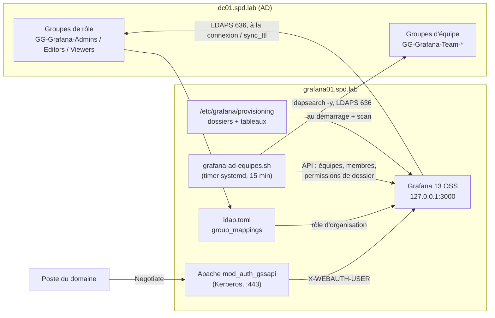
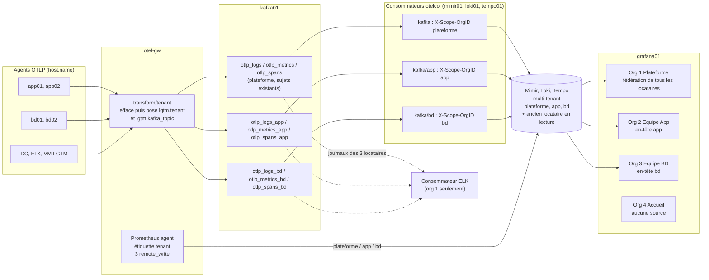
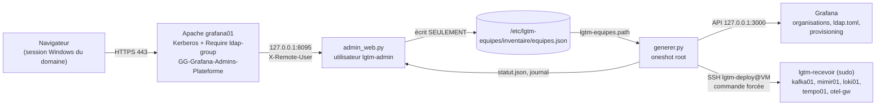

# Grafana OSS – dossiers, tableaux de bord et droits par groupe AD

Ce runbook complète le runbook LGTM (`Runbook_LGTM_Kafka_Offline_Debian13_DNS-Simple.md`, §5.6 et §8). Les §1 à §10 ne modifient rien de ce qui est déjà en place : sources de données, LDAP vers `dc01.spd.lab`, SSO Kerberos via Apache. Le §11 (cloisonnement par équipe) modifie **volontairement** la chaîne d'ingestion, les stockages, les sources de données et `ldap.toml`, avec sauvegardes et checkpoints.

**Ce que tu vas mettre en place :**

1. des **dossiers** par domaine (Plateforme, Systèmes, Journaux, Applications), créés par **provisioning fichier** avec des UID fixes ;
2. des **tableaux de bord de départ** (santé LGTM, Kafka, nœuds, journaux), plus l'import hors ligne du tableau grafana.com **1860** ;
3. des **droits par groupe AD** qui fonctionnent en **Grafana OSS** :
   - le rôle d'organisation vient de `group_mappings` (déjà en place au §8.1) ;
   - les **équipes** (*Teams*) sont alimentées par un **script** lancé par un timer systemd, puisque Team Sync n'existe pas en OSS ;
   - les **permissions de dossier** sont données aux équipes par l'API ;
4. un **cloisonnement réel des données** par équipe et groupe de serveurs (§11) : un locataire par équipe dans Mimir, Loki et Tempo, et une organisation Grafana par équipe.

**Légende.** « **non testé** » = rédigé d'après la documentation officielle, sans avoir tourné sur ton lab. Le script de synchronisation a été testé (`bash -n`, `shellcheck`, et un test fonctionnel contre une **simulation** de l'API Grafana et de `ldapsearch`). Il n'a **pas** tourné contre un vrai Grafana 13 ni contre dc01 : sur le lab, il reste **non testé**.

**Règles de sécurité appliquées partout :**

- aucun secret à l'écran, aucun mot de passe ni jeton en argument de commande ;
- le jeton du compte de service est saisi avec `read -rsp`, puis stocké dans un fichier `0600` ;
- le mot de passe LDAP est lu par `ldapsearch -y` depuis un fichier `0600` ;
- si un secret apparaît à l'écran, dans un journal ou sur une photo, **fais-le tourner** (nouveau jeton, nouveau mot de passe).

---

## 1. Verdict OSS ou Enterprise : ce qui est possible

| Besoin | Grafana OSS 13 | Source officielle |
|---|---|---|
| Rôle d'organisation (Viewer, Editor, Admin) d'après un groupe LDAP : `group_mappings` avec `org_role`, `grafana_admin`, `org_id` | **Oui** | [Configure LDAP authentication](https://grafana.com/docs/grafana/latest/setup-grafana/configure-access/configure-authentication/ldap/) |
| **Team Sync** : appartenance aux équipes d'après les groupes LDAP | **Non**, la page indique « *Available in Grafana Enterprise and Grafana Cloud* » | [Configure team sync](https://grafana.com/docs/grafana/latest/setup-grafana/configure-access/configure-team-sync/) |
| Synchronisation LDAP **en arrière-plan** (Enhanced LDAP) | **Non** (Enterprise / Cloud). En OSS, LDAP met à jour l'utilisateur **à la connexion** | [Enhanced LDAP integration](https://grafana.com/docs/grafana/latest/setup-grafana/configure-access/configure-authentication/enhanced-ldap/) |
| En-tête `Groups` de l'auth proxy (`X-WEBAUTH-GROUPS`) vers les équipes | **Non** (section « Team Sync » de la page auth proxy, Enterprise) | [Auth proxy](https://grafana.com/docs/grafana/latest/setup-grafana/configure-access/configure-authentication/auth-proxy/) |
| Équipes, membres, permissions de **dossier** par équipe, via l'interface ou l'API | **Oui** | [Team HTTP API](https://grafana.com/docs/grafana/latest/developer-resources/api-reference/http-api/api-legacy/team/), [Folder permissions HTTP API](https://grafana.com/docs/grafana/latest/developer-resources/api-reference/http-api/api-legacy/folder_permissions/) |
| Comptes de service et jetons | **Oui** | [Service accounts](https://grafana.com/docs/grafana/latest/administration/service-accounts/) |
| Permissions **par source de données** (qui peut interroger Mimir, Loki, `elk`…) | **Non** (« *Available in Grafana Enterprise and Grafana Cloud* ») | [Data source management](https://grafana.com/docs/grafana/latest/administration/data-source-management/) |

**En clair :** en OSS, LDAP ne sait donner qu'un **rôle** (un seul par organisation : le premier `group_mappings` qui correspond, en partant du haut). Pour « le groupe AD X voit le dossier Y », il faut des **équipes** alimentées par un **script**. C'est l'objet des §5 à §7.

> **Limite importante (OSS).** Une permission de dossier masque des **tableaux de bord**, pas des **données**. La documentation l'écrit : « *By default, any user in an organization can query the data sources in that organization. For example, a user with the Viewer role can issue any possible query to a data source* ». Si une équipe ne doit pas voir certains journaux ou certaines métriques, l'isolation se fait **à la source** (voir §9) avec **une organisation par groupe** (§10). La mise en œuvre complète et testée est au **§11**.

---

## 2. Vue d'ensemble



Flux :

1. Le navigateur s'authentifie en Kerberos auprès d'Apache. Apache transmet `X-WEBAUTH-USER` à Grafana, qui crée l'utilisateur à la première visite (`auto_sign_up`).
2. LDAP (`group_mappings`) attribue le **rôle** d'organisation.
3. Le script lit les **groupes d'équipe** dans l'AD et met à jour les **équipes** Grafana, puis les **permissions des dossiers**.
4. Le provisioning crée les **dossiers** (UID fixes) et les **tableaux de bord** de départ.

---

## 3. Prérequis

### 3.1 Déjà en place (runbook LGTM)

- Grafana 13.2.4 OSS sur grafana01 (systemd), sources de données provisionnées dans `/etc/grafana/provisioning/datasources/lgtm.yaml`. Les UID sont `mimir` (par défaut), `mimir-am`, `loki`, `tempo` et `elk`. Ce runbook **réutilise** ces UID et ne crée **aucune** autre source de données.
- LDAP vers dc01 (LDAPS 636, `use_ssl = true`, `start_tls = false`), avec `group_mappings` vers GG-Grafana-Admins / Editors / Viewers (§8.1).
- SSO Kerberos via Apache, en-tête `X-WEBAUTH-USER`, Grafana sur `127.0.0.1:3000` (§8.2, validé).
- Métriques déjà collectées par l'agent Prometheus (§5.5) :
  - job `node` (étiquette `vm`) ;
  - job `windows` (dc) ;
  - job `lgtm-self` (étiquettes `vm` et `service`) ;
  - métriques Kafka du récepteur `kafkametrics`.
- Journaux dans Loki, avec les étiquettes `service_name` et `service_namespace`.

> Si tes noms de job ou d'étiquettes diffèrent, adapte les requêtes des tableaux (§4.4) avant de les déposer.

### 3.2 Paquets hors ligne sur grafana01 (`jq`, `curl`, `ldap-utils`)

Le script a besoin de `curl`, `jq`, `ldapsearch` (paquet `ldap-utils`, déjà prévu au §8.5 du runbook LGTM), `flock` et `base64`. Ces deux derniers viennent de `util-linux` et `coreutils`, toujours présents.

D'abord, vérifie ce qui manque :

```bash
# Sur grafana01
for c in curl jq ldapsearch flock base64; do command -v "$c" >/dev/null && echo "OK  $c" || echo "MANQUE $c"; done
```

Pour chaque paquet manquant, suis la même méthode que le §8.5 du runbook LGTM :

1. Ouvre la page `https://packages.debian.org/trixie/amd64/<paquet>/download` sur le poste Windows.
2. Télécharge le paquet et vérifie son SHA-256 avec `Get-FileHash`.
3. Transfère-le par SFTP sur grafana01.
4. Installe avec `dpkg -i`, les dépendances **en premier**.

Dépendances relevées dans l'index Debian 13 « trixie » (`Packages`, le 16 nov. 2026). Lis les versions sur la page du paquet au moment du téléchargement :

| Paquet | Dépendances directes à prévoir si elles sont absentes |
|---|---|
| `jq` | `libjq1`, `libonig5` |
| `curl` | `libcurl4t64`, puis selon l'installation : `libbrotli1`, `libldap2`, `libnghttp2-14`, `libnghttp3-9`, `libpsl5t64`, `librtmp1`, `libsasl2-2`, `libsasl2-modules-db`, `libssh2-1t64` |
| `ldap-utils` | `libldap2`, `libsasl2-2`, `libsasl2-modules-db` |

```bash
# Sur grafana01, dans le dossier où tu as déposé les .deb
sudo dpkg --dry-run -i ./*.deb     # doit ne plus signaler de dépendance manquante
sudo dpkg -i ./*.deb
jq --version; curl --version | head -1; ldapsearch -VV 2>&1 | head -1
```

---

## 4. Dossiers et tableaux de bord par provisioning

### 4.1 Plan des dossiers

| Dossier (titre) | UID fixe | Contenu | Équipes (exemple, §7) |
|---|---|---|---|
| Plateforme | `lab-plateforme` | Santé Mimir / Loki / Tempo, Kafka | Equipe-Plateforme : Edit · Equipe-Systemes : View |
| Systèmes | `lab-systemes` | Nœuds (node_exporter), 1860 importé | Equipe-Systemes : Edit · Equipe-Plateforme : View |
| Journaux | `lab-journaux` | Journaux Loki par service | rôles Viewer et Editor : View (tout le monde) |
| Applications | `lab-applications` | Tableaux des équipes, page d'accueil | Equipe-Applications : Edit · rôles Viewer et Editor : View |

**Pourquoi des UID fixes ?** Le script de permissions (§7) vise les dossiers par leur UID. Avec `folderUid` renseigné, l'UID ne change pas d'une réinstallation à l'autre. La documentation dit que l'UID est « *automatically generated if not specified* ».

**Pourquoi un fournisseur par dossier ?** Le mode `foldersFromFilesStructure` crée les dossiers d'après l'arborescence, mais il impose de **laisser vides** `folder` et `folderUid` (documentation [Provisioning](https://grafana.com/docs/grafana/latest/administration/provisioning/)). Les UID ne sont alors pas choisis. Un fournisseur par dossier garde la maîtrise des UID.

Les tableaux provisionnés sont en **lecture seule** dans l'interface (`allowUiUpdates: false`). La documentation précise : « *If you set allowUiUpdates to false, you can't save changes to a provisioned dashboard* ». Pour adapter un tableau, l'utilisateur fait *Save as* dans un dossier où il a **Edit**. La permission Edit sur Plateforme ou Systèmes sert donc à **créer** de nouveaux tableaux dans ce dossier, pas à modifier ceux du provisioning.

### 4.2 Arborescence et fichier du fournisseur

```bash
# Sur grafana01
sudo install -d -m 0750 -o root -g grafana /etc/grafana/dashboards
for d in lab-plateforme lab-systemes lab-journaux lab-applications; do
  sudo install -d -m 0750 -o root -g grafana "/etc/grafana/dashboards/$d"
done

sudo tee /etc/grafana/provisioning/dashboards/lab-dossiers.yaml >/dev/null <<'EOF'
# Un fournisseur par dossier : UID de dossier fixes, visés par grafana-ad-equipes.sh
apiVersion: 1
providers:
  - name: lab-plateforme
    orgId: 1
    folder: Plateforme
    folderUid: lab-plateforme
    type: file
    disableDeletion: false
    updateIntervalSeconds: 30
    allowUiUpdates: false
    options:
      path: /etc/grafana/dashboards/lab-plateforme
  - name: lab-systemes
    orgId: 1
    folder: Systèmes
    folderUid: lab-systemes
    type: file
    disableDeletion: false
    updateIntervalSeconds: 30
    allowUiUpdates: false
    options:
      path: /etc/grafana/dashboards/lab-systemes
  - name: lab-journaux
    orgId: 1
    folder: Journaux
    folderUid: lab-journaux
    type: file
    disableDeletion: false
    updateIntervalSeconds: 30
    allowUiUpdates: false
    options:
      path: /etc/grafana/dashboards/lab-journaux
  - name: lab-applications
    orgId: 1
    folder: Applications
    folderUid: lab-applications
    type: file
    disableDeletion: false
    updateIntervalSeconds: 30
    allowUiUpdates: false
    options:
      path: /etc/grafana/dashboards/lab-applications
EOF
sudo chown root:grafana /etc/grafana/provisioning/dashboards/lab-dossiers.yaml
sudo chmod 0640 /etc/grafana/provisioning/dashboards/lab-dossiers.yaml
```

Notes sur les clés (toutes tirées de l'exemple officiel de la page Provisioning) :

- `updateIntervalSeconds: 30` : Grafana relit les fichiers toutes les 30 s. La documentation indique qu'une valeur de 10 ou moins utilise la surveillance du système de fichiers, et qu'une valeur plus grande force un balayage périodique.
- `disableDeletion: false` : si tu supprimes un fichier JSON, le tableau disparaît de Grafana.
- `orgId: 1` : organisation principale.

Ne touche pas à `/etc/grafana/provisioning/datasources/lgtm.yaml`, les sources de données y sont déjà.

### 4.3 Tableaux de bord de départ

Les tableaux ci-dessous ont été écrits pour ce lab :

- leur JSON a été validé avec `jq` ;
- les 19 requêtes PromQL ont été validées **syntaxiquement** avec `promtool check rules` (Prometheus 3.16) ;
- les requêtes LogQL n'ont **pas** été validées.

Les **noms de métriques** viennent du code source de Mimir, Loki et Tempo (branche principale) et des jobs du §5.5. Leur présence sur tes versions (Mimir 3.2.3, Loki 3.7.9, Tempo 3.1.1) est **non testée** : vérifie chaque requête dans *Explore* (§12).

| Fichier | UID | Contenu |
|---|---|---|
| `lab-plateforme/lgtm-sante.json` | `lab-lgtm-sante` | `up` des services `lgtm-self`, requêtes/s et 5xx/s par route (`*_request_duration_seconds_count`), ingestion (échantillons Mimir, lignes Loki, spans Tempo), mémoire et CPU par service |
| `lab-plateforme/kafka-consommateurs.json` | `lab-kafka-conso` | `kafka_consumer_group_lag`, `kafka_consumer_group_members`, débit `kafka_partition_current_offset` |
| `lab-systemes/noeuds-apercu.json` | `lab-noeuds` | `up` (node + windows), CPU, mémoire, disque par `vm` (variable `$vm`) |
| `lab-journaux/journaux-services.json` | `lab-journaux` | volume par `service_name` et panneau de journaux, variables `$service` et `$filtre` |
| `lab-applications/accueil.json` | `lab-accueil` | page texte « mode d'emploi » |

Copie chaque bloc tel quel. Les délimiteurs des blocs (`<<'JSON_EOF'`) sont entre guillemets : le shell ne remplace pas les `$` des requêtes.

#### Santé LGTM — `lab-plateforme/lgtm-sante.json`

```bash
# Sur grafana01
sudo tee /etc/grafana/dashboards/lab-plateforme/lgtm-sante.json >/dev/null <<'JSON_EOF'
{
  "uid": "lab-lgtm-sante",
  "title": "LGTM – santé des services",
  "tags": [
    "lab",
    "lgtm"
  ],
  "editable": false,
  "schemaVersion": 39,
  "version": 1,
  "time": {
    "from": "now-6h",
    "to": "now"
  },
  "refresh": "1m",
  "timezone": "browser",
  "templating": {
    "list": []
  },
  "annotations": {
    "list": []
  },
  "panels": [
    {
      "id": 1,
      "type": "stat",
      "title": "Services LGTM joignables (up)",
      "datasource": {
        "type": "prometheus",
        "uid": "mimir"
      },
      "gridPos": {
        "x": 0,
        "y": 0,
        "w": 24,
        "h": 5
      },
      "fieldConfig": {
        "defaults": {
          "unit": "short",
          "mappings": [
            {
              "type": "value",
              "options": {
                "0": {
                  "text": "DOWN",
                  "color": "red"
                },
                "1": {
                  "text": "UP",
                  "color": "green"
                }
              }
            }
          ],
          "thresholds": {
            "mode": "absolute",
            "steps": [
              {
                "color": "red",
                "value": null
              },
              {
                "color": "green",
                "value": 1
              }
            ]
          }
        },
        "overrides": []
      },
      "options": {
        "colorMode": "background",
        "reduceOptions": {
          "calcs": [
            "lastNotNull"
          ]
        },
        "textMode": "value_and_name"
      },
      "targets": [
        {
          "refId": "A",
          "datasource": {
            "type": "prometheus",
            "uid": "mimir"
          },
          "expr": "up{job=\"lgtm-self\"}",
          "legendFormat": "{{service}}"
        }
      ]
    },
    {
      "id": 2,
      "type": "timeseries",
      "title": "Requêtes/s par route (Mimir, Loki, Tempo)",
      "datasource": {
        "type": "prometheus",
        "uid": "mimir"
      },
      "gridPos": {
        "x": 0,
        "y": 5,
        "w": 12,
        "h": 8
      },
      "fieldConfig": {
        "defaults": {
          "unit": "reqps"
        },
        "overrides": []
      },
      "options": {},
      "targets": [
        {
          "refId": "A",
          "datasource": {
            "type": "prometheus",
            "uid": "mimir"
          },
          "expr": "sum by (route) (rate(cortex_request_duration_seconds_count{job=\"lgtm-self\"}[$__rate_interval]))",
          "legendFormat": "mimir {{route}}"
        },
        {
          "refId": "B",
          "datasource": {
            "type": "prometheus",
            "uid": "mimir"
          },
          "expr": "sum by (route) (rate(loki_request_duration_seconds_count{job=\"lgtm-self\"}[$__rate_interval]))",
          "legendFormat": "loki {{route}}"
        },
        {
          "refId": "C",
          "datasource": {
            "type": "prometheus",
            "uid": "mimir"
          },
          "expr": "sum by (route) (rate(tempo_request_duration_seconds_count{job=\"lgtm-self\"}[$__rate_interval]))",
          "legendFormat": "tempo {{route}}"
        }
      ]
    },
    {
      "id": 3,
      "type": "timeseries",
      "title": "Erreurs 5xx/s par route",
      "datasource": {
        "type": "prometheus",
        "uid": "mimir"
      },
      "gridPos": {
        "x": 12,
        "y": 5,
        "w": 12,
        "h": 8
      },
      "fieldConfig": {
        "defaults": {
          "unit": "reqps"
        },
        "overrides": []
      },
      "options": {},
      "targets": [
        {
          "refId": "A",
          "datasource": {
            "type": "prometheus",
            "uid": "mimir"
          },
          "expr": "sum by (route) (rate(cortex_request_duration_seconds_count{job=\"lgtm-self\", status_code=~\"5..|error\"}[$__rate_interval]))",
          "legendFormat": "mimir {{route}}"
        },
        {
          "refId": "B",
          "datasource": {
            "type": "prometheus",
            "uid": "mimir"
          },
          "expr": "sum by (route) (rate(loki_request_duration_seconds_count{job=\"lgtm-self\", status_code=~\"5..|error\"}[$__rate_interval]))",
          "legendFormat": "loki {{route}}"
        },
        {
          "refId": "C",
          "datasource": {
            "type": "prometheus",
            "uid": "mimir"
          },
          "expr": "sum by (route) (rate(tempo_request_duration_seconds_count{job=\"lgtm-self\", status_code=~\"5..|error\"}[$__rate_interval]))",
          "legendFormat": "tempo {{route}}"
        }
      ]
    },
    {
      "id": 4,
      "type": "timeseries",
      "title": "Ingestion",
      "datasource": {
        "type": "prometheus",
        "uid": "mimir"
      },
      "gridPos": {
        "x": 0,
        "y": 13,
        "w": 12,
        "h": 8
      },
      "fieldConfig": {
        "defaults": {
          "unit": "short"
        },
        "overrides": []
      },
      "options": {},
      "targets": [
        {
          "refId": "A",
          "datasource": {
            "type": "prometheus",
            "uid": "mimir"
          },
          "expr": "sum(rate(cortex_distributor_received_samples_total{job=\"lgtm-self\"}[$__rate_interval]))",
          "legendFormat": "Mimir échantillons/s"
        },
        {
          "refId": "B",
          "datasource": {
            "type": "prometheus",
            "uid": "mimir"
          },
          "expr": "sum(rate(loki_distributor_lines_received_total{job=\"lgtm-self\"}[$__rate_interval]))",
          "legendFormat": "Loki lignes/s"
        },
        {
          "refId": "C",
          "datasource": {
            "type": "prometheus",
            "uid": "mimir"
          },
          "expr": "sum(rate(tempo_distributor_spans_received_total{job=\"lgtm-self\"}[$__rate_interval]))",
          "legendFormat": "Tempo spans/s"
        }
      ]
    },
    {
      "id": 5,
      "type": "timeseries",
      "title": "Mémoire résidente par service",
      "datasource": {
        "type": "prometheus",
        "uid": "mimir"
      },
      "gridPos": {
        "x": 12,
        "y": 13,
        "w": 12,
        "h": 8
      },
      "fieldConfig": {
        "defaults": {
          "unit": "bytes"
        },
        "overrides": []
      },
      "options": {},
      "targets": [
        {
          "refId": "A",
          "datasource": {
            "type": "prometheus",
            "uid": "mimir"
          },
          "expr": "process_resident_memory_bytes{job=\"lgtm-self\"}",
          "legendFormat": "{{service}}"
        }
      ]
    },
    {
      "id": 6,
      "type": "timeseries",
      "title": "CPU par service (cœurs)",
      "datasource": {
        "type": "prometheus",
        "uid": "mimir"
      },
      "gridPos": {
        "x": 0,
        "y": 21,
        "w": 24,
        "h": 8
      },
      "fieldConfig": {
        "defaults": {
          "unit": "short"
        },
        "overrides": []
      },
      "options": {},
      "targets": [
        {
          "refId": "A",
          "datasource": {
            "type": "prometheus",
            "uid": "mimir"
          },
          "expr": "rate(process_cpu_seconds_total{job=\"lgtm-self\"}[$__rate_interval])",
          "legendFormat": "{{service}}"
        }
      ]
    }
  ]
}
JSON_EOF
```

#### Kafka – groupes de consommateurs — `lab-plateforme/kafka-consommateurs.json`

```bash
# Sur grafana01
sudo tee /etc/grafana/dashboards/lab-plateforme/kafka-consommateurs.json >/dev/null <<'JSON_EOF'
{
  "uid": "lab-kafka-conso",
  "title": "Kafka – groupes de consommateurs",
  "tags": [
    "lab",
    "kafka"
  ],
  "editable": false,
  "schemaVersion": 39,
  "version": 1,
  "time": {
    "from": "now-6h",
    "to": "now"
  },
  "refresh": "1m",
  "timezone": "browser",
  "templating": {
    "list": []
  },
  "annotations": {
    "list": []
  },
  "panels": [
    {
      "id": 1,
      "type": "timeseries",
      "title": "Retard (lag) par groupe et topic",
      "datasource": {
        "type": "prometheus",
        "uid": "mimir"
      },
      "gridPos": {
        "x": 0,
        "y": 0,
        "w": 24,
        "h": 8
      },
      "fieldConfig": {
        "defaults": {
          "unit": "short"
        },
        "overrides": []
      },
      "options": {},
      "targets": [
        {
          "refId": "A",
          "datasource": {
            "type": "prometheus",
            "uid": "mimir"
          },
          "expr": "sum by (group, topic) (kafka_consumer_group_lag)",
          "legendFormat": "{{group}} / {{topic}}"
        }
      ]
    },
    {
      "id": 2,
      "type": "timeseries",
      "title": "Membres par groupe",
      "datasource": {
        "type": "prometheus",
        "uid": "mimir"
      },
      "gridPos": {
        "x": 0,
        "y": 8,
        "w": 12,
        "h": 8
      },
      "fieldConfig": {
        "defaults": {
          "unit": "short"
        },
        "overrides": []
      },
      "options": {},
      "targets": [
        {
          "refId": "A",
          "datasource": {
            "type": "prometheus",
            "uid": "mimir"
          },
          "expr": "max by (group) (kafka_consumer_group_members)",
          "legendFormat": "{{group}}"
        }
      ]
    },
    {
      "id": 3,
      "type": "timeseries",
      "title": "Messages produits/s par topic",
      "datasource": {
        "type": "prometheus",
        "uid": "mimir"
      },
      "gridPos": {
        "x": 12,
        "y": 8,
        "w": 12,
        "h": 8
      },
      "fieldConfig": {
        "defaults": {
          "unit": "short"
        },
        "overrides": []
      },
      "options": {},
      "targets": [
        {
          "refId": "A",
          "datasource": {
            "type": "prometheus",
            "uid": "mimir"
          },
          "expr": "sum by (topic) (rate(kafka_partition_current_offset[$__rate_interval]))",
          "legendFormat": "{{topic}}"
        }
      ]
    }
  ]
}
JSON_EOF
```

#### Nœuds – aperçu — `lab-systemes/noeuds-apercu.json`

```bash
# Sur grafana01
sudo tee /etc/grafana/dashboards/lab-systemes/noeuds-apercu.json >/dev/null <<'JSON_EOF'
{
  "uid": "lab-noeuds",
  "title": "Nœuds – aperçu (node_exporter)",
  "tags": [
    "lab",
    "node"
  ],
  "editable": false,
  "schemaVersion": 39,
  "version": 1,
  "time": {
    "from": "now-6h",
    "to": "now"
  },
  "refresh": "1m",
  "timezone": "browser",
  "templating": {
    "list": [
      {
        "name": "vm",
        "label": "vm",
        "type": "query",
        "datasource": {
          "type": "prometheus",
          "uid": "mimir"
        },
        "query": {
          "query": "label_values(up{job=\"node\"}, vm)",
          "refId": "PrometheusVariableQueryEditor-VariableQuery"
        },
        "definition": "label_values(up{job=\"node\"}, vm)",
        "refresh": 2,
        "includeAll": true,
        "multi": true,
        "current": {
          "text": "All",
          "value": "$__all"
        },
        "sort": 1
      }
    ]
  },
  "annotations": {
    "list": []
  },
  "panels": [
    {
      "id": 1,
      "type": "stat",
      "title": "Cibles joignables (node + windows)",
      "datasource": {
        "type": "prometheus",
        "uid": "mimir"
      },
      "gridPos": {
        "x": 0,
        "y": 0,
        "w": 24,
        "h": 5
      },
      "fieldConfig": {
        "defaults": {
          "unit": "short"
        },
        "overrides": []
      },
      "options": {},
      "targets": [
        {
          "refId": "A",
          "datasource": {
            "type": "prometheus",
            "uid": "mimir"
          },
          "expr": "up{job=~\"node|windows\"}",
          "legendFormat": "{{vm}}"
        }
      ]
    },
    {
      "id": 2,
      "type": "timeseries",
      "title": "CPU utilisé",
      "datasource": {
        "type": "prometheus",
        "uid": "mimir"
      },
      "gridPos": {
        "x": 0,
        "y": 5,
        "w": 12,
        "h": 8
      },
      "fieldConfig": {
        "defaults": {
          "unit": "percentunit"
        },
        "overrides": []
      },
      "options": {},
      "targets": [
        {
          "refId": "A",
          "datasource": {
            "type": "prometheus",
            "uid": "mimir"
          },
          "expr": "1 - avg by (vm) (rate(node_cpu_seconds_total{job=\"node\", vm=~\"$vm\", mode=\"idle\"}[$__rate_interval]))",
          "legendFormat": "{{vm}}"
        }
      ]
    },
    {
      "id": 3,
      "type": "timeseries",
      "title": "Mémoire utilisée",
      "datasource": {
        "type": "prometheus",
        "uid": "mimir"
      },
      "gridPos": {
        "x": 12,
        "y": 5,
        "w": 12,
        "h": 8
      },
      "fieldConfig": {
        "defaults": {
          "unit": "percentunit"
        },
        "overrides": []
      },
      "options": {},
      "targets": [
        {
          "refId": "A",
          "datasource": {
            "type": "prometheus",
            "uid": "mimir"
          },
          "expr": "1 - (node_memory_MemAvailable_bytes{job=\"node\", vm=~\"$vm\"} / node_memory_MemTotal_bytes{job=\"node\", vm=~\"$vm\"})",
          "legendFormat": "{{vm}}"
        }
      ]
    },
    {
      "id": 4,
      "type": "timeseries",
      "title": "Espace disque utilisé",
      "datasource": {
        "type": "prometheus",
        "uid": "mimir"
      },
      "gridPos": {
        "x": 0,
        "y": 18,
        "w": 24,
        "h": 8
      },
      "fieldConfig": {
        "defaults": {
          "unit": "percentunit"
        },
        "overrides": []
      },
      "options": {},
      "targets": [
        {
          "refId": "A",
          "datasource": {
            "type": "prometheus",
            "uid": "mimir"
          },
          "expr": "1 - (node_filesystem_avail_bytes{job=\"node\", vm=~\"$vm\", fstype!~\"tmpfs|ramfs|overlay|squashfs\"} / node_filesystem_size_bytes{job=\"node\", vm=~\"$vm\", fstype!~\"tmpfs|ramfs|overlay|squashfs\"})",
          "legendFormat": "{{vm}} {{mountpoint}}"
        }
      ]
    }
  ]
}
JSON_EOF
```

#### Journaux par service — `lab-journaux/journaux-services.json`

```bash
# Sur grafana01
sudo tee /etc/grafana/dashboards/lab-journaux/journaux-services.json >/dev/null <<'JSON_EOF'
{
  "uid": "lab-journaux",
  "title": "Journaux – par service (Loki)",
  "tags": [
    "lab",
    "loki"
  ],
  "editable": false,
  "schemaVersion": 39,
  "version": 1,
  "time": {
    "from": "now-1h",
    "to": "now"
  },
  "refresh": "",
  "timezone": "browser",
  "templating": {
    "list": [
      {
        "name": "service",
        "label": "service",
        "type": "query",
        "datasource": {
          "type": "loki",
          "uid": "loki"
        },
        "query": "label_values(service_name)",
        "definition": "label_values(service_name)",
        "refresh": 2,
        "includeAll": true,
        "multi": true,
        "current": {
          "text": "All",
          "value": "$__all"
        },
        "sort": 1,
        "allValue": ".+"
      },
      {
        "name": "filtre",
        "label": "texte recherché",
        "type": "textbox",
        "query": "",
        "current": {
          "text": "",
          "value": ""
        }
      }
    ]
  },
  "annotations": {
    "list": []
  },
  "panels": [
    {
      "id": 1,
      "type": "timeseries",
      "title": "Volume de lignes par service",
      "datasource": {
        "type": "loki",
        "uid": "loki"
      },
      "gridPos": {
        "x": 0,
        "y": 0,
        "w": 24,
        "h": 7
      },
      "fieldConfig": {
        "defaults": {
          "unit": "short",
          "custom": {
            "drawStyle": "bars",
            "stacking": {
              "mode": "normal"
            }
          }
        },
        "overrides": []
      },
      "options": {},
      "targets": [
        {
          "refId": "A",
          "datasource": {
            "type": "loki",
            "uid": "loki"
          },
          "expr": "sum by (service_name) (count_over_time({service_name=~\"$service\"} |= \"$filtre\" [$__interval]))",
          "legendFormat": "{{service_name}}"
        }
      ]
    },
    {
      "id": 2,
      "type": "logs",
      "title": "Journaux",
      "datasource": {
        "type": "loki",
        "uid": "loki"
      },
      "gridPos": {
        "x": 0,
        "y": 7,
        "w": 24,
        "h": 16
      },
      "options": {
        "showTime": true,
        "wrapLogMessage": true,
        "sortOrder": "Descending",
        "enableLogDetails": true
      },
      "targets": [
        {
          "refId": "A",
          "datasource": {
            "type": "loki",
            "uid": "loki"
          },
          "expr": "{service_name=~\"$service\"} |= \"$filtre\"",
          "maxLines": 500
        }
      ]
    }
  ]
}
JSON_EOF
```

#### Accueil du dossier Applications — `lab-applications/accueil.json`

```bash
# Sur grafana01
sudo tee /etc/grafana/dashboards/lab-applications/accueil.json >/dev/null <<'JSON_EOF'
{
  "uid": "lab-accueil",
  "title": "Accueil – mode d'emploi",
  "tags": [
    "lab"
  ],
  "editable": false,
  "schemaVersion": 39,
  "version": 1,
  "time": {
    "from": "now-6h",
    "to": "now"
  },
  "refresh": "",
  "timezone": "browser",
  "templating": {
    "list": []
  },
  "annotations": {
    "list": []
  },
  "panels": [
    {
      "id": 1,
      "type": "text",
      "title": "",
      "gridPos": {
        "x": 0,
        "y": 0,
        "w": 24,
        "h": 9
      },
      "options": {
        "mode": "markdown",
        "content": "## Dossier Applications\n\nCe dossier accueille les tableaux de bord des équipes.\n\n* Les tableaux **provisionnés** (dossiers *Plateforme*, *Systèmes*, *Journaux*) sont en lecture seule : copie-les (*Save as*) ici pour les adapter.\n* Les droits de ce dossier sont gérés par le script `grafana-ad-equipes.sh` à partir des groupes AD.\n* Données : `mimir` (métriques), `loki` (journaux), `tempo` (traces), `elk` (Elasticsearch)."
      }
    }
  ]
}
JSON_EOF
```

Droits et rechargement :

```bash
# Sur grafana01
sudo chown -R root:grafana /etc/grafana/dashboards
sudo find /etc/grafana/dashboards -type d -exec chmod 0750 {} +
sudo find /etc/grafana/dashboards -type f -name '*.json' -exec chmod 0640 {} +
for f in /etc/grafana/dashboards/*/*.json; do jq -e .uid "$f" >/dev/null && echo "JSON OK $f" || echo "JSON KO $f"; done
sudo systemctl restart grafana-server      # nécessaire pour un NOUVEAU fichier de fournisseur
sudo journalctl -u grafana-server -n 80 --no-pager | grep -i provisioning
```

Tu attends : aucune ligne `level=error` liée au provisioning. Les quatre dossiers apparaissent dans *Dashboards*. **Non testé.**

### 4.4 Adapter les requêtes à ton lab

- **Santé LGTM.** Si le panneau « Requêtes/s » est vide pour un composant, ouvre *Explore* (source `mimir`) et tape `{job="lgtm-self", __name__=~".*request_duration_seconds.*"}` pour voir les noms réellement exposés. Selon la configuration des histogrammes, seule la série native (sans `_count`) peut exister. Dans ce cas, remplace `rate(x_count[…])` par `histogram_count(rate(x[…]))`. **Non testé.**
- **Kafka.** Les noms d'étiquettes (`group`, `topic`) viennent du récepteur `kafkametrics` d'otelcol-contrib. Vérifie-les dans *Explore* avec `kafka_consumer_group_lag`. **Non testé.**
- **Journaux.** Si `service_name` n'existe pas dans Loki, remplace-le par l'étiquette que tu vois dans *Explore* → Loki → *Label browser*. **Non testé.**

### 4.5 Import hors ligne d'un tableau grafana.com (1860 « Node Exporter Full »)

Identifiants vérifiés le 16 nov. 2026 sur l'API publique `https://grafana.com/api/dashboards/<id>` :

| ID | Nom | Auteur | Révision au 16 nov. 2026 | Intérêt sur ce lab |
|---|---|---|---|---|
| **1860** | Node Exporter Full | rfraile | 46 (mise à jour le 31 oct. 2026) | **Recommandé** : correspond au job `node` |
| 17607 | Mimir / Overview | Grafana Labs (mixin Mimir) | — | **Déconseillé ici** : ses variables lisent `cortex_build_info` par `cluster` et `namespace`, et ses requêtes filtrent `job=~"($namespace)/…"`. Ton job s'appelle `lgtm-self`, sans étiquette `cluster` : les panneaux resteraient vides sans adaptation |
| 16026 / 16016 | Mimir / Writes, Mimir / Reads | Grafana Labs (mixin Mimir) | — | Même remarque que 17607 |

Pour Loki, Tempo et le récepteur Kafka d'OpenTelemetry, je n'ai trouvé **aucun** tableau grafana.com qui corresponde à ce déploiement monolithique sans adaptation. D'où les tableaux maison du §4.3.

**Sur le poste Windows (PowerShell) :**

```powershell
# Révision « latest » (renvoie la dernière révision publiée)
$out = "$env:USERPROFILE\Downloads\node-exporter-full-1860.json"
curl.exe -fL -o $out "https://grafana.com/api/dashboards/1860/revisions/latest/download"
# Ou une révision figée, pour un import reproductible :
#   https://grafana.com/api/dashboards/1860/revisions/46/download
Get-FileHash -Algorithm SHA256 $out     # note l'empreinte, compare-la après le transfert
(Get-Content $out -Raw | ConvertFrom-Json).title    # attendu : Node Exporter Full
```

Transfère le fichier par SFTP vers grafana01 (par exemple dans `/tmp`), puis :

```bash
# Sur grafana01
sha256sum /tmp/node-exporter-full-1860.json      # même empreinte que sur Windows
jq -r '.title, .uid, (.__inputs // "pas de __inputs")' /tmp/node-exporter-full-1860.json
jq -r '.templating.list[] | select(.type=="datasource") | .name + " -> " + .query' /tmp/node-exporter-full-1860.json
sudo install -m 0640 -o root -g grafana /tmp/node-exporter-full-1860.json \
  /etc/grafana/dashboards/lab-systemes/node-exporter-full-1860.json
rm -f /tmp/node-exporter-full-1860.json
```

La révision 46 (inspectée le 16 nov. 2026) n'a **pas** de section `__inputs`. Elle utilise une variable de type *datasource* nommée `ds_prometheus` (type `prometheus`), que Grafana renseigne avec la source Prometheus **par défaut**, ici `mimir` (`isDefault: true`). Aucune substitution n'est donc nécessaire pour le provisioning. Grafana le prend en compte en 30 s au plus, sans redémarrage. **Non testé.**

> **Si une autre révision contient `__inputs`** (variables `${DS_PROMETHEUS}`), le provisioning ne les résout pas. Remplace-les par l'UID `mimir` :
> `sed -i 's/\${DS_PROMETHEUS}/mimir/g' fichier.json`. Vérifie ensuite avec `grep -c 'DS_PROMETHEUS' fichier.json`, qui doit donner 0. **Non testé.**
>
> Autre voie, sans provisioning : *Dashboards* → *New* → *Import* → *Upload dashboard JSON file*, dans le dossier voulu. Le tableau est alors modifiable dans l'interface, mais il n'est plus géré par fichier.

---

## 5. Rôles par groupe AD : `group_mappings` (OSS, déjà en place)

Le §8.1.10 du runbook LGTM a déjà configuré ceci dans `/etc/grafana/ldap.toml` :

| Groupe AD | `org_role` | Autre |
|---|---|---|
| `CN=GG-Grafana-Admins,CN=Users,DC=spd,DC=lab` | `Admin` | `grafana_admin = true` |
| `CN=GG-Grafana-Editors,CN=Users,DC=spd,DC=lab` | `Editor` | |
| `CN=GG-Grafana-Viewers,CN=Users,DC=spd,DC=lab` | `Viewer` | |

Règles utiles, toutes tirées de la documentation LDAP :

- « *The first group mapping that an LDAP user is matched to will be used* ». Garde l'ordre **Admins → Editors → Viewers**.
- `group_dn = "*"` est un joker. En dernière position, il donnerait un rôle par défaut (par exemple Viewer) à tout utilisateur LDAP. Ne l'ajoute que si c'est voulu.
- `org_id` permet d'attribuer un rôle dans une **autre** organisation (cloisonnement du §11).

**Recommandation :** chaque personne d'un groupe d'équipe de dossiers (`GG-Grafana-Team-*`, organisation 1) doit aussi être dans **un** groupe de rôle. Ce n'est **pas** le cas des groupes d'organisation du §11 (`GG-Grafana-Equipe-*`) : leurs membres ne doivent être dans **aucun** groupe de rôle de l'organisation 1.

**Utilisateur sans aucun `group_mappings` :** testé sur la machine de rédaction (Grafana 13.2.4, annuaire simulé par GLAuth), la connexion est acceptée et l'utilisateur arrive dans l'organisation `[users] auto_assign_org_id` (1 par défaut) avec le rôle `auto_assign_org_role` (Viewer). Avec le §11, cette organisation devient « Accueil », vide (§11.12.3). Sur ton lab : **non testé**.

> **Ne modifie pas `ldap.toml` pour les équipes.** En OSS, il n'existe pas de clé `ldap.toml` qui remplisse les équipes. Le script s'en charge.

---

## 6. Groupes d'équipe, compte de service et secrets

### 6.1 Groupes AD d'équipe (PowerShell sur dc01)

Les noms ci-dessous sont des **exemples**. Adapte-les à tes équipes réelles. Aucun mot de passe n'est créé ici.

```powershell
# Sur dc01, PowerShell en administrateur du domaine
Import-Module ActiveDirectory
$equipes = 'GG-Grafana-Team-Plateforme','GG-Grafana-Team-Systemes','GG-Grafana-Team-Applications'
foreach ($n in $equipes) {
  if (-not (Get-ADGroup -Filter "Name -eq '$n'")) {
    New-ADGroup -Name $n -GroupScope Global -GroupCategory Security `
      -Path 'CN=Users,DC=spd,DC=lab' -Description 'Équipe Grafana (synchro grafana-ad-equipes)'
  }
}
# Membres de test (utilisateurs du §8.1.9 du runbook LGTM)
Add-ADGroupMember -Identity 'GG-Grafana-Team-Plateforme'   -Members 'gf-admin','gf-editor'
Add-ADGroupMember -Identity 'GG-Grafana-Team-Systemes'     -Members 'gf-viewer'
Add-ADGroupMember -Identity 'GG-Grafana-Team-Applications' -Members 'gf-editor'
# DN exacts à reporter dans equipes.conf (§6.5)
Get-ADGroup -Filter "Name -like 'GG-Grafana-Team-*'" | Select-Object Name, DistinguishedName
```

**Groupes imbriqués.** Par défaut, le script ne prend que les membres **directs** (`memberOf=<DN>`). Avec `GROUPES_IMBRIQUES=1`, il utilise la règle AD `LDAP_MATCHING_RULE_IN_CHAIN` (OID `1.2.840.113556.1.4.1941`, [documentation Microsoft](https://learn.microsoft.com/en-us/windows/win32/adsi/search-filter-syntax)), qui inclut les membres indirects. Cette option est **non testée** sur le lab.

### 6.2 Compte système local sur grafana01

```bash
# Sur grafana01
sudo useradd --system --home-dir /nonexistent --no-create-home \
  --shell /usr/sbin/nologin grafana-adsync
sudo install -d -m 0700 -o grafana-adsync -g grafana-adsync /etc/grafana-ad-equipes
```

### 6.3 Compte de service Grafana et jeton (lu avec `read -rsp`)

Les comptes de service sont disponibles en OSS ([Service accounts](https://grafana.com/docs/grafana/latest/administration/service-accounts/)). Le script a besoin du rôle d'organisation **Admin** pour trois raisons :

- créer des équipes et gérer leurs membres (l'administrateur d'organisation gère toutes les équipes) ;
- modifier les permissions des dossiers (`folders.permissions:write`) ;
- lister les utilisateurs de l'organisation (`GET /api/org/users`, action `org.users:read`).

Les API `/api/users…` exigent un **administrateur de serveur** avec authentification *basic* : un compte de service ne peut pas les appeler. Le script ne s'en sert donc pas.

1. Connecte-toi à Grafana avec un compte **Admin** (par exemple `gf-admin`).
2. Ouvre **Administration → Users and access → Service accounts → Add service account**. Les libellés peuvent varier légèrement selon la version.
   - *Display name* : `grafana-ad-equipes`
   - *Role* : **Admin**
3. Sur ce compte, clique **Add service account token**. Donne-lui un nom et une **date d'expiration** (par exemple 90 jours, à noter dans ton agenda), puis **Generate token**.
4. Le jeton n'est affiché **qu'une fois**. Copie-le, puis colle-le **uniquement** dans l'invite `read -rsp` ci-dessous. Ne le colle jamais dans une commande, un ticket ou un message.

```bash
# Sur grafana01 — le jeton n'apparaît ni à l'écran, ni dans l'historique, ni dans ps
sudo install -m 0600 -o grafana-adsync -g grafana-adsync /dev/null /etc/grafana-ad-equipes/grafana.token
read -rsp 'Jeton du compte de service Grafana : ' GF_TOKEN; echo
printf '%s' "$GF_TOKEN" | sudo tee /etc/grafana-ad-equipes/grafana.token >/dev/null
unset GF_TOKEN
sudo stat -c '%a %U:%G %s octets' /etc/grafana-ad-equipes/grafana.token   # attendu : 600 grafana-adsync:grafana-adsync, taille > 0
```

`printf` est une commande interne de bash : le jeton ne passe pas dans les arguments d'un processus. `tee` écrit dans le fichier déjà créé en `0600`. Le script refuse de démarrer si ce fichier n'est pas en `0600` ou `0400`.

### 6.4 Mot de passe de liaison LDAP pour `ldapsearch -y`

Le script lit l'AD avec le compte **en lecture seule** `svc-grafana-ldap`, celui du §8.1. Si tu préfères un compte dédié (par exemple `svc-grafana-adsync`), c'est possible : remplace alors `LDAP_BIND_DN` au §6.5.

`ldapsearch -y` lit le fichier **en entier** comme mot de passe. Il ne doit donc contenir **aucun saut de ligne** final, d'où `printf '%s'`.

```bash
# Sur grafana01
sudo install -m 0600 -o grafana-adsync -g grafana-adsync /dev/null /etc/grafana-ad-equipes/ldap-bind.pwd
read -rsp 'Mot de passe de svc-grafana-ldap : ' LDAP_PWD; echo
printf '%s' "$LDAP_PWD" | sudo tee /etc/grafana-ad-equipes/ldap-bind.pwd >/dev/null
unset LDAP_PWD
```

> **Rotation :** ce mot de passe est aussi dans `/etc/grafana/ldap-bind.env` (§8.1.10 du runbook LGTM). Si tu le changes dans l'AD, mets à jour **les deux** fichiers, puis redémarre `grafana-server`.

Test de lecture d'un groupe, sous le compte du service :

```bash
# Sur grafana01 — affiche des sAMAccountName, aucun secret
sudo -u grafana-adsync ldapsearch -LLL -o ldif-wrap=no -H ldaps://dc01.spd.lab:636 -x \
  -D 'CN=svc-grafana-ldap,CN=Users,DC=spd,DC=lab' -y /etc/grafana-ad-equipes/ldap-bind.pwd \
  -b 'DC=spd,DC=lab' '(&(objectCategory=person)(objectClass=user)(memberOf=CN=GG-Grafana-Team-Plateforme,CN=Users,DC=spd,DC=lab))' \
  sAMAccountName
```

Tu attends `sAMAccountName: gf-admin` et `sAMAccountName: gf-editor`. Code 49 = mauvais mot de passe ou mauvais DN. Une erreur de certificat renvoie au §8.1.7 et §8.1.8 du runbook LGTM.

### 6.5 Fichiers de configuration du script

```bash
# Sur grafana01 — paramètres NON secrets
sudo tee /etc/grafana-ad-equipes/ad-equipes.env >/dev/null <<'EOF'
GRAFANA_URL=http://127.0.0.1:3000
LDAP_URI=ldaps://dc01.spd.lab:636
LDAP_BIND_DN=CN=svc-grafana-ldap,CN=Users,DC=spd,DC=lab
LDAP_BASE=DC=spd,DC=lab
# 1 = inclure les membres des groupes imbriqués (non testé)
GROUPES_IMBRIQUES=0
# 1 = retirer de l'équipe ceux qui ne sont plus dans le groupe AD (mode « l'AD fait foi »)
RETIRER_MEMBRES=1
EOF

# Équipe Grafana ; DN EXACT du groupe AD (Get-ADGroup … DistinguishedName)
sudo tee /etc/grafana-ad-equipes/equipes.conf >/dev/null <<'EOF'
# Equipe Grafana;DN exact du groupe AD (exemples, à adapter)
Equipe-Plateforme;CN=GG-Grafana-Team-Plateforme,CN=Users,DC=spd,DC=lab
Equipe-Systemes;CN=GG-Grafana-Team-Systemes,CN=Users,DC=spd,DC=lab
Equipe-Applications;CN=GG-Grafana-Team-Applications,CN=Users,DC=spd,DC=lab
EOF

# uid_dossier ; team|role ; nom de l'équipe ou Viewer|Editor ; 1=View 2=Edit 4=Admin
sudo tee /etc/grafana-ad-equipes/dossiers.conf >/dev/null <<'EOF'
# uid_dossier;team|role;nom;permission  (1=View 2=Edit 4=Admin)
# Plateforme : réservé aux équipes (pas de ligne role)
lab-plateforme;team;Equipe-Plateforme;2
lab-plateforme;team;Equipe-Systemes;1
# Systèmes : réservé aux équipes
lab-systemes;team;Equipe-Systemes;2
lab-systemes;team;Equipe-Plateforme;1
# Journaux : lecture pour tous les rôles
lab-journaux;role;Viewer;1
lab-journaux;role;Editor;1
# Applications : l'équipe Applications modifie, tout le monde lit
lab-applications;team;Equipe-Applications;2
lab-applications;role;Viewer;1
lab-applications;role;Editor;1
EOF
sudo chown grafana-adsync:grafana-adsync /etc/grafana-ad-equipes/*
sudo chmod 0600 /etc/grafana-ad-equipes/*
```

**Règles de `dossiers.conf`** (API [Folder permissions](https://grafana.com/docs/grafana/latest/developer-resources/api-reference/http-api/api-legacy/folder_permissions/)) :

- pour un dossier listé, le script envoie **toutes** ses lignes en une seule requête `POST /api/folders/:uid/permissions`. La documentation précise que cette requête « *will remove existing permissions if they're not included in the request* » ;
- un dossier **absent** du fichier n'est pas touché ;
- une modification faite à la main dans l'interface sur un dossier listé est **écrasée** au passage suivant : c'est voulu, l'AD et ce fichier font foi ;
- par défaut, un dossier donne `Viewer: View` et `Editor: Edit` à tous. Pour réserver un dossier à des équipes, ne mets **pas** de ligne `role` pour ce dossier ;
- les administrateurs d'organisation voient toujours tout ;
- valeurs : `1` = View, `2` = Edit, `4` = Admin. Les rôles acceptés sont `Viewer` et `Editor`.

---

## 7. Script de synchronisation AD → équipes et timer systemd

### 7.1 Ce que fait le script

1. Il lit les utilisateurs de l'organisation : `GET /api/org/users`, qui donne `userId` et `login`.
2. Pour chaque ligne de `equipes.conf` :
   - il cherche l'équipe (`GET /api/teams/search?name=…`) et la crée si elle n'existe pas (`POST /api/teams`) ;
   - il lit les membres AD du groupe (`ldapsearch -y`) et compare leur `sAMAccountName` en minuscules au `login` Grafana ;
   - il ajoute les membres manquants (`POST /api/teams/:id/members`) et retire ceux qui ne sont plus dans le groupe (`DELETE /api/teams/:id/members/:userId`).
3. Il applique `dossiers.conf` : `POST /api/folders/:uid/permissions` pour chaque dossier listé.

Une personne qui est dans le groupe AD mais **ne s'est jamais connectée** n'a pas encore d'utilisateur Grafana. Le script la signale et l'ignore pour ce passage. Elle est ajoutée au passage qui suit sa première connexion (§8).

Garde-fous :

- `--simulation` : affiche les actions sans rien écrire ;
- un seul passage à la fois (`flock`) ;
- refus de démarrer si le jeton ou le mot de passe n'est pas en `0600` ;
- si l'AD renvoie un groupe **vide** alors que l'équipe a des membres (DN mal saisi, droit de lecture manquant), **aucun retrait**, et le passage sort en erreur. Pour vider volontairement une équipe, relance avec `FORCER_VIDE=1` ;
- si la lecture AD échoue (`ldapsearch` en erreur), l'équipe est laissée telle quelle ;
- le jeton est passé à `curl` par `-K -` (configuration lue sur l'entrée standard), jamais en argument : il n'apparaît pas dans `ps`.

Endpoints utilisés (documentation Grafana, API « legacy » `/api`, toujours servie par Grafana 13) : [Team](https://grafana.com/docs/grafana/latest/developer-resources/api-reference/http-api/api-legacy/team/), [Folder permissions](https://grafana.com/docs/grafana/latest/developer-resources/api-reference/http-api/api-legacy/folder_permissions/), [Organization](https://grafana.com/docs/grafana/latest/developer-resources/api-reference/http-api/api-legacy/org/).

**Tests effectués sur ce script :**

- `bash -n` et `shellcheck` : **aucune remarque** ;
- test fonctionnel contre une **simulation** : un faux serveur d'API Grafana qui vérifie le jeton *Bearer*, plus un faux `ldapsearch` qui refuse `-w` et exige `-y`. Résultats :
  - la simulation n'a fait aucune écriture ;
  - création d'équipe, ajout et retrait de membres : OK ;
  - un login AD en majuscules et un `sAMAccountName::` encodé en base64 sont bien reconnus ;
  - un deuxième passage ne change rien (idempotent) ;
  - un jeton en `0644` est refusé ;
  - une erreur LDAP 49, un dossier inconnu (404), une équipe inconnue ou une permission invalide sont signalés et donnent le code de sortie 1 ;
  - le verrou est respecté ;
  - le garde-fou « groupe vide » fonctionne ;
  - aucun secret ne figure dans les arguments ni dans les journaux.
- Contre **ton** Grafana 13.2.4 et **ton** dc01 : **non testé**.

### 7.2 Le script

```bash
# Sur grafana01
sudo tee /usr/local/sbin/grafana-ad-equipes.sh >/dev/null <<'SCRIPT_EOF'
#!/usr/bin/env bash
# /usr/local/sbin/grafana-ad-equipes.sh
# Synchronise des groupes AD (dc01.spd.lab) vers des équipes Grafana OSS,
# puis applique les permissions des dossiers. Grafana OSS n'a pas Team Sync
# (fonction Enterprise / Cloud) : ce script le remplace, à intervalle fixe.
#
#   grafana-ad-equipes.sh              # applique
#   grafana-ad-equipes.sh --simulation # affiche ce qui serait fait, n'écrit rien
#
# Fichiers (propriétaire grafana-adsync, 0600 pour les secrets) :
#   /etc/grafana-ad-equipes/equipes.conf    Equipe;DN du groupe AD
#   /etc/grafana-ad-equipes/dossiers.conf   uid_dossier;team|role;nom;1|2|4
#   /etc/grafana-ad-equipes/grafana.token   jeton du compte de service (0600)
#   /etc/grafana-ad-equipes/ldap-bind.pwd   mot de passe de svc-grafana-ldap (0600)
#   /etc/grafana-ad-equipes/ad-equipes.env  paramètres non secrets (facultatif)
set -euo pipefail
umask 077

CONF_DIR="${CONF_DIR:-/etc/grafana-ad-equipes}"
# shellcheck source=/dev/null
[[ -r "${CONF_DIR}/ad-equipes.env" ]] && . "${CONF_DIR}/ad-equipes.env"

GRAFANA_URL="${GRAFANA_URL:-http://127.0.0.1:3000}"
LDAP_URI="${LDAP_URI:-ldaps://dc01.spd.lab:636}"
LDAP_BIND_DN="${LDAP_BIND_DN:-CN=svc-grafana-ldap,CN=Users,DC=spd,DC=lab}"
LDAP_BASE="${LDAP_BASE:-DC=spd,DC=lab}"
GROUPES_IMBRIQUES="${GROUPES_IMBRIQUES:-0}"   # 1 = membres indirects (LDAP_MATCHING_RULE_IN_CHAIN)
RETIRER_MEMBRES="${RETIRER_MEMBRES:-1}"       # 1 = retirer de l'équipe ceux qui ne sont plus dans le groupe
TOKEN_FILE="${TOKEN_FILE:-${CONF_DIR}/grafana.token}"
LDAP_PWD_FILE="${LDAP_PWD_FILE:-${CONF_DIR}/ldap-bind.pwd}"
EQUIPES_CONF="${EQUIPES_CONF:-${CONF_DIR}/equipes.conf}"
DOSSIERS_CONF="${DOSSIERS_CONF:-${CONF_DIR}/dossiers.conf}"

SIMULATION=0
[[ "${1:-}" == "--simulation" ]] && SIMULATION=1

log()  { printf '%s\n' "$*"; }
err()  { printf 'ERREUR : %s\n' "$*" >&2; }

for c in curl jq ldapsearch flock; do
  command -v "$c" >/dev/null 2>&1 || { err "commande absente : $c"; exit 2; }
done
for f in "$TOKEN_FILE" "$LDAP_PWD_FILE" "$EQUIPES_CONF"; do
  [[ -r "$f" ]] || { err "fichier illisible : $f"; exit 2; }
done
# Refuser un fichier secret lisible par d'autres (groupe ou autres)
for f in "$TOKEN_FILE" "$LDAP_PWD_FILE"; do
  mode=$(stat -c '%a' "$f")
  [[ "$mode" == "600" || "$mode" == "400" ]] || { err "$f doit être en 0600 (actuel : $mode)"; exit 2; }
done

# Un seul passage à la fois
exec 9>"${RUN_LOCK:-/run/lock/grafana-ad-equipes.lock}"
flock -n 9 || { log "Un passage est déjà en cours, abandon."; exit 0; }

# --- Appel de l'API Grafana : le jeton passe par un fichier de config curl
#     lu sur l'entrée standard (jamais dans les arguments, donc invisible dans ps).
api() {
  local methode="$1" chemin="$2" corps="${3:-}"
  local -a opts=(-sS -K - -X "$methode" -H 'Accept: application/json'
                 -w '\n%{http_code}' "${GRAFANA_URL}${chemin}")
  [[ -n "$corps" ]] && opts+=(-H 'Content-Type: application/json' --data-binary "$corps")
  local sortie code
  sortie=$(printf 'header = "Authorization: Bearer %s"\n' "$(tr -d '\r\n' < "$TOKEN_FILE")" \
           | curl "${opts[@]}") || { err "curl $methode $chemin"; return 1; }
  code="${sortie##*$'\n'}"
  sortie="${sortie%$'\n'*}"
  if [[ "$code" != 2* ]]; then
    err "$methode $chemin -> HTTP $code : $(printf '%s' "$sortie" | head -c 300)"
    return 1
  fi
  printf '%s' "$sortie"
}

# Échappement d'une valeur dans un filtre LDAP (RFC 4515)
ldap_echappe() {
  local v="$1"
  v="${v//\\/\\5c}"; v="${v//\*/\\2a}"; v="${v//(/\\28}"; v="${v//)/\\29}"
  printf '%s' "$v"
}

# Membres (sAMAccountName, en minuscules) d'un groupe AD
membres_ad() {
  local dn filtre
  dn=$(ldap_echappe "$1")
  if [[ "$GROUPES_IMBRIQUES" == "1" ]]; then
    filtre="(&(objectCategory=person)(objectClass=user)(memberOf:1.2.840.113556.1.4.1941:=${dn}))"
  else
    filtre="(&(objectCategory=person)(objectClass=user)(memberOf=${dn}))"
  fi
  ldapsearch -LLL -o ldif-wrap=no -H "$LDAP_URI" -x -D "$LDAP_BIND_DN" -y "$LDAP_PWD_FILE" \
    -b "$LDAP_BASE" -E pr=500/noprompt "$filtre" sAMAccountName </dev/null \
  | while IFS= read -r ligne; do
      case "$ligne" in
        "sAMAccountName:: "*) printf '%s' "${ligne#sAMAccountName:: }" | base64 -d; echo ;;
        "sAMAccountName: "*)  printf '%s\n' "${ligne#sAMAccountName: }" ;;
      esac
    done | tr '[:upper:]' '[:lower:]' | sort -u
}

# --- Utilisateurs de l'organisation : login (minuscules) -> userId
UTILISATEURS=$(api GET /api/org/users) || exit 1
declare -A UID_PAR_LOGIN=()
while IFS=$'\t' read -r login id; do
  [[ -n "$login" ]] && UID_PAR_LOGIN["$login"]="$id"
done < <(printf '%s' "$UTILISATEURS" | jq -r '.[] | [(.login | ascii_downcase), (.userId|tostring)] | @tsv')
log "Utilisateurs Grafana dans l'organisation : ${#UID_PAR_LOGIN[@]}"

declare -A TEAM_ID=()
erreurs=0

# --- Équipes et membres
while IFS=';' read -r equipe groupe_dn || [[ -n "${equipe:-}" ]]; do
  [[ -z "${equipe// /}" || "$equipe" == \#* ]] && continue
  equipe="${equipe%"${equipe##*[![:space:]]}"}"
  log "== Équipe « $equipe » <- $groupe_dn"

  q=$(jq -rn --arg n "$equipe" '$n|@uri')
  res=$(api GET "/api/teams/search?name=${q}") || { erreurs=$((erreurs+1)); continue; }
  id=$(printf '%s' "$res" | jq -r --arg n "$equipe" '.teams[] | select(.name==$n) | .id' | head -n1)
  if [[ -z "$id" ]]; then
    if (( SIMULATION )); then
      log "  [simulation] création de l'équipe"; id="simulation"
    else
      corps=$(jq -cn --arg n "$equipe" '{name:$n}')
      id=$(api POST /api/teams "$corps" | jq -r '.teamId') || { erreurs=$((erreurs+1)); continue; }
      log "  équipe créée (id $id)"
    fi
  fi
  TEAM_ID["$equipe"]="$id"

  if ! voulus=$(membres_ad "$groupe_dn"); then
    err "  lecture AD impossible pour $groupe_dn : équipe laissée telle quelle"
    erreurs=$((erreurs+1)); continue
  fi
  declare -A voulu_ids=()
  while IFS= read -r login; do
    [[ -z "$login" ]] && continue
    if [[ -n "${UID_PAR_LOGIN[$login]:-}" ]]; then
      voulu_ids["${UID_PAR_LOGIN[$login]}"]="$login"
    else
      log "  $login : pas encore d'utilisateur Grafana (créé à sa première connexion), ignoré pour ce passage"
    fi
  done <<< "$voulus"

  declare -A actuels=()
  if [[ "$id" != "simulation" ]]; then
    while IFS=$'\t' read -r uidm loginm; do
      [[ -n "$uidm" ]] && actuels["$uidm"]="$loginm"
    done < <(api GET "/api/teams/${id}/members" | jq -r '.[] | [(.userId|tostring), .login] | @tsv')
  fi

  for u in "${!voulu_ids[@]}"; do
    [[ -n "${actuels[$u]:-}" ]] && continue
    if (( SIMULATION )); then log "  [simulation] ajout de ${voulu_ids[$u]}"
    else api POST "/api/teams/${id}/members" "{\"userId\":${u}}" >/dev/null \
           && log "  ajout de ${voulu_ids[$u]}" || erreurs=$((erreurs+1))
    fi
  done
  # Garde-fou : un groupe AD vu vide (DN mal saisi, droit de lecture manquant)
  # ne doit pas vider une équipe existante. FORCER_VIDE=1 pour l'autoriser.
  if [[ ${#voulu_ids[@]} -eq 0 && ${#actuels[@]} -gt 0 && "${FORCER_VIDE:-0}" != "1" ]]; then
    err "  groupe AD vu vide alors que l'équipe a ${#actuels[@]} membre(s) : aucun retrait (FORCER_VIDE=1 pour forcer)"
    erreurs=$((erreurs+1)); unset voulu_ids actuels; continue
  fi
  if [[ "$RETIRER_MEMBRES" == "1" ]]; then
    for u in "${!actuels[@]}"; do
      [[ -n "${voulu_ids[$u]:-}" ]] && continue
      if (( SIMULATION )); then log "  [simulation] retrait de ${actuels[$u]}"
      else api DELETE "/api/teams/${id}/members/${u}" >/dev/null \
             && log "  retrait de ${actuels[$u]}" || erreurs=$((erreurs+1))
      fi
    done
  fi
  unset voulu_ids actuels
done < "$EQUIPES_CONF"

# --- Permissions des dossiers (la requête REMPLACE toutes les permissions du dossier)
if [[ -r "$DOSSIERS_CONF" ]]; then
  declare -A ITEMS=()
  while IFS=';' read -r dossier type nom perm || [[ -n "${dossier:-}" ]]; do
    [[ -z "${dossier// /}" || "$dossier" == \#* ]] && continue
    case "$perm" in 1|2|4) ;; *) err "permission invalide « $perm » pour $dossier"; erreurs=$((erreurs+1)); continue ;; esac
    case "$type" in
      team)
        tid="${TEAM_ID[$nom]:-}"
        if [[ -z "$tid" ]]; then
          q=$(jq -rn --arg n "$nom" '$n|@uri')
          tid=$(api GET "/api/teams/search?name=${q}" | jq -r --arg n "$nom" '.teams[] | select(.name==$n) | .id' | head -n1) || tid=""
        fi
        [[ -z "$tid" ]] && { err "équipe inconnue « $nom » (dossier $dossier)"; erreurs=$((erreurs+1)); continue; }
        [[ "$tid" == "simulation" ]] && tid=0
        item=$(jq -cn --argjson t "$tid" --argjson p "$perm" '{teamId:$t, permission:$p}') ;;
      role)
        case "$nom" in Viewer|Editor) ;; *) err "rôle invalide « $nom »"; erreurs=$((erreurs+1)); continue ;; esac
        item=$(jq -cn --arg r "$nom" --argjson p "$perm" '{role:$r, permission:$p}') ;;
      *) err "type invalide « $type » (team ou role)"; erreurs=$((erreurs+1)); continue ;;
    esac
    ITEMS["$dossier"]+="${item}"$'\n'
  done < "$DOSSIERS_CONF"

  for dossier in "${!ITEMS[@]}"; do
    corps=$(printf '%s' "${ITEMS[$dossier]}" | jq -cs '{items: .}')
    if (( SIMULATION )); then
      log "== [simulation] dossier $dossier : $corps"
    else
      api POST "/api/folders/${dossier}/permissions" "$corps" >/dev/null \
        && log "== dossier $dossier : permissions appliquées" || erreurs=$((erreurs+1))
    fi
  done
fi

if (( erreurs > 0 )); then
  err "$erreurs erreur(s) pendant le passage"
  exit 1
fi
log "Passage terminé sans erreur."
SCRIPT_EOF
sudo chown root:root /usr/local/sbin/grafana-ad-equipes.sh
sudo chmod 0755 /usr/local/sbin/grafana-ad-equipes.sh
bash -n /usr/local/sbin/grafana-ad-equipes.sh && echo "syntaxe OK"
```

### 7.3 Premier passage, à la main, en simulation

```bash
# Sur grafana01
sudo -u grafana-adsync RUN_LOCK=/tmp/grafana-ad-equipes.lock /usr/local/sbin/grafana-ad-equipes.sh --simulation
```

Tu attends :

- `Utilisateurs Grafana dans l'organisation : N` ;
- pour chaque équipe, des lignes `[simulation] création…`, `ajout…` ou `retrait…` ;
- puis le JSON prévu pour chaque dossier, et `Passage terminé sans erreur.`

Si c'est conforme, lance le passage réel :

```bash
sudo -u grafana-adsync RUN_LOCK=/tmp/grafana-ad-equipes.lock /usr/local/sbin/grafana-ad-equipes.sh
```

### 7.4 Service et timer systemd

```bash
# Sur grafana01
sudo tee /etc/systemd/system/grafana-ad-equipes.service >/dev/null <<'EOF'
[Unit]
Description=Synchronisation groupes AD -> équipes Grafana (OSS)
Documentation=file:///usr/local/sbin/grafana-ad-equipes.sh
Wants=network-online.target
After=network-online.target grafana-server.service

[Service]
Type=oneshot
User=grafana-adsync
Group=grafana-adsync
RuntimeDirectory=grafana-ad-equipes
RuntimeDirectoryMode=0700
Environment=RUN_LOCK=/run/grafana-ad-equipes/verrou
ExecStart=/usr/local/sbin/grafana-ad-equipes.sh
TimeoutStartSec=5min
# Durcissement
NoNewPrivileges=yes
PrivateTmp=yes
ProtectSystem=strict
ProtectHome=yes
ProtectKernelTunables=yes
ProtectKernelModules=yes
ProtectControlGroups=yes
RestrictAddressFamilies=AF_INET AF_INET6 AF_UNIX
RestrictSUIDSGID=yes
LockPersonality=yes
MemoryDenyWriteExecute=yes
CapabilityBoundingSet=
EOF
sudo tee /etc/systemd/system/grafana-ad-equipes.timer >/dev/null <<'EOF'
[Unit]
Description=Synchronisation AD -> équipes Grafana toutes les 15 minutes

[Timer]
OnBootSec=5min
OnUnitActiveSec=15min
RandomizedDelaySec=60
Persistent=false

[Install]
WantedBy=timers.target
EOF
sudo systemd-analyze verify /etc/systemd/system/grafana-ad-equipes.service /etc/systemd/system/grafana-ad-equipes.timer
sudo systemctl daemon-reload
sudo systemctl start grafana-ad-equipes.service     # un passage tout de suite
sudo systemctl status grafana-ad-equipes.service --no-pager
sudo journalctl -u grafana-ad-equipes.service -n 50 --no-pager
sudo systemctl enable --now grafana-ad-equipes.timer
systemctl list-timers grafana-ad-equipes.timer --no-pager
```

Sur la machine de rédaction, `systemd-analyze verify` n'a signalé qu'une chose : le script était absent de `/usr/local/sbin`. Le durcissement (`ProtectSystem=strict`, etc.) est **non testé** sur grafana01. Si le service échoue avec « Permission denied » ou « Read-only file system », commente une option de durcissement à la fois pour trouver la coupable.

---

## 8. Interaction avec l'auth proxy (Kerberos) et LDAP

Documentation : [Auth proxy](https://grafana.com/docs/grafana/latest/setup-grafana/configure-access/configure-authentication/auth-proxy/).

- **Création de l'utilisateur.** Avec `auto_sign_up = true`, Grafana crée l'utilisateur à sa **première** requête via Apache, avec le login de `X-WEBAUTH-USER` (`header_property = username`). Avant cette première visite, il n'existe pas : le script ne peut pas l'ajouter à une équipe et le signale (§7.1).
- **Rôle via LDAP.** La documentation de `sync_ttl` dit : « *Define cache time to live in minutes. If combined with Grafana LDAP integration it is also the sync interval. Set to 0 to always fetch and sync the latest user data* ». Avec `sync_ttl = 15` (§8.2.5) et LDAP actif, le rôle issu de `group_mappings` serait rafraîchi au plus toutes les 15 minutes, lors d'une requête de l'utilisateur. **Non testé.**
- **Équipes via le script.** L'appartenance aux équipes ne dépend ni de l'auth proxy ni de LDAP. Elle suit le timer (15 min). Délai maximal entre l'ajout dans un groupe AD et l'accès au dossier : environ **15 min + 1 min** (aléa du timer). Si la personne ne s'était jamais connectée, ajoute le délai jusqu'à sa première visite plus le passage suivant. Pour accélérer : `sudo systemctl start grafana-ad-equipes.service`.
- **Retrait.** Une personne retirée du groupe d'équipe perd l'accès au dossier au passage suivant du script. Retirée d'un groupe de **rôle**, elle perd son rôle au prochain rafraîchissement LDAP (`sync_ttl`). **Non testé.**
- **Utilisateur supprimé de Grafana.** La documentation indique : « *If the user is deleted from Grafana, the user will be not be able to login and resync until after the sync_ttl has expired* ». Après une suppression, attends `sync_ttl` (15 min) avant que la personne puisse revenir. Elle aura alors un **nouvel** `userId` et le script la remettra dans ses équipes au passage suivant.
- **Login identique.** Le script compare le `sAMAccountName` (AD, en minuscules) au `login` Grafana (en minuscules). Il faut donc que le login créé par l'auth proxy soit bien le `sAMAccountName` sans `@SPD.LAB`, ce que vise `GssapiLocalName On` (§8.2.5). Contrôle-le dans *Administration → Users*.
- **En-tête `X-WEBAUTH-GROUPS`.** N'ajoute pas `headers = Groups:…` pour remplir les équipes : c'est la section Team Sync de la page auth proxy, réservée à Enterprise.

---

## 9. Isolation des données : ce que les permissions de dossier ne font pas

- **Les sources de données sont interrogeables par tous.** En OSS, il n'existe pas de permission par source de données (Enterprise / Cloud). Un Viewer peut interroger `mimir`, `loki`, `tempo` ou `elk` par l'API, même sans voir aucun tableau.
- **Explore.** Par défaut, il est réservé aux Editors et Admins. L'option `viewers_can_edit` (par défaut `false`, marquée obsolète dans la documentation de configuration) l'ouvrirait aux Viewers. Laisse-la à `false`.
- **Elasticsearch (`elk`).** La source utilise **une seule** clé d'API (en-tête `ApiKey` lu par `$__file{…}`). ReadonlyREST sur elk01 ne voit donc **qu'une** identité, quelle que soit la personne connectée à Grafana. Pour isoler des index par équipe, il faut une source par périmètre, chacune avec sa clé limitée côté ReadonlyREST, et donc une **organisation par périmètre** (§10), puisque l'OSS ne restreint pas l'accès à une source. Rappel : une clé d'API ES exposée se révoque et se recrée avec `"expiration": "90d"`.
- **Loki, Mimir et Tempo.** Même logique : en mono-tenant, tout est visible. L'isolation passe par des locataires (`X-Scope-OrgID`) et une source par locataire, dans des organisations séparées : c'est le **§11**.

Conclusion : les **dossiers par équipe** conviennent pour **ranger et alléger** l'interface et limiter qui **modifie** quoi. Ce ne sont **pas** une frontière de sécurité sur les données.

---

## 10. Une organisation par groupe AD : principe

Principe (OSS) : `group_mappings` avec `org_id` place chaque groupe AD dans **son** organisation, avec un rôle. La documentation LDAP précise que `org_id` « *allows for multiple group_dn's to be assigned to the same org_role provided the org_id differs* ». Une organisation n'interroge que **ses** sources de données : c'est la seule frontière de données disponible en OSS.

**Avantages :**

- isolation réelle des sources de données, à condition que chaque source ne lise que le périmètre de l'équipe (locataire Mimir/Loki/Tempo, clé ES limitée…) ;
- pas de script : LDAP fait tout, en OSS.

**Limites :**

- il faut **créer** les organisations à l'avance (*Administration → Organizations* ou `POST /api/orgs` en *basic*, administrateur du serveur). Les comptes de service sont limités à **une** organisation ;
- sources de données et tableaux sont à **provisionner par organisation** (`orgId:` dans les YAML) : **duplication** ;
- aucun tableau ni dossier partagé entre organisations. L'utilisateur membre de plusieurs organisations **change** d'organisation dans l'interface ;
- alerting, contact points, comptes de service et jetons sont **par organisation** ;
- la règle « premier mapping qui correspond » s'applique **par organisation** : relis l'ordre des blocs ;
- un utilisateur sans groupe arrive dans `auto_assign_org_id` (1 par défaut) : il faut une organisation d'accueil vide (testé, §11.12.3).

Recommandation pour ce lab : garde **une organisation + équipes + dossiers** (§4 à §7) pour ranger les tableaux et répartir l'édition au sein de la plateforme. Dès qu'une équipe ne doit **pas** voir les données d'une autre, applique le **§11** (un locataire et une organisation par équipe), qui met ce principe en œuvre de bout en bout.

---

## 11. Cloisonnement par équipe et groupe de serveurs

> **Périmètre : le lab uniquement.** La préproduction et la production feront l'objet d'un jalon séparé.

### 11.1 Besoin et principe retenu

Chaque équipe ne doit voir **que** les données de **ses** serveurs : métriques, journaux et traces. Ça doit tenir dans les tableaux de bord, mais aussi dans *Explore*, par l'API Grafana et par le proxy des sources de données. Les noms ci-dessous sont des **exemples** à remplacer par tes équipes et tes serveurs réels :

| Équipe (exemple) | Serveurs (exemple) | Locataire (*tenant*) | Organisation Grafana |
|---|---|---|---|
| Plateforme / administrateurs | tout le reste (DC, ELK, VM LGTM…) + **lecture de tout** | `plateforme` (écriture), fédération `anonymous\|plateforme\|app\|bd` (lecture) | 1 (existante) |
| Equipe App | `app01`, `app02` | `app` | « Equipe App » (ID attribué à la création) |
| Equipe BD | `bd01`, `bd02` | `bd` | « Equipe BD » |
| Utilisateur sans groupe d'équipe | — | aucun | « Accueil » (vide, créée en premier) |

Principe : **le locataire est décidé à l'ingestion, sur otel-gw**, d'après le serveur d'origine (`host.name` pour l'OTLP, étiquette `tenant` pour Prometheus). Chaque locataire est stocké à part dans Mimir, Loki et Tempo (`X-Scope-OrgID`). Grafana lit chaque locataire **depuis une organisation dédiée**, avec des sources de données dont l'en-tête est **fixe** et **non modifiable** par les membres de l'équipe.

**Administration.** Une équipe se déclare dans **un seul fichier**, l'inventaire `/etc/lgtm-equipes/inventaire/equipes.json`, que tu modifies par une page web réservée aux administrateurs de la plateforme (`https://grafana01.spd.lab/lgtm-admin/`). À chaque enregistrement, un générateur rend, valide et applique toutes les configurations, avec retour arrière automatique (§11.6). Tu n'édites plus à la main ni `ldap.toml`, ni les sources de données, ni otel-gw, ni les consommateurs, ni les sujets Kafka.

### 11.2 Comparaison des options

| Option | Isolation réelle des données ? | Disponible en OSS ? | Verdict |
|---|---|---|---|
| **a) Dossiers et tableaux filtrés** (variable `vm`, permissions de dossier, §4–§7) | **Non.** Un tableau filtré n'empêche pas d'écrire une autre requête. La doc l'écrit : « *a user with the Viewer role can issue any possible query to a data source* ». *Explore* (Editor) et `/api/ds/query` lisent toute la source. | Oui | Rangement et confort seulement, **pas** une frontière de sécurité. |
| **b) Une organisation par équipe** (`group_mappings` + `org_id`) **et** un locataire par équipe dans Mimir/Loki/Tempo, sources avec `X-Scope-OrgID` fixe | **Oui**, côté Grafana : une organisation ne voit que ses sources ; l'en-tête est stocké chiffré dans la source et un membre non Admin ne peut ni le lire ni le changer. Testé (§11.3). | Oui (LDAP `org_id`, provisioning `orgId`, multi-tenant Mimir/Loki/Tempo) | **Retenue.** C'est la seule voie OSS qui couvre les trois signaux, *Explore* compris. |
| **c) prom-label-proxy** devant Mimir | Partielle : impose une étiquette dans les requêtes PromQL (et l'API Alertmanager), mais **sans authentification** (le README demande un proxy d'authentification devant lui), sans Loki ni Tempo. | Oui (projet prometheus-community) | Écartée : ne couvre que les métriques et ajoute une brique sans identité. |
| **d) LBAC / permissions par source de données** | Oui | **Non** : Grafana Enterprise / Cloud | Mention seulement. |

**Conclusion honnête sur b).** Ton intuition est juste : b) est l'option OSS la plus robuste, à **trois conditions** qui ne sont pas optionnelles :

1. **Le locataire est imposé à l'ingestion**, pas choisi par l'agent. otel-gw efface toute valeur reçue, puis décide (testé, y compris contre une valeur usurpée).
2. **Les stockages ne sont joignables que par les VM qui posent elles-mêmes l'en-tête** (grafana01, otel-gw, et les consommateurs qui tournent sur les VM de stockage). Mimir, Loki et Tempo n'authentifient **pas** `X-Scope-OrgID` : leurs pages officielles demandent un proxy inverse qui authentifie et injecte l'en-tête. Dans ce lab, **nftables** joue ce rôle par adresse IP (§11.11). C'est la limite principale.
3. **Aucun membre d'équipe n'est Admin de son organisation**, ni dans `GG-Grafana-Admins`, ni dans les groupes de rôle de l'organisation 1 (`GG-Grafana-Viewers` / `GG-Grafana-Editors`), qui voit tout.

Un trio de sujets Kafka **par locataire** permet de n'utiliser que des composants otelcol **Beta** ou **Stable** ; un sujet partagé exigerait des composants **Alpha** (`routing`, `headers_setter`) : détail au §11.6.4.

Sources :

- Mimir, authentification et autorisation (« *you must add a layer of protection such as a reverse proxy that authenticates requests and injects the appropriate tenant ID* », fédération `a|b|c`) : <https://grafana.com/docs/mimir/latest/manage/secure/authentication-and-authorization/>
- Loki, multi-tenancy (`auth_enabled`, locataire `fake`, `multi_tenant_queries_enabled`) : <https://grafana.com/docs/loki/latest/operations/multi-tenancy/>
- Tempo, multitenancy et requêtes inter-locataires : <https://grafana.com/docs/tempo/latest/operations/manage-advanced-systems/multitenancy/>, <https://grafana.com/docs/tempo/latest/operations/manage-advanced-systems/cross_tenant_query/>
- Grafana, LDAP `group_mappings` / `org_id` : <https://grafana.com/docs/grafana/latest/setup-grafana/configure-access/configure-authentication/ldap/>
- Grafana, provisioning des sources (`orgId`, `httpHeaderName1`, `secureJsonData`) : <https://grafana.com/docs/grafana/latest/administration/provisioning/>
- Grafana, permissions par source = Enterprise / Cloud : <https://grafana.com/docs/grafana/latest/administration/data-source-management/>
- Grafana, `[users] auto_assign_org_id` : <https://grafana.com/docs/grafana/latest/setup-grafana/configure-grafana/>
- prom-label-proxy : <https://github.com/prometheus-community/prom-label-proxy>
- Apache 2.4 – mod_authnz_ldap (`Require ldap-group`, `AuthLDAPURL`, `AuthLDAPBindPassword exec:`) : <https://httpd.apache.org/docs/2.4/mod/mod_authnz_ldap.html>
- Apache 2.4 – mod_ldap (`LDAPTrustedGlobalCert`, `LDAPCacheTTL`, `LDAPOpCacheTTL`) : <https://httpd.apache.org/docs/2.4/mod/mod_ldap.html>
- mod_auth_gssapi : <https://github.com/gssapi/mod_auth_gssapi>
- Grafana – API Admin (rechargement du provisioning ; `POST /api/admin/ldap/reload` supprimé, `410`) : <https://grafana.com/docs/grafana/latest/developer-resources/api-reference/http-api/api-legacy/admin/>
- Grafana – API SSO settings (`GET` / `DELETE /api/v1/sso-settings/ldap`, source `database` / `system`) : <https://grafana.com/docs/grafana/latest/developer-resources/api-reference/http-api/api-legacy/sso-settings/>
- OpenTelemetry Collector contrib v0.164.0 – connecteur routing (Alpha, non utilisé) : <https://github.com/open-telemetry/opentelemetry-collector-contrib/tree/v0.164.0/connector/routingconnector>
- OpenTelemetry Collector contrib v0.164.0 – extension headers_setter (Alpha, non utilisée) : <https://github.com/open-telemetry/opentelemetry-collector-contrib/tree/v0.164.0/extension/headerssetterextension>
- systemd – unités `.path` (`PathChanged=`) : <https://www.freedesktop.org/software/systemd/man/latest/systemd.path.html>
- OpenSSH – format `authorized_keys` (`restrict`, `from=`, `command=`) : <https://man.openbsd.org/sshd#AUTHORIZED_KEYS_FILE_FORMAT>
- sudo – sudoers (argument `""` = aucun argument, `env_reset`) : <https://www.sudo.ws/docs/man/sudoers.man/>

### 11.3 Ce qui a été testé (machine de rédaction, versions du lab)

Tout ce qui suit a tourné sur la machine de rédaction avec **les binaires exacts du lab** : Mimir 3.2.3, Loki 3.7.9, Tempo 3.1.1, otelcol-contrib 0.164.0, Prometheus 3.15.1 (agent), Kafka 4.4.0, Grafana 13.2.4. L'AD était simulé par GLAuth 2.5.4, avec l'auth proxy en `X-WEBAUTH-USER`. Rien n'a tourné sur **ton** lab : sur le lab, tout est **non testé**.

| Contrôle | Résultat |
|---|---|
| Mimir : données écrites en mono-tenant, puis passage en multi-tenant | Les anciennes séries restent sous `anonymous`, lisibles par fédération |
| Mimir / Loki / Tempo : écriture ou lecture **sans** en-tête après bascule | `401` (`no org id`) |
| Mimir, en-tête `app` puis `bd` | Chaque locataire ne voit que ses séries |
| Fédération `anonymous\|plateforme\|app\|bd` | Tout est visible, avec l'étiquette `__tenant_id__` |
| Loki : anciens journaux | Sous `fake`, lisibles par fédération |
| Tempo : ancienne trace après redémarrage | Sous `single-tenant`, lisible par fédération |
| Tempo : trace d'un autre locataire | `200` avec une trace **vide** |
| Tempo : métriques de spans (*metrics-generator*) | Dans le locataire Mimir de la trace (`app`, `bd`) |
| Bout en bout otel-gw → Kafka → consommateurs | `app01`, `APP02.spd.lab` → `app` ; `bd01` → `bd` ; `otel-gw`, `inconnu99` → `plateforme` |
| Usurpation | `app01` avec `lgtm.tenant=plateforme` reste `app`. Un hôte inconnu avec `lgtm.tenant=bd` et un sujet forgé reste `plateforme` |
| Trace qui traverse app01 et bd01 | Coupée par ressource : l'équipe App ne voit que les spans d'app01 |
| Consommateur ELK | Reçoit les journaux des trois locataires |
| Prometheus agent, 3 `remote_write` | `up{job="node"}` : plateforme = otel-gw seul, app = app01, bd = bd01 |
| Ruler et Alertmanager Mimir | Règles chargées avec `mimirtool --id=plateforme`. `LabWatchdog` arrive dans l'Alertmanager du locataire `plateforme` |
| Grafana, organisations et provisioning | Mêmes UID de sources dans les organisations 1, 2 et 3. Sources en lecture seule. Grafana **refuse de démarrer** si un fichier vise une organisation inexistante |
| Mapping LDAP → organisation | Membre App → seulement org 2 ; BD → seulement org 3 ; Admins → Admin de 1, 2 et 3 + administrateur du serveur |
| Utilisateur **sans** groupe | Avec `auto_assign_org_id = 1` : arrive **Viewer de l'org 1** = **fuite**. Avec l'org Accueil vide : 0 source |
| Membre App (Viewer **et** Editor) avec en-tête forgé (`X-Scope-OrgID: bd`, `app\|bd`), `X-Grafana-Org-Id: 3` ou `POST /api/user/using/3` | Toujours seulement app01, ou `403` / `401` |
| Membre App Editor : créer ou modifier une source | `403` ; *Explore* accessible, limité au locataire `app` |
| Org Admin sur une source provisionnée | `403`. En revanche, un Admin **crée** une source dans son organisation (testé : `200`), avec l'en-tête de son choix : d'où la condition 3 |

**Administration par formulaire (§11.6 à §11.9), testée le 17 nov. 2026 sur le même banc** (mêmes binaires, GLAuth, VM simulées par des répertoires ; `systemctl` et `nft` remplacés par des scripts de banc : les collecteurs et Prometheus redémarrent vraiment, `nft` ne fait que `-c`) :

| Contrôle | Résultat |
|---|---|
| Page sans identité, ou identité invalide | `403` |
| Enregistrement sans jeton, jeton forgé, jeton d'un autre utilisateur | `403` « Jeton de formulaire absent ou expiré » |
| `Origin` étrangère | `403` « Origine refusée » |
| Serveur déjà dans une autre équipe ; serveur de la plateforme (`mimir01`) ; nom invalide (`Bad_Host`) | `400` avec **toutes** les erreurs, inventaire inchangé |
| Empreinte périmée (deux administrateurs en même temps) | refus « l'inventaire a été modifié entre-temps », inventaire inchangé |
| Identifiant modifié à l'édition, suppression d'une équipe inconnue | `400` / `404` |
| Texte `<script>` dans un nom | `400` (nom invalide), rien d'écrit ; la réponse ne contient pas la balise |
| Contrôles de l'inventaire (identifiant majuscule, réservé, `|`, trop long ; DN injecté ; FQDN ; doublons sans casse) | tous refusés |
| Audit | une ligne JSON par action avec l'utilisateur, l'avant et l'après |
| Ajout de 3 équipes (`app`, `bd`, `web`) par le formulaire, puis générateur | 9 sujets Kafka créés ; consommateurs à 4 pipelines validés et actifs ; otel-gw validé (`otelcol-contrib`, `promtool`, `nft -c`) et actif ; organisations créées ; sources vérifiées dans 4 organisations |
| Bout en bout après ajout de `web` | `web01` → locataire `web` seulement ; `app01`, `APP02.spd.lab` → `app` ; `bd01` → `bd` ; inconnu et usurpations → `plateforme` (métriques, journaux ; traces : `app` et `bd` ne voient que leurs spans) |
| Membre du groupe de la nouvelle équipe | voit son organisation (Editor) **sans redémarrage** de Grafana, environ 30 s après le passage |
| `POST /api/admin/ldap/reload` (Grafana 13.2.4) | `410` : endpoint supprimé ; `ldap.toml` est relu seul (§11.12.4) |
| Nouveau passage sans changement | tous les rôles « inchangé », 0,4 s ; un simple renommage d'équipe ne redémarre aucun service |
| Suppression d'une équipe | otel-gw d'abord, puis consommateurs ; sources de l'organisation supprimées (`prune`) ; membres rattachés à Accueil |
| Panne provoquée sur otel-gw (port déjà pris) | otel-gw non sain → sa sauvegarde remise ; Kafka, Mimir, Loki, Tempo remis au dernier rendu bon ; statut `echec` ; tout reste actif |
| Premier passage en échec (aucun rendu bon) | message explicite ; le rôle en échec a remis sa sauvegarde, les rôles déjà poussés gardent leur nouvelle configuration (validée et active) |
| Deux passages lancés en même temps | sérialisés par un verrou |
| Utilisateur sans groupe, `auto_assign_org_id` = Accueil | arrive dans Accueil ; un ancien compte reste dans l'org 1 (d'où §11.12.6) |
| `--rendu-seul` avec le `generateur.env` du lab | 4 configurations otelcol, `prometheus.yml` et le fichier nftables valides |
| Règle sudo « sans argument » | sans argument : accepté ; avec argument, variable ou autre commande : refusé |
| Unités systemd | `systemd-analyze verify` sans erreur ; page : exposition « 1.3 OK » |

Trois défauts trouvés par ces tests ont été corrigés dans les fichiers de ce chapitre : le rechargement LDAP par l'API (supprimé dans Grafana 13), une organisation d'équipe retirée qui gardait ses membres, et un contrôle de Prometheus faussé par `pipefail`.

Non testés faute d'outils sur la machine de rédaction : **Apache** (mod_auth_gssapi, mod_authnz_ldap), **SSH** (commande forcée, `from=`, `known_hosts`), le **déclenchement par l'unité `.path`**, et tout ce qui touche les vraies VM (§14).

### 11.4 Flux des locataires



Le locataire **n'existe nulle part dans le message lui-même** : il est porté par le **sujet Kafka**, puis par l'**en-tête fixe** de l'exportateur du consommateur. Un agent ne peut donc pas choisir le locataire où il écrit.

### 11.5 Ordre de mise en place (et pourquoi)

Deux comportements testés dictent l'ordre :

- Mimir **mono-tenant ignore** l'en-tête `X-Scope-OrgID` (les données vont dans `anonymous`). Loki (`auth_enabled: false`) et Tempo font de même. On peut donc poser les en-têtes **avant** de basculer les stockages, sans rien casser.
- Une fois un stockage **multi-tenant**, toute écriture **sans** en-tête reçoit `401`. Prometheus **abandonne** les échantillons refusés en `4xx`, et le consommateur otelcol les rejoue depuis Kafka (`message_marking.on_error: false`), mais seulement pendant la rétention Kafka (24 h). Les en-têtes doivent donc être en place **avant** la bascule.

Le premier passage du générateur, avec un inventaire **vide**, pose justement tous les en-têtes du locataire `plateforme` : consommateurs à un pipeline, passerelle avec `transform/tenant`, Prometheus avec un `remote_write` `plateforme`, organisation 1 en fédération. Les équipes ne s'ajoutent qu'**après** la bascule des stockages : avant, Mimir mono-tenant rangerait leurs règles et leurs données dans `anonymous`.

| Étape | VM | Action | Section |
|---|---|---|---|
| 0 | Hyper-V | Checkpoints de toutes les VM LGTM | ci-dessous |
| 1 | kafka01, mimir01, loki01, tempo01, otel-gw | Compte `lgtm-deploy`, récepteur `lgtm-recevoir`, règle sudo ; sur otel-gw, nftables avec le jeu `agents_otlp` et l'`include` ; sur mimir01, `regles-equipe.yaml` | §11.7 |
| 2 | grafana01 | Générateur, modèles, secrets, clé SSH ; rendu seul, puis **premier passage avec l'inventaire vide** | §11.8 |
| 3 | grafana01 | Page d'administration : service local, unités `.path`, Apache, tableau « Admin plateforme » | §11.9 |
| 4 | mimir01, loki01, tempo01 | Bascule multi-tenant, puis règles Mimir du locataire `plateforme` | §11.10 |
| 5 | grafana01 | `auto_assign_org_id` = ID de « Accueil » (donné par le journal du premier passage) | §11.12.3 |
| 6 | mimir01, loki01, tempo01, kafka01 | nftables des stockages et de Kafka | §11.11 |
| 7 | navigateur | Première équipe par le formulaire, puis les suivantes | §11.9.6 |
| 8 | — | Vérifications | §11.13 |

Entre l'étape 2 et l'étape 4, l'organisation 1 envoie un en-tête fédéré à des stockages encore mono-tenant. Sans multi-tenant, l'en-tête est ignoré et tout s'affiche comme avant (testé pour Mimir ; **non testé** pour Loki et Tempo en mono-tenant avec un en-tête qui contient `|`).

```powershell
# Sur l'hôte Hyper-V, PowerShell en administrateur
"kafka01","otel-gw","mimir01","loki01","tempo01","grafana01" | ForEach-Object {
  Checkpoint-VM -Name $_ -SnapshotName "avant-cloisonnement-$(Get-Date -Format yyyyMMdd)"
}
Get-VMSnapshot -VMName kafka01,otel-gw,mimir01,loki01,tempo01,grafana01 | Select-Object VMName, Name
```

### 11.6 Administration : un inventaire, un générateur, une page web

**Ce que tu fais pour ajouter une équipe :** tu ouvres `https://grafana01.spd.lab/lgtm-admin/` (ou le tableau « Admin plateforme » de l'organisation 1), tu remplis identifiant, nom, groupe AD et serveurs, puis **Enregistrer**. Le reste est automatique et prend 1 à 3 minutes : sujets Kafka, consommateurs, passerelle, Prometheus, nftables d'otel-gw, organisation Grafana, `ldap.toml` et sources de données. La page affiche ensuite le résultat et le journal du dernier passage.



#### 11.6.1 Qui écrit quoi

| Élément | Emplacement (grafana01 sauf mention) | Propriétaire, droits | Rôle |
|---|---|---|---|
| Inventaire (la **seule** source de vérité) | `/etc/lgtm-equipes/inventaire/equipes.json` | `lgtm-admin:lgtm-admin` 0640, répertoire 0750 | écrit par la page, lu par le générateur |
| Variables du générateur | `/etc/lgtm-equipes/generateur.env` | `root:lgtm-admin` 0640 | noms des VM, URL, groupes de l'org 1 ; **aucun secret** |
| Modèles `{{NOM_VARIABLE}}` | `/etc/lgtm-equipes/modeles/*.modele` | `root:root` 0644 | consommateur, passerelle, Prometheus, `ldap.toml` |
| Secrets | `/etc/lgtm-equipes/secrets/` : `grafana-admin.pwd`, `id_ed25519_deploiement`, `known_hosts` | `root:root` 0600, répertoire 0700 | lus par le générateur seul |
| Adresses forcées (option) | `/etc/lgtm-equipes/hotes-ip.txt` | `root:root` 0644 | `nom IP` quand un serveur n'a pas d'enregistrement DNS |
| Code | `/usr/local/lib/lgtm-equipes/{inventaire,generer,admin_web}.py` | `root:root` 0755 | Python 3 de Debian 13, bibliothèque standard seulement |
| État du générateur | `/var/lib/lgtm-equipes/` : `statut.json`, `journal/`, `rendu/`, `dernier-bon/`, `etat.json` | `root:lgtm-admin` 0750 ; `etat.json` 0600 | dernier rendu appliqué, ID des organisations |
| État de la page | `/var/lib/lgtm-admin/` : `csrf.key` 0600, `audit.log` | `lgtm-admin` 0700 | clé des jetons, journal d'audit |
| Récepteur | `/usr/local/sbin/lgtm-recevoir` sur chaque VM cible | `root:root` 0755 | valide, installe, redémarre, revient en arrière |
| Rôle de la VM | `/etc/lgtm-recevoir.conf` sur chaque VM cible | `root:root` 0644 | `ROLE=kafka`, `mimir`, `loki`, `tempo` ou `otel-gw` |

**Format de l'inventaire** (le formulaire le maintient ; tu peux le lire, pas besoin de l'éditer) :

```json
{
  "version": 1,
  "modifie_le": "2026-11-17T15:22:38-0500",
  "modifie_par": "karim",
  "equipes": [
    {"id": "app", "nom": "Equipe App",
     "groupe_ad": "CN=GG-Grafana-Equipe-App,CN=Users,DC=spd,DC=lab",
     "serveurs": ["app01", "app02"]}
  ]
}
```

Contrôles appliqués **avant** toute écriture (page) **et** au début de chaque passage (générateur) :

| Champ | Règle |
|---|---|
| `id` (= locataire) | `^[a-z][a-z0-9]{1,14}$` ; refusés : `plateforme`, `anonymous`, `fake`, `admin`, `accueil`, `main` ; unique ; non modifiable après création |
| `nom` (= organisation) | 2 à 40 caractères : lettres (accents compris), chiffres, espace, `'`, `.`, `_`, `-`, en commençant par une lettre ou un chiffre ; unique (sans casse) |
| `groupe_ad` | DN fait de `CN=` / `OU=` (lettres **sans accent**, chiffres, espace, `.`, `_`, `-`), puis de `DC=` ; donc ni `"`, ni `\`, ni `;`, ni virgule échappée ; 400 caractères au plus ; unique (sans casse) |
| `serveurs` | noms **courts** `^[a-z0-9]([a-z0-9-]{0,61}[a-z0-9])?$` (mis en minuscules, doublons retirés) ; 1 à 100 ; un serveur n'appartient qu'à **une** équipe ; refusés : les VM de la plateforme (`SERVEURS_RESERVES`) |
| ensemble | 30 équipes au plus |

#### 11.6.2 Ce que fait un passage du générateur

1. Lit et valide l'inventaire, calcule son empreinte (sha256).
2. Résout l'adresse IPv4 de chaque serveur d'équipe (`hotes-ip.txt`, sinon DNS `serveur.spd.lab`) : un nom introuvable **arrête** le passage avant tout déploiement.
3. Rend tous les fichiers dans `/var/lib/lgtm-equipes/rendu/<date>-<empreinte>/` : consommateurs Mimir / Loki / Tempo (un pipeline par locataire), passerelle otel-gw (`transform/tenant` avec une regex `host.name` par équipe), Prometheus agent (un `remote_write` par locataire), `agents-equipes.nft`, liste des locataires pour Kafka.
4. Pousse chaque rôle dont le contenu a changé, dans cet ordre : **kafka → mimir → loki → tempo → otel-gw** (les sujets et les consommateurs existent avant que la passerelle n'écrive). Si une équipe a été **retirée** : **kafka → otel-gw → consommateurs** (la passerelle arrête d'écrire avant qu'on retire les pipelines).
5. Grafana : crée (ou renomme) l'organisation « Accueil » puis une organisation par équipe ; écrit `ldap.toml`, `provisioning/datasources/lgtm.yaml` (org 1, fédération), `datasources/equipes.yaml` et `dashboards/equipes.yaml` ; recharge le provisioning par l'API ; vérifie que Grafana voit bien le nouveau `ldap.toml` et les 4 sources attendues dans chaque organisation.
6. Équipe retirée : son organisation est **vidée** de ses membres (rattachés à Accueil), après 60 s d'attente (cache LDAP de Grafana). L'organisation, ses tableaux et ses sujets Kafka sont conservés : nettoyage manuel (§11.9.6).
7. Succès : le rendu devient `dernier-bon`. Échec à n'importe quelle étape : les rôles déjà poussés **dans ce passage** reçoivent à nouveau `dernier-bon`, les fichiers Grafana sont restaurés et rechargés, `statut.json` passe à `echec`.

Sur chaque VM, `lgtm-recevoir` contrôle le paquet (2 Mo au plus, liste exacte de fichiers, aucun chemin ni lien), valide (`otelcol-contrib validate`, `promtool check config --agent`, `nft -c`), sauvegarde l'existant dans `/var/backups/lgtm-recevoir/<date>/`, installe, redémarre, attend 10 s, vérifie que le service est actif **sans** redémarrage entre-temps (et, sur otel-gw, que Prometheus a accepté la configuration), sinon remet la sauvegarde. Sur kafka01, il crée les sujets manquants et n'en supprime **jamais**.

**Délais d'effet.** Données : dès le redémarrage de la passerelle, à la fin du passage. Droits Grafana : à la prochaine synchronisation LDAP de la personne (`sync_ttl` = 15 min dans le runbook LGTM) ; sur le banc, Grafana a pris le nouveau `ldap.toml` en compte en 30 s environ.

#### 11.6.3 Propagation vers les VM séparées

Le générateur tourne sur grafana01 et **pousse** ; les VM ne tirent rien et n'ont aucun accès à grafana01.

- **Transport :** `ssh -i /etc/lgtm-equipes/secrets/id_ed25519_deploiement -o BatchMode=yes -o StrictHostKeyChecking=yes -o UserKnownHostsFile=/etc/lgtm-equipes/secrets/known_hosts lgtm-deploy@<VM>`, le paquet tar sur l'entrée standard.
- **Côté VM :** `authorized_keys` avec `restrict,from="<IP de grafana01>",command="/usr/bin/sudo -n /usr/local/sbin/lgtm-recevoir"`. Le client ne choisit ni la commande, ni le rôle (lu dans `/etc/lgtm-recevoir.conf`), ni les variables (`env_reset`). sudo n'autorise que ce programme, **sans argument** (testé sur la machine de rédaction : sans argument accepté ; avec un argument, une variable ou une autre commande : refusé).
- **Pourquoi pas autre chose :** un partage de fichiers ou un tirage périodique ajouterait un service à exposer et un délai ; Ansible n'est pas dans le lot hors ligne. SSH est déjà sur chaque VM, et nftables l'autorise déjà.

#### 11.6.4 Choix des composants : Beta seulement

Vérifié avec `otelcol-contrib components` (0.164.0) sur les composants des fichiers rendus :

| Composant | Où | Stabilité |
|---|---|---|
| récepteur `otlp` | otel-gw | Stable |
| processeurs `memory_limiter`, `batch` | otel-gw, consommateurs | Beta |
| processeur `transform` (efface puis pose `lgtm.tenant` et `lgtm.kafka_topic`) | otel-gw | Beta |
| exportateur `kafka` (`topic_from_attribute: lgtm.kafka_topic`) | otel-gw | Beta |
| récepteur `kafka_metrics` | otel-gw (existant) | Beta (métriques) |
| exportateur `elasticsearch` | otel-gw (existant) | Beta (journaux) |
| récepteur `kafka` (un par sujet de locataire) | consommateurs | Beta |
| exportateurs `otlp_http` / `otlp_grpc` avec `headers: X-Scope-OrgID` fixe | consommateurs | Stable |
| connecteur `routing`, extension `headers_setter`, processeur `filter` | **non utilisés** | Alpha |

**Verdict : la correspondance serveur → locataire tient avec des composants Beta et Stable uniquement**, à condition d'avoir **un trio de sujets Kafka par locataire**.

**Variante écartée : un sujet partagé.** Garder `otlp_logs`, `otlp_metrics` et `otlp_spans` pour tout le monde obligerait le consommateur à choisir l'en-tête **par message**. Il faudrait le connecteur `routing` (un pipeline par locataire selon un attribut) ou l'extension `headers_setter` (en-tête tiré du contexte) : tous deux **Alpha** dans 0.164.0. Coût du choix retenu : trois sujets de plus par équipe sur kafka01, soit 3 × (512 + 256 + 256) Mio = 3 Gio au maximum par équipe (rétention 24 h).

#### 11.6.5 Modèles `{{NOM_VARIABLE}}`

Les modèles utilisent la même syntaxe `{{NOM_VARIABLE}}` et le même format de variables (`NOM=valeur`, une par ligne) que `scripts/rendre-config.sh` et `variables/environnements.env` du paquet prod. Le générateur ne **réutilise pas** `rendre-config.sh`, pour trois raisons :

- il doit insérer des **blocs** répétés par équipe (récepteurs, pipelines, `remote_write`) ;
- un `{{NOM}}` inconnu doit être une **erreur**, alors que `rendre-config.sh` le laisse tel quel et le signale ;
- le fichier de variables est **lu**, pas exécuté (`rendre-config.sh` le charge avec `.`).

Règle propre au générateur : un `{{NOM}}` seul sur sa ligne reçoit un bloc de plusieurs lignes, indenté comme le marqueur.

### 11.7 VM cibles : récepteur `lgtm-recevoir`

À faire **une fois** sur kafka01, mimir01, loki01, tempo01 et otel-gw. Rien ne change encore dans la chaîne : le récepteur attend son premier paquet.

#### 11.7.1 Clé de déploiement (grafana01)

```bash
# Sur grafana01, en root
install -d -m 0700 -o root -g root /etc/lgtm-equipes /etc/lgtm-equipes/secrets
chmod 0755 /etc/lgtm-equipes            # le répertoire parent reste lisible ; secrets/ reste 0700
ssh-keygen -t ed25519 -N '' -C 'lgtm-equipes@grafana01' -f /etc/lgtm-equipes/secrets/id_ed25519_deploiement
chmod 0600 /etc/lgtm-equipes/secrets/id_ed25519_deploiement
cat /etc/lgtm-equipes/secrets/id_ed25519_deploiement.pub      # clé PUBLIQUE : à recopier sur les 5 VM
hostname -I                                                    # IP de grafana01 pour from= ci-dessous
```

La clé privée n'a pas de phrase de passe : le générateur tourne sans personne devant. Sa portée est limitée par la commande forcée, `from=` et la règle sudo ci-dessous.

#### 11.7.2 Compte, récepteur et règle sudo (chaque VM cible)

```bash
# Sur chaque VM cible, en root. ROLE = kafka (kafka01), mimir, loki, tempo, ou otel-gw.
ROLE=mimir
adduser --system --group --home /var/lib/lgtm-deploy --shell /bin/sh lgtm-deploy
echo "ROLE=$ROLE" > /etc/lgtm-recevoir.conf && chmod 0644 /etc/lgtm-recevoir.conf
install -d -m 0700 /var/backups/lgtm-recevoir
install -d -m 0700 -o lgtm-deploy -g lgtm-deploy /var/lib/lgtm-deploy/.ssh
```

Crée le récepteur (même fichier sur les 5 VM) :

```bash
cat > /usr/local/sbin/lgtm-recevoir <<'EOF2'
#!/bin/bash
# /usr/local/sbin/lgtm-recevoir  (kafka01, mimir01, loki01, tempo01, otel-gw)
# Reçoit sur l'entrée standard un paquet tar poussé par grafana01 (lgtm-equipes), le contrôle,
# valide les configurations, les installe avec sauvegarde, redémarre, vérifie, et revient en arrière en cas d'échec.
# Appelé UNIQUEMENT par la commande forcée de ~lgtm-deploy/.ssh/authorized_keys, via sudo (règle sans argument).
# Le rôle de la VM vient de /etc/lgtm-recevoir.conf, jamais du client SSH.
set -euo pipefail
umask 077
export LC_ALL=C.UTF-8
R="${LGTM_RECEVOIR_RACINE:-}"                 # préfixe : banc d'essai uniquement
CONF="${R}/etc/lgtm-recevoir.conf"
[[ -r "$CONF" ]] || { echo "ERREUR : $CONF absent"; exit 2; }
# shellcheck source=/dev/null
. "$CONF"
ROLE="${ROLE:-}"
if [[ -n "${LGTM_RECEVOIR_BANC:-}" && -n "${1:-}" ]]; then ROLE="$1"; fi
SYSTEMCTL="${SYSTEMCTL:-systemctl}"
OTELCOL="${OTELCOL:-/usr/bin/otelcol-contrib}"
PROMTOOL="${PROMTOOL:-/usr/local/bin/promtool}"
NFT="${NFT:-/usr/sbin/nft}"
KAFKA_BIN="${KAFKA_BIN:-/opt/kafka/current/bin}"
KAFKA_LOCAL="${KAFKA_LOCAL:-127.0.0.1:9092}"
MIMIRTOOL="${MIMIRTOOL:-$(command -v mimirtool || echo /usr/bin/mimirtool)}"
MIMIR_LOCAL="${MIMIR_LOCAL:-http://127.0.0.1:9009}"
ATTENTE="${ATTENTE:-10}"
PROM_METRIQUES="${PROM_METRIQUES:-http://127.0.0.1:9090/metrics}"
export JAVA_HOME="${JAVA_HOME:-/opt/java/current}"

case "$ROLE" in
  kafka)            ATTENDUS="locataires.txt" ;;
  mimir|loki|tempo) ATTENDUS="consommateur.yaml locataires.txt" ;;
  otel-gw)          ATTENDUS="agents-equipes.nft otel-gw.yaml prometheus.yml" ;;
  *) echo "ERREUR : rôle inconnu « $ROLE » dans $CONF"; exit 2 ;;
esac

T=$(mktemp -d "${TMPDIR:-/tmp}/lgtm-recevoir.XXXXXX")
trap 'rm -rf "$T"' EXIT
head -c 2000001 > "$T/paquet.tar"
[[ $(stat -c %s "$T/paquet.tar") -le 2000000 ]] || { echo "ERREUR : paquet trop gros"; exit 3; }
# Contenu exact attendu : noms simples, aucun répertoire, aucun lien
LISTE=$(tar -tvf "$T/paquet.tar" 2>/dev/null | awk '{print substr($1,1,1), $NF}' | sort -k2) \
  || { echo "ERREUR : paquet illisible (tar)"; exit 3; }
ATTENDU=$(for f in $ATTENDUS; do echo "- $f"; done | sort -k2)
[[ "$LISTE" == "$ATTENDU" ]] || { echo "ERREUR : contenu du paquet inattendu"; printf '%s\n' "$LISTE"; exit 3; }
mkdir "$T/in"
tar -xf "$T/paquet.tar" -C "$T/in" --no-same-owner --no-same-permissions
LOCATAIRES=()
if [[ -f "$T/in/locataires.txt" ]]; then
  while IFS= read -r l; do
    [[ "$l" =~ ^[a-z][a-z0-9]{1,14}$ ]] || { echo "ERREUR : locataire invalide"; exit 3; }
    LOCATAIRES+=("$l")
  done < "$T/in/locataires.txt"
fi

SAUV="${R}/var/backups/lgtm-recevoir/$(date +%Y%m%d-%H%M%S)"
declare -A CIBLE=()
installer() {   # $1 = fichier du paquet, $2 = cible ; conserve propriétaire et droits de la cible
  local src="$T/in/$1" dst="$2"
  mkdir -p "$SAUV"
  if [[ -e "$dst" ]]; then
    cp -p "$dst" "$SAUV/$(basename "$dst")"
    install -m "$(stat -c %a "$dst")" -o "$(stat -c %u "$dst")" -g "$(stat -c %g "$dst")" "$src" "$dst.lgtm-tmp"
  else
    : > "$SAUV/$(basename "$dst").absent"
    install -m 0644 "$src" "$dst.lgtm-tmp"
  fi
  mv -f "$dst.lgtm-tmp" "$dst"
  CIBLE["$dst"]=1
}
restaurer() {
  local dst
  for dst in "${!CIBLE[@]}"; do
    if [[ -e "$SAUV/$(basename "$dst")" ]]; then cp -p "$SAUV/$(basename "$dst")" "$dst"
    else rm -f "$dst"; fi
  done
}
sain() {        # $1 = service : actif après ATTENTE s, sans redémarrage entre-temps
  local n1 n2
  n1=$($SYSTEMCTL show -p NRestarts --value "$1" 2>/dev/null || echo 0)
  sleep "$ATTENTE"
  n2=$($SYSTEMCTL show -p NRestarts --value "$1" 2>/dev/null || echo 0)
  $SYSTEMCTL is-active --quiet "$1" && [[ "$n1" == "$n2" ]]
}
valider_otel() {  # $1 = fichier ; variables de l'EnvironmentFile chargées dans un sous-shell (jamais affichées)
  ( set -a
    # shellcheck source=/dev/null
    [[ -r "${R}/etc/otelcol-contrib/otelcol-contrib.conf" ]] && . "${R}/etc/otelcol-contrib/otelcol-contrib.conf"
    set +a
    "$OTELCOL" validate --config="$1" >"$T/validate.log" 2>&1 ) \
    || { echo "ERREUR : otelcol-contrib validate a refusé $(basename "$1")"; tail -n 5 "$T/validate.log"; return 1; }
  echo "validate OK : $(basename "$1")"
}

case "$ROLE" in
kafka)
  existants=$("$KAFKA_BIN/kafka-topics.sh" --bootstrap-server "$KAFKA_LOCAL" --list 2>/dev/null)
  for t in "${LOCATAIRES[@]}"; do
    for s in "logs:536870912" "metrics:268435456" "spans:268435456"; do
      sujet="otlp_${s%%:*}_$t"
      if grep -qx "$sujet" <<<"$existants"; then echo "existe déjà : $sujet"; continue; fi
      "$KAFKA_BIN/kafka-topics.sh" --bootstrap-server "$KAFKA_LOCAL" --create --topic "$sujet" \
        --partitions 3 --replication-factor 1 --config retention.ms=86400000 \
        --config retention.bytes="${s##*:}" --config segment.bytes=268435456 \
        --config max.message.bytes=1048588 2>&1 | grep -v '^WARNING' || true
      "$KAFKA_BIN/kafka-topics.sh" --bootstrap-server "$KAFKA_LOCAL" --list 2>/dev/null | grep -qx "$sujet" \
        || { echo "ERREUR : création de $sujet"; exit 4; }
      echo "créé : $sujet"
    done
  done
  echo "OK kafka : ${#LOCATAIRES[@]} locataire(s) d'équipe ; aucun sujet n'est supprimé automatiquement"
  ;;
mimir|loki|tempo)
  valider_otel "$T/in/consommateur.yaml" || exit 5
  installer consommateur.yaml "${R}/etc/otelcol-contrib/config.yaml"
  $SYSTEMCTL restart otelcol-contrib || true
  if ! sain otelcol-contrib; then
    echo "ERREUR : otelcol-contrib n'est pas resté actif -> retour à la configuration précédente"
    restaurer; $SYSTEMCTL restart otelcol-contrib || true; exit 6
  fi
  if [[ "$ROLE" == mimir && -r "${R}/etc/mimir/regles-equipe.yaml" ]]; then
    for t in "${LOCATAIRES[@]}"; do
      if [[ $("$MIMIRTOOL" rules list --address="$MIMIR_LOCAL" --id="$t" 2>/dev/null | grep -c '|') -gt 1 ]]; then
        echo "règles déjà présentes : $t"
      elif "$MIMIRTOOL" rules load --address="$MIMIR_LOCAL" --id="$t" "${R}/etc/mimir/regles-equipe.yaml" >/dev/null 2>&1; then
        echo "règles chargées : $t"
      else
        echo "ATTENTION : chargement des règles impossible pour $t (non bloquant)"
      fi
    done
  fi
  echo "OK $ROLE : consommateur à $(( ${#LOCATAIRES[@]} + 1 )) pipeline(s) actif ; sauvegarde $SAUV"
  ;;
otel-gw)
  valider_otel "$T/in/otel-gw.yaml" || exit 5
  "$PROMTOOL" check config --agent "$T/in/prometheus.yml" >"$T/promtool.log" 2>&1 \
    || { echo "ERREUR : promtool refuse prometheus.yml"; tail -n 5 "$T/promtool.log"; exit 5; }
  echo "promtool OK : prometheus.yml"
  installer agents-equipes.nft "${R}/etc/nftables.d/lgtm-agents-equipes.nft"
  if ! $NFT -c -f "${R}/etc/nftables.conf" >"$T/nft.log" 2>&1; then
    echo "ERREUR : nft -c refuse le jeu de règles"; tail -n 5 "$T/nft.log"; restaurer; exit 5
  fi
  echo "nft -c OK"
  installer otel-gw.yaml "${R}/etc/otelcol-contrib/config.yaml"
  installer prometheus.yml "${R}/etc/prometheus/prometheus.yml"
  ok=1
  $NFT -f "${R}/etc/nftables.conf" || ok=0
  $SYSTEMCTL restart otelcol-contrib || true
  $SYSTEMCTL reload prometheus || ok=0
  # Un SIGHUP sur une configuration refusée laisse Prometheus actif avec l'ancienne : on lit le résultat du rechargement.
  # (sortie lue d'abord : avec pipefail, « wget | grep -q » échouerait sur SIGPIPE)
  prom_recharge() { local m; m=$(wget -qO- "$PROM_METRIQUES" 2>/dev/null) || return 1
                    grep -q '^prometheus_config_last_reload_successful 1' <<<"$m"; }
  if [[ $ok == 1 ]] && sain otelcol-contrib && sain prometheus && prom_recharge; then
    echo "OK otel-gw : passerelle, Prometheus agent et nftables appliqués ; sauvegarde $SAUV"
  else
    echo "ERREUR : service non sain après application -> retour à la configuration précédente"
    restaurer
    $NFT -f "${R}/etc/nftables.conf" || true
    $SYSTEMCTL restart otelcol-contrib || true
    $SYSTEMCTL reload prometheus || true
    exit 6
  fi
  ;;
esac
EOF2
```

```bash
chmod 0755 /usr/local/sbin/lgtm-recevoir && bash -n /usr/local/sbin/lgtm-recevoir && echo "syntaxe OK"
```

Règle sudo, contrôlée par `visudo` **avant** d'être installée (une erreur de syntaxe dans `/etc/sudoers.d` bloque sudo) :

```bash
cat > /root/lgtm-deploy.sudoers <<'EOF2'
# /etc/sudoers.d/lgtm-deploy (kafka01, mimir01, loki01, tempo01, otel-gw) - 0440 root:root
# Le compte de déploiement ne peut lancer QUE le récepteur, SANS argument ("" = aucun argument accepté).
# env_reset (défaut Debian) : aucune variable du client n'atteint le récepteur.
Defaults:lgtm-deploy !requiretty, env_reset
lgtm-deploy ALL=(root) NOPASSWD: /usr/local/sbin/lgtm-recevoir ""
EOF2
```

```bash
visudo -cf /root/lgtm-deploy.sudoers && install -m 0440 -o root -g root /root/lgtm-deploy.sudoers /etc/sudoers.d/lgtm-deploy && rm /root/lgtm-deploy.sudoers
```

Clé autorisée : remplace `IP_DE_GRAFANA01` et colle la clé publique du §11.7.1 **sur une seule ligne** :

```bash
cat > /var/lib/lgtm-deploy/.ssh/authorized_keys <<'EOF2'
# ~lgtm-deploy/.ssh/authorized_keys (chaque VM cible) - 0600 lgtm-deploy
# restrict : ni pty, ni redirection, ni agent, ni X11 ; from= : seule l'IP de grafana01 ; command= : forcée
# (l'argument « rôle » envoyé par grafana01 est ignoré, le rôle vient de /etc/lgtm-recevoir.conf).
restrict,from="IP_DE_GRAFANA01",command="/usr/bin/sudo -n /usr/local/sbin/lgtm-recevoir" ssh-ed25519 AAAA...CLE_PUBLIQUE... lgtm-equipes@grafana01
EOF2
```

```bash
nano /var/lib/lgtm-deploy/.ssh/authorized_keys       # remplace IP_DE_GRAFANA01 et AAAA...CLE_PUBLIQUE...
chown lgtm-deploy:lgtm-deploy /var/lib/lgtm-deploy/.ssh/authorized_keys && chmod 0600 /var/lib/lgtm-deploy/.ssh/authorized_keys
ssh-keygen -lf /etc/ssh/ssh_host_ed25519_key.pub      # empreinte de la VM : note-la pour le §11.7.5
```

`adduser --system` crée un compte sans mot de passe utilisable : la connexion par clé reste possible avec la configuration SSH par défaut de Debian (`UsePAM yes`). Si sshd refuse avec « *account is locked* », c'est que ton `sshd_config` diffère : **non testé** sur le lab.

#### 11.7.3 otel-gw : nftables prêt pour les serveurs d'équipe

Le récepteur dépose `/etc/nftables.d/lgtm-agents-equipes.nft`, qui **ajoute** les adresses des serveurs d'équipe au jeu `agents_otlp`. Le fichier `/etc/nftables.conf` d'otel-gw garde les sources fixes (DC, ELK) et inclut ce fichier **après** la table. L'`include` avec un joker n'échoue pas tant que le fichier n'existe pas encore (testé avec nftables 1.1.3 : un `include` sans joker vers un fichier absent est refusé).

```text
#!/usr/sbin/nft -f
# /etc/nftables.conf (VM otel-gw) - EXEMPLE ; DC .10, ELK .11 = adresses d'exemple du runbook LGTM
flush ruleset
table inet filtre {
  set agents_otlp {
    type ipv4_addr
    elements = { 192.0.2.10, 192.0.2.11 }   # DC, ELK ; les serveurs d'équipe sont ajoutés par lgtm-agents-equipes.nft
  }
  chain entree {
    type filter hook input priority filter; policy drop;
    iif lo accept
    ct state established,related accept
    ct state invalid drop
    meta l4proto { icmp, ipv6-icmp } accept
    tcp dport 22 accept
    ip saddr @agents_otlp tcp dport { 4317, 4318 } accept    # OTLP des agents
  }
}
include "/etc/nftables.d/lgtm-*.nft"
```

```bash
# Sur otel-gw, console Hyper-V ouverte (une erreur sur le port 22 coupe SSH)
install -d -m 0755 /etc/nftables.d
cp -a /etc/nftables.conf /etc/nftables.conf.avant-cloisonnement 2>/dev/null || true
nano /etc/nftables.conf
nft -c -f /etc/nftables.conf && systemctl enable --now nftables && nft list set inet filtre agents_otlp
```

Le récepteur d'otel-gw applique **tout** `/etc/nftables.conf` (`nft -f`) après un `nft -c` réussi. Une règle ajoutée à la main dans ce fichier est donc conservée ; une règle ajoutée seulement en mémoire (`nft add rule …`) est perdue au premier passage.

#### 11.7.4 mimir01 : règles des nouveaux locataires

À la création d'un locataire, le récepteur de mimir01 charge `/etc/mimir/regles-equipe.yaml` dans ce locataire (si le fichier existe ; un échec n'est pas bloquant). Ce fichier reprend le groupe `lab-sante` de `regles-lab.yaml` (cibles en panne, watchdog), **sans** `lab-kafka`, qui ne concerne pas les équipes :

```bash
# Sur mimir01, en root
cp /etc/mimir/regles-lab.yaml /etc/mimir/regles-equipe.yaml
nano /etc/mimir/regles-equipe.yaml          # supprime le groupe « - name: lab-kafka » et toutes ses règles
mimirtool rules lint /etc/mimir/regles-equipe.yaml && grep -c 'name: lab-kafka' /etc/mimir/regles-equipe.yaml   # attendu : 0
chmod 0644 /etc/mimir/regles-equipe.yaml
```

#### 11.7.5 Épingler les clés des VM et tester (grafana01)

```bash
# Sur grafana01, en root - compare CHAQUE empreinte à celle notée sur la console de la VM (§11.7.2)
K=/etc/lgtm-equipes/secrets/known_hosts
for h in kafka01 mimir01 loki01 tempo01 otel-gw; do
  ssh-keyscan -t ed25519 "$h.spd.lab" 2>/dev/null > "/root/$h.cle"
  echo "$h : $(ssh-keygen -lf "/root/$h.cle")"
done
# Seulement si les 5 empreintes correspondent :
cat /root/{kafka01,mimir01,loki01,tempo01,otel-gw}.cle > "$K" && chmod 0600 "$K" && rm /root/*.cle
# Test : un paquet vide doit être REFUSÉ par le récepteur (preuve que la commande forcée et sudo marchent)
for h in kafka01 mimir01 loki01 tempo01 otel-gw; do
  printf '%s : ' "$h"
  ssh -i /etc/lgtm-equipes/secrets/id_ed25519_deploiement -o BatchMode=yes -o StrictHostKeyChecking=yes \
      -o UserKnownHostsFile="$K" -T "lgtm-deploy@$h.spd.lab" test < /dev/null 2>&1 | tail -n 1
done
# attendu, pour chaque VM : « ERREUR : paquet illisible (tar) » (c'est le récepteur qui a répondu)
# « Permission denied (publickey) » : authorized_keys ; « Host key verification failed » : known_hosts ;
# « sudo: a password is required » : règle sudo.
```

La commande forcée, `restrict`, `from=` et l'échange SSH n'ont **pas** été testés (pas de serveur SSH sur la machine de rédaction) : **non testé**. La règle sudo l'a été.

### 11.8 grafana01 : générateur et modèles

#### 11.8.1 Comptes, répertoires et mot de passe admin Grafana

```bash
# Sur grafana01, en root
adduser --system --group --no-create-home --home /nonexistent lgtm-admin
install -d -m 0755 -o root -g root /usr/local/lib/lgtm-equipes /etc/lgtm-equipes/modeles
install -d -m 0750 -o lgtm-admin -g lgtm-admin /etc/lgtm-equipes/inventaire
install -d -m 0750 -o root -g lgtm-admin /var/lib/lgtm-equipes
# Mot de passe de l'admin local Grafana : saisi masqué, écrit dans un fichier 0600, jamais en argument
umask 077
read -rsp "Mot de passe de l'admin local Grafana : " P; echo
printf '%s' "$P" > /etc/lgtm-equipes/secrets/grafana-admin.pwd; unset P      # printf est interne à bash
chmod 0600 /etc/lgtm-equipes/secrets/grafana-admin.pwd
```

Le générateur utilise l'admin local (authentification *basic* depuis 127.0.0.1) parce que créer une organisation (`POST /api/orgs`) est réservé aux administrateurs **du serveur**, et qu'un compte de service est limité à une organisation. L'en-tête d'authentification est construit en mémoire, jamais passé à une commande.

#### 11.8.2 Code (bibliothèque standard Python uniquement)

```bash
cat > /usr/local/lib/lgtm-equipes/inventaire.py <<'EOF2'
#!/usr/bin/python3
# /usr/local/lib/lgtm-equipes/inventaire.py
# Inventaire des équipes du lab (cloisonnement §11) : lecture, validation, écriture atomique.
# Bibliothèque standard Python uniquement. Partagé par admin_web.py (écriture) et generer.py (lecture).
import fcntl
import hashlib
import json
import os
import re
import tempfile
import time

CHEMIN_DEFAUT = "/etc/lgtm-equipes/inventaire/equipes.json"

RE_ID = re.compile(r"^[a-z][a-z0-9]{1,14}$")
RE_NOM = re.compile(r"^[A-Za-z0-9À-ÖØ-öø-ÿ][A-Za-z0-9À-ÖØ-öø-ÿ '._-]{1,39}$")
RE_RDN = r"[A-Za-z0-9][A-Za-z0-9 ._-]{0,63}"
RE_DN = re.compile(r"^(CN|OU)=" + RE_RDN + r"(,(CN|OU)=" + RE_RDN + r")*(,DC=[A-Za-z0-9-]{1,63})+$", re.I)
RE_HOTE = re.compile(r"^[a-z0-9]([a-z0-9-]{0,61}[a-z0-9])?$")
# Locataires réservés : plateforme et anciens locataires implicites de Mimir / Loki / Tempo
IDS_RESERVES = {"plateforme", "anonymous", "fake", "admin", "accueil", "main"}
MAX_EQUIPES = 30
MAX_SERVEURS = 100


class ErreurInventaire(ValueError):
    pass


def vide():
    return {"version": 1, "modifie_le": "", "modifie_par": "", "equipes": []}


def lire(chemin=CHEMIN_DEFAUT):
    """Renvoie (inventaire, empreinte sha256 du fichier). Fichier absent = inventaire vide."""
    try:
        with open(chemin, "rb") as f:
            brut = f.read()
    except FileNotFoundError:
        return vide(), ""
    try:
        inv = json.loads(brut.decode("utf-8"))
    except (UnicodeDecodeError, json.JSONDecodeError) as e:
        raise ErreurInventaire("inventaire illisible (JSON) : %s" % e)
    return inv, hashlib.sha256(brut).hexdigest()


def decouper_serveurs(texte):
    """« app01, app02\\napp03 » -> ['app01', 'app02', 'app03'] (minuscules, sans doublon, ordre conservé)."""
    vus, res = set(), []
    for h in re.split(r"[\s,;]+", texte.strip().lower()):
        if h and h not in vus:
            vus.add(h)
            res.append(h)
    return res


def valider(inv, serveurs_reserves=()):
    """Lève ErreurInventaire avec la liste de TOUTES les erreurs trouvées."""
    err = []
    if not isinstance(inv, dict) or inv.get("version") != 1 or not isinstance(inv.get("equipes"), list):
        raise ErreurInventaire("structure inattendue (version 1, liste « equipes »)")
    if len(inv["equipes"]) > MAX_EQUIPES:
        err.append("plus de %d équipes" % MAX_EQUIPES)
    reserves = {s.lower() for s in serveurs_reserves}
    ids, noms, groupes, proprietaire = set(), set(), set(), {}
    for i, e in enumerate(inv["equipes"], 1):
        if not isinstance(e, dict):
            err.append("équipe n°%d : format invalide" % i)
            continue
        eid, nom, dn, srv = e.get("id"), e.get("nom"), e.get("groupe_ad"), e.get("serveurs")
        lib = "équipe « %s »" % (eid if isinstance(eid, str) else i)
        if not isinstance(eid, str) or not RE_ID.match(eid):
            err.append("%s : identifiant invalide (2 à 15 caractères, a-z puis a-z0-9)" % lib)
        elif eid in IDS_RESERVES:
            err.append("%s : identifiant réservé" % lib)
        elif eid in ids:
            err.append("%s : identifiant en double" % lib)
        else:
            ids.add(eid)
        if not isinstance(nom, str) or not RE_NOM.match(nom):
            err.append("%s : nom affiché invalide (2 à 40 caractères, lettres, chiffres, espace ' . _ -)" % lib)
        elif nom.lower() in noms or nom.lower() in ("main org.", "accueil"):
            err.append("%s : nom affiché en double ou réservé" % lib)
        else:
            noms.add(nom.lower())
        if not isinstance(dn, str) or len(dn) > 400 or not RE_DN.match(dn):
            err.append("%s : DN du groupe AD invalide (forme CN=...,CN=Users,DC=spd,DC=lab)" % lib)
        elif dn.lower() in groupes:
            err.append("%s : groupe AD déjà utilisé par une autre équipe" % lib)
        else:
            groupes.add(dn.lower())
        if not isinstance(srv, list) or not srv:
            err.append("%s : au moins un serveur" % lib)
            continue
        if len(srv) > MAX_SERVEURS:
            err.append("%s : plus de %d serveurs" % (lib, MAX_SERVEURS))
        for h in srv:
            if not isinstance(h, str) or not RE_HOTE.match(h):
                err.append("%s : nom de serveur invalide « %s » (nom court, a-z0-9 et -)" % (lib, str(h)[:70]))
            elif h in reserves:
                err.append("%s : « %s » est un serveur de la plateforme" % (lib, h))
            elif h in proprietaire:
                err.append("%s : « %s » appartient déjà à l'équipe « %s »" % (lib, h, proprietaire[h]))
            else:
                proprietaire[h] = eid
    if err:
        raise ErreurInventaire("\n".join(err))
    return inv


def ecrire(inv, utilisateur, empreinte_attendue, chemin=CHEMIN_DEFAUT, serveurs_reserves=()):
    """Écriture atomique (fichier temporaire + rename) sous verrou, avec contrôle de concurrence."""
    valider(inv, serveurs_reserves)
    dossier = os.path.dirname(chemin)
    with open(os.path.join(dossier, ".verrou"), "a") as v:
        fcntl.flock(v, fcntl.LOCK_EX)
        _, actuelle = lire(chemin)
        if empreinte_attendue is not None and actuelle != empreinte_attendue:
            raise ErreurInventaire("l'inventaire a été modifié entre-temps : recharge la page")
        inv = dict(inv)
        inv["modifie_le"] = time.strftime("%Y-%m-%dT%H:%M:%S%z")
        inv["modifie_par"] = utilisateur
        donnees = (json.dumps(inv, ensure_ascii=False, indent=2) + "\n").encode("utf-8")
        fd, tmp = tempfile.mkstemp(prefix=".equipes-", dir=dossier)
        try:
            with os.fdopen(fd, "wb") as f:
                f.write(donnees)
                f.flush()
                os.fsync(f.fileno())
            os.chmod(tmp, 0o640)
            os.replace(tmp, chemin)
        except BaseException:
            try:
                os.unlink(tmp)
            except FileNotFoundError:
                pass
            raise
        return hashlib.sha256(donnees).hexdigest()
EOF2
```

```bash
cat > /usr/local/lib/lgtm-equipes/generer.py <<'EOF2'
#!/usr/bin/python3
# /usr/local/lib/lgtm-equipes/generer.py  (root, lancé par lgtm-equipes-generer.service)
# Lit l'inventaire des équipes, rend toutes les configurations, les valide, puis les déploie
# dans cet ordre : kafka01 (sujets) -> consommateurs (mimir01, loki01, tempo01) -> otel-gw -> Grafana local.
# Si une équipe disparaît : otel-gw passe AVANT les consommateurs (plus rien n'est écrit dans ses sujets).
# Échec d'une étape : les VM déjà modifiées pendant ce passage reçoivent à nouveau le dernier rendu bon,
# Grafana est restauré, et le passage s'arrête. Bibliothèque standard Python uniquement.
#
#   generer.py               passage normal (déploiement)
#   generer.py --rendu-seul  rend et valide dans un dossier, ne déploie rien
import base64
import configparser
import fcntl
import hashlib
import io
import json
import os
import re
import shutil
import socket
import subprocess
import sys
import tarfile
import time
import tomllib
import urllib.error
import urllib.request

sys.path.insert(0, os.path.dirname(os.path.abspath(__file__)))
import inventaire  # noqa: E402

R = os.environ.get("LGTM_EQUIPES_RACINE", "")          # préfixe, pour les essais hors VM uniquement
ETC = R + "/etc/lgtm-equipes"
VAR = R + "/var/lib/lgtm-equipes"
FICHIER_ENV = ETC + "/generateur.env"
MODELES = ETC + "/modeles"
SECRETS = ETC + "/secrets"
INVENTAIRE = ETC + "/inventaire/equipes.json"
HOTES_IP = ETC + "/hotes-ip.txt"
GRAFANA_ETC = os.environ.get("LGTM_GRAFANA_ETC", "/etc/grafana")
ROLES = ["kafka", "mimir", "loki", "tempo", "otel-gw"]
SIGNAUX = {"mimir": ("metrics", "otlp_metrics"), "loki": ("logs", "otlp_logs"), "tempo": ("traces", "otlp_spans")}
RE_VAR = re.compile(r"\{\{([A-Z][A-Z0-9_]*)\}\}")

journal = io.StringIO()


def log(msg):
    ligne = time.strftime("%H:%M:%S ") + msg
    print(ligne, flush=True)
    journal.write(ligne + "\n")


class Echec(Exception):
    pass


# ---------------------------------------------------------------- variables et modèles
def lire_env(chemin):
    """Format KEY=valeur (comme environnements.env du paquet prod), sans exécuter de shell."""
    v = {}
    with open(chemin, encoding="utf-8") as f:
        for n, ligne in enumerate(f, 1):
            ligne = ligne.strip()
            if not ligne or ligne.startswith("#"):
                continue
            m = re.match(r"^([A-Z][A-Z0-9_]*)=(.*)$", ligne)
            if not m:
                raise Echec("%s ligne %d : format attendu NOM=valeur" % (chemin, n))
            val = m.group(2).strip()
            if len(val) >= 2 and val[0] == val[-1] and val[0] in "\"'":
                val = val[1:-1]
            v[m.group(1)] = val
    return v


def rendre(texte, variables, nom_modele):
    """Remplace {{NOM_VARIABLE}}. Un placeholder seul sur sa ligne reçoit un bloc multi-ligne,
    indenté comme lui. Variable inconnue = erreur (rien n'est déployé)."""
    inconnues = sorted({n for n in RE_VAR.findall(texte) if n not in variables})
    if inconnues:
        raise Echec("%s : variable(s) inconnue(s) : %s" % (nom_modele, ", ".join(inconnues)))
    sortie = []
    for ligne in texte.splitlines():
        m = re.match(r"^(\s*)\{\{([A-Z][A-Z0-9_]*)\}\}\s*$", ligne)
        if m:
            val = str(variables[m.group(2)])
            if val == "":
                continue
            sortie.extend((m.group(1) + l) if l else "" for l in val.split("\n"))
        else:
            sortie.append(RE_VAR.sub(lambda x: str(variables[x.group(1)]), ligne))
    return "\n".join(sortie) + "\n"


def modele(nom, variables):
    with open(os.path.join(MODELES, nom), encoding="utf-8") as f:
        return rendre(f.read(), variables, nom)


# ---------------------------------------------------------------- blocs générés
def regex_hotes(serveurs):
    return "(?i)^(" + "|".join(serveurs) + ")([.].*)?$"


def transform(equipes, prefixe_sujet):
    l = ['delete_key(resource.attributes, "lgtm.tenant")',
         'delete_key(resource.attributes, "lgtm.kafka_topic")',
         'set(resource.attributes["lgtm.tenant"], "plateforme")']
    for e in equipes:
        l.append('set(resource.attributes["lgtm.tenant"], "%s") where IsMatch(resource.attributes["host.name"], "%s")'
                 % (e["id"], regex_hotes(e["serveurs"])))
    if equipes:
        l.append('set(resource.attributes["lgtm.kafka_topic"], Concat(["%s", resource.attributes["lgtm.tenant"]], "_"))'
                 ' where resource.attributes["lgtm.tenant"] != "plateforme"' % prefixe_sujet)
    return "\n".join("- " + s for s in l)


def bloc_recepteur(service, signal, sujet, t, v):
    return "\n".join([
        "kafka/%s:" % t,
        '  brokers: ["%s"]' % v["KAFKA_BOOTSTRAP"],
        "  group_id: lgtm-%s-%s" % (service, t),
        "  client_id: %s01-%s" % (service, t),
        "  initial_offset: earliest",
        "  %s:" % signal,
        "    topics: [%s_%s]" % (sujet, t),
        "    encoding: otlp_proto",
        "  message_marking:",
        "    after: true",
        "    on_error: false",
        "  error_backoff:",
        "    enabled: true",
        "    initial_interval: 1s",
        "    max_interval: 30s",
        "    max_elapsed_time: 0"])


def bloc_exportateur(service, t, v):
    typ = v.get("CONSO_%s_TYPE" % service.upper(), "otlp_grpc" if service == "tempo" else "otlp_http")
    ep = v["CONSO_%s_ENDPOINT" % service.upper()]
    l = ["%s/%s_%s:" % (typ, service, t), '  endpoint: "%s"' % ep]
    if typ == "otlp_grpc":
        l += ["  tls:", "    insecure: true"]
    l += ["  headers:", "    X-Scope-OrgID: %s" % t, "  sending_queue:", "    enabled: false"]
    return "\n".join(l), "%s/%s_%s" % (typ, service, t)


def rendre_tout(inv, empreinte, v, dossier):
    equipes = inv["equipes"]
    ids = [e["id"] for e in equipes]
    base = dict(v)
    base["EMPREINTE_INVENTAIRE"] = "sha256:%s, modifié par %s le %s" % (
        empreinte[:12] or "-", inv.get("modifie_par") or "-", inv.get("modifie_le") or "-")
    os.makedirs(dossier)

    def ecrire(rel, contenu):
        p = os.path.join(dossier, rel)
        os.makedirs(os.path.dirname(p), exist_ok=True)
        with open(p, "w", encoding="utf-8") as f:
            f.write(contenu)

    # kafka01 : liste des locataires d'équipe (le récepteur crée les sujets manquants)
    ecrire("kafka/locataires.txt", "".join(t + "\n" for t in ids))
    # consommateurs
    for service, (signal, sujet) in SIGNAUX.items():
        rec, exp, pip = [], [], []
        texte, nom_plat = bloc_exportateur(service, "plateforme", v)
        exp.append(texte)
        for t in ids:
            rec.append(bloc_recepteur(service, signal, sujet, t, v))
            texte, nom = bloc_exportateur(service, t, v)
            exp.append(texte)
            pip.append("\n".join(["%s/%s:" % (signal, t), "  receivers: [kafka/%s]" % t,
                                  "  processors: [memory_limiter]", "  exporters: [%s]" % nom]))
        var = dict(base, SERVICE=service, SIGNAL=signal, SUJET=sujet, RECEPTEURS_EQUIPES="\n".join(rec),
                   EXPORTATEURS="\n".join(exp), EXPORTATEUR_PLATEFORME=nom_plat,
                   PIPELINES_EQUIPES="\n".join(pip),
                   PORT_TELEMETRIE=v.get("PORT_TELEMETRIE_%s" % service.upper(), "8888"))
        ecrire(service + "/consommateur.yaml", modele("consommateur.yaml.modele", var))
        ecrire(service + "/locataires.txt", "".join(t + "\n" for t in ids))
    # otel-gw : passerelle, Prometheus agent, adresses des agents pour nftables
    var = dict(base, TRANSFORM_LOGS=transform(equipes, "otlp_logs"),
               TRANSFORM_METRIQUES=transform(equipes, "otlp_metrics"),
               TRANSFORM_TRACES=transform(equipes, "otlp_spans"),
               SUJETS_JOURNAUX=", ".join(["otlp_logs"] + ["otlp_logs_" + t for t in ids]),
               PORT_TELEMETRIE=v.get("PORT_TELEMETRIE_OTEL_GW", "8888"))
    var.setdefault("OTLP_GRPC_ECOUTE", "0.0.0.0:4317")
    var.setdefault("OTLP_HTTP_ECOUTE", "0.0.0.0:4318")
    var.setdefault("ELK_CA", "/etc/otelcol-contrib/es-http-ca.crt")
    ecrire("otel-gw/otel-gw.yaml", modele("otel-gw.yaml.modele", var))
    rw, cibles = [], []
    for e in equipes:
        t = e["id"]
        rw.append("\n".join(["- name: %s" % t, "  url: %s/api/v1/push" % v["MIMIR_URL"], "  headers:",
                             "    X-Scope-OrgID: %s" % t, "  write_relabel_configs:",
                             "    - source_labels: [tenant]", "      regex: %s" % t, "      action: keep"]))
        for h in e["serveurs"]:
            cibles.append("- targets: ['%s.%s:9100']\n  labels: { vm: %s, tenant: %s }" % (h, v["DOMAINE"], h, t))
    var = dict(base, REMOTE_WRITE_EQUIPES="\n".join(rw), CIBLES_EQUIPES="\n".join(cibles),
               REGEX_EQUIPES="|".join(ids) if ids else "__aucune_equipe__")
    ecrire("otel-gw/prometheus.yml", modele("prometheus.yml.modele", var))
    ecrire("otel-gw/agents-equipes.nft", nft_agents(equipes, v))
    # Grafana : rendu après la création des organisations (les sources dépendent de leurs ID)
    os.makedirs(os.path.join(dossier, "grafana"))


def resoudre(h, v, fixes):
    if h in fixes:
        return fixes[h]
    fq = "%s.%s" % (h, v["DOMAINE"])
    try:
        return sorted({a[4][0] for a in socket.getaddrinfo(fq, None, socket.AF_INET)})[0]
    except OSError:
        raise Echec("résolution DNS impossible pour %s (enregistrement A sur dc01, ou ligne dans %s)" % (fq, HOTES_IP))


def nft_agents(equipes, v):
    fixes = {}
    if os.path.exists(HOTES_IP):
        with open(HOTES_IP, encoding="utf-8") as f:
            for ligne in f:
                p = ligne.split("#")[0].split()
                if len(p) == 2:
                    socket.inet_aton(p[1])
                    fixes[p[0].lower()] = p[1]
    ips = []
    for e in equipes:
        for h in e["serveurs"]:
            ips.append((resoudre(h, v, fixes), h, e["id"]))
    lignes = ["# /etc/nftables.d/lgtm-agents-equipes.nft (otel-gw) - FICHIER GÉNÉRÉ par lgtm-equipes : ne pas modifier ici.",
              "# Serveurs d'équipe autorisés à envoyer de l'OTLP (4317, 4318). Inclus APRÈS la table inet filtre."]
    if ips:
        lignes.append("add element inet filtre agents_otlp { %s }" % ", ".join(sorted({i[0] for i in ips})))
        lignes += ["#   %s = %s (%s)" % (h, ip, t) for ip, h, t in ips]
    return "\n".join(lignes) + "\n"


# ---------------------------------------------------------------- Grafana
class Grafana:
    def __init__(self, v):
        self.url = v.get("GRAFANA_API", "http://127.0.0.1:3000").rstrip("/")
        user = v.get("GRAFANA_ADMIN_USER", "admin")
        with open(os.path.join(SECRETS, "grafana-admin.pwd"), encoding="utf-8") as f:
            pwd = f.read().rstrip("\r\n")
        self._auth = "Basic " + base64.b64encode(("%s:%s" % (user, pwd)).encode()).decode()
        self.user = user
        del pwd

    def api(self, methode, chemin, corps=None, org=None):
        h = {"Authorization": self._auth, "Accept": "application/json"}
        data = None
        if corps is not None:
            data = json.dumps(corps).encode()
            h["Content-Type"] = "application/json"
        if org:
            h["X-Grafana-Org-Id"] = str(org)
        req = urllib.request.Request(self.url + chemin, data=data, headers=h, method=methode)
        try:
            with urllib.request.urlopen(req, timeout=30) as r:
                b = r.read()
                return r.status, (json.loads(b) if b else None)
        except urllib.error.HTTPError as e:
            b = e.read()
            try:
                return e.code, json.loads(b)
            except ValueError:
                return e.code, {"message": b[:200].decode("utf-8", "replace")}

    def exiger(self, methode, chemin, corps=None, org=None, codes=(200,)):
        c, r = self.api(methode, chemin, corps, org)
        if c not in codes:
            raise Echec("Grafana %s %s : HTTP %s %s" % (methode, chemin, c, (r or {}).get("message", "")))
        return r


def assurer_orgs(g, equipes, v, etat):
    orgs = {o["name"]: o["id"] for o in g.exiger("GET", "/api/orgs")}
    par_id = {i: n for n, i in orgs.items()}
    ids = etat.setdefault("orgs", {})

    def assurer(cle, nom):
        oid = ids.get(cle)
        if oid in par_id:
            if par_id[oid] != nom:
                if nom in orgs:
                    raise Echec("organisation « %s » existe déjà (ID %s)" % (nom, orgs[nom]))
                g.exiger("PUT", "/api/orgs/%d" % oid, {"name": nom})
                log("Grafana : organisation %d renommée « %s »" % (oid, nom))
        elif nom in orgs:
            oid = orgs[nom]
            log("Grafana : organisation existante « %s » (ID %d) reprise" % (nom, oid))
        else:
            oid = g.exiger("POST", "/api/orgs", {"name": nom})["orgId"]
            log("Grafana : organisation « %s » créée (ID %d)" % (nom, oid))
        ids[cle] = oid
        # l'admin de service doit être membre pour vérifier les sources de cette organisation
        c, _ = g.api("POST", "/api/orgs/%d/users" % oid, {"loginOrEmail": g.user, "role": "Admin"})
        if c not in (200, 409):
            raise Echec("ajout de %s à l'organisation %d : HTTP %s" % (g.user, oid, c))
        return oid

    accueil = assurer("__accueil__", v.get("NOM_ORG_ACCUEIL", "Accueil"))
    for e in equipes:
        assurer(e["id"], e["nom"])
    return accueil


def vider_orgs_retirees(g, equipes, etat):
    """Grafana ne retire PAS l'appartenance à une organisation quand plus aucun group_mapping ne la vise :
    pour une équipe supprimée, on retire donc nous-mêmes tous les membres (sauf l'admin de service).
    L'organisation et ses tableaux de bord sont conservés (nettoyage manuel, §11)."""
    actifs = {e["id"] for e in equipes} | {"__accueil__"}
    retirees = {c: o for c, o in etat.get("orgs", {}).items() if c not in actifs}
    if not retirees:
        return
    a_vider = False
    for oid in retirees.values():
        c, membres = g.api("GET", "/api/orgs/%d/users" % oid)
        a_vider = a_vider or (c == 200 and any(m.get("login") != g.user for m in membres or []))
    if a_vider:
        # Grafana garde la configuration LDAP en cache ~30 s (mesuré sur le banc, Grafana 13.2.4) : retirer les
        # membres plus tôt laisserait une connexion en cours les ré-ajouter avec l'ancien mapping.
        attente = int(os.environ.get("LGTM_ATTENTE_LDAP", "60"))
        log("Grafana : attente de %d s (cache LDAP de Grafana) avant de vider les organisations retirées" % attente)
        time.sleep(attente)
    for cle, oid in sorted(retirees.items()):
        c, membres = g.api("GET", "/api/orgs/%d/users" % oid)
        if c == 404:
            continue
        if c != 200:
            raise Echec("lecture des membres de l'organisation %d : HTTP %s" % (oid, c))
        partis = []
        for m in membres or []:
            if m.get("login") == g.user:
                continue
            g.exiger("DELETE", "/api/orgs/%d/users/%d" % (oid, m["userId"]))
            partis.append(m.get("login", "?"))
            # rattachement à « Accueil » (vide) pour qu'il ne reste pas sans organisation ; 409 = déjà membre
            accueil = etat["orgs"].get("__accueil__")
            if accueil:
                g.exiger("POST", "/api/orgs/%d/users" % accueil, {"loginOrEmail": m["login"], "role": "Viewer"},
                         codes=(200, 409))
        if partis:
            log("Grafana : équipe « %s » retirée, organisation %d vidée de %d membre(s) : %s"
                % (cle, oid, len(partis), ", ".join(partis)))


def mapping(dn, role, org, admin=False):
    l = ["[[servers.group_mappings]]", 'group_dn = "%s"' % dn, 'org_role = "%s"' % role]
    if admin:
        l.append("grafana_admin = true")
    l.append("org_id = %d" % org)
    return "\n".join(l)


def rendre_grafana(equipes, v, etat, empreinte, dossier):
    ids = [e["id"] for e in equipes]
    org = etat["orgs"]
    m = ["# --- Organisation 1 = plateforme : voit tous les locataires (fédération) ---",
         mapping(v["GROUPE_AD_ADMINS"], "Admin", 1, admin=True),
         mapping(v["GROUPE_AD_EDITORS"], "Editor", 1),
         mapping(v["GROUPE_AD_VIEWERS"], "Viewer", 1)]
    for e in equipes:
        m.append("# --- Organisation %d = %s (locataire %s) ---" % (org[e["id"]], e["nom"], e["id"]))
        m.append(mapping(v["GROUPE_AD_ADMINS"], "Admin", org[e["id"]]))
        m.append(mapping(e["groupe_ad"], v.get("ROLE_EQUIPE", "Editor"), org[e["id"]]))
    with open(os.path.join(MODELES, "ldap.toml.modele"), encoding="utf-8") as f:
        ldap = rendre(f.read(), dict(v, GROUP_MAPPINGS="\n\n".join(m)), "ldap.toml.modele")

    def sources(o, mim, lok, tem, am):
        d = [
            {"name": "Mimir", "uid": "mimir", "orgId": o, "type": "prometheus", "access": "proxy",
             "url": v["MIMIR_URL"] + "/prometheus", "isDefault": True, "editable": False,
             "jsonData": {"prometheusType": "Mimir", "timeInterval": "30s", "httpHeaderName1": "X-Scope-OrgID",
                          "exemplarTraceIdDestinations": [{"name": "trace_id", "datasourceUid": "tempo"}]},
             "secureJsonData": {"httpHeaderValue1": mim}},
            {"name": "Mimir Alertmanager", "uid": "mimir-am", "orgId": o, "type": "alertmanager", "access": "proxy",
             "url": v["MIMIR_URL"], "editable": False,
             "jsonData": {"implementation": "mimir", "handleGrafanaManagedAlerts": False,
                          "httpHeaderName1": "X-Scope-OrgID"},
             "secureJsonData": {"httpHeaderValue1": am}},
            {"name": "Loki", "uid": "loki", "orgId": o, "type": "loki", "access": "proxy", "url": v["LOKI_URL"],
             "editable": False,
             "jsonData": {"httpHeaderName1": "X-Scope-OrgID",
                          "derivedFields": [{"name": "TraceID", "matcherType": "label", "matcherRegex": "trace_id",
                                             "datasourceUid": "tempo", "url": "$${__value.raw}"}]},
             "secureJsonData": {"httpHeaderValue1": lok}},
            {"name": "Tempo", "uid": "tempo", "orgId": o, "type": "tempo", "access": "proxy", "url": v["TEMPO_URL"],
             "editable": False,
             "jsonData": {"httpHeaderName1": "X-Scope-OrgID",
                          "tracesToLogsV2": {"datasourceUid": "loki", "filterByTraceID": True},
                          "tracesToMetrics": {"datasourceUid": "mimir"}, "serviceMap": {"datasourceUid": "mimir"},
                          "nodeGraph": {"enabled": True}},
             "secureJsonData": {"httpHeaderValue1": tem}}]
        return d

    def fed(ancien):
        return "|".join(([ancien] if ancien else []) + ["plateforme"] + ids)

    org1 = sources(1, fed(v.get("ANCIEN_LOCATAIRE_MIMIR", "")), fed(v.get("ANCIEN_LOCATAIRE_LOKI", "")),
                   fed(v.get("ANCIEN_LOCATAIRE_TEMPO", "")), "plateforme")
    if v.get("ELK_URL") and v.get("ELK_DANS_GRAFANA", "oui") == "oui":
        org1.append({"name": "Elasticsearch (ELK, transitoire)", "uid": "elk", "orgId": 1, "type": "elasticsearch",
                     "access": "proxy", "url": v["ELK_URL"], "editable": False,
                     "jsonData": {"index": "logs-*", "timeField": "@timestamp", "tlsAuthWithCACert": True,
                                  "httpHeaderName1": "Authorization"},
                     "secureJsonData": {"tlsCACert": "$__file{/etc/grafana/es-http-ca.crt}",
                                        "httpHeaderValue1": "ApiKey $__file{/etc/grafana/es-grafana-apikey}"}})
    eq, dash = [], []
    for e in equipes:
        o = org[e["id"]]
        eq += sources(o, e["id"], e["id"], e["id"], e["id"])
        for dossier_uid, titre, chemin in (("systemes", "Systèmes", "lab-systemes"), ("journaux", "Journaux", "lab-journaux")):
            dash.append({"name": "%s-%s" % (e["id"], dossier_uid), "orgId": o, "folder": titre,
                         "folderUid": "%s-%s" % (e["id"], dossier_uid), "type": "file", "disableDeletion": False,
                         "updateIntervalSeconds": 30, "allowUiUpdates": False,
                         "options": {"path": v.get("GRAFANA_DASHBOARDS", "/etc/grafana/dashboards") + "/" + chemin}})
    entete = "# FICHIER GÉNÉRÉ par lgtm-equipes (inventaire sha256:%s) : ne pas modifier ici. JSON = YAML valide.\n" % empreinte[:12]
    fichiers = {
        "grafana/ldap.toml": ldap,
        "grafana/datasources-lgtm.yaml": entete + json.dumps(
            {"apiVersion": 1, "prune": True, "datasources": org1}, ensure_ascii=False, indent=2) + "\n",
        "grafana/datasources-equipes.yaml": entete + json.dumps(
            {"apiVersion": 1, "prune": True, "datasources": eq}, ensure_ascii=False, indent=2) + "\n",
        "grafana/dashboards-equipes.yaml": entete + json.dumps(
            {"apiVersion": 1, "providers": dash}, ensure_ascii=False, indent=2) + "\n"}
    for rel, c in fichiers.items():
        with open(os.path.join(dossier, rel), "w", encoding="utf-8") as f:
            f.write(c)
    # contrôles locaux
    tomllib.loads(ldap)
    for rel in ("grafana/datasources-lgtm.yaml", "grafana/datasources-equipes.yaml", "grafana/dashboards-equipes.yaml"):
        with open(os.path.join(dossier, rel), encoding="utf-8") as f:
            d = json.loads(f.read().split("\n", 1)[1])
        connus = set(org.values()) | {1}
        for x in d.get("datasources", []) + d.get("providers", []):
            if x["orgId"] not in connus:
                raise Echec("%s vise l'organisation %s inconnue" % (rel, x["orgId"]))
    vus = [(x["orgId"], x["uid"]) for x in org1 + eq]
    if len(vus) != len(set(vus)):
        raise Echec("UID de source en double dans une organisation")


CIBLES_GRAFANA = {
    "grafana/ldap.toml": "ldap.toml",
    "grafana/datasources-lgtm.yaml": "provisioning/datasources/lgtm.yaml",
    "grafana/datasources-equipes.yaml": "provisioning/datasources/equipes.yaml",
    "grafana/dashboards-equipes.yaml": "provisioning/dashboards/equipes.yaml"}


def installer_grafana(g, dossier, equipes, etat):
    sauvegarde = {}
    for rel, cible in CIBLES_GRAFANA.items():
        p = os.path.join(GRAFANA_ETC, cible)
        sauvegarde[p] = open(p, "rb").read() if os.path.exists(p) else None
    try:
        for rel, cible in CIBLES_GRAFANA.items():
            p = os.path.join(GRAFANA_ETC, cible)
            tmp = p + ".lgtm-tmp"
            shutil.copyfile(os.path.join(dossier, rel), tmp)
            os.chmod(tmp, 0o640)
            try:
                shutil.chown(tmp, "root", "grafana")
            except (LookupError, PermissionError):
                pass                                    # banc d'essai sans groupe grafana
            os.replace(tmp, p)
        recharger_grafana(g)
        verifier_ldap(g, os.path.join(dossier, "grafana/ldap.toml"))
        attendu = {1: {"mimir", "mimir-am", "loki", "tempo"}}
        for e in equipes:
            attendu[etat["orgs"][e["id"]]] = {"mimir", "mimir-am", "loki", "tempo"}
        for o, uids in attendu.items():
            vus = {d["uid"] for d in g.exiger("GET", "/api/datasources", org=o)}
            if not uids <= vus:
                raise Echec("organisation %d : sources attendues %s, trouvées %s" % (o, sorted(uids), sorted(vus)))
        log("Grafana : ldap.toml et provisioning appliqués, sources vérifiées dans %d organisation(s)" % len(attendu))
    except Exception as ex:
        log("Grafana : ÉCHEC (%s) -> restauration des fichiers précédents" % ex)
        for p, contenu in sauvegarde.items():
            if contenu is None:
                if os.path.exists(p):
                    os.unlink(p)
            else:
                with open(p, "wb") as f:
                    f.write(contenu)
        try:
            recharger_grafana(g)
        except Exception as ex2:
            log("Grafana : rechargement après restauration en échec : %s" % ex2)
        raise


def recharger_grafana(g):
    g.exiger("POST", "/api/admin/provisioning/datasources/reload")
    g.exiger("POST", "/api/admin/provisioning/dashboards/reload")
    # Pas de POST /api/admin/ldap/reload : supprimé depuis Grafana 12.4 (HTTP 410) ; ldap.toml est relu via
    # les « SSO settings » (vérifié par verifier_ldap).


def verifier_ldap(g, fichier, delai=30):
    """Grafana >= 12.4 relit ldap.toml via les « SSO settings » (plus d'API de rechargement).
    On vérifie que la configuration effective porte exactement nos group_mappings et qu'aucun
    réglage LDAP stocké en base (source « database ») ne masque le fichier."""
    with open(fichier, "rb") as f:
        voulu = tomllib.load(f)
    cle = lambda m: (m["group_dn"].lower(), int(m.get("org_id", 1)), m.get("org_role", ""), bool(m.get("grafana_admin", False)))
    attendu = sorted(cle(m) for srv in voulu["servers"] for m in srv.get("group_mappings", []))
    fin = time.time() + delai
    while True:
        d = g.exiger("GET", "/api/v1/sso-settings/ldap")
        if d.get("source") == "database":
            raise Echec("la configuration LDAP de Grafana est stockée en base (SSO settings) et masque ldap.toml : "
                        "supprime-la une fois (DELETE /api/v1/sso-settings/ldap ou « Reset to default values » "
                        "dans Administration > Authentification > LDAP), puis relance")
        vus = sorted(cle(m) for srv in d.get("settings", {}).get("config", {}).get("servers", [])
                     for m in (srv.get("group_mappings") or []))
        if vus == attendu:
            return
        if time.time() > fin:
            raise Echec("Grafana n'a pas pris en compte le nouveau ldap.toml en %d s (%d mappings attendus, %d vus)"
                        % (delai, len(attendu), len(vus)))
        time.sleep(2)


def verifier_accueil(accueil):
    p = os.path.join(GRAFANA_ETC, "grafana.ini")
    try:
        cp = configparser.ConfigParser(strict=False, inline_comment_prefixes=(";", "#"), interpolation=None)
        cp.read(p, encoding="utf-8")
        val = cp.get("users", "auto_assign_org_id", fallback="1").strip()
    except (configparser.Error, OSError):
        val = "?"
    if val != str(accueil):
        log("ATTENTION : grafana.ini [users] auto_assign_org_id = %s, l'organisation Accueil a l'ID %d. "
            "Un utilisateur sans groupe arriverait ailleurs que dans Accueil (§11.12.3)." % (val, accueil))


# ---------------------------------------------------------------- transport vers les VM
def paquet(dossier, role):
    buf = io.BytesIO()
    with tarfile.open(fileobj=buf, mode="w") as tar:
        for nom in sorted(os.listdir(os.path.join(dossier, role))):
            ti = tar.gettarinfo(os.path.join(dossier, role, nom), arcname=nom)
            ti.uid = ti.gid = 0
            ti.uname = ti.gname = "root"
            ti.mode = 0o644
            ti.mtime = 0                             # paquet identique si le contenu l'est
            with open(os.path.join(dossier, role, nom), "rb") as f:
                tar.addfile(ti, f)
    return buf.getvalue()


RE_LIGNE_INVENTAIRE = re.compile(rb"^# Inventaire : .*$", re.M)


def contenu_utile(dossier, role):
    """Contenu du rôle sans la ligne de commentaire « # Inventaire : sha256… » : modifier une autre
    équipe ne doit pas redémarrer un service dont la configuration réelle n'a pas changé."""
    d = os.path.join(dossier, role)
    return {n: RE_LIGNE_INVENTAIRE.sub(b"", open(os.path.join(d, n), "rb").read()) for n in sorted(os.listdir(d))}


def pousser(role, donnees, v):
    hote = v["CIBLE_" + role.upper().replace("-", "_")]
    if v.get("TRANSPORT", "ssh") == "local":                 # banc d'essai uniquement
        cmd = v["RECEVOIR_LOCAL"].split() + [role]
    else:
        cmd = ["ssh", "-i", os.path.join(SECRETS, "id_ed25519_deploiement"),
               "-o", "BatchMode=yes", "-o", "IdentitiesOnly=yes", "-o", "StrictHostKeyChecking=yes",
               "-o", "UserKnownHostsFile=" + os.path.join(SECRETS, "known_hosts"),
               "-o", "ConnectTimeout=10", "-T", "lgtm-deploy@" + hote, role]
    p = subprocess.run(cmd, input=donnees, capture_output=True, timeout=600)
    for ligne in (p.stdout + p.stderr).decode("utf-8", "replace").splitlines():
        log("  [%s] %s" % (role, ligne))
    if p.returncode != 0:
        raise Echec("%s (%s) : code de retour %d" % (role, hote, p.returncode))


# ---------------------------------------------------------------- passage complet
def lisible_admin(chemin):
    """Groupe lgtm-admin en lecture (statut et journal affichés par la page web) ; ignoré sur le banc."""
    try:
        shutil.chown(chemin, group="lgtm-admin")
    except (LookupError, PermissionError):
        pass


def ecrire_json_atomique(chemin, obj, mode=0o640):
    tmp = chemin + ".tmp"
    with open(tmp, "w", encoding="utf-8") as f:
        json.dump(obj, f, ensure_ascii=False, indent=2)
    os.chmod(tmp, mode)
    if mode == 0o640:
        lisible_admin(tmp)
    os.replace(tmp, chemin)


def passage(rendu_seul=False):
    v = lire_env(FICHIER_ENV)
    for cle in ("DOMAINE", "KAFKA_BOOTSTRAP", "MIMIR_URL", "LOKI_URL", "TEMPO_URL", "GROUPE_AD_ADMINS",
                "GROUPE_AD_EDITORS", "GROUPE_AD_VIEWERS", "CONSO_MIMIR_ENDPOINT", "CONSO_LOKI_ENDPOINT",
                "CONSO_TEMPO_ENDPOINT"):
        if not v.get(cle):
            raise Echec("variable %s absente de %s" % (cle, FICHIER_ENV))
    inv, empreinte = inventaire.lire(INVENTAIRE)
    inventaire.valider(inv, v.get("SERVEURS_RESERVES", "").split())
    equipes = inv["equipes"]
    log("Inventaire sha256:%s, %d équipe(s) : %s (modifié par %s le %s)" % (
        empreinte[:12], len(equipes), ", ".join(e["id"] for e in equipes) or "aucune",
        inv.get("modifie_par") or "-", inv.get("modifie_le") or "-"))
    os.makedirs(VAR + "/rendu", exist_ok=True)
    dossier = os.path.join(VAR, "rendu", time.strftime("%Y%m%d-%H%M%S-") + empreinte[:8])
    if os.path.exists(dossier):
        shutil.rmtree(dossier)
    rendre_tout(inv, empreinte, v, dossier)
    log("Rendu : %s" % dossier)
    etat_p = os.path.join(VAR, "etat.json")
    etat = json.load(open(etat_p)) if os.path.exists(etat_p) else {}
    dernier = os.path.join(VAR, "dernier-bon")
    if rendu_seul:
        return dossier, None
    precedents = set(etat.get("locataires", []))
    retires = sorted(precedents - {e["id"] for e in equipes})
    ordre = ["kafka", "otel-gw", "mimir", "loki", "tempo"] if retires else ROLES
    if retires:
        log("Équipe(s) retirée(s) : %s -> otel-gw d'abord, sujets Kafka et organisations conservés" % ", ".join(retires))
    faits = []
    try:
        for role in ordre:
            neuf = paquet(dossier, role)
            if os.path.isdir(os.path.join(dernier, role)) and contenu_utile(dernier, role) == contenu_utile(dossier, role):
                log("%s : inchangé, rien à pousser" % role)
                continue
            log("%s : déploiement" % role)
            faits.append(role)
            pousser(role, neuf, v)
        g = Grafana(v)
        accueil = assurer_orgs(g, equipes, v, etat)
        rendre_grafana(equipes, v, etat, empreinte, dossier)
        installer_grafana(g, dossier, equipes, etat)
        vider_orgs_retirees(g, equipes, etat)
        verifier_accueil(accueil)
    except Exception:
        if faits and not os.path.isdir(dernier):
            log("Aucun rendu bon précédent (premier passage) : pas de retour arrière automatique sur %s" % ", ".join(faits))
        if faits and os.path.isdir(dernier):
            log("Retour au dernier rendu bon sur : %s" % ", ".join(faits))
            for role in reversed(faits):
                try:
                    pousser(role, paquet(dernier, role), v)
                except Exception as ex:
                    log("  retour arrière %s en échec : %s (intervention manuelle)" % (role, ex))
        ecrire_json_atomique(etat_p, etat, 0o600)          # garde les ID d'organisation créées
        raise
    etat["locataires"] = [e["id"] for e in equipes]
    if retires:
        log("Organisations conservées (vides) pour %s : à supprimer à la main si besoin (Administration → Organizations)"
            % ", ".join(retires))
    ecrire_json_atomique(etat_p, etat, 0o600)
    tmp = dernier + ".nouveau"
    if os.path.exists(tmp):
        shutil.rmtree(tmp)
    shutil.copytree(dossier, tmp)
    if os.path.exists(dernier):
        shutil.rmtree(dernier)
    os.replace(tmp, dernier)
    # ne garder que les 20 derniers rendus
    for vieux in sorted(os.listdir(VAR + "/rendu"))[:-20]:
        shutil.rmtree(os.path.join(VAR, "rendu", vieux), ignore_errors=True)
    return dossier, empreinte


def main():
    rendu_seul = "--rendu-seul" in sys.argv
    os.umask(0o027)
    os.makedirs(VAR + "/journal", exist_ok=True)
    verrou = open(os.path.join(VAR, ".verrou"), "w")       # un seul passage à la fois (unité + lancement manuel)
    fcntl.flock(verrou, fcntl.LOCK_EX)
    statut_p = os.path.join(VAR, "statut.json")
    statut = {"debut": time.strftime("%Y-%m-%dT%H:%M:%S%z"), "resultat": "en_cours"}
    if not rendu_seul:
        ecrire_json_atomique(statut_p, statut)
    code = 0
    traitee = None
    try:
        for _ in range(5):                       # l'inventaire a changé pendant le passage : on recommence
            dossier, traitee = passage(rendu_seul)
            if rendu_seul or inventaire.lire(INVENTAIRE)[1] == traitee:
                break
            log("L'inventaire a changé pendant le passage : nouveau passage")
        statut.update(resultat="ok", message="configuration appliquée" if not rendu_seul else "rendu seul : " + dossier)
        log("Terminé : OK")
    except Exception as ex:                      # toute erreur : statut « echec », jamais « en_cours » figé
        attendu = isinstance(ex, (Echec, inventaire.ErreurInventaire, OSError, subprocess.TimeoutExpired,
                                  tomllib.TOMLDecodeError))
        msg = str(ex) if attendu else "%s: %s" % (type(ex).__name__, ex)
        statut.update(resultat="echec", message=msg)
        log("ÉCHEC : %s" % msg)
        code = 1
    statut["fin"] = time.strftime("%Y-%m-%dT%H:%M:%S%z")
    statut["empreinte_inventaire"] = traitee
    if not rendu_seul:
        ecrire_json_atomique(statut_p, statut)
        j = os.path.join(VAR, "journal")
        nom = time.strftime("%Y%m%d-%H%M%S") + ".log"
        with open(os.path.join(j, nom), "w", encoding="utf-8") as f:
            f.write(journal.getvalue())
        dern = os.path.join(j, "derniere-execution.log")
        shutil.copyfile(os.path.join(j, nom), dern + ".tmp")
        os.chmod(dern + ".tmp", 0o640)
        lisible_admin(dern + ".tmp")
        os.replace(dern + ".tmp", dern)
        os.chmod(j, 0o750)
        lisible_admin(j)
        for vieux in sorted(x for x in os.listdir(j) if x[0].isdigit())[:-50]:
            os.unlink(os.path.join(j, vieux))
    return code


if __name__ == "__main__":
    sys.exit(main())
EOF2
```

```bash
chmod 0755 /usr/local/lib/lgtm-equipes/*.py
python3 -m py_compile /usr/local/lib/lgtm-equipes/inventaire.py /usr/local/lib/lgtm-equipes/generer.py && echo "code OK"
```

#### 11.8.3 Variables et modèles

Aligne les noms et les URL sur ton lab (mêmes valeurs que dans tes fichiers actuels du runbook LGTM) :

```bash
cat > /etc/lgtm-equipes/generateur.env <<'EOF2'
# /etc/lgtm-equipes/generateur.env (grafana01) - variables du générateur lgtm-equipes (lab)
# Même format que variables/environnements.env du paquet prod : NOM=valeur, une par ligne.
# Les modèles /etc/lgtm-equipes/modeles/*.modele utilisent {{NOM_VARIABLE}}.
# AUCUN secret ici (le mot de passe admin Grafana et la clé SSH sont dans /etc/lgtm-equipes/secrets/).
DOMAINE=spd.lab
KAFKA_BOOTSTRAP=kafka01.spd.lab:9092
MIMIR_URL=http://mimir01.spd.lab:9009
LOKI_URL=http://loki01.spd.lab:3100
TEMPO_URL=http://tempo01.spd.lab:3200
ELK_URL=https://elk.spd.lab:9200
# AC du HTTPS d'ELK lue par otel-gw (défaut ci-dessous) ; ELK_DANS_GRAFANA=non retire la source elk de l'org 1
ELK_CA=/etc/otelcol-contrib/es-http-ca.crt
# Écritures locales des consommateurs (chaque consommateur écrit sur sa propre VM)
CONSO_MIMIR_ENDPOINT=http://127.0.0.1:9009/otlp
CONSO_LOKI_ENDPOINT=http://127.0.0.1:3100/otlp
CONSO_TEMPO_ENDPOINT=127.0.0.1:4417
# Grafana local (API) et chemins
GRAFANA_API=http://127.0.0.1:3000
GRAFANA_ADMIN_USER=admin
GRAFANA_DASHBOARDS=/etc/grafana/dashboards
NOM_ORG_ACCUEIL=Accueil
ROLE_EQUIPE=Editor
# Groupes AD de l'organisation 1 (plateforme)
GROUPE_AD_ADMINS=CN=GG-Grafana-Admins,CN=Users,DC=spd,DC=lab
GROUPE_AD_EDITORS=CN=GG-Grafana-Editors,CN=Users,DC=spd,DC=lab
GROUPE_AD_VIEWERS=CN=GG-Grafana-Viewers,CN=Users,DC=spd,DC=lab
# Ancien locataire (avant cloisonnement), lu par l'organisation 1 jusqu'à expiration ; vider après
# 15 j (Mimir), 168 h (Loki), 72 h (Tempo).
ANCIEN_LOCATAIRE_MIMIR=anonymous
ANCIEN_LOCATAIRE_LOKI=fake
ANCIEN_LOCATAIRE_TEMPO=single-tenant
# Serveurs qui restent à la plateforme (refusés dans une équipe)
SERVEURS_RESERVES=otel-gw kafka01 mimir01 loki01 tempo01 grafana01 dc01 elk
# Déploiement : SSH vers le compte lgtm-deploy (commande forcée lgtm-recevoir)
TRANSPORT=ssh
CIBLE_KAFKA=kafka01.spd.lab
CIBLE_MIMIR=mimir01.spd.lab
CIBLE_LOKI=loki01.spd.lab
CIBLE_TEMPO=tempo01.spd.lab
CIBLE_OTEL_GW=otel-gw.spd.lab
EOF2
```

```bash
chown root:lgtm-admin /etc/lgtm-equipes/generateur.env && chmod 0640 /etc/lgtm-equipes/generateur.env
```

Les quatre modèles. Ils reprennent les fichiers testés de la version précédente de ce chapitre ; les parties propres à chaque équipe sont devenues des marqueurs `{{…}}`. Si tu as personnalisé `memory_limiter`, la TLS d'ES ou les cibles Prometheus, reporte-le **dans le modèle** : les fichiers rendus sont écrasés à chaque passage.

```bash
cat > /etc/lgtm-equipes/modeles/consommateur.yaml.modele <<'EOF2'
# /etc/otelcol-contrib/config.yaml (VM {{SERVICE}}01) - otelcol-contrib 0.164.0
# FICHIER GÉNÉRÉ par lgtm-equipes (grafana01) depuis consommateur.yaml.modele : ne pas modifier ici.
# Consommateur Kafka cloisonné : un récepteur, un exportateur (X-Scope-OrgID fixe) et un pipeline par locataire.
# Inventaire : {{EMPREINTE_INVENTAIRE}}
receivers:
  kafka:
    brokers: ["{{KAFKA_BOOTSTRAP}}"]
    group_id: lgtm-{{SERVICE}}            # groupe existant : offsets conservés (locataire plateforme)
    client_id: {{SERVICE}}01
    initial_offset: earliest
    {{SIGNAL}}:
      topics: [{{SUJET}}]
      encoding: otlp_proto
    message_marking:
      after: true
      on_error: false
    error_backoff:
      enabled: true
      initial_interval: 1s
      max_interval: 30s
      max_elapsed_time: 0
  {{RECEPTEURS_EQUIPES}}

processors:
  memory_limiter:
    check_interval: 1s
    limit_mib: 300
    spike_limit_mib: 60

exporters:
  {{EXPORTATEURS}}

service:
  telemetry:
    metrics:
      readers:
        - pull:
            exporter:
              prometheus:
                host: 0.0.0.0
                port: {{PORT_TELEMETRIE}}
  pipelines:
    {{SIGNAL}}:
      receivers: [kafka]
      processors: [memory_limiter]
      exporters: [{{EXPORTATEUR_PLATEFORME}}]
    {{PIPELINES_EQUIPES}}
EOF2
```

```bash
cat > /etc/lgtm-equipes/modeles/otel-gw.yaml.modele <<'EOF2'
# /etc/otelcol-contrib/config.yaml (VM otel-gw) - otelcol-contrib 0.164.0
# FICHIER GÉNÉRÉ par lgtm-equipes (grafana01) depuis otel-gw.yaml.modele : ne pas modifier ici.
# La passerelle décide du locataire d'après host.name et écrit chaque équipe dans ses sujets Kafka
# (otlp_<signal>_<équipe>). Tout le reste = locataire plateforme = sujets existants.
# Composants : otlp (Stable), transform, kafka, memory_limiter, batch (Beta). Aucun composant Alpha.
# Inventaire : {{EMPREINTE_INVENTAIRE}}
receivers:
  otlp:
    protocols:
      grpc:
        endpoint: "{{OTLP_GRPC_ECOUTE}}"
      http:
        endpoint: "{{OTLP_HTTP_ECOUTE}}"

  # Consommateur ELK : lit les sujets journaux de TOUS les locataires.
  kafka/elk:
    brokers: ["{{KAFKA_BOOTSTRAP}}"]
    group_id: elk-es
    client_id: otel-gw-elk
    initial_offset: earliest
    logs:
      topics: [{{SUJETS_JOURNAUX}}]
      encoding: otlp_proto
    message_marking:
      after: true
      on_error: false
    error_backoff:
      enabled: true
      initial_interval: 1s
      max_interval: 30s
      max_elapsed_time: 0

  kafka_metrics:
    brokers: ["{{KAFKA_BOOTSTRAP}}"]
    client_id: otel-gw-kafkametrics
    collection_interval: 30s
    scrapers: [brokers, topics, consumers]
    group_match: "^(lgtm-.*|elk-es)$"

processors:
  memory_limiter:
    check_interval: 1s
    limit_mib: 600
    spike_limit_mib: 120
  batch: {}

  # Attribution du locataire (générée depuis l'inventaire) :
  # 1) efface toute valeur envoyée par l'agent ; 2) plateforme par défaut ;
  # 3) équipe selon host.name ; 4) sujet Kafka de l'équipe (absent pour plateforme).
  transform/tenant:
    error_mode: ignore
    log_statements:
      {{TRANSFORM_LOGS}}
    metric_statements:
      {{TRANSFORM_METRIQUES}}
    trace_statements:
      {{TRANSFORM_TRACES}}

exporters:
  kafka:
    brokers: ["{{KAFKA_BOOTSTRAP}}"]
    client_id: otel-gw
    topic_from_attribute: lgtm.kafka_topic
    logs:
      topic: otlp_logs
      encoding: otlp_proto
    metrics:
      topic: otlp_metrics
      encoding: otlp_proto
    traces:
      topic: otlp_spans
      encoding: otlp_proto
    partition_traces_by_id: true
    partition_logs_by_resource_attributes: true
    producer:
      required_acks: -1
      compression: zstd
      allow_auto_topic_creation: false

  elasticsearch:
    endpoints: ["{{ELK_URL}}"]
    api_key: ${env:ES_OTEL_API_KEY}
    tls:
      ca_file: {{ELK_CA}}
    sending_queue:
      enabled: false

  otlp_http/mimir:
    endpoint: "{{MIMIR_URL}}/otlp"
    headers:
      X-Scope-OrgID: plateforme

service:
  telemetry:
    metrics:
      readers:
        - pull:
            exporter:
              prometheus:
                host: 127.0.0.1
                port: {{PORT_TELEMETRIE}}
  pipelines:
    logs:
      receivers: [otlp]
      processors: [memory_limiter, transform/tenant, batch]
      exporters: [kafka]
    metrics:
      receivers: [otlp]
      processors: [memory_limiter, transform/tenant, batch]
      exporters: [kafka]
    traces:
      receivers: [otlp]
      processors: [memory_limiter, transform/tenant, batch]
      exporters: [kafka]
    logs/elk:
      receivers: [kafka/elk]
      processors: [memory_limiter]
      exporters: [elasticsearch]
    metrics/kafka:
      receivers: [kafka_metrics]
      processors: [memory_limiter, batch]
      exporters: [otlp_http/mimir]
EOF2
```

```bash
cat > /etc/lgtm-equipes/modeles/prometheus.yml.modele <<'EOF2'
# /etc/prometheus/prometheus.yml (VM otel-gw) - Prometheus 3.15.1 en mode agent
# FICHIER GÉNÉRÉ par lgtm-equipes (grafana01) depuis prometheus.yml.modele : ne pas modifier ici.
# Un remote_write par locataire, filtré par l'étiquette tenant, avec un X-Scope-OrgID fixe.
# Une cible SANS étiquette tenant part chez plateforme.
# Inventaire : {{EMPREINTE_INVENTAIRE}}
global:
  scrape_interval: 30s
  metric_name_validation_scheme: legacy
  external_labels:
    lab: lgtm-kafka

remote_write:
  - name: plateforme
    url: {{MIMIR_URL}}/api/v1/push
    headers:
      X-Scope-OrgID: plateforme
    write_relabel_configs:
      - source_labels: [tenant]
        regex: "{{REGEX_EQUIPES}}"
        action: drop
  {{REMOTE_WRITE_EQUIPES}}

scrape_configs:
  - job_name: prometheus-agent
    static_configs:
      - targets: ['127.0.0.1:9090']
  - job_name: node
    static_configs:
      - targets: ['127.0.0.1:9100']
        labels: { vm: otel-gw }
      - targets: ['kafka01.spd.lab:9100']
        labels: { vm: kafka01 }
      - targets: ['mimir01.spd.lab:9100']
        labels: { vm: mimir01 }
      - targets: ['loki01.spd.lab:9100']
        labels: { vm: loki01 }
      - targets: ['tempo01.spd.lab:9100']
        labels: { vm: tempo01 }
      - targets: ['grafana01.spd.lab:9100']
        labels: { vm: grafana01 }
      - targets: ['elk.spd.lab:9100']
        labels: { vm: elk }
      # --- Serveurs d'équipe (générés depuis l'inventaire) ---
      {{CIBLES_EQUIPES}}
  - job_name: windows
    static_configs:
      - targets: ['dc01.spd.lab:9182']
        labels: { vm: dc }
  - job_name: lgtm-self
    static_configs:
      - targets: ['mimir01.spd.lab:9009']
        labels: { vm: mimir01, service: mimir }
      - targets: ['loki01.spd.lab:3100']
        labels: { vm: loki01, service: loki }
      - targets: ['tempo01.spd.lab:3200']
        labels: { vm: tempo01, service: tempo }
      - targets: ['grafana01.spd.lab:3000']
        labels: { vm: grafana01, service: grafana }
      - targets: ['127.0.0.1:8888']
        labels: { vm: otel-gw, service: otelcol-gw }
      - targets: ['mimir01.spd.lab:8888', 'loki01.spd.lab:8888', 'tempo01.spd.lab:8888']
        labels: { service: otelcol-consommateur }
EOF2
```

```bash
cat > /etc/lgtm-equipes/modeles/ldap.toml.modele <<'EOF2'
# /etc/grafana/ldap.toml (grafana01) - FICHIER GÉNÉRÉ par lgtm-equipes depuis ldap.toml.modele : ne pas modifier ici.
# Pour changer la connexion LDAP, modifie /etc/lgtm-equipes/modeles/ldap.toml.modele, puis relance la génération.
[[servers]]
host = "dc01.spd.lab"
port = 636
use_ssl = true
start_tls = false
ssl_skip_verify = false
root_ca_cert = "/usr/local/share/ca-certificates/spd-lab-ca.crt"
bind_dn = "CN=svc-grafana-ldap,CN=Users,DC=spd,DC=lab"
# Mot de passe fourni par /etc/grafana/ldap-bind.env (0600), jamais dans ce fichier
bind_password = "${LDAP_BIND_PASSWORD}"
search_filter = "(sAMAccountName=%s)"
search_base_dns = ["DC=spd,DC=lab"]

[servers.attributes]
name = "displayName"
surname = "sn"
username = "sAMAccountName"
member_of = "memberOf"
email = "mail"

{{GROUP_MAPPINGS}}
EOF2
```

```bash
chmod 0644 /etc/lgtm-equipes/modeles/*.modele
```

Le modèle `ldap.toml` garde la liaison du §8.1 du runbook LGTM : `bind_password = "${LDAP_BIND_PASSWORD}"`, valeur fournie à Grafana par son fichier d'environnement 0600. Le générateur ne voit jamais ce mot de passe.

#### 11.8.4 Rendu seul, puis premier passage

```bash
# Sur grafana01, en root - sauvegardes de ce que le générateur va remplacer
for f in ldap.toml provisioning/datasources/lgtm.yaml; do cp -a "/etc/grafana/$f" "/etc/grafana/$f.avant-cloisonnement"; done
# 1) Rendu seul : rien n'est poussé ni écrit dans /etc/grafana
python3 /usr/local/lib/lgtm-equipes/generer.py --rendu-seul
R=$(ls -d /var/lib/lgtm-equipes/rendu/* | tail -n 1); ls -R "$R"
# Relis otel-gw/otel-gw.yaml et mimir/consommateur.yaml : noms des VM, ELK, ports. La validation
# (otelcol-contrib validate, promtool, nft -c) est faite par le récepteur sur chaque VM, avant installation.
# 2) Premier passage, inventaire vide : pose le locataire plateforme partout
python3 /usr/local/lib/lgtm-equipes/generer.py; echo "code retour : $?"
cat /var/lib/lgtm-equipes/statut.json
grep -E 'Accueil|ATTENTION|ÉCHEC' /var/lib/lgtm-equipes/journal/derniere-execution.log
```

Attendu : `"resultat": "ok"`, la ligne `organisation « Accueil » créée (ID n)` (note **n** pour le §11.12.3) et l'avertissement `auto_assign_org_id = 1` tant que l'étape 5 n'est pas faite.

Le `--rendu-seul` a été testé avec le `generateur.env` du lab ci-dessus et un inventaire de 3 équipes : les 4 fichiers otelcol passent `otelcol-contrib validate` (0.164.0), `prometheus.yml` passe `promtool check config --agent` (3.15.1) et `agents-equipes.nft` passe `nft -c` à la suite d'un `nftables.conf` d'otel-gw comme celui du §11.7.3. Le **premier passage réel** sur le lab : **non testé**.

### 11.9 grafana01 : page d'administration

#### 11.9.1 Service web local

Le service écoute **uniquement** `127.0.0.1:8095` (il refuse de démarrer sur une autre adresse). Il tourne sous `lgtm-admin`, n'écrit que l'inventaire et son propre état, et ne lance rien : c'est l'unité `.path` qui déclenche le générateur.

```bash
cat > /usr/local/lib/lgtm-equipes/admin_web.py <<'EOF2'
#!/usr/bin/python3
# /usr/local/lib/lgtm-equipes/admin_web.py  (utilisateur lgtm-admin, 127.0.0.1:8095, derrière Apache)
# Page d'administration des équipes du lab : créer, modifier, supprimer une équipe.
# - n'écrit QUE l'inventaire /etc/lgtm-equipes/inventaire/equipes.json (le générateur root fait le reste) ;
# - identité : en-tête X-Remote-User posé par Apache après Kerberos + contrôle du groupe AD ;
# - jeton anti-CSRF (HMAC lié à l'utilisateur, 1 h) + contrôle d'Origin ;
# - journal d'audit : qui, quand, quoi (avant / après), dans le journal systemd et un fichier.
# Bibliothèque standard Python uniquement.
import hashlib
import hmac
import html
import json
import os
import re
import secrets
import sys
import time
import urllib.parse
from http.server import BaseHTTPRequestHandler, ThreadingHTTPServer

sys.path.insert(0, os.path.dirname(os.path.abspath(__file__)))
import inventaire  # noqa: E402

R = os.environ.get("LGTM_EQUIPES_RACINE", "")
INVENTAIRE = R + "/etc/lgtm-equipes/inventaire/equipes.json"
FICHIER_ENV = R + "/etc/lgtm-equipes/generateur.env"
STATUT = R + "/var/lib/lgtm-equipes/statut.json"
JOURNAL_GEN = R + "/var/lib/lgtm-equipes/journal/derniere-execution.log"
ETAT_WEB = os.environ.get("STATE_DIRECTORY", R + "/var/lib/lgtm-admin")
AUDIT = os.path.join(ETAT_WEB, "audit.log")
ECOUTE = os.environ.get("LGTM_ADMIN_ECOUTE", "127.0.0.1:8095")
ORIGINE = os.environ.get("LGTM_ADMIN_ORIGINE", "https://grafana01.spd.lab")   # Origin attendu (navigateur)
RE_UTIL = re.compile(r"^[A-Za-z0-9._-]{1,64}$")
DUREE_JETON = 3600


def cle_csrf():
    """Clé HMAC persistante (0600, propre au service) : les jetons survivent à un redémarrage."""
    p = os.path.join(ETAT_WEB, "csrf.key")
    try:
        with open(p, "rb") as f:
            k = f.read()
        if len(k) == 32:
            return k
    except FileNotFoundError:
        pass
    k = secrets.token_bytes(32)
    fd = os.open(p, os.O_WRONLY | os.O_CREAT | os.O_TRUNC, 0o600)
    with os.fdopen(fd, "wb") as f:
        f.write(k)
    return k


CLE = None


def jeton(util, t=None):
    t = int(t if t is not None else time.time())
    sig = hmac.new(CLE, ("%s|%d" % (util, t)).encode(), hashlib.sha256).hexdigest()
    return "%d.%s" % (t, sig)


def jeton_valide(util, j):
    try:
        t, _ = j.split(".", 1)
        t = int(t)
    except (ValueError, AttributeError):
        return False
    if not 0 <= time.time() - t <= DUREE_JETON:
        return False
    return hmac.compare_digest(jeton(util, t), j)


def reserves():
    try:
        with open(FICHIER_ENV, encoding="utf-8") as f:
            for l in f:
                m = re.match(r"^SERVEURS_RESERVES=(.*)$", l.strip())
                if m:
                    return m.group(1).strip("\"'").split()
    except FileNotFoundError:
        pass
    return []


def audit(util, action, detail):
    ligne = json.dumps({"horodatage": time.strftime("%Y-%m-%dT%H:%M:%S%z"), "utilisateur": util,
                        "action": action, **detail}, ensure_ascii=False)
    print("AUDIT " + ligne, flush=True)                      # journal systemd (root)
    fd = os.open(AUDIT, os.O_WRONLY | os.O_CREAT | os.O_APPEND, 0o640)
    with os.fdopen(fd, "a", encoding="utf-8") as f:
        f.write(ligne + "\n")


E = html.escape

STYLE = """body{font-family:sans-serif;margin:1.5em;max-width:70em;color:#222}
table{border-collapse:collapse;width:100%}td,th{border:1px solid #ccc;padding:.4em;vertical-align:top;text-align:left}
th{background:#f2f2f2}.ok{color:#176a1e}.ko{color:#a01010}.cours{color:#8a5a00}
input[type=text],textarea{width:100%;box-sizing:border-box;font-family:monospace}
pre{background:#f7f7f7;padding:.6em;max-height:22em;overflow:auto;font-size:.85em}
.err{background:#fde8e8;border:1px solid #a01010;padding:.6em;white-space:pre-wrap}
.info{background:#e8f3fd;border:1px solid #1060a0;padding:.6em}form.inline{display:inline}"""


class Gestion(BaseHTTPRequestHandler):
    server_version = "lgtm-admin"
    sys_version = ""

    def log_message(self, fmt, *args):
        sys.stderr.write("%s %s\n" % (self.headers.get("X-Remote-User", "-"), fmt % args))

    # ------------------------------------------------------------ outils
    def utilisateur(self):
        u = self.headers.get("X-Remote-User", "")
        return u if RE_UTIL.match(u) else None

    def envoyer(self, code, corps, type_="text/html; charset=utf-8", entetes=None):
        b = corps.encode("utf-8")
        self.send_response(code)
        self.send_header("Content-Type", type_)
        self.send_header("Content-Length", str(len(b)))
        self.send_header("Cache-Control", "no-store")
        self.send_header("X-Frame-Options", "DENY")
        self.send_header("X-Content-Type-Options", "nosniff")
        self.send_header("Referrer-Policy", "same-origin")
        self.send_header("Content-Security-Policy",
                         "default-src 'none'; style-src 'unsafe-inline'; form-action 'self'; frame-ancestors 'none'")
        for k, v in (entetes or {}).items():
            self.send_header(k, v)
        self.end_headers()
        self.wfile.write(b)

    def page(self, util, contenu, code=200):
        self.envoyer(code, "<!doctype html><html lang=fr><head><meta charset=utf-8>"
                     "<title>LGTM lab – équipes</title><style>%s</style></head><body>"
                     "<h1>Cloisonnement LGTM du lab – équipes et serveurs</h1>"
                     "<p>Connecté : <b>%s</b> · <a href=\"./\">liste</a> · <a href=\"./nouvelle\">nouvelle équipe</a>"
                     " · <a href=\"./journal\">journal du dernier passage</a></p>%s</body></html>"
                     % (STYLE, E(util), contenu), )

    def refuser(self, code, msg):
        self.envoyer(code, "<!doctype html><meta charset=utf-8><p>%s</p>" % E(msg))

    # ------------------------------------------------------------ GET
    def do_GET(self):
        util = self.utilisateur()
        if not util:
            return self.refuser(403, "Identité absente (accès direct interdit : passe par https://grafana01.spd.lab/lgtm-admin/).")
        chemin = urllib.parse.urlsplit(self.path)
        q = urllib.parse.parse_qs(chemin.query)
        try:
            if chemin.path in ("/", ""):
                return self.liste(util)
            if chemin.path == "/nouvelle":
                return self.formulaire(util, None)
            if chemin.path == "/modifier":
                return self.formulaire(util, q.get("id", [""])[0])
            if chemin.path == "/journal":
                return self.journal(util)
            if chemin.path == "/statut.json":
                return self.envoyer(200, json.dumps(self.statut(), ensure_ascii=False), "application/json")
        except inventaire.ErreurInventaire as ex:
            return self.page(util, "<div class=err>%s</div>" % E(str(ex)), 500)
        self.refuser(404, "Page inconnue.")

    def statut(self):
        try:
            with open(STATUT, encoding="utf-8") as f:
                return json.load(f)
        except (FileNotFoundError, ValueError):
            return {"resultat": "inconnu", "message": "aucun passage enregistré"}

    def bloc_statut(self, empreinte):
        s = self.statut()
        cls = {"ok": "ok", "echec": "ko", "en_cours": "cours"}.get(s.get("resultat"), "")
        appli = ""
        if s.get("resultat") == "ok" and empreinte and s.get("empreinte_inventaire") != empreinte:
            appli = " <b class=cours>— la dernière modification n'est pas encore appliquée (passage en attente ou en cours)</b>"
        elif s.get("resultat") == "ok":
            appli = " — inventaire actuel appliqué"
        return ("<div class=info>Dernier passage du générateur : <b class=%s>%s</b> (%s → %s)%s<br>%s</div>"
                % (cls, E(str(s.get("resultat"))), E(str(s.get("debut", "-"))), E(str(s.get("fin", "-"))), appli,
                   E(str(s.get("message", "")))))

    def liste(self, util, message=""):
        inv, emp = inventaire.lire(INVENTAIRE)
        lignes = []
        j = jeton(util)
        for e in inv["equipes"]:
            lignes.append(
                "<tr><td><code>%s</code></td><td>%s</td><td><code>%s</code></td><td>%s</td><td>"
                "<a href=\"./modifier?id=%s\">modifier</a> "
                "<form class=inline method=post action=\"./supprimer\">"
                "<input type=hidden name=csrf value=\"%s\"><input type=hidden name=empreinte value=\"%s\">"
                "<input type=hidden name=id value=\"%s\"><button>supprimer</button></form></td></tr>"
                % (E(e["id"]), E(e["nom"]), E(e["groupe_ad"]), E(", ".join(e["serveurs"])),
                   urllib.parse.quote(e["id"]), j, emp, E(e["id"])))
        corps = (message + self.bloc_statut(emp)
                 + "<h2>Équipes</h2><table><tr><th>Locataire</th><th>Nom (organisation Grafana)</th>"
                 "<th>Groupe AD</th><th>Serveurs</th><th></th></tr>%s</table>"
                 "<p>Plateforme : voit tous les locataires (organisation 1, fédération). "
                 "Serveurs réservés à la plateforme : <code>%s</code>.</p>"
                 "<form method=post action=\"./relancer\"><input type=hidden name=csrf value=\"%s\">"
                 "<input type=hidden name=empreinte value=\"%s\"><button>Relancer l'application</button> "
                 "(après correction d'un DNS ou d'une VM, sans changer l'inventaire)</form>"
                 "<p>Dernière modification : %s par %s.</p>"
                 % ("".join(lignes) or "<tr><td colspan=5>aucune équipe</td></tr>", E(" ".join(reserves())), j, emp,
                    E(inv.get("modifie_le") or "-"), E(inv.get("modifie_par") or "-")))
        self.page(util, corps)

    def formulaire(self, util, eid, valeurs=None, erreur=""):
        inv, emp = inventaire.lire(INVENTAIRE)
        e = None
        if eid is not None:
            e = next((x for x in inv["equipes"] if x["id"] == eid), None)
            if e is None:
                return self.page(util, "<div class=err>Équipe inconnue.</div>", 404)
        v = valeurs or ({"id": e["id"], "nom": e["nom"], "groupe_ad": e["groupe_ad"],
                         "serveurs": "\n".join(e["serveurs"])} if e else
                        {"id": "", "nom": "", "groupe_ad": "CN=GG-Grafana-Equipe-XXX,CN=Users,DC=spd,DC=lab", "serveurs": ""})
        ro = " readonly" if e else ""
        corps = ("%s<h2>%s</h2><form method=post action=\"./enregistrer\">"
                 "<input type=hidden name=csrf value=\"%s\"><input type=hidden name=empreinte value=\"%s\">"
                 "<input type=hidden name=origine_id value=\"%s\">"
                 "<p><label>Identifiant du locataire (2 à 15 caractères, a-z puis a-z0-9 ; non modifiable ensuite)"
                 "<input type=text name=id required maxlength=15 pattern=\"[a-z][a-z0-9]{1,14}\" value=\"%s\"%s></label></p>"
                 "<p><label>Nom affiché = nom de l'organisation Grafana"
                 "<input type=text name=nom required maxlength=40 value=\"%s\"></label></p>"
                 "<p><label>DN du groupe AD (Get-ADGroup … | Select DistinguishedName)"
                 "<input type=text name=groupe_ad required maxlength=400 value=\"%s\"></label></p>"
                 "<p><label>Serveurs (noms courts, un par ligne ou séparés par des virgules)"
                 "<textarea name=serveurs rows=6 required>%s</textarea></label></p>"
                 "<p><button>Enregistrer</button> <a href=\"./\">annuler</a></p></form>"
                 % (("<div class=err>%s</div>" % E(erreur)) if erreur else "",
                    "Modifier l'équipe « %s »" % E(e["id"]) if e else "Nouvelle équipe",
                    jeton(util), emp, E(e["id"]) if e else "", E(v["id"]), ro, E(v["nom"]), E(v["groupe_ad"]),
                    E(v["serveurs"])))
        self.page(util, corps, 400 if erreur else 200)

    def journal(self, util):
        try:
            with open(JOURNAL_GEN, encoding="utf-8", errors="replace") as f:
                txt = f.read()[-60000:]
        except FileNotFoundError:
            txt = "aucun passage enregistré"
        self.page(util, self.bloc_statut(inventaire.lire(INVENTAIRE)[1]) + "<pre>%s</pre>" % E(txt))

    # ------------------------------------------------------------ POST
    def do_POST(self):
        util = self.utilisateur()
        if not util:
            return self.refuser(403, "Identité absente.")
        origine = self.headers.get("Origin")
        if origine is not None and origine != ORIGINE:
            return self.refuser(403, "Origine refusée.")
        try:
            n = int(self.headers.get("Content-Length", "0"))
        except ValueError:
            n = -1
        if not 0 <= n <= 20000 or not self.headers.get("Content-Type", "").startswith("application/x-www-form-urlencoded"):
            return self.refuser(400, "Requête invalide.")
        champs = {k: v[0] for k, v in urllib.parse.parse_qs(self.rfile.read(n).decode("utf-8", "replace"),
                                                             keep_blank_values=True, max_num_fields=20).items()}
        if not jeton_valide(util, champs.get("csrf", "")):
            return self.refuser(403, "Jeton de formulaire absent ou expiré : recharge la page.")
        chemin = urllib.parse.urlsplit(self.path).path
        try:
            if chemin == "/enregistrer":
                return self.enregistrer(util, champs)
            if chemin == "/supprimer":
                return self.supprimer(util, champs)
            if chemin == "/relancer":
                return self.relancer(util, champs)
        except inventaire.ErreurInventaire as ex:
            return self.page(util, "<div class=err>%s</div>" % E(str(ex)), 409)
        self.refuser(404, "Action inconnue.")

    def redirection(self):
        self.send_response(303)
        self.send_header("Location", "./")
        self.send_header("Content-Length", "0")
        self.end_headers()

    def enregistrer(self, util, c):
        inv, emp = inventaire.lire(INVENTAIRE)
        origine_id = c.get("origine_id", "")
        e = {"id": c.get("id", "").strip(), "nom": c.get("nom", "").strip(),
             "groupe_ad": c.get("groupe_ad", "").strip(),
             "serveurs": inventaire.decouper_serveurs(c.get("serveurs", ""))}
        valeurs = dict(e, serveurs=c.get("serveurs", ""))
        avant = None
        nouv = json.loads(json.dumps(inv))
        if origine_id:
            idx = next((i for i, x in enumerate(nouv["equipes"]) if x["id"] == origine_id), None)
            if idx is None or e["id"] != origine_id:
                return self.formulaire(util, None, valeurs, "Équipe introuvable ou identifiant modifié.")
            avant = nouv["equipes"][idx]
            nouv["equipes"][idx] = e
        else:
            nouv["equipes"].append(e)
        try:
            inventaire.ecrire(nouv, util, c.get("empreinte", ""), INVENTAIRE, reserves())
        except inventaire.ErreurInventaire as ex:
            return self.formulaire(util, origine_id or None, valeurs, str(ex))
        audit(util, "modifier" if avant else "creer", {"avant": avant, "apres": e})
        self.redirection()

    def supprimer(self, util, c):
        inv, _ = inventaire.lire(INVENTAIRE)
        avant = next((x for x in inv["equipes"] if x["id"] == c.get("id")), None)
        if avant is None:
            return self.page(util, "<div class=err>Équipe inconnue.</div>", 404)
        nouv = dict(inv, equipes=[x for x in inv["equipes"] if x["id"] != avant["id"]])
        inventaire.ecrire(nouv, util, c.get("empreinte", ""), INVENTAIRE, reserves())
        audit(util, "supprimer", {"avant": avant, "apres": None})
        self.redirection()

    def relancer(self, util, c):
        inv, _ = inventaire.lire(INVENTAIRE)
        inventaire.ecrire(inv, util, c.get("empreinte", ""), INVENTAIRE, reserves())
        audit(util, "relancer", {})
        self.redirection()


def main():
    global CLE
    os.makedirs(ETAT_WEB, exist_ok=True)
    CLE = cle_csrf()
    hote, port = ECOUTE.rsplit(":", 1)
    if hote not in ("127.0.0.1", "::1"):
        sys.exit("refus : écoute réservée à la boucle locale (Apache fait le reste)")
    ThreadingHTTPServer((hote, int(port)), Gestion).serve_forever()


if __name__ == "__main__":
    main()
EOF2
```

Ce que fait la page, en bref :

- **Identité** : l'en-tête `X-Remote-User` posé par Apache (`^[A-Za-z0-9._-]{1,64}$`), sinon `403`.
- **CSRF** : chaque formulaire porte un jeton HMAC-SHA256 lié à l'utilisateur, valable 1 h (clé `csrf.key` 0600 créée au premier démarrage), **et** l'en-tête `Origin` doit valoir `https://grafana01.spd.lab` (`LGTM_ADMIN_ORIGINE`).
- **Concurrence** : chaque formulaire porte l'empreinte de l'inventaire lu ; si quelqu'un a enregistré entre-temps, l'écriture est refusée (« recharge la page »). Écriture atomique (fichier temporaire, `fsync`, `rename`) sous verrou.
- **Audit** : une ligne JSON par action (`creer`, `modifier`, `supprimer`, `relancer`) avec l'utilisateur, l'avant et l'après, dans le journal du service (`journalctl -u lgtm-equipes-admin`) et dans `/var/lib/lgtm-admin/audit.log`.
- **Navigateur** : aucune ligne de JavaScript ; `Content-Security-Policy: default-src 'none'; style-src 'unsafe-inline'; form-action 'self'; frame-ancestors 'none'`, `X-Frame-Options: DENY`, `Cache-Control: no-store` ; tout texte affiché est échappé.
- **État** : la page affiche `statut.json` (en cours, ok, échec, message) et le journal du dernier passage (`/journal`). Le bouton **Relancer** réécrit l'inventaire à l'identique (nouvelle date) pour relancer un passage après une correction hors inventaire (DNS, VM arrêtée).

#### 11.9.2 Unités systemd

```bash
cat > /etc/systemd/system/lgtm-equipes-admin.service <<'EOF2'
# /etc/systemd/system/lgtm-equipes-admin.service (grafana01) - page d'administration des équipes
# Écoute UNIQUEMENT 127.0.0.1:8095 ; exposée par Apache (/lgtm-admin/, Kerberos + groupe AD).
# N'écrit QUE l'inventaire (/etc/lgtm-equipes/inventaire) et son état (/var/lib/lgtm-admin).
[Unit]
Description=LGTM - administration des équipes (formulaire web local)
After=network.target

[Service]
Type=simple
User=lgtm-admin
Group=lgtm-admin
Environment=LGTM_ADMIN_ECOUTE=127.0.0.1:8095
Environment=LGTM_ADMIN_ORIGINE=https://grafana01.spd.lab
ExecStart=/usr/bin/python3 /usr/local/lib/lgtm-equipes/admin_web.py
StateDirectory=lgtm-admin
StateDirectoryMode=0700
UMask=0027
Restart=on-failure
RestartSec=5
NoNewPrivileges=yes
ProtectSystem=strict
ReadWritePaths=/etc/lgtm-equipes/inventaire
ProtectHome=yes
PrivateTmp=yes
PrivateDevices=yes
ProtectKernelTunables=yes
ProtectKernelModules=yes
ProtectKernelLogs=yes
ProtectControlGroups=yes
ProtectClock=yes
ProtectHostname=yes
RestrictAddressFamilies=AF_INET AF_INET6 AF_UNIX
RestrictNamespaces=yes
RestrictRealtime=yes
RestrictSUIDSGID=yes
LockPersonality=yes
MemoryDenyWriteExecute=yes
SystemCallArchitectures=native
SystemCallFilter=@system-service
SystemCallFilter=~@privileged @resources
CapabilityBoundingSet=
AmbientCapabilities=
IPAddressDeny=any
IPAddressAllow=localhost

[Install]
WantedBy=multi-user.target
EOF2
```

```bash
cat > /etc/systemd/system/lgtm-equipes.path <<'EOF2'
# /etc/systemd/system/lgtm-equipes.path (grafana01) - déclenche le générateur à chaque écriture de l'inventaire
[Unit]
Description=LGTM - surveille l'inventaire des équipes

[Path]
# admin_web.py écrit via fichier temporaire + rename : PathChanged voit la fermeture du nouveau fichier.
PathChanged=/etc/lgtm-equipes/inventaire/equipes.json
Unit=lgtm-equipes-generer.service

[Install]
WantedBy=paths.target
EOF2
```

```bash
cat > /etc/systemd/system/lgtm-equipes-generer.service <<'EOF2'
# /etc/systemd/system/lgtm-equipes-generer.service (grafana01) - rendu + validation + déploiement + retour arrière
# Lancé par lgtm-equipes.path (ou à la main : systemctl start lgtm-equipes-generer). Root : écrit
# /etc/grafana (ldap.toml, provisioning) et lit les secrets 0600 de /etc/lgtm-equipes/secrets.
[Unit]
Description=LGTM - application de l'inventaire des équipes
After=network-online.target grafana-server.service
Wants=network-online.target

[Service]
Type=oneshot
ExecStart=/usr/bin/python3 /usr/local/lib/lgtm-equipes/generer.py
# Un passage complet (5 rôles, ~10 s chacun + Grafana + éventuelle attente LDAP 60 s) dure 1 à 3 min.
TimeoutStartSec=15min
UMask=0027
NoNewPrivileges=yes
ProtectSystem=full
ProtectHome=read-only
PrivateTmp=yes
ReadWritePaths=/etc/grafana /var/lib/lgtm-equipes
# /var/lib/lgtm-equipes est créé à l'installation : root:lgtm-admin 0750 (la page lit statut.json et le journal).
EOF2
```

```bash
systemd-analyze verify /etc/systemd/system/lgtm-equipes-admin.service /etc/systemd/system/lgtm-equipes.path /etc/systemd/system/lgtm-equipes-generer.service
systemctl daemon-reload
systemctl enable --now lgtm-equipes-admin.service lgtm-equipes.path
systemctl is-active lgtm-equipes-admin.service lgtm-equipes.path        # attendu : active, active
ss -ltnp | grep 8095                                                       # attendu : 127.0.0.1:8095 seulement
curl -s -o /dev/null -w '%{http_code}\n' http://127.0.0.1:8095/            # attendu : 403 (pas d'identité)
systemd-analyze security lgtm-equipes-admin.service | tail -n 1           # banc : « 1.3 OK »
```

Le générateur tourne en root parce qu'il écrit dans `/etc/grafana` et lit les secrets 0600. La page, elle, ne peut **que** modifier l'inventaire, qui est validé à nouveau par le générateur : une page compromise peut déclarer une équipe absurde, pas exécuter de commande en root. Les trois unités passent `systemd-analyze verify` (systemd 257, celui de Debian 13) ; la page obtient « 1.3 OK » à `systemd-analyze security --offline=true`. Le déclenchement réel par la `.path` : **non testé** (pas de systemd actif sur la machine de rédaction ; le générateur et la page ont été lancés à la main).

#### 11.9.3 Apache : Kerberos + groupe AD

La page est servie par le vhost Kerberos existant (`grafana-sso.conf`, §8.2.5 du runbook LGTM), sous `/lgtm-admin/`. L'authentification Kerberos (mod_auth_gssapi) est héritée de `<Location />` ; l'autorisation passe par **mod_authnz_ldap** en mode « autorisation seule » : l'utilisateur Kerberos (`REMOTE_USER` = `sAMAccountName`, grâce à `GssapiLocalName On`) est cherché dans l'AD, puis son DN est comparé aux membres du groupe.

Groupe AD (sur dc01, PowerShell) — il peut contenir les mêmes personnes que `GG-Grafana-Admins` :

```powershell
New-ADGroup -Name 'GG-Grafana-Admins-Plateforme' -GroupScope Global -GroupCategory Security `
  -Path 'CN=Users,DC=spd,DC=lab' -Description 'Page d''administration des equipes LGTM'
Add-ADGroupMember -Identity 'GG-Grafana-Admins-Plateforme' -Members 'gf-admin'
```

Réglages globaux de mod_ldap (contexte serveur uniquement, hors `VirtualHost`) :

```bash
cat > /etc/apache2/conf-available/lgtm-ldap.conf <<'EOF2'
# /etc/apache2/conf-available/lgtm-ldap.conf (grafana01) - EXEMPLE, NON TESTÉ
# LDAPTrustedGlobalCert n'est valide qu'au niveau serveur (hors VirtualHost) : AC du lab pour LDAPS vers dc01.
LDAPTrustedGlobalCert CA_BASE64 /usr/local/share/ca-certificates/spd-lab-ca.crt
LDAPVerifyServerCert On
# Cache des résultats (défaut 600 s) : un retrait du groupe AD prend effet sur /lgtm-admin/ au plus tard après
# LDAPCacheTTL / LDAPOpCacheTTL. Réduit ici à 300 s.
LDAPCacheTTL 300
LDAPOpCacheTTL 300
EOF2
```

Bloc de la page :

```bash
cat > /etc/apache2/lgtm/lgtm-admin.conf <<'EOF2'
# /etc/apache2/lgtm/lgtm-admin.conf (grafana01) - EXEMPLE, NON TESTÉ (pas d'Apache sur le banc)
# Inclus DANS <VirtualHost *:443> de /etc/apache2/sites-available/grafana-sso.conf, AVANT « ProxyRequests Off »
# et « ProxyPass / ... » : Apache applique le premier ProxyPass qui correspond.
# Authentification : Kerberos (mod_auth_gssapi) héritée de <Location />.
# Autorisation : groupe AD GG-Grafana-Admins-Plateforme via mod_authnz_ldap (mode « autorisation seule ») :
# l'utilisateur REMOTE_USER (sAMAccountName, GssapiLocalName On) est cherché avec AuthLDAPURL, puis son DN
# est comparé aux membres du groupe (attributs member/uniqueMember, groupes imbriqués jusqu'à 10 niveaux).
<Location /lgtm-admin/>
    AuthLDAPURL "ldaps://dc01.spd.lab:636/DC=spd,DC=lab?sAMAccountName?sub?(objectClass=user)"
    AuthLDAPBindDN "CN=svc-grafana-ldap,CN=Users,DC=spd,DC=lab"
    # Mot de passe lu dans un fichier root 0600 au démarrage d'Apache (exec: depuis Apache 2.4.5) :
    AuthLDAPBindPassword "exec:/bin/cat /etc/apache2/ldap-bind.pwd"
    # Remplace « Require valid-user » hérité (AuthMerging Off par défaut) :
    Require ldap-group CN=GG-Grafana-Admins-Plateforme,CN=Users,DC=spd,DC=lab
    # Identité transmise au service local ; tout en-tête du même nom envoyé par le client est écrasé.
    RequestHeader set X-Remote-User "%{REMOTE_USER}s"
    RequestHeader unset X-WEBAUTH-USER
    RequestHeader unset Authorization
    ProxyPass        http://127.0.0.1:8095/
    ProxyPassReverse http://127.0.0.1:8095/
</Location>
EOF2
```

```bash
# Sur grafana01, en root
a2enmod ldap authnz_ldap headers proxy proxy_http
install -d -m 0755 /etc/apache2/lgtm
# (crée /etc/apache2/conf-available/lgtm-ldap.conf et /etc/apache2/lgtm/lgtm-admin.conf avec les blocs ci-dessus)
a2enconf lgtm-ldap
# Mot de passe de liaison de svc-grafana-ldap : saisi masqué, fichier root 0600 lu au démarrage d'Apache
umask 077
read -rsp 'Mot de passe de svc-grafana-ldap : ' P; echo
printf '%s' "$P" > /etc/apache2/ldap-bind.pwd; unset P
chmod 0600 /etc/apache2/ldap-bind.pwd && chown root:root /etc/apache2/ldap-bind.pwd
# Inclusion dans le vhost existant, AVANT « ProxyRequests Off » (le premier ProxyPass qui correspond l'emporte)
cp -a /etc/apache2/sites-available/grafana-sso.conf /etc/apache2/sites-available/grafana-sso.conf.avant-admin
sed -i 's|^\(\s*\)ProxyRequests Off|\1Include /etc/apache2/lgtm/lgtm-admin.conf\n\n\1ProxyRequests Off|' /etc/apache2/sites-available/grafana-sso.conf
grep -n -E 'Include /etc/apache2/lgtm|ProxyRequests|ProxyPass ' /etc/apache2/sites-available/grafana-sso.conf
# attendu : la ligne Include AVANT ProxyRequests Off et ProxyPass /
apache2ctl configtest && systemctl reload apache2
```

`AuthLDAPBindPassword "exec:…"` est documenté depuis Apache 2.4.5 : Apache lance la commande au démarrage et lit le mot de passe sur sa sortie, sans le mettre dans un fichier de configuration lisible. `/etc/apache2/ldap-bind.pwd` contient le même mot de passe que celui de Grafana pour `svc-grafana-ldap` : à changer aux deux endroits lors d'une rotation.

**Délai de retrait.** mod_ldap garde le résultat des comparaisons en cache (`LDAPCacheTTL`, `LDAPOpCacheTTL`, 600 s par défaut, ramenés à 300 s ci-dessus) : une personne retirée du groupe garde l'accès à la page jusqu'à 5 minutes.

Rien de ce paragraphe n'a tourné (pas d'Apache sur la machine de rédaction) : **non testé**. Les directives et leurs contextes ont été vérifiés dans la documentation d'Apache 2.4 (mod_authnz_ldap, mod_ldap).

#### 11.9.4 Lien depuis Grafana : tableau « Admin plateforme »

Un tableau de l'organisation 1, dans le dossier **Plateforme** (`lab-plateforme`, §4), avec un lien vers `/lgtm-admin/`, le nombre de séries `up` et `target_info` par locataire (`__tenant_id__`) et le retard des groupes Kafka `lgtm-*`. Le lien n'ouvre rien de plus que ce qu'Apache autorise.

```bash
cat > /etc/grafana/dashboards/lab-plateforme/admin-plateforme.json <<'EOF2'
{
  "uid": "lab-admin-plateforme",
  "title": "Admin plateforme – équipes et cloisonnement",
  "tags": ["lab", "admin", "plateforme"],
  "editable": false,
  "schemaVersion": 41,
  "time": {"from": "now-6h", "to": "now"},
  "links": [
    {"title": "Gérer les équipes (page d'administration)", "type": "link", "icon": "cog",
     "url": "/lgtm-admin/", "targetBlank": true, "tooltip": "Réservé à GG-Grafana-Admins-Plateforme"}
  ],
  "panels": [
    {
      "id": 1, "type": "text", "title": "Équipes et serveurs",
      "gridPos": {"x": 0, "y": 0, "w": 24, "h": 7},
      "options": {"mode": "markdown", "content": "### Ajouter ou modifier une équipe\n\n[**Ouvrir la page d'administration des équipes**](/lgtm-admin/)\n\nUne équipe = un locataire Mimir/Loki/Tempo + une organisation Grafana + une liste de serveurs (`host.name`).\nAprès **Enregistrer**, le générateur applique la configuration (Kafka, consommateurs, otel-gw, Grafana) en 1 à 3 minutes.\nLes droits d'un utilisateur changent à sa prochaine synchronisation LDAP (au plus `sync_ttl` = 15 min).\n\nPage réservée au groupe AD **GG-Grafana-Admins-Plateforme** (contrôle par Apache)."}
    },
    {
      "id": 2, "type": "table", "title": "Séries par locataire (5 min)",
      "datasource": {"type": "prometheus", "uid": "mimir"},
      "gridPos": {"x": 0, "y": 7, "w": 12, "h": 8},
      "targets": [{"refId": "A", "datasource": {"type": "prometheus", "uid": "mimir"}, "instant": true, "format": "table",
                   "expr": "count by (__tenant_id__) (count_over_time({__name__=~\"up|target_info\"}[5m]))"}]
    },
    {
      "id": 3, "type": "table", "title": "Retard des groupes Kafka d'équipe",
      "datasource": {"type": "prometheus", "uid": "mimir"},
      "gridPos": {"x": 12, "y": 7, "w": 12, "h": 8},
      "targets": [{"refId": "A", "datasource": {"type": "prometheus", "uid": "mimir"}, "instant": true, "format": "table",
                   "expr": "sum by (group) (kafka_consumer_group_lag{group=~\"lgtm-.*\"})"}]
    }
  ]
}
EOF2
```

```bash
chown root:grafana /etc/grafana/dashboards/lab-plateforme/admin-plateforme.json && chmod 0640 /etc/grafana/dashboards/lab-plateforme/admin-plateforme.json
jq -e .uid /etc/grafana/dashboards/lab-plateforme/admin-plateforme.json     # attendu : "lab-admin-plateforme"
```

Testé sur Grafana 13.2.4 : le tableau apparaît dans l'organisation 1 (« Admin plateforme – équipes et cloisonnement ») et pas dans les organisations d'équipe.

#### 11.9.5 Filtrage réseau

Rien de nouveau n'est exposé : la page passe par le **443** d'Apache, déjà ouvert pour Grafana. Le port 8095 n'écoute que sur `127.0.0.1` ; ne l'ajoute **pas** à nftables. Les VM cibles n'ouvrent rien de nouveau : le générateur utilise SSH (22), déjà autorisé, et `from=` limite la clé à l'adresse de grafana01. Si tu restreins plus tard le port 22 des VM aux postes d'administration, ajoute l'adresse de grafana01 à cette liste.

#### 11.9.6 Ajouter, modifier ou supprimer une équipe

**Avant** d'ajouter une équipe : crée son groupe AD (§11.12.1), assure-toi que ses serveurs ont un enregistrement DNS `nom.spd.lab` (ou une ligne dans `/etc/lgtm-equipes/hotes-ip.txt`) et que leurs agents envoient bien `host.name`.

1. Ouvre `https://grafana01.spd.lab/lgtm-admin/` (ou le lien du tableau « Admin plateforme »).
2. **Nouvelle équipe** : identifiant (`app`, devient le locataire et le suffixe des sujets Kafka : **définitif**), nom de l'organisation, DN du groupe AD (copie-le depuis `Get-ADGroup … | Select DistinguishedName`), serveurs (noms courts, séparés par des espaces, virgules ou retours à la ligne). **Enregistrer**.
3. La page revient à la liste avec « la dernière modification n'est pas encore appliquée (passage en attente ou en cours) ». Recharge-la au bout de 1 à 3 minutes : « ok » et le journal ; ou « échec », le message et le journal. En cas d'échec, la configuration **précédente** est toujours en place.
4. Les membres du groupe voient leur organisation à leur prochaine synchronisation LDAP (15 min au plus).

**Modifier** : nom de l'organisation (renommée), groupe AD ou serveurs. L'identifiant ne change pas : pour renommer un locataire, crée une nouvelle équipe et supprime l'ancienne (l'historique reste dans l'ancien locataire).

**Supprimer** : la passerelle arrête d'abord de classer ses serveurs dans ce locataire (ils repartent chez `plateforme`), puis les consommateurs perdent le pipeline, puis la source de données disparaît de l'organisation (provisioning avec `prune`) et ses membres sont rattachés à Accueil. **Restent en place** : l'organisation (vide de membres), ses tableaux, les sujets Kafka et les données du locataire jusqu'à expiration. Nettoyage manuel, quand tu es sûr :

```bash
# Sur kafka01 - seulement quand les groupes lgtm-*-<id> n'ont plus de retard
for s in logs metrics spans; do /opt/kafka/current/bin/kafka-topics.sh --bootstrap-server 127.0.0.1:9092 --delete --topic "otlp_${s}_ancienid"; done
# Sur mimir01 - règles du locataire
mimirtool rules delete --address=http://127.0.0.1:9009 --id=ancienid lab lab-sante
# Organisation Grafana : Administration > General > Organizations > (organisation) > Delete
```

Si tu recrées plus tard une équipe avec le **même** identifiant, le générateur reprend son ancienne organisation (même ID) et ses sujets Kafka.

### 11.10 Stockages : bascule multi-tenant et ancien locataire

**Ancien locataire : on ne renomme rien.** Les données écrites en mono-tenant restent sous le locataire implicite : `anonymous` (Mimir), `fake` (Loki), `single-tenant` (Tempo). Aucune de ces trois briques ne propose de renommer un locataire sur disque, et une copie serait un risque inutile pour un lab. L'organisation 1 les lit **par fédération**, en ajoutant l'ancien locataire en tête de son en-tête (§11.12). Elles expirent ensuite d'elles-mêmes, selon la rétention du runbook LGTM : 15 jours pour Mimir (`compactor_blocks_retention_period`), 168 h pour Loki, 72 h pour Tempo. Passé ce délai, retire l'ancien locataire de l'en-tête de l'organisation 1. Les équipes ne voient **pas** leur historique d'avant la bascule : il est dans l'ancien locataire, réservé à la plateforme. Testé : données conservées et lisibles après la bascule pour les trois stockages.

Bascule, une VM après l'autre, **Mimir d'abord** puis **Tempo juste après** : en multi-tenant, le *metrics-generator* de Tempo pose lui-même l'en-tête de la trace sur son `remote_write` (`remote_write_add_org_id_header`, vrai par défaut). Pendant la courte fenêtre où Mimir est multi-tenant et Tempo pas encore, les métriques de spans partent avec un en-tête `single-tenant` ou sans en-tête (**non testé**).

**mimir01**

```bash
sudo cp -a /etc/mimir/config.yml /etc/mimir/config.yml.avant-cloisonnement
sudo nano /etc/mimir/config.yml
```

```diff
-multitenancy_enabled: false
+multitenancy_enabled: true
+tenant_federation:
+  enabled: true            # lecture de plusieurs locataires « a|b|c » (organisation 1)
```

```bash
sudo -u mimir mimir -config.file=/etc/mimir/config.yml -print.config 2>/dev/null | grep -A1 -E '^(multitenancy_enabled|tenant_federation):'
# attendu : multitenancy_enabled: true  et  tenant_federation: / enabled: true
sudo systemctl restart mimir && sleep 15 && systemctl is-active mimir
wget -qO- --server-response http://127.0.0.1:9009/prometheus/api/v1/query?query=up 2>&1 | grep -m1 'HTTP/'   # attendu : 401 (sans en-tête)

# Règles : rechargées dans le locataire plateforme, retirées de l'ancien locataire anonymous
mimirtool rules load --address=http://127.0.0.1:9009 --id=plateforme /etc/mimir/regles-lab.yaml
mimirtool rules delete --address=http://127.0.0.1:9009 --id=anonymous lab lab-sante
mimirtool rules delete --address=http://127.0.0.1:9009 --id=anonymous lab lab-kafka
# Équipes : rien à faire ici. Le récepteur de mimir01 charge regles-equipe.yaml (groupe lab-sante)
# dans chaque NOUVEAU locataire d'équipe (§11.7.4) ; c'est pourquoi on n'ajoute les équipes qu'après cette bascule.
for t in anonymous plateforme; do echo "== $t"; mimirtool rules list --address=http://127.0.0.1:9009 --id="$t"; done
# attendu : anonymous vide ; plateforme lab-kafka + lab-sante

# Alertes : l'appel du §7.4 du runbook LGTM demande maintenant un locataire
sleep 90; wget -qO- --header='X-Scope-OrgID: plateforme' http://127.0.0.1:9009/alertmanager/api/v2/alerts | grep -o '"alertname":"[^"]*"' | sort -u   # attendu : LabWatchdog
```

Testé avec mimirtool 3.2.3 contre Mimir 3.2.3 : `load`, `delete` et `list` par locataire. Les règles chargées avant la bascule restent sous `anonymous` et continueraient d'être évaluées : c'est pourquoi on les supprime. Chaque locataire a son Alertmanager, avec la configuration de secours `alertmanager-fallback.yml` (récepteur factice). Pour une alerte d'équipe vers un vrai destinataire, il faudra plus tard charger une configuration par locataire (`mimirtool alertmanager load --id=app …`, **non testé**).

**loki01**

```bash
sudo cp -a /etc/loki/config.yml /etc/loki/config.yml.avant-cloisonnement
sudo nano /etc/loki/config.yml
```

```diff
-auth_enabled: false
+auth_enabled: true
+
+querier:
+  multi_tenant_queries_enabled: true   # lecture « a|b|c » (organisation 1) ; faux par défaut
```

S'il existe déjà un bloc `querier:` dans ton fichier, ajoute la clé dedans au lieu d'en créer un second.

```bash
sudo -u loki loki -config.file=/etc/loki/config.yml -verify-config && echo "config Loki OK"
sudo systemctl restart loki && sleep 15 && systemctl is-active loki
wget -qO- --server-response 'http://127.0.0.1:3100/loki/api/v1/labels' 2>&1 | grep -m1 'HTTP/'   # attendu : 401
```

Le ruler de Loki (s'il a des règles) les lit désormais par locataire, et `alertmanager_url` reçoit l'en-tête du locataire de la règle (**non testé**).

**tempo01**

```bash
sudo cp -a /etc/tempo/config.yml /etc/tempo/config.yml.avant-cloisonnement
sudo nano /etc/tempo/config.yml
```

```diff
 stream_over_http_enabled: true
+multitenancy_enabled: true
```

`query_frontend.multi_tenant_queries_enabled` vaut `true` par défaut et n'a d'effet qu'en multi-tenant : rien à ajouter pour la fédération.

```bash
sudo -u tempo tempo -config.file=/etc/tempo/config.yml -config.verify=true && echo "config Tempo OK"
sudo systemctl restart tempo && sleep 15 && systemctl is-active tempo
wget -qO- --server-response 'http://127.0.0.1:3200/api/search/tags' 2>&1 | grep -m1 'HTTP/'   # attendu : 401
```

Les consommateurs, eux, n'ont rien à faire : leurs en-têtes sont en place depuis le premier passage du générateur (étape 2). Contrôle sur chaque VM : `journalctl -u otelcol-contrib --since "5 min ago" | grep -c ' 401'` doit donner `0`.

### 11.11 Sécurité : filtrage réseau et limites

**Le point faible est connu et assumé dans ce lab : `X-Scope-OrgID` n'est pas authentifié.** Quiconque joint le port HTTP d'un stockage choisit son locataire. Le cloisonnement n'est donc réel **que si** seules les machines de confiance joignent ces ports. Les pages officielles de Mimir et de Tempo demandent un proxy inverse qui authentifie puis injecte l'en-tête. Ici, nftables le remplace par adresse IP.

| VM | Port | Sources autorisées | Pourquoi |
|---|---|---|---|
| mimir01 | 9009 | grafana01, otel-gw, tempo01, loki01 | Grafana (lecture), Prometheus et `kafka_metrics` (écriture), *metrics-generator* de Tempo, ruler de Loki |
| loki01 | 3100 | grafana01, otel-gw | Grafana ; otel-gw pour la supervision |
| tempo01 | 3200 | grafana01, otel-gw | idem |
| kafka01 | 9092 | otel-gw, mimir01, loki01, tempo01 | production et consommation |
| otel-gw | 4317, 4318 | DC, ELK (fichier) + serveurs d'équipe (ajoutés par le générateur) | agents OTLP |
| app01…bd02 | 9100 | otel-gw | Prometheus agent |
| grafana01 | 3000 | **127.0.0.1 seulement** (Apache) | auth proxy du runbook LGTM §8.2 |
| grafana01 | 8095 | **127.0.0.1 seulement** (Apache, `/lgtm-admin/`) | page d'administration (§11.9) ; rien à ouvrir |
| VM cibles | 22 | déjà ouvert ; clé de déploiement limitée par `from=` à grafana01 | propagation (§11.6.3) |

Les consommateurs écrivent en `127.0.0.1` sur leur propre VM : rien à ouvrir pour eux. Les tableaux ci-dessous reprennent ceux du runbook LGTM (§5.7) ; seuls changent les serveurs d'équipe et les journaux de refus.

**mimir01**

```text
#!/usr/sbin/nft -f
# /etc/nftables.conf (VM mimir01) - EXEMPLE, adresses du runbook LGTM (192.0.2.0/24) à remplacer
# Mimir 9009 : SEULES les VM qui posent elles-mêmes X-Scope-OrgID ou en ont besoin.
flush ruleset
table inet filtre {
  set lgtm_9009 {
    type ipv4_addr
    elements = { 192.0.2.26, 192.0.2.22, 192.0.2.25, 192.0.2.24 }   # grafana01, otel-gw, tempo01, loki01
  }
  chain entree {
    type filter hook input priority filter; policy drop;
    iif lo accept
    ct state established,related accept
    ct state invalid drop
    meta l4proto { icmp, ipv6-icmp } accept
    tcp dport 22 accept                                       # SSH (restreindre aux postes d'administration si possible)
    ip saddr @lgtm_9009 tcp dport 9009 accept                 # Mimir HTTP (en-tête X-Scope-OrgID non authentifié)
    ip saddr 192.0.2.22 tcp dport { 8888, 9100 } accept       # Prometheus d'otel-gw (consommateur, node_exporter)
    tcp dport 9009 log prefix "nft-refus-mimir " limit rate 5/minute drop
  }
}
```

**loki01** (tempo01 : même fichier avec 3200)

```text
#!/usr/sbin/nft -f
# /etc/nftables.conf (VM loki01) - EXEMPLE ; pour tempo01, remplace 3100 par 3200 (mêmes sources)
flush ruleset
table inet filtre {
  chain entree {
    type filter hook input priority filter; policy drop;
    iif lo accept
    ct state established,related accept
    ct state invalid drop
    meta l4proto { icmp, ipv6-icmp } accept
    tcp dport 22 accept
    ip saddr { 192.0.2.26, 192.0.2.22 } tcp dport 3100 accept   # Loki HTTP (grafana01, otel-gw)
    ip saddr 192.0.2.22 tcp dport { 8888, 9100 } accept
    tcp dport 3100 log prefix "nft-refus-loki " limit rate 5/minute drop
  }
}
```

**kafka01**

```text
#!/usr/sbin/nft -f
# /etc/nftables.conf (VM kafka01) - EXEMPLE
# Kafka 9092 n'a ni authentification ni ACL : qui joint 9092 lit TOUS les sujets (toutes équipes) et peut en écrire.
flush ruleset
table inet filtre {
  chain entree {
    type filter hook input priority filter; policy drop;
    iif lo accept
    ct state established,related accept
    ct state invalid drop
    meta l4proto { icmp, ipv6-icmp } accept
    tcp dport 22 accept
    ip saddr { 192.0.2.22, 192.0.2.23, 192.0.2.24, 192.0.2.25 } tcp dport 9092 accept   # otel-gw, mimir01, loki01, tempo01
    ip saddr 192.0.2.22 tcp dport 9100 accept
    tcp dport 9092 log prefix "nft-refus-kafka " limit rate 5/minute drop
  }
}
```

**otel-gw** : fichier du §11.7.3 (jeu `agents_otlp` avec DC et ELK, plus l'`include` du fichier généré). Les serveurs d'équipe n'y sont **plus** écrits à la main : le générateur résout leurs adresses et le récepteur les ajoute au jeu (`/etc/nftables.d/lgtm-agents-equipes.nft`) après `nft -c`.

```bash
# Sur chaque VM, console Hyper-V ouverte (une erreur sur le port 22 coupe SSH)
sudo nft -c -f /etc/nftables.conf && sudo systemctl enable --now nftables && sudo nft list ruleset | head -n 25
sudo journalctl -k --since "10 min ago" | grep -c nft-refus     # refus journalisés
```

Ces fichiers, celui d'otel-gw du §11.7.3 et le fichier généré passent `nft -c` (nftables 1.1.3, celle de Debian 13) sur la machine de rédaction. Les adresses `192.0.2.x` sont celles d'exemple du runbook LGTM. Ils n'ont **pas** été appliqués sur une VM : **non testé**.

**Limites à connaître (écrites telles quelles) :**

- **Toute personne qui a un shell** sur grafana01, otel-gw, mimir01, loki01, tempo01 ou kafka01 peut lire ou écrire **n'importe quel** locataire : il suffit de poser l'en-tête. Sur grafana01, elle peut aussi se faire passer pour n'importe quel utilisateur Grafana (`X-WEBAUTH-USER` accepté depuis 127.0.0.1). Ces VM sont réservées à la plateforme.
- **Kafka 9092** n'a ni authentification ni ACL. Une VM autorisée lit les sujets de toutes les équipes et peut en injecter.
- **L'agent choisit `host.name`.** Un serveur d'équipe compromis peut se déclarer `bd01` et **polluer** les données de BD. Il ne peut **pas** les lire. L'usurpation inverse (se faire classer `plateforme`) n'apporte rien en lecture.
- **ELK n'est pas cloisonné.** Il reçoit les journaux des trois locataires avec une seule clé d'API. La source `elk` reste donc dans l'organisation 1 seulement.
- **Les administrateurs du serveur Grafana** (`GG-Grafana-Admins`) voient toutes les organisations. Un **Admin d'organisation** peut créer une source avec l'en-tête de son choix (testé) : aucun membre d'équipe ne doit l'être.
- **La chaîne d'administration** donne des droits root sur les 5 VM cibles **par construction** : le récepteur installe des configurations et redémarre des services. Qui contrôle grafana01 en root (ou la clé `id_ed25519_deploiement`) peut pousser une configuration otelcol arbitraire, dans la limite de ce que le récepteur accepte (liste fixe de fichiers, validation). La clé est limitée par `from=`, `restrict` et la commande forcée ; garde `secrets/` en 0700.
- **La page d'administration** fait confiance à l'en-tête `X-Remote-User`. Seul Apache doit pouvoir la joindre : elle n'écoute que sur 127.0.0.1, mais **toute personne qui a un shell sur grafana01** peut l'appeler directement avec l'identité de son choix (même limite que l'auth proxy de Grafana). Elle ne peut toutefois écrire que l'inventaire, revalidé par le générateur.
- Le durcissement — proxy inverse authentifiant devant les stockages, SASL et ACL Kafka, mTLS — relève d'un jalon ultérieur.

### 11.12 Grafana : organisations, mapping AD et provisioning

Le modèle : **une organisation = un périmètre de données**. Les sources de données y portent un en-tête `X-Scope-OrgID` **fixe**, rangé dans `secureJsonData`, donc chiffré en base et jamais renvoyé au navigateur. Elles sont provisionnées avec `editable: false`. Tout ce chapitre est **généré** depuis l'inventaire (§11.6) ; il explique ce qui est produit et les réglages qui restent manuels (§11.12.1, §11.12.3, §11.12.6). Les UID (`mimir`, `loki`, `tempo`, `mimir-am`) sont **les mêmes** dans chaque organisation : les tableaux de bord `lab-systemes` et `lab-journaux` se réutilisent sans modification (testé).

| Organisation | Qui (groupe AD → rôle) | Sources | Tableaux |
|---|---|---|---|
| 1 Main Org. (plateforme) | `GG-Grafana-Admins` → Admin ; `GG-Grafana-Editors` → Editor ; `GG-Grafana-Viewers` → Viewer | `mimir`, `mimir-am`, `loki`, `tempo` (fédération), `elk` | tous les dossiers du §4 ; équipes et script du §7 inchangés |
| Accueil (créée en premier) | toute personne sans groupe (`auto_assign_org_id`) | **aucune** | aucun |
| une par équipe, ex. « Equipe App » | `GG-Grafana-Admins` → Admin ; groupe AD de l'équipe → **Editor** (`ROLE_EQUIPE`) | `mimir`, `mimir-am`, `loki`, `tempo` (en-tête = identifiant, ex. `app`) | Systèmes, Journaux |

**Pourquoi Editor pour les équipes ?** *Explore* est réservé aux Editors. Testé : un Editor de l'organisation 2 ouvre *Explore*, reste limité au locataire `app`, et reçoit `403` s'il tente de créer ou de modifier une source. Si tu préfères Viewer (sans *Explore*), mets `ROLE_EQUIPE=Viewer` dans `generateur.env` et clique **Relancer** : l'isolation est la même.

#### 11.12.1 Groupes et utilisateurs de test dans l'AD (dc01)

```powershell
# Sur dc01, PowerShell en administrateur du domaine - noms d'EXEMPLE
Import-Module ActiveDirectory
foreach ($n in 'GG-Grafana-Equipe-App','GG-Grafana-Equipe-BD') {
  if (-not (Get-ADGroup -Filter "Name -eq '$n'")) {
    New-ADGroup -Name $n -GroupScope Global -GroupCategory Security `
      -Path 'CN=Users,DC=spd,DC=lab' -Description 'Organisation Grafana d''equipe (cloisonnement)'
  }
}
# Utilisateurs de test : le mot de passe est saisi masqué, jamais sur la ligne de commande
foreach ($u in 'gf-app','gf-bd','gf-sansgroupe') {
  if (-not (Get-ADUser -Filter "SamAccountName -eq '$u'")) {
    $pw = Read-Host "Mot de passe de $u" -AsSecureString
    New-ADUser -Name $u -SamAccountName $u -UserPrincipalName "$u@spd.lab" `
      -Path 'CN=Users,DC=spd,DC=lab' -AccountPassword $pw -Enabled $true
    Remove-Variable pw
  }
}
Add-ADGroupMember -Identity 'GG-Grafana-Equipe-App' -Members 'gf-app'
Add-ADGroupMember -Identity 'GG-Grafana-Equipe-BD'  -Members 'gf-bd'
Get-ADGroup -Filter "Name -like 'GG-Grafana-Equipe-*'" | Select-Object Name, DistinguishedName
# Contrôle : un membre d'équipe ne doit être dans AUCUN autre groupe GG-Grafana-* (org 1 = tout voir)
'gf-app','gf-bd' | ForEach-Object { "$_ : " + ((Get-ADPrincipalGroupMembership $_ | Where-Object Name -like 'GG-Grafana-*').Name -join ', ') }
```

`gf-sansgroupe` sert au contrôle « utilisateur sans groupe » (§11.13). Ce bloc n'a **pas** été exécuté (pas d'AD sur la machine de rédaction) : **non testé**.

#### 11.12.2 Organisations : créées par le générateur

**Testé :** Grafana 13.2.4 **refuse de démarrer** si un fichier de provisioning vise une organisation qui n'existe pas (`failed to get org by ID`). Et sur une base neuve, un `auto_assign_org_id` qui pointe vers une organisation absente empêche la création du compte `admin`. C'est pourquoi le générateur crée les organisations **par l'API, avant** d'écrire le moindre fichier qui les cite, puis vérifie que chaque fichier rendu ne vise que des organisations connues.

- « Accueil » est créée au premier passage, puis une organisation par équipe, nommée comme le champ `nom`. Les ID sont attribués par Grafana et retenus dans `/var/lib/lgtm-equipes/etat.json` ; une organisation qui porte déjà ce nom est **reprise** (pas de doublon).
- Renommer une équipe dans le formulaire renomme son organisation.
- L'admin local est ajouté comme Admin de chaque organisation : c'est ce qui permet au générateur de vérifier les sources de chacune.

```bash
# Contrôle (sur grafana01) : liste des organisations et ID retenus
jq . /var/lib/lgtm-equipes/etat.json          # 0600 root : à lancer en root
```

#### 11.12.3 Arrivée des utilisateurs sans groupe : organisation Accueil

Dans la section `[users]` **existante** de `/etc/grafana/grafana.ini` (ne crée pas une seconde section) :

```ini
[users]
auto_assign_org = true
auto_assign_org_id = 2          ; EXEMPLE : ID de « Accueil » donné par le journal du premier passage. Défaut = 1 : fuite
auto_assign_org_role = Viewer
```

**Testé :** avec la valeur par défaut (`1`), un utilisateur LDAP sans aucun `group_mappings` arrive **Viewer de l'organisation 1**, donc avec la fédération de tous les locataires : c'est une **fuite**. Avec l'organisation Accueil, il arrive dans une organisation vide : 0 source, 0 tableau. La doc précise que l'organisation « *must already exist* ».

```bash
# Sur grafana01, après modification de grafana.ini
systemctl restart grafana-server
python3 /usr/local/lib/lgtm-equipes/generer.py >/dev/null; grep -c 'ATTENTION : grafana.ini' /var/lib/lgtm-equipes/journal/derniere-execution.log   # attendu : 0
```

Le générateur compare à chaque passage `auto_assign_org_id` à l'ID d'Accueil et écrit un avertissement s'ils diffèrent (testé). Testé sur le banc : après correction, un nouvel utilisateur sans groupe arrive dans Accueil (Viewer, 0 source).

#### 11.12.4 `ldap.toml` : un rôle par organisation (généré)

Le générateur écrit `/etc/grafana/ldap.toml` depuis `ldap.toml.modele` (§11.8.3). Seul le bloc `{{GROUP_MAPPINGS}}` change d'un passage à l'autre :

```toml
# --- Organisation 1 = plateforme : voit tous les locataires (fédération) ---
[[servers.group_mappings]]
group_dn = "CN=GG-Grafana-Admins,CN=Users,DC=spd,DC=lab"
org_role = "Admin"
grafana_admin = true
org_id = 1
# ... GG-Grafana-Editors -> Editor, GG-Grafana-Viewers -> Viewer (org 1)

# --- Organisation 3 = Equipe App (locataire app) ---   <- EXEMPLE : un bloc par équipe de l'inventaire
[[servers.group_mappings]]
group_dn = "CN=GG-Grafana-Admins,CN=Users,DC=spd,DC=lab"
org_role = "Admin"
org_id = 3

[[servers.group_mappings]]
group_dn = "CN=GG-Grafana-Equipe-App,CN=Users,DC=spd,DC=lab"
org_role = "Editor"
org_id = 3
```

**Pas de rechargement par l'API dans Grafana 13.** `POST /api/admin/ldap/reload` répond `410` (« *This endpoint has been removed. LDAP configuration is now loaded from SSO settings.* ») : testé sur 13.2.4, et la documentation de l'API Admin indique que depuis Grafana 12.4 les réglages LDAP sont relus automatiquement depuis la base ou le fichier `.toml`. Testé sur le banc : un nouveau `ldap.toml` est pris en compte **sans redémarrage**, en 30 s environ pour une session déjà ouverte. Le générateur lit ensuite `GET /api/v1/sso-settings/ldap` et vérifie que les `group_mappings` effectifs sont exactement ceux du fichier.

**Piège : réglages LDAP stockés en base.** Si quelqu'un a modifié la configuration LDAP dans l'interface (*Administration → Authentication → LDAP*) ou par l'API SSO settings, Grafana garde cette version en base, et elle **masque** `ldap.toml`. Le générateur s'arrête alors avec un message clair (source `database`). Correction, une seule fois : *Reset to default values* sur la page LDAP, ou `DELETE /api/v1/sso-settings/ldap` avec l'admin local.

**Grafana ne retire pas une organisation quand plus aucun mapping ne la vise.** Testé : une personne qui ne correspond plus à aucun `group_mappings` **garde** ses organisations. D'où l'étape « vider l'organisation retirée » du générateur (§11.6.2) et l'audit du §11.12.6.

#### 11.12.5 Provisioning des sources et des tableaux (généré)

| Fichier (dans `/etc/grafana/provisioning/`) | Contenu | Remarques |
|---|---|---|
| `datasources/lgtm.yaml` | organisation 1 : `mimir`, `mimir-am`, `loki`, `tempo` avec l'en-tête fédéré `ancien\|plateforme\|app\|…` (par stockage : `anonymous`, `fake`, `single-tenant`), et `elk` | remplace le fichier du runbook LGTM ; `mimir-am` lit seulement `plateforme` (l'Alertmanager ne se fédère pas) |
| `datasources/equipes.yaml` | une copie des 4 sources par organisation d'équipe, en-tête = l'identifiant de l'équipe | `prune: true` : une équipe retirée perd ses sources |
| `dashboards/equipes.yaml` | dossiers « Systèmes » et « Journaux » de chaque organisation d'équipe (`folderUid` `<id>-systemes`, `<id>-journaux`) | mêmes fichiers JSON que `lab-systemes` et `lab-journaux` de l'organisation 1 |

Les en-têtes sont rangés dans `secureJsonData` (chiffrés en base, jamais renvoyés au navigateur), les sources sont `editable: false`, et les UID sont les mêmes dans chaque organisation : les tableaux se réutilisent tels quels (testé). Les fichiers sont écrits en JSON, qui est du YAML valide, avec une ligne d'en-tête « FICHIER GÉNÉRÉ ». Après écriture, le générateur appelle `POST /api/admin/provisioning/datasources/reload` et `…/dashboards/reload` (testés sur 13.2.4 : `200`), puis vérifie la présence des 4 UID dans chaque organisation.

Quand l'ancien historique a expiré (15 j Mimir, 168 h Loki, 72 h Tempo), vide `ANCIEN_LOCATAIRE_MIMIR`, `_LOKI` et `_TEMPO` dans `generateur.env` et clique **Relancer** : l'en-tête fédéré ne cite plus l'ancien locataire.

#### 11.12.6 Audit des membres de l'organisation 1

**Testé :** un utilisateur créé **avant** ce changement par `auto_assign_org` (défaut org 1), sans mapping LDAP, **reste** dans l'organisation 1. Liste ses membres et retire ceux qui n'ont rien à y faire :

```bash
# Sur grafana01 - mot de passe saisi masqué, passé à curl par un fichier 0600 (ni ps, ni historique)
umask 077; F=$(mktemp)
read -rsp "Mot de passe de l'admin local Grafana : " P; echo
printf 'user = "admin:%s"\n' "$P" > "$F"; unset P
curl -sS -K "$F" http://127.0.0.1:3000/api/orgs/1/users | jq -r '.[] | [.userId, .login, .role] | @tsv'
# Retrait d'un compte (remplace 42 par son userId) :
# curl -sS -K "$F" -X DELETE http://127.0.0.1:3000/api/orgs/1/users/42
shred -u "$F"
```

Attendu : seulement des membres de `GG-Grafana-Admins`, `-Editors`, `-Viewers`, plus l'admin local. Un membre d'équipe présent ici voit **tout**.

#### 11.12.7 Le script `grafana-ad-equipes.sh`

**Aucune modification.** Son compte de service appartient à l'organisation 1, et les comptes de service sont limités à **une** organisation. Il continue donc de gérer les équipes et les dossiers de l'organisation 1 (§4–§7). Dans les organisations 2 et 3, l'organisation **est** l'équipe : le mapping LDAP suffit, il n'y a ni équipe ni permission de dossier à synchroniser.

Si tu veux plus tard des équipes **à l'intérieur** d'une organisation d'équipe, il faudra une seconde instance du script : un compte de service créé **dans** cette organisation, un `CONF_DIR` et un `RUN_LOCK` distincts, et une seconde unité systemd (**non testé**).

### 11.13 Vérifications à faire toi-même

Chaque contrôle donne le **résultat attendu**. Aucune commande n'affiche de secret. Les requêtes « en tant que » passent par l'auth proxy local de grafana01 (`X-WEBAUTH-USER` depuis 127.0.0.1), comme Apache. Elles créent l'utilisateur à sa première requête (`auto_sign_up`).

1. **Kafka.** Sur kafka01 : `/opt/kafka/current/bin/kafka-consumer-groups.sh --bootstrap-server 127.0.0.1:9092 --describe --group lgtm-mimir-app`. Attendu : 3 partitions, un `CONSUMER-ID`, `LAG` proche de 0. Même contrôle pour `lgtm-loki-app`, `lgtm-tempo-bd`… et pour `lgtm-mimir` : ses offsets continuent, sans remise à zéro.
2. **Stockages sans en-tête.** Les trois `wget … | grep HTTP/` du §11.10 donnent `401`.
3. **Un locataire, directement** (sur mimir01) :

   ```bash
   Q='query=count%20by%20(vm)(up%7Bjob%3D%22node%22%7D)'
   for t in plateforme app bd; do echo "$t : $(wget -qO- --header="X-Scope-OrgID: $t" "http://127.0.0.1:9009/prometheus/api/v1/query?$Q" | jq -c '[.data.result[].metric.vm]')"; done
   # attendu : plateforme = les VM du lab sans app/bd ; app = app01, app02 ; bd = bd01, bd02
   ```

4. **Interface, en `gf-app`.** Ouvre une session Windows `gf-app` sur un poste du domaine, puis `https://grafana01.spd.lab`.
   - Le sélecteur d'organisation ne propose que **Equipe App**.
   - *Dashboards* : **Systèmes** et **Journaux** seulement. Dans « Nœuds », la variable `vm` ne propose que `app01` et `app02`.
   - *Explore* → `Mimir` → `count by (vm) (up)` : jamais `bd01` ni une VM du lab.
   - *Explore* → `Loki` → `{service_name=~".+"}` : seulement des journaux des serveurs App.
   - *Explore* → `Tempo` → *Search* : seulement des traces (ou spans) d'app01 / app02.
   - *Connections → Data sources* : pas de bouton *Add new data source*, et les sources sont en lecture seule.
5. **En-tête forgé, par Grafana** (sur grafana01) :

   ```bash
   Q='query=count%20by%20(vm)(up%7Bjob%3D%22node%22%7D)'
   curl -sS -H 'X-WEBAUTH-USER: gf-app' -H 'X-Scope-OrgID: bd' \
     "http://127.0.0.1:3000/api/datasources/proxy/uid/mimir/api/v1/query?$Q" | jq -c '[.data.result[].metric.vm]'
   # attendu : ["app01","app02"] - l'en-tête du client est remplacé par celui de la source
   curl -sS -o /dev/null -w '%{http_code}\n' -H 'X-WEBAUTH-USER: gf-app' -H 'X-Grafana-Org-Id: 3' http://127.0.0.1:3000/api/datasources
   # attendu : 403 (pas membre de l'organisation 3)
   curl -sS -H 'X-WEBAUTH-USER: gf-app' http://127.0.0.1:3000/api/user/orgs | jq -c '[.[] | {name, role}]'
   # attendu : [{"name":"Equipe App","role":"Editor"}]
   ```

6. **Même chose en `gf-bd`** : `bd01`, `bd02` seulement, et `403` sur l'organisation 2.
7. **Utilisateur sans groupe.** `curl -sS -H 'X-WEBAUTH-USER: gf-sansgroupe' http://127.0.0.1:3000/api/user/orgs | jq -c .` donne seulement **Accueil**. Dans l'interface, aucune source et aucun tableau.
8. **Plateforme.** En `gf-viewer` (organisation 1) : *Explore* est réservé aux Editors, utilise donc `gf-editor` → `Mimir` → `count by (__tenant_id__) (up)`. Attendu : `plateforme`, `app`, `bd`, et `anonymous` tant que l'ancien historique n'a pas expiré.
9. **Supervision Kafka** (organisation 1) : `kafka_consumer_group_lag{group=~"lgtm-.*-(app|bd)"}` donne une série par nouveau groupe et sujet.
10. **ELK toujours alimenté** : dans l'organisation 1, source `elk`, des documents récents viennent d'app01 et de bd01.
11. **Alertes par locataire** (sur mimir01) : `wget -qO- --header='X-Scope-OrgID: app' http://127.0.0.1:9009/alertmanager/api/v2/alerts | grep -o '"alertname":"[^"]*"' | sort -u` donne `LabWatchdog`.
12. **nftables, contrôle négatif.** Depuis une VM non autorisée (kafka01, ou un serveur d'équipe) : `curl -m 5 -sS http://mimir01.spd.lab:9009/ready` doit **expirer**, puis `sudo journalctl -k | grep nft-refus-mimir` sur mimir01 montre le refus. Depuis grafana01, la même commande répond `ready`. Fais de même pour `loki01:3100`, `tempo01:3200` et `kafka01:9092` (`nc -zv -w 5 kafka01.spd.lab 9092` depuis grafana01 : refusé).
13. **Page d'administration, accès.** En `gf-admin` (membre de `GG-Grafana-Admins-Plateforme`) : `https://grafana01.spd.lab/lgtm-admin/` affiche la liste des équipes. En `gf-app` : `403` d'Apache. Sur grafana01 : `ss -ltn | grep 8095` ne montre que `127.0.0.1:8095`.
14. **Page d'administration, cycle complet.** Ajoute une équipe de test (`essai`, un serveur réel libre), attends « ok », vérifie : `kafka-topics.sh --list | grep _essai` sur kafka01 (3 sujets), `journalctl -u lgtm-equipes-generer -n 30` sur grafana01 (fin : « Terminé : OK »), l'organisation dans Grafana, puis supprime l'équipe et vérifie que son organisation n'a plus de membre ni de source.
15. **Audit.** `sudo tail -n 3 /var/lib/lgtm-admin/audit.log` : une ligne par action avec ton login ; `journalctl -u lgtm-equipes-admin | grep -c '"action"'` augmente d'autant.
16. **Secrets.** `sudo stat -c '%a %U %n' /etc/lgtm-equipes/secrets/* /var/lib/lgtm-admin/csrf.key /etc/apache2/ldap-bind.pwd` : `600` partout ; `sudo grep -rciE 'password|passwd' /var/lib/lgtm-equipes/journal/ | grep -v ':0$'` : rien.

### 11.14 Dépannage

| Symptôme | Cause probable | Action |
|---|---|---|
| Grafana ne démarre plus : `failed to get org by ID: 2` | Fichier de provisioning qui vise une organisation inexistante | Fichier écrit à la main : retire-le ; fichiers générés : relance un passage (§11.12.2) |
| `the same folder UID is used more than once` | Même `folderUid` dans deux fournisseurs (même dans deux organisations) | Un `folderUid` distinct par organisation (comme `app-systemes` / `bd-systemes`) |
| `failed to create admin user: … organization ID 4 does not exist` | `auto_assign_org_id` posé avant la création de l'organisation | Remets `1`, démarre, crée l'organisation, puis remets l'ID |
| Journaux du consommateur : `401` / `no org id` | Stockage basculé avant le consommateur, ou exportateur sans `headers` | Compare au modèle `consommateur.yaml.modele` (§11.8.3) ; Kafka rejoue tant que la rétention (24 h) n'est pas dépassée |
| Prometheus : `server returned HTTP status 401` | `remote_write` sans `headers` | Modèle `prometheus.yml.modele` (§11.8.3) ; ces échantillons-là sont perdus (le WAL de l'agent ne les rejoue pas après un 4xx) |
| otel-gw : erreur de sujet inconnu sur l'exportateur `kafka` | Sujet d'équipe absent (`allow_auto_topic_creation: false`) | Journal du passage, partie `[kafka]` ; `kafka-topics.sh --list` |
| Organisation 2 vide, organisation 1 voit le serveur sous `plateforme` | `host.name` absent ou différent de la regex ; étiquette `tenant` manquante dans Prometheus | Organisation 1, *Explore* : `count by (__tenant_id__, host_name) (target_info)` ; corrige la liste de serveurs de l'équipe (formulaire) ou l'agent |
| Écriture refusée `400` (Loki) ou `503` (Mimir) avec `app\|bd` | Un en-tête multi-locataires est interdit en **écriture** | Un seul locataire par exportateur |
| Organisation 1 ne voit plus l'historique | Ancien locataire absent de l'en-tête | `ANCIEN_LOCATAIRE_*` dans `generateur.env` (§11.12.5), puis **Relancer** |
| Loki fédéré en erreur dans l'organisation 1 | `querier.multi_tenant_queries_enabled` absent | §11.10 |
| Un membre d'équipe voit l'organisation 1 | Il est dans `GG-Grafana-Viewers` / `-Editors` / `-Admins`, ou il a été créé avant le changement | §11.12.1 (contrôle des groupes) et §11.12.6 (audit) |
| Changement de groupe AD sans effet | Délai `sync_ttl` (15 min) | Attends, ou reconnecte-toi après 15 min |
| Trace d'une autre équipe : page vide (`200`) | Comportement normal de Tempo pour un locataire qui n'a pas la trace | Rien à faire |
| Alertes en double ou fantômes | Règles encore chargées sous `anonymous` | `mimirtool rules list --id=anonymous`, puis `delete` (§11.10) |
| Une VM autorisée n'arrive plus aux stockages | Adresse modifiée, ou DNS absent au chargement de nftables | `nft list ruleset` ; les noms sont résolus une seule fois (runbook LGTM §5.7) |
| Page : `403` « Identité absente » | Requête qui ne passe pas par `/lgtm-admin/` d'Apache, ou `RequestHeader set X-Remote-User` absent | `grep -n lgtm-admin /etc/apache2/sites-available/grafana-sso.conf` ; l'`Include` doit précéder `ProxyPass /` |
| Apache : `403` pour un administrateur | Pas dans `GG-Grafana-Admins-Plateforme`, cache mod_ldap (5 min), liaison LDAP en échec | `journalctl -u apache2` / `error.log` (niveau `LogLevel authnz_ldap:debug` le temps du test) ; `ldapsearch -y` du §6 avec le même compte |
| Page : « Jeton de formulaire absent ou expiré » | Page ouverte depuis plus d'1 h, ou `csrf.key` supprimée | Recharge la page |
| Page : « Origine refusée » | Adresse d'accès différente de `https://grafana01.spd.lab` | Utilise ce nom, ou adapte `LGTM_ADMIN_ORIGINE` dans l'unité |
| Statut figé « la dernière modification n'est pas encore appliquée » | Unité `.path` inactive, ou passage bloqué | `systemctl status lgtm-equipes.path lgtm-equipes-generer.service` ; `systemctl start lgtm-equipes-generer` |
| `résolution DNS impossible pour xxx.spd.lab` | Serveur sans enregistrement A | Ajoute l'enregistrement sur dc01, ou `xxx 192.0.2.x` dans `/etc/lgtm-equipes/hotes-ip.txt`, puis **Relancer** |
| `[vm] Permission denied (publickey)` / `Host key verification failed` | `authorized_keys`, `from=` ou `known_hosts` | §11.7.5 |
| `[vm] ERREUR : … validate a refusé` | Modèle modifié avec une erreur | Corrige le modèle (§11.8.3) ; rien n'a été installé sur la VM |
| `[otel-gw] ERREUR : service non sain` | Port déjà pris, Kafka injoignable, rechargement Prometheus refusé | `journalctl -u otelcol-contrib -n 50` et `-u prometheus` sur otel-gw ; la sauvegarde a été remise |
| `retour arrière … en échec (intervention manuelle)` | La VM refuse aussi le dernier rendu bon (VM arrêtée, disque plein…) | Sur la VM : `ls -t /var/backups/lgtm-recevoir/` puis recopie la sauvegarde voulue et redémarre le service |
| `la configuration LDAP de Grafana est stockée en base` | Réglage LDAP fait dans l'interface ou par l'API SSO | §11.12.4 : *Reset to default values*, puis **Relancer** |
| `Grafana n'a pas pris en compte le nouveau ldap.toml en 30 s` | `ldap.toml` illisible pour Grafana (droits), Grafana arrêté | `ls -l /etc/grafana/ldap.toml` (`root:grafana 0640`) ; `journalctl -u grafana-server` |
| `organisation « X » existe déjà` | Renommage vers le nom d'une autre organisation | Choisis un autre nom |

### 11.15 Retour arrière

- **Une modification d'équipe** : refais l'inverse dans le formulaire (le générateur applique). Pour revenir exactement au rendu précédent, le dernier rendu appliqué est dans `/var/lib/lgtm-equipes/dernier-bon/` et les sauvegardes de chaque VM dans `/var/backups/lgtm-recevoir/<date>/`.
- **Arrêter l'automatisation** sans rien défaire : `systemctl disable --now lgtm-equipes.path lgtm-equipes-admin.service` sur grafana01. Les configurations en place restent.
- **Le plus sûr pour tout défaire :** restaurer les checkpoints Hyper-V de l'étape 0. Tout ce qui a été ingéré depuis est perdu sur les VM restaurées. Ce qui attend encore dans Kafka (24 h) sera relu si kafka01 n'est **pas** restauré.
- **Fichier par fichier** (ordre inverse), après avoir arrêté l'automatisation :
  1. Grafana : retire `datasources/equipes.yaml` et `dashboards/equipes.yaml`, puis remets `lgtm.yaml`, `ldap.toml` et `[users]` depuis les copies `avant-cloisonnement`. Les organisations peuvent rester, vides. Retire l'`Include` de `grafana-sso.conf` (copie `avant-admin`).
  2. Stockages en mono-tenant (fichiers `avant-cloisonnement`). **Attention :** en mono-tenant, Mimir, Loki et Tempo ne lisent plus que `anonymous` / `fake` / `single-tenant`. Les données écrites dans `plateforme` et les locataires d'équipe restent sur disque mais deviennent **invisibles**, jusqu'à expiration ou retour au multi-tenant. Recharge les règles avec `--id=anonymous`.
  3. Consommateurs, puis passerelle et Prometheus d'otel-gw : remets les fichiers du runbook LGTM (ou la plus ancienne sauvegarde de `/var/backups/lgtm-recevoir/`), puis `nftables.conf.avant-cloisonnement` sur otel-gw.
  4. Sujets d'équipe : supprime-les seulement quand les groupes `lgtm-*-<id>` n'ont plus de retard.
  5. VM cibles : `rm /etc/sudoers.d/lgtm-deploy /usr/local/sbin/lgtm-recevoir /etc/lgtm-recevoir.conf && deluser --remove-home lgtm-deploy`.

  Ce retour arrière n'a **pas** été rejoué : **non testé**.

---

## 12. Vérifications à faire toi-même

Tu ne peux pas partager les sorties : chaque contrôle donne le **résultat attendu**. Aucune de ces commandes n'affiche de secret.

1. **Provisioning.** Lance `sudo journalctl -u grafana-server --since "10 min ago" --no-pager | grep -iE 'provision|error'`. Tu attends aucune erreur de provisioning. Dans *Dashboards*, les dossiers **Plateforme**, **Systèmes**, **Journaux** et **Applications** apparaissent. Leur UID est visible dans l'URL d'un dossier (`/dashboards/f/lab-plateforme/…`).
2. **Lecture seule.** Ouvre « LGTM – santé des services » et modifie un panneau. *Save* affiche « Cannot save provisioned dashboard ».
3. **Données.**
   - *Explore* → `mimir` → `up{job="lgtm-self"}` : une série par service, valeur 1.
   - *Explore* → `mimir` → `kafka_consumer_group_lag` : des séries avec `group` et `topic`.
   - *Explore* → `loki` → `{service_name=~".+"}` : des lignes.
   - Note chaque panneau vide et applique le §4.4.
4. **1860.** Dans **Systèmes → Node Exporter Full**, la variable *datasource* vaut `Mimir`, et *job* propose `node`.
5. **Équipes.**
   - Ouvre *Administration → Users and access → Teams* : Equipe-Plateforme, Equipe-Systemes et Equipe-Applications existent.
   - Les membres correspondent aux groupes AD, mais **seulement** pour les personnes qui se sont déjà connectées.
6. **Permissions.** Ouvre **Plateforme → (⋮) Manage permissions**. Tu attends Equipe-Plateforme : *Edit*, Equipe-Systemes : *View*, et **pas** de ligne Viewer ou Editor par rôle.
7. **Contrôle positif.** Depuis un poste du domaine, ouvre une session `gf-viewer` (Equipe-Systemes) et ouvre `https://grafana01.spd.lab`. **Systèmes** et **Plateforme** sont visibles (View), **Applications** l'est aussi (rôle Viewer : View). Il n'y a pas de bouton *New dashboard* dans Plateforme.
8. **Contrôle négatif.** Retire `gf-viewer` de GG-Grafana-Team-Systemes dans l'AD, puis lance `sudo systemctl start grafana-ad-equipes.service`. Recharge la page : **Plateforme** et **Systèmes** ne sont plus visibles pour lui. Remets-le dans le groupe ensuite.
9. **Nouvel arrivant.** Ajoute un utilisateur AD qui ne s'est jamais connecté à un groupe d'équipe. Le journal du service affiche « pas encore d'utilisateur Grafana… ignoré ». Après sa première connexion et un nouveau passage, il est membre de l'équipe.
10. **Timer.** Lance `systemctl list-timers grafana-ad-equipes.timer`. La prochaine exécution doit être dans 15 min au plus. `journalctl -u grafana-ad-equipes.service -n 20` se termine par « Passage terminé sans erreur. ».
11. **Secrets.**
    - `sudo stat -c '%a %U' /etc/grafana-ad-equipes/grafana.token /etc/grafana-ad-equipes/ldap-bind.pwd` donne `600 grafana-adsync` pour les deux.
    - `sudo journalctl -u grafana-ad-equipes.service | grep -ciE 'glsa_|bearer|password'` donne `0`.

---

## 13. Dépannage

| Symptôme | Cause probable | Action |
|---|---|---|
| Les dossiers n'apparaissent pas | Fichier fournisseur non lu (droits, YAML invalide) ou Grafana non redémarré après **création** du fichier | `journalctl -u grafana-server` filtré sur `provisioning` ; contrôle `0640 root:grafana` et l'indentation YAML |
| `Dashboard title cannot be empty` ou `invalid character` | JSON mal copié | `jq . fichier.json` ; recopie le bloc |
| Deux tableaux en conflit (même UID) | Même `uid` dans deux fichiers, ou tableau importé à la main avec le même UID | Un UID unique par fichier ; supprime le doublon manuel |
| Panneau « No data » | Nom de métrique ou d'étiquette différent sur ta version | §4.4, *Explore* |
| 1860 : *datasource* vide | Pas de source Prometheus par défaut, ou révision avec `__inputs` | Vérifie `isDefault: true` sur `mimir` ; `sed` du §4.5 |
| Script : `HTTP 401` | Jeton expiré, révoqué ou mal copié (espace, retour chariot) | Nouveau jeton (§6.3) ; l'ancien est à révoquer dans l'interface |
| Script : `HTTP 403` | Compte de service sans rôle **Admin** | Rôle Admin sur le compte de service |
| Script : `HTTP 404` sur `/api/folders/<uid>/permissions` | UID de dossier différent de `dossiers.conf` | Contrôle l'URL du dossier ; corrige `dossiers.conf` |
| Script : `HTTP 400` à l'ajout d'un membre | Déjà membre (course avec une action manuelle) | Relance : le passage suivant est propre |
| `ldap_bind: Invalid credentials (49)` | Mot de passe ou DN de liaison incorrect, saut de ligne dans `ldap-bind.pwd` | Refais le §6.4 avec `printf '%s'` ; contrôle `LDAP_BIND_DN` |
| `Can't contact LDAP server (-1)` | CA non reconnue, port 636 fermé, résolution DNS | `openssl s_client -connect dc01.spd.lab:636` (§8.1.8 du runbook LGTM) |
| « groupe AD vu vide alors que l'équipe a N membre(s) » | DN faux dans `equipes.conf`, ou groupe réellement vidé | Corrige le DN (`Get-ADGroup`) ; pour vider exprès : `sudo -u grafana-adsync FORCER_VIDE=1 RUN_LOCK=/tmp/x.lock /usr/local/sbin/grafana-ad-equipes.sh` |
| Un membre AD n'est jamais ajouté | Il ne s'est jamais connecté, ou son login Grafana diffère du `sAMAccountName` (`@SPD.LAB` conservé, e-mail) | Vérifie le login dans *Administration → Users* ; `GssapiLocalName` (§8.2.5) |
| Les permissions faites à la main disparaissent | Dossier listé dans `dossiers.conf` : le script réapplique l'état voulu | Modifie `dossiers.conf`, pas l'interface |
| `fichier … doit être en 0600` | Droits trop larges sur le jeton ou le mot de passe | `sudo chmod 0600 …` ; `chown grafana-adsync:` |
| Service : `Read-only file system` | Durcissement `ProtectSystem=strict` | Le verrou doit rester dans `/run/grafana-ad-equipes/` (déjà configuré) |
| « Un passage est déjà en cours » | Deux exécutions simultanées | Normal ; sinon, cherche un processus bloqué (`systemctl status`) |
| Un utilisateur supprimé ne peut plus se reconnecter | Comportement documenté de l'auth proxy | Attends `sync_ttl` (15 min) |

---

## 14. Ce qui est non testé

Résumé de tout ce qui n'a pas tourné sur ton lab :

- le provisioning des 4 dossiers et des 5 tableaux sur Grafana 13.2.4 ;
- la présence des métriques et étiquettes utilisées par les tableaux sur tes versions de Mimir, Loki, Tempo et du récepteur `kafkametrics` ;
- les requêtes LogQL (les requêtes PromQL n'ont été validées que syntaxiquement) ;
- l'import provisionné du 1860 (révision 46) avec la source par défaut ;
- le script de synchronisation contre ton Grafana et ton dc01 : il n'a été testé que contre une **simulation**, avec `bash -n` et `shellcheck` ;
- l'option `GROUPES_IMBRIQUES=1` ;
- la modification des permissions d'un dossier **provisionné** par l'API ;
- le service et le timer systemd, ainsi que les options de durcissement ;
- l'interaction `sync_ttl` + LDAP + auth proxy et le délai de retrait de rôle, avec le vrai dc01 (testés seulement avec un annuaire simulé) ;
- le comportement d'un utilisateur LDAP sans `group_mappings` correspondant, avec le vrai dc01 ;
- **cloisonnement (§11)** — testé sur la machine de rédaction avec les versions du lab, mais **non testé sur le lab** :
  - toutes les étapes sur les vraies VM (kafka01, otel-gw, mimir01, loki01, tempo01, grafana01) et le retour arrière ;
  - les DN réels de l'AD (`CN=…,CN=Users,…`), le chemin Kerberos/Apache avec `gf-app` / `gf-bd`, le bloc PowerShell du §11.12.1 ;
  - les règles nftables appliquées (seul `nft -c` a tourné) ;
  - les agents d'app01…bd02 et leur `host.name` ;
  - le ruler de Loki vers l'Alertmanager de Mimir en multi-tenant ; les règles Mimir fédérées (`source_tenants`) ; une configuration Alertmanager par locataire ;
  - Loki et Tempo **mono-tenant** recevant un en-tête qui contient `|` (fenêtre entre les étapes 2 et 4 du §11.5) ; les métriques de spans pendant la bascule ;
  - l'ancienne trace Tempo après écriture en bloc sur disque (seule la relecture du WAL après redémarrage a été testée) ;
  - le tableau 1860 et les requêtes LogQL dans les organisations d'équipe ;
  - une seconde instance de `grafana-ad-equipes.sh` par organisation ;
- **administration par formulaire (§11.6 à §11.9)** — testée sur le banc, **non testée sur le lab** :
  - Apache : `<Location /lgtm-admin/>`, héritage de mod_auth_gssapi, `Require ldap-group` (mod_authnz_ldap en autorisation seule) contre le vrai dc01, `AuthLDAPBindPassword "exec:…"`, `LDAPTrustedGlobalCert`, ordre `Include` / `ProxyPass /`, délai du cache mod_ldap ;
  - SSH : clé de déploiement, `known_hosts` épinglé, `authorized_keys` avec `restrict`, `from=` et commande forcée, connexion d'un compte `adduser --system` (seule la règle sudo a été testée) ;
  - systemd réel : déclenchement de `lgtm-equipes-generer.service` par `lgtm-equipes.path`, durcissement de la page (`ProtectSystem=strict`, `IPAddressAllow`…) à l'exécution (seul `systemd-analyze verify` / `security --offline` a tourné) ;
  - le récepteur `lgtm-recevoir` sur les vraies VM (chemins `/opt/kafka/current`, `/opt/java/current`, `mimirtool`, `promtool`, unités `otelcol-contrib` et `prometheus` du runbook LGTM), `nft -f` réellement appliqué sur otel-gw ;
  - la résolution DNS des serveurs d'équipe par dc01 (le banc résout tout nom : seul le fichier `hotes-ip.txt` a été exercé) ;
  - les DN réels des groupes d'équipe et de `GG-Grafana-Admins-Plateforme` ; le premier passage avec les vrais fichiers `ldap.toml` et `lgtm.yaml` du lab ; la source `elk` générée ;
  - le délai de prise en compte de `ldap.toml` avec `sync_ttl = 15` (banc : `sync_ttl = 0`, environ 30 s) et l'attente de 60 s avant de vider une organisation retirée ;
  - le comportement d'une page ouverte par deux administrateurs sur deux postes (seul le refus par empreinte a été testé).

---

## 15. Références officielles

- Grafana – LDAP (`group_mappings`, `org_id`, joker `*`) : <https://grafana.com/docs/grafana/latest/setup-grafana/configure-access/configure-authentication/ldap/>
- Grafana – Team Sync (Enterprise / Cloud) : <https://grafana.com/docs/grafana/latest/setup-grafana/configure-access/configure-team-sync/>
- Grafana – Enhanced LDAP (Enterprise / Cloud) : <https://grafana.com/docs/grafana/latest/setup-grafana/configure-access/configure-authentication/enhanced-ldap/>
- Grafana – Auth proxy (`auto_sign_up`, `sync_ttl`, en-têtes) : <https://grafana.com/docs/grafana/latest/setup-grafana/configure-access/configure-authentication/auth-proxy/>
- Grafana – Provisioning (fournisseurs de tableaux, `folderUid`, `allowUiUpdates`) : <https://grafana.com/docs/grafana/latest/administration/provisioning/>
- Grafana – Rôles et permissions : <https://grafana.com/docs/grafana/latest/administration/roles-and-permissions/>
- Grafana – Data source management (permissions par source : Enterprise / Cloud) : <https://grafana.com/docs/grafana/latest/administration/data-source-management/>
- Grafana – Comptes de service : <https://grafana.com/docs/grafana/latest/administration/service-accounts/>
- API Team : <https://grafana.com/docs/grafana/latest/developer-resources/api-reference/http-api/api-legacy/team/>
- API Folder permissions : <https://grafana.com/docs/grafana/latest/developer-resources/api-reference/http-api/api-legacy/folder_permissions/>
- API Organization (`/api/org/users`, `/api/orgs`) : <https://grafana.com/docs/grafana/latest/developer-resources/api-reference/http-api/api-legacy/org/>
- API Service account : <https://grafana.com/docs/grafana/latest/developer-resources/api-reference/http-api/api-legacy/serviceaccount/>
- grafana.com – Node Exporter Full (1860) : <https://grafana.com/grafana/dashboards/1860-node-exporter-full/>
- Microsoft – syntaxe des filtres LDAP, `LDAP_MATCHING_RULE_IN_CHAIN` : <https://learn.microsoft.com/en-us/windows/win32/adsi/search-filter-syntax>
- Debian – paquets trixie : <https://packages.debian.org/trixie/>
- Mimir – authentification, locataires, fédération : <https://grafana.com/docs/mimir/latest/manage/secure/authentication-and-authorization/>
- Mimir – mimirtool (`rules load/delete/list --id`) : <https://grafana.com/docs/mimir/latest/manage/tools/mimirtool/>
- Loki – multi-tenancy : <https://grafana.com/docs/loki/latest/operations/multi-tenancy/>
- Tempo – multitenancy : <https://grafana.com/docs/tempo/latest/operations/manage-advanced-systems/multitenancy/>
- Tempo – requêtes inter-locataires : <https://grafana.com/docs/tempo/latest/operations/manage-advanced-systems/cross_tenant_query/>
- Grafana – configuration (`[users] auto_assign_org_id`) : <https://grafana.com/docs/grafana/latest/setup-grafana/configure-grafana/>
- OpenTelemetry Collector contrib v0.164.0 – exportateur Kafka (`topic_from_attribute`) : <https://github.com/open-telemetry/opentelemetry-collector-contrib/tree/v0.164.0/exporter/kafkaexporter>
- OpenTelemetry Collector contrib v0.164.0 – récepteur Kafka : <https://github.com/open-telemetry/opentelemetry-collector-contrib/tree/v0.164.0/receiver/kafkareceiver>
- OpenTelemetry Collector contrib v0.164.0 – processeur transform : <https://github.com/open-telemetry/opentelemetry-collector-contrib/tree/v0.164.0/processor/transformprocessor>
- Prometheus – `remote_write`, `write_relabel_configs`, `headers` : <https://prometheus.io/docs/prometheus/latest/configuration/configuration/#remote_write>
- prom-label-proxy : <https://github.com/prometheus-community/prom-label-proxy>
