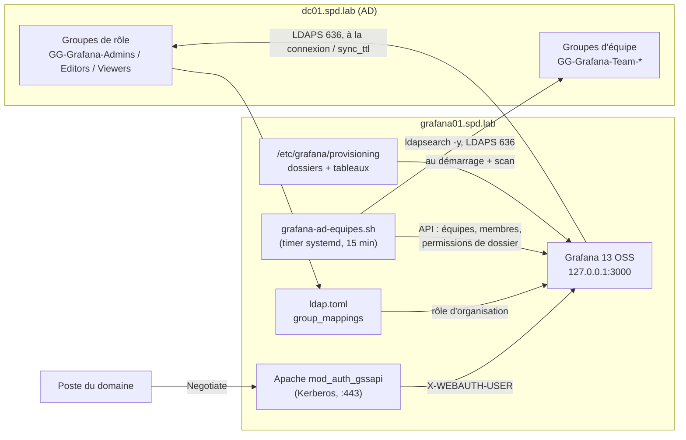

# Grafana OSS – dossiers, tableaux de bord et droits par groupe AD

Ce runbook complète le runbook LGTM (`Runbook_LGTM_Kafka_Offline_Debian13_DNS-Simple.md`, §5.6 et §8). Il ne modifie rien de ce qui est déjà en place : sources de données, LDAP vers `dc01.spd.lab`, SSO Kerberos via Apache.

**Ce que tu vas mettre en place :**

1. des **dossiers** par domaine (Plateforme, Systèmes, Journaux, Applications), créés par **provisioning fichier** avec des UID fixes ;
2. des **tableaux de bord de départ** (santé LGTM, Kafka, nœuds, journaux), plus l'import hors ligne du tableau grafana.com **1860** ;
3. des **droits par groupe AD** qui fonctionnent en **Grafana OSS** :
   - le rôle d'organisation vient de `group_mappings` (déjà en place au §8.1) ;
   - les **équipes** (*Teams*) sont alimentées par un **script** lancé par un timer systemd, puisque Team Sync n'existe pas en OSS ;
   - les **permissions de dossier** sont données aux équipes par l'API.

**Légende.** « **non testé** » = rédigé d'après la documentation officielle, sans avoir tourné sur ton lab. Le script de synchronisation a été testé (`bash -n`, `shellcheck`, et un test fonctionnel contre une **simulation** de l'API Grafana et de `ldapsearch`). Il n'a **pas** tourné contre un vrai Grafana 13 ni contre dc01 : sur le lab, il reste **non testé**.

**Règles de sécurité appliquées partout :**

- aucun secret à l'écran, aucun mot de passe ni jeton en argument de commande ;
- le jeton du compte de service est saisi avec `read -rsp`, puis stocké dans un fichier `0600` ;
- le mot de passe LDAP est lu par `ldapsearch -y` depuis un fichier `0600` ;
- si un secret apparaît à l'écran, dans un journal ou sur une photo, **fais-le tourner** (nouveau jeton, nouveau mot de passe).

---

## 1. Verdict OSS ou Enterprise : ce qui est possible

| Besoin | Grafana OSS 13 | Source officielle |
|---|---|---|
| Rôle d'organisation (Viewer, Editor, Admin) d'après un groupe LDAP : `group_mappings` avec `org_role`, `grafana_admin`, `org_id` | **Oui** | [Configure LDAP authentication](https://grafana.com/docs/grafana/latest/setup-grafana/configure-access/configure-authentication/ldap/) |
| **Team Sync** : appartenance aux équipes d'après les groupes LDAP | **Non**, la page indique « *Available in Grafana Enterprise and Grafana Cloud* » | [Configure team sync](https://grafana.com/docs/grafana/latest/setup-grafana/configure-access/configure-team-sync/) |
| Synchronisation LDAP **en arrière-plan** (Enhanced LDAP) | **Non** (Enterprise / Cloud). En OSS, LDAP met à jour l'utilisateur **à la connexion** | [Enhanced LDAP integration](https://grafana.com/docs/grafana/latest/setup-grafana/configure-access/configure-authentication/enhanced-ldap/) |
| En-tête `Groups` de l'auth proxy (`X-WEBAUTH-GROUPS`) vers les équipes | **Non** (section « Team Sync » de la page auth proxy, Enterprise) | [Auth proxy](https://grafana.com/docs/grafana/latest/setup-grafana/configure-access/configure-authentication/auth-proxy/) |
| Équipes, membres, permissions de **dossier** par équipe, via l'interface ou l'API | **Oui** | [Team HTTP API](https://grafana.com/docs/grafana/latest/developer-resources/api-reference/http-api/api-legacy/team/), [Folder permissions HTTP API](https://grafana.com/docs/grafana/latest/developer-resources/api-reference/http-api/api-legacy/folder_permissions/) |
| Comptes de service et jetons | **Oui** | [Service accounts](https://grafana.com/docs/grafana/latest/administration/service-accounts/) |
| Permissions **par source de données** (qui peut interroger Mimir, Loki, `elk`…) | **Non** (« *Available in Grafana Enterprise and Grafana Cloud* ») | [Data source management](https://grafana.com/docs/grafana/latest/administration/data-source-management/) |

**En clair :** en OSS, LDAP ne sait donner qu'un **rôle** (un seul par organisation : le premier `group_mappings` qui correspond, en partant du haut). Pour « le groupe AD X voit le dossier Y », il faut des **équipes** alimentées par un **script**. C'est l'objet des §5 à §7.

> **Limite importante (OSS).** Une permission de dossier masque des **tableaux de bord**, pas des **données**. La documentation l'écrit : « *By default, any user in an organization can query the data sources in that organization. For example, a user with the Viewer role can issue any possible query to a data source* ». Si une équipe ne doit pas voir certains journaux ou certaines métriques, l'isolation se fait **à la source** (voir §9) ou par **une organisation par groupe** (§10).

---

## 2. Vue d'ensemble



Flux :

1. Le navigateur s'authentifie en Kerberos auprès d'Apache. Apache transmet `X-WEBAUTH-USER` à Grafana, qui crée l'utilisateur à la première visite (`auto_sign_up`).
2. LDAP (`group_mappings`) attribue le **rôle** d'organisation.
3. Le script lit les **groupes d'équipe** dans l'AD et met à jour les **équipes** Grafana, puis les **permissions des dossiers**.
4. Le provisioning crée les **dossiers** (UID fixes) et les **tableaux de bord** de départ.

---

## 3. Prérequis

### 3.1 Déjà en place (runbook LGTM)

- Grafana 13.2.4 OSS sur grafana01 (systemd), sources de données provisionnées dans `/etc/grafana/provisioning/datasources/lgtm.yaml`. Les UID sont `mimir` (par défaut), `mimir-am`, `loki`, `tempo` et `elk`. Ce runbook **réutilise** ces UID et ne crée **aucune** autre source de données.
- LDAP vers dc01 (LDAPS 636, `use_ssl = true`, `start_tls = false`), avec `group_mappings` vers GG-Grafana-Admins / Editors / Viewers (§8.1).
- SSO Kerberos via Apache, en-tête `X-WEBAUTH-USER`, Grafana sur `127.0.0.1:3000` (§8.2, validé).
- Métriques déjà collectées par l'agent Prometheus (§5.5) :
  - job `node` (étiquette `vm`) ;
  - job `windows` (dc) ;
  - job `lgtm-self` (étiquettes `vm` et `service`) ;
  - métriques Kafka du récepteur `kafkametrics`.
- Journaux dans Loki, avec les étiquettes `service_name` et `service_namespace`.

> Si tes noms de job ou d'étiquettes diffèrent, adapte les requêtes des tableaux (§4.4) avant de les déposer.

### 3.2 Paquets hors ligne sur grafana01 (`jq`, `curl`, `ldap-utils`)

Le script a besoin de `curl`, `jq`, `ldapsearch` (paquet `ldap-utils`, déjà prévu au §8.5 du runbook LGTM), `flock` et `base64`. Ces deux derniers viennent de `util-linux` et `coreutils`, toujours présents.

D'abord, vérifie ce qui manque :

```bash
# Sur grafana01
for c in curl jq ldapsearch flock base64; do command -v "$c" >/dev/null && echo "OK  $c" || echo "MANQUE $c"; done
```

Pour chaque paquet manquant, suis la même méthode que le §8.5 du runbook LGTM :

1. Ouvre la page `https://packages.debian.org/trixie/amd64/<paquet>/download` sur le poste Windows.
2. Télécharge le paquet et vérifie son SHA-256 avec `Get-FileHash`.
3. Transfère-le par SFTP sur grafana01.
4. Installe avec `dpkg -i`, les dépendances **en premier**.

Dépendances relevées dans l'index Debian 13 « trixie » (`Packages`, le 16 nov. 2026). Lis les versions sur la page du paquet au moment du téléchargement :

| Paquet | Dépendances directes à prévoir si elles sont absentes |
|---|---|
| `jq` | `libjq1`, `libonig5` |
| `curl` | `libcurl4t64`, puis selon l'installation : `libbrotli1`, `libldap2`, `libnghttp2-14`, `libnghttp3-9`, `libpsl5t64`, `librtmp1`, `libsasl2-2`, `libsasl2-modules-db`, `libssh2-1t64` |
| `ldap-utils` | `libldap2`, `libsasl2-2`, `libsasl2-modules-db` |

```bash
# Sur grafana01, dans le dossier où tu as déposé les .deb
sudo dpkg --dry-run -i ./*.deb     # doit ne plus signaler de dépendance manquante
sudo dpkg -i ./*.deb
jq --version; curl --version | head -1; ldapsearch -VV 2>&1 | head -1
```

---

## 4. Dossiers et tableaux de bord par provisioning

### 4.1 Plan des dossiers

| Dossier (titre) | UID fixe | Contenu | Équipes (exemple, §7) |
|---|---|---|---|
| Plateforme | `lab-plateforme` | Santé Mimir / Loki / Tempo, Kafka | Equipe-Plateforme : Edit · Equipe-Systemes : View |
| Systèmes | `lab-systemes` | Nœuds (node_exporter), 1860 importé | Equipe-Systemes : Edit · Equipe-Plateforme : View |
| Journaux | `lab-journaux` | Journaux Loki par service | rôles Viewer et Editor : View (tout le monde) |
| Applications | `lab-applications` | Tableaux des équipes, page d'accueil | Equipe-Applications : Edit · rôles Viewer et Editor : View |

**Pourquoi des UID fixes ?** Le script de permissions (§7) vise les dossiers par leur UID. Avec `folderUid` renseigné, l'UID ne change pas d'une réinstallation à l'autre. La documentation dit que l'UID est « *automatically generated if not specified* ».

**Pourquoi un fournisseur par dossier ?** Le mode `foldersFromFilesStructure` crée les dossiers d'après l'arborescence, mais il impose de **laisser vides** `folder` et `folderUid` (documentation [Provisioning](https://grafana.com/docs/grafana/latest/administration/provisioning/)). Les UID ne sont alors pas choisis. Un fournisseur par dossier garde la maîtrise des UID.

Les tableaux provisionnés sont en **lecture seule** dans l'interface (`allowUiUpdates: false`). La documentation précise : « *If you set allowUiUpdates to false, you can't save changes to a provisioned dashboard* ». Pour adapter un tableau, l'utilisateur fait *Save as* dans un dossier où il a **Edit**. La permission Edit sur Plateforme ou Systèmes sert donc à **créer** de nouveaux tableaux dans ce dossier, pas à modifier ceux du provisioning.

### 4.2 Arborescence et fichier du fournisseur

```bash
# Sur grafana01
sudo install -d -m 0750 -o root -g grafana /etc/grafana/dashboards
for d in lab-plateforme lab-systemes lab-journaux lab-applications; do
  sudo install -d -m 0750 -o root -g grafana "/etc/grafana/dashboards/$d"
done

sudo tee /etc/grafana/provisioning/dashboards/lab-dossiers.yaml >/dev/null <<'EOF'
# Un fournisseur par dossier : UID de dossier fixes, visés par grafana-ad-equipes.sh
apiVersion: 1
providers:
  - name: lab-plateforme
    orgId: 1
    folder: Plateforme
    folderUid: lab-plateforme
    type: file
    disableDeletion: false
    updateIntervalSeconds: 30
    allowUiUpdates: false
    options:
      path: /etc/grafana/dashboards/lab-plateforme
  - name: lab-systemes
    orgId: 1
    folder: Systèmes
    folderUid: lab-systemes
    type: file
    disableDeletion: false
    updateIntervalSeconds: 30
    allowUiUpdates: false
    options:
      path: /etc/grafana/dashboards/lab-systemes
  - name: lab-journaux
    orgId: 1
    folder: Journaux
    folderUid: lab-journaux
    type: file
    disableDeletion: false
    updateIntervalSeconds: 30
    allowUiUpdates: false
    options:
      path: /etc/grafana/dashboards/lab-journaux
  - name: lab-applications
    orgId: 1
    folder: Applications
    folderUid: lab-applications
    type: file
    disableDeletion: false
    updateIntervalSeconds: 30
    allowUiUpdates: false
    options:
      path: /etc/grafana/dashboards/lab-applications
EOF
sudo chown root:grafana /etc/grafana/provisioning/dashboards/lab-dossiers.yaml
sudo chmod 0640 /etc/grafana/provisioning/dashboards/lab-dossiers.yaml
```

Notes sur les clés (toutes tirées de l'exemple officiel de la page Provisioning) :

- `updateIntervalSeconds: 30` : Grafana relit les fichiers toutes les 30 s. La documentation indique qu'une valeur de 10 ou moins utilise la surveillance du système de fichiers, et qu'une valeur plus grande force un balayage périodique.
- `disableDeletion: false` : si tu supprimes un fichier JSON, le tableau disparaît de Grafana.
- `orgId: 1` : organisation principale.

Ne touche pas à `/etc/grafana/provisioning/datasources/lgtm.yaml`, les sources de données y sont déjà.

### 4.3 Tableaux de bord de départ

Les tableaux ci-dessous ont été écrits pour ce lab :

- leur JSON a été validé avec `jq` ;
- les 19 requêtes PromQL ont été validées **syntaxiquement** avec `promtool check rules` (Prometheus 3.16) ;
- les requêtes LogQL n'ont **pas** été validées.

Les **noms de métriques** viennent du code source de Mimir, Loki et Tempo (branche principale) et des jobs du §5.5. Leur présence sur tes versions (Mimir 3.2.3, Loki 3.7.9, Tempo 3.1.1) est **non testée** : vérifie chaque requête dans *Explore* (§11).

| Fichier | UID | Contenu |
|---|---|---|
| `lab-plateforme/lgtm-sante.json` | `lab-lgtm-sante` | `up` des services `lgtm-self`, requêtes/s et 5xx/s par route (`*_request_duration_seconds_count`), ingestion (échantillons Mimir, lignes Loki, spans Tempo), mémoire et CPU par service |
| `lab-plateforme/kafka-consommateurs.json` | `lab-kafka-conso` | `kafka_consumer_group_lag`, `kafka_consumer_group_members`, débit `kafka_partition_current_offset` |
| `lab-systemes/noeuds-apercu.json` | `lab-noeuds` | `up` (node + windows), CPU, mémoire, disque par `vm` (variable `$vm`) |
| `lab-journaux/journaux-services.json` | `lab-journaux` | volume par `service_name` et panneau de journaux, variables `$service` et `$filtre` |
| `lab-applications/accueil.json` | `lab-accueil` | page texte « mode d'emploi » |

Copie chaque bloc tel quel. Les délimiteurs des blocs (`<<'JSON_EOF'`) sont entre guillemets : le shell ne remplace pas les `$` des requêtes.

#### Santé LGTM — `lab-plateforme/lgtm-sante.json`

```bash
# Sur grafana01
sudo tee /etc/grafana/dashboards/lab-plateforme/lgtm-sante.json >/dev/null <<'JSON_EOF'
{
  "uid": "lab-lgtm-sante",
  "title": "LGTM – santé des services",
  "tags": [
    "lab",
    "lgtm"
  ],
  "editable": false,
  "schemaVersion": 39,
  "version": 1,
  "time": {
    "from": "now-6h",
    "to": "now"
  },
  "refresh": "1m",
  "timezone": "browser",
  "templating": {
    "list": []
  },
  "annotations": {
    "list": []
  },
  "panels": [
    {
      "id": 1,
      "type": "stat",
      "title": "Services LGTM joignables (up)",
      "datasource": {
        "type": "prometheus",
        "uid": "mimir"
      },
      "gridPos": {
        "x": 0,
        "y": 0,
        "w": 24,
        "h": 5
      },
      "fieldConfig": {
        "defaults": {
          "unit": "short",
          "mappings": [
            {
              "type": "value",
              "options": {
                "0": {
                  "text": "DOWN",
                  "color": "red"
                },
                "1": {
                  "text": "UP",
                  "color": "green"
                }
              }
            }
          ],
          "thresholds": {
            "mode": "absolute",
            "steps": [
              {
                "color": "red",
                "value": null
              },
              {
                "color": "green",
                "value": 1
              }
            ]
          }
        },
        "overrides": []
      },
      "options": {
        "colorMode": "background",
        "reduceOptions": {
          "calcs": [
            "lastNotNull"
          ]
        },
        "textMode": "value_and_name"
      },
      "targets": [
        {
          "refId": "A",
          "datasource": {
            "type": "prometheus",
            "uid": "mimir"
          },
          "expr": "up{job=\"lgtm-self\"}",
          "legendFormat": "{{service}}"
        }
      ]
    },
    {
      "id": 2,
      "type": "timeseries",
      "title": "Requêtes/s par route (Mimir, Loki, Tempo)",
      "datasource": {
        "type": "prometheus",
        "uid": "mimir"
      },
      "gridPos": {
        "x": 0,
        "y": 5,
        "w": 12,
        "h": 8
      },
      "fieldConfig": {
        "defaults": {
          "unit": "reqps"
        },
        "overrides": []
      },
      "options": {},
      "targets": [
        {
          "refId": "A",
          "datasource": {
            "type": "prometheus",
            "uid": "mimir"
          },
          "expr": "sum by (route) (rate(cortex_request_duration_seconds_count{job=\"lgtm-self\"}[$__rate_interval]))",
          "legendFormat": "mimir {{route}}"
        },
        {
          "refId": "B",
          "datasource": {
            "type": "prometheus",
            "uid": "mimir"
          },
          "expr": "sum by (route) (rate(loki_request_duration_seconds_count{job=\"lgtm-self\"}[$__rate_interval]))",
          "legendFormat": "loki {{route}}"
        },
        {
          "refId": "C",
          "datasource": {
            "type": "prometheus",
            "uid": "mimir"
          },
          "expr": "sum by (route) (rate(tempo_request_duration_seconds_count{job=\"lgtm-self\"}[$__rate_interval]))",
          "legendFormat": "tempo {{route}}"
        }
      ]
    },
    {
      "id": 3,
      "type": "timeseries",
      "title": "Erreurs 5xx/s par route",
      "datasource": {
        "type": "prometheus",
        "uid": "mimir"
      },
      "gridPos": {
        "x": 12,
        "y": 5,
        "w": 12,
        "h": 8
      },
      "fieldConfig": {
        "defaults": {
          "unit": "reqps"
        },
        "overrides": []
      },
      "options": {},
      "targets": [
        {
          "refId": "A",
          "datasource": {
            "type": "prometheus",
            "uid": "mimir"
          },
          "expr": "sum by (route) (rate(cortex_request_duration_seconds_count{job=\"lgtm-self\", status_code=~\"5..|error\"}[$__rate_interval]))",
          "legendFormat": "mimir {{route}}"
        },
        {
          "refId": "B",
          "datasource": {
            "type": "prometheus",
            "uid": "mimir"
          },
          "expr": "sum by (route) (rate(loki_request_duration_seconds_count{job=\"lgtm-self\", status_code=~\"5..|error\"}[$__rate_interval]))",
          "legendFormat": "loki {{route}}"
        },
        {
          "refId": "C",
          "datasource": {
            "type": "prometheus",
            "uid": "mimir"
          },
          "expr": "sum by (route) (rate(tempo_request_duration_seconds_count{job=\"lgtm-self\", status_code=~\"5..|error\"}[$__rate_interval]))",
          "legendFormat": "tempo {{route}}"
        }
      ]
    },
    {
      "id": 4,
      "type": "timeseries",
      "title": "Ingestion",
      "datasource": {
        "type": "prometheus",
        "uid": "mimir"
      },
      "gridPos": {
        "x": 0,
        "y": 13,
        "w": 12,
        "h": 8
      },
      "fieldConfig": {
        "defaults": {
          "unit": "short"
        },
        "overrides": []
      },
      "options": {},
      "targets": [
        {
          "refId": "A",
          "datasource": {
            "type": "prometheus",
            "uid": "mimir"
          },
          "expr": "sum(rate(cortex_distributor_received_samples_total{job=\"lgtm-self\"}[$__rate_interval]))",
          "legendFormat": "Mimir échantillons/s"
        },
        {
          "refId": "B",
          "datasource": {
            "type": "prometheus",
            "uid": "mimir"
          },
          "expr": "sum(rate(loki_distributor_lines_received_total{job=\"lgtm-self\"}[$__rate_interval]))",
          "legendFormat": "Loki lignes/s"
        },
        {
          "refId": "C",
          "datasource": {
            "type": "prometheus",
            "uid": "mimir"
          },
          "expr": "sum(rate(tempo_distributor_spans_received_total{job=\"lgtm-self\"}[$__rate_interval]))",
          "legendFormat": "Tempo spans/s"
        }
      ]
    },
    {
      "id": 5,
      "type": "timeseries",
      "title": "Mémoire résidente par service",
      "datasource": {
        "type": "prometheus",
        "uid": "mimir"
      },
      "gridPos": {
        "x": 12,
        "y": 13,
        "w": 12,
        "h": 8
      },
      "fieldConfig": {
        "defaults": {
          "unit": "bytes"
        },
        "overrides": []
      },
      "options": {},
      "targets": [
        {
          "refId": "A",
          "datasource": {
            "type": "prometheus",
            "uid": "mimir"
          },
          "expr": "process_resident_memory_bytes{job=\"lgtm-self\"}",
          "legendFormat": "{{service}}"
        }
      ]
    },
    {
      "id": 6,
      "type": "timeseries",
      "title": "CPU par service (cœurs)",
      "datasource": {
        "type": "prometheus",
        "uid": "mimir"
      },
      "gridPos": {
        "x": 0,
        "y": 21,
        "w": 24,
        "h": 8
      },
      "fieldConfig": {
        "defaults": {
          "unit": "short"
        },
        "overrides": []
      },
      "options": {},
      "targets": [
        {
          "refId": "A",
          "datasource": {
            "type": "prometheus",
            "uid": "mimir"
          },
          "expr": "rate(process_cpu_seconds_total{job=\"lgtm-self\"}[$__rate_interval])",
          "legendFormat": "{{service}}"
        }
      ]
    }
  ]
}
JSON_EOF
```

#### Kafka – groupes de consommateurs — `lab-plateforme/kafka-consommateurs.json`

```bash
# Sur grafana01
sudo tee /etc/grafana/dashboards/lab-plateforme/kafka-consommateurs.json >/dev/null <<'JSON_EOF'
{
  "uid": "lab-kafka-conso",
  "title": "Kafka – groupes de consommateurs",
  "tags": [
    "lab",
    "kafka"
  ],
  "editable": false,
  "schemaVersion": 39,
  "version": 1,
  "time": {
    "from": "now-6h",
    "to": "now"
  },
  "refresh": "1m",
  "timezone": "browser",
  "templating": {
    "list": []
  },
  "annotations": {
    "list": []
  },
  "panels": [
    {
      "id": 1,
      "type": "timeseries",
      "title": "Retard (lag) par groupe et topic",
      "datasource": {
        "type": "prometheus",
        "uid": "mimir"
      },
      "gridPos": {
        "x": 0,
        "y": 0,
        "w": 24,
        "h": 8
      },
      "fieldConfig": {
        "defaults": {
          "unit": "short"
        },
        "overrides": []
      },
      "options": {},
      "targets": [
        {
          "refId": "A",
          "datasource": {
            "type": "prometheus",
            "uid": "mimir"
          },
          "expr": "sum by (group, topic) (kafka_consumer_group_lag)",
          "legendFormat": "{{group}} / {{topic}}"
        }
      ]
    },
    {
      "id": 2,
      "type": "timeseries",
      "title": "Membres par groupe",
      "datasource": {
        "type": "prometheus",
        "uid": "mimir"
      },
      "gridPos": {
        "x": 0,
        "y": 8,
        "w": 12,
        "h": 8
      },
      "fieldConfig": {
        "defaults": {
          "unit": "short"
        },
        "overrides": []
      },
      "options": {},
      "targets": [
        {
          "refId": "A",
          "datasource": {
            "type": "prometheus",
            "uid": "mimir"
          },
          "expr": "max by (group) (kafka_consumer_group_members)",
          "legendFormat": "{{group}}"
        }
      ]
    },
    {
      "id": 3,
      "type": "timeseries",
      "title": "Messages produits/s par topic",
      "datasource": {
        "type": "prometheus",
        "uid": "mimir"
      },
      "gridPos": {
        "x": 12,
        "y": 8,
        "w": 12,
        "h": 8
      },
      "fieldConfig": {
        "defaults": {
          "unit": "short"
        },
        "overrides": []
      },
      "options": {},
      "targets": [
        {
          "refId": "A",
          "datasource": {
            "type": "prometheus",
            "uid": "mimir"
          },
          "expr": "sum by (topic) (rate(kafka_partition_current_offset[$__rate_interval]))",
          "legendFormat": "{{topic}}"
        }
      ]
    }
  ]
}
JSON_EOF
```

#### Nœuds – aperçu — `lab-systemes/noeuds-apercu.json`

```bash
# Sur grafana01
sudo tee /etc/grafana/dashboards/lab-systemes/noeuds-apercu.json >/dev/null <<'JSON_EOF'
{
  "uid": "lab-noeuds",
  "title": "Nœuds – aperçu (node_exporter)",
  "tags": [
    "lab",
    "node"
  ],
  "editable": false,
  "schemaVersion": 39,
  "version": 1,
  "time": {
    "from": "now-6h",
    "to": "now"
  },
  "refresh": "1m",
  "timezone": "browser",
  "templating": {
    "list": [
      {
        "name": "vm",
        "label": "vm",
        "type": "query",
        "datasource": {
          "type": "prometheus",
          "uid": "mimir"
        },
        "query": {
          "query": "label_values(up{job=\"node\"}, vm)",
          "refId": "PrometheusVariableQueryEditor-VariableQuery"
        },
        "definition": "label_values(up{job=\"node\"}, vm)",
        "refresh": 2,
        "includeAll": true,
        "multi": true,
        "current": {
          "text": "All",
          "value": "$__all"
        },
        "sort": 1
      }
    ]
  },
  "annotations": {
    "list": []
  },
  "panels": [
    {
      "id": 1,
      "type": "stat",
      "title": "Cibles joignables (node + windows)",
      "datasource": {
        "type": "prometheus",
        "uid": "mimir"
      },
      "gridPos": {
        "x": 0,
        "y": 0,
        "w": 24,
        "h": 5
      },
      "fieldConfig": {
        "defaults": {
          "unit": "short"
        },
        "overrides": []
      },
      "options": {},
      "targets": [
        {
          "refId": "A",
          "datasource": {
            "type": "prometheus",
            "uid": "mimir"
          },
          "expr": "up{job=~\"node|windows\"}",
          "legendFormat": "{{vm}}"
        }
      ]
    },
    {
      "id": 2,
      "type": "timeseries",
      "title": "CPU utilisé",
      "datasource": {
        "type": "prometheus",
        "uid": "mimir"
      },
      "gridPos": {
        "x": 0,
        "y": 5,
        "w": 12,
        "h": 8
      },
      "fieldConfig": {
        "defaults": {
          "unit": "percentunit"
        },
        "overrides": []
      },
      "options": {},
      "targets": [
        {
          "refId": "A",
          "datasource": {
            "type": "prometheus",
            "uid": "mimir"
          },
          "expr": "1 - avg by (vm) (rate(node_cpu_seconds_total{job=\"node\", vm=~\"$vm\", mode=\"idle\"}[$__rate_interval]))",
          "legendFormat": "{{vm}}"
        }
      ]
    },
    {
      "id": 3,
      "type": "timeseries",
      "title": "Mémoire utilisée",
      "datasource": {
        "type": "prometheus",
        "uid": "mimir"
      },
      "gridPos": {
        "x": 12,
        "y": 5,
        "w": 12,
        "h": 8
      },
      "fieldConfig": {
        "defaults": {
          "unit": "percentunit"
        },
        "overrides": []
      },
      "options": {},
      "targets": [
        {
          "refId": "A",
          "datasource": {
            "type": "prometheus",
            "uid": "mimir"
          },
          "expr": "1 - (node_memory_MemAvailable_bytes{job=\"node\", vm=~\"$vm\"} / node_memory_MemTotal_bytes{job=\"node\", vm=~\"$vm\"})",
          "legendFormat": "{{vm}}"
        }
      ]
    },
    {
      "id": 4,
      "type": "timeseries",
      "title": "Espace disque utilisé",
      "datasource": {
        "type": "prometheus",
        "uid": "mimir"
      },
      "gridPos": {
        "x": 0,
        "y": 18,
        "w": 24,
        "h": 8
      },
      "fieldConfig": {
        "defaults": {
          "unit": "percentunit"
        },
        "overrides": []
      },
      "options": {},
      "targets": [
        {
          "refId": "A",
          "datasource": {
            "type": "prometheus",
            "uid": "mimir"
          },
          "expr": "1 - (node_filesystem_avail_bytes{job=\"node\", vm=~\"$vm\", fstype!~\"tmpfs|ramfs|overlay|squashfs\"} / node_filesystem_size_bytes{job=\"node\", vm=~\"$vm\", fstype!~\"tmpfs|ramfs|overlay|squashfs\"})",
          "legendFormat": "{{vm}} {{mountpoint}}"
        }
      ]
    }
  ]
}
JSON_EOF
```

#### Journaux par service — `lab-journaux/journaux-services.json`

```bash
# Sur grafana01
sudo tee /etc/grafana/dashboards/lab-journaux/journaux-services.json >/dev/null <<'JSON_EOF'
{
  "uid": "lab-journaux",
  "title": "Journaux – par service (Loki)",
  "tags": [
    "lab",
    "loki"
  ],
  "editable": false,
  "schemaVersion": 39,
  "version": 1,
  "time": {
    "from": "now-1h",
    "to": "now"
  },
  "refresh": "",
  "timezone": "browser",
  "templating": {
    "list": [
      {
        "name": "service",
        "label": "service",
        "type": "query",
        "datasource": {
          "type": "loki",
          "uid": "loki"
        },
        "query": "label_values(service_name)",
        "definition": "label_values(service_name)",
        "refresh": 2,
        "includeAll": true,
        "multi": true,
        "current": {
          "text": "All",
          "value": "$__all"
        },
        "sort": 1,
        "allValue": ".+"
      },
      {
        "name": "filtre",
        "label": "texte recherché",
        "type": "textbox",
        "query": "",
        "current": {
          "text": "",
          "value": ""
        }
      }
    ]
  },
  "annotations": {
    "list": []
  },
  "panels": [
    {
      "id": 1,
      "type": "timeseries",
      "title": "Volume de lignes par service",
      "datasource": {
        "type": "loki",
        "uid": "loki"
      },
      "gridPos": {
        "x": 0,
        "y": 0,
        "w": 24,
        "h": 7
      },
      "fieldConfig": {
        "defaults": {
          "unit": "short",
          "custom": {
            "drawStyle": "bars",
            "stacking": {
              "mode": "normal"
            }
          }
        },
        "overrides": []
      },
      "options": {},
      "targets": [
        {
          "refId": "A",
          "datasource": {
            "type": "loki",
            "uid": "loki"
          },
          "expr": "sum by (service_name) (count_over_time({service_name=~\"$service\"} |= \"$filtre\" [$__interval]))",
          "legendFormat": "{{service_name}}"
        }
      ]
    },
    {
      "id": 2,
      "type": "logs",
      "title": "Journaux",
      "datasource": {
        "type": "loki",
        "uid": "loki"
      },
      "gridPos": {
        "x": 0,
        "y": 7,
        "w": 24,
        "h": 16
      },
      "options": {
        "showTime": true,
        "wrapLogMessage": true,
        "sortOrder": "Descending",
        "enableLogDetails": true
      },
      "targets": [
        {
          "refId": "A",
          "datasource": {
            "type": "loki",
            "uid": "loki"
          },
          "expr": "{service_name=~\"$service\"} |= \"$filtre\"",
          "maxLines": 500
        }
      ]
    }
  ]
}
JSON_EOF
```

#### Accueil du dossier Applications — `lab-applications/accueil.json`

```bash
# Sur grafana01
sudo tee /etc/grafana/dashboards/lab-applications/accueil.json >/dev/null <<'JSON_EOF'
{
  "uid": "lab-accueil",
  "title": "Accueil – mode d'emploi",
  "tags": [
    "lab"
  ],
  "editable": false,
  "schemaVersion": 39,
  "version": 1,
  "time": {
    "from": "now-6h",
    "to": "now"
  },
  "refresh": "",
  "timezone": "browser",
  "templating": {
    "list": []
  },
  "annotations": {
    "list": []
  },
  "panels": [
    {
      "id": 1,
      "type": "text",
      "title": "",
      "gridPos": {
        "x": 0,
        "y": 0,
        "w": 24,
        "h": 9
      },
      "options": {
        "mode": "markdown",
        "content": "## Dossier Applications\n\nCe dossier accueille les tableaux de bord des équipes.\n\n* Les tableaux **provisionnés** (dossiers *Plateforme*, *Systèmes*, *Journaux*) sont en lecture seule : copie-les (*Save as*) ici pour les adapter.\n* Les droits de ce dossier sont gérés par le script `grafana-ad-equipes.sh` à partir des groupes AD.\n* Données : `mimir` (métriques), `loki` (journaux), `tempo` (traces), `elk` (Elasticsearch)."
      }
    }
  ]
}
JSON_EOF
```

Droits et rechargement :

```bash
# Sur grafana01
sudo chown -R root:grafana /etc/grafana/dashboards
sudo find /etc/grafana/dashboards -type d -exec chmod 0750 {} +
sudo find /etc/grafana/dashboards -type f -name '*.json' -exec chmod 0640 {} +
for f in /etc/grafana/dashboards/*/*.json; do jq -e .uid "$f" >/dev/null && echo "JSON OK $f" || echo "JSON KO $f"; done
sudo systemctl restart grafana-server      # nécessaire pour un NOUVEAU fichier de fournisseur
sudo journalctl -u grafana-server -n 80 --no-pager | grep -i provisioning
```

Tu attends : aucune ligne `level=error` liée au provisioning. Les quatre dossiers apparaissent dans *Dashboards*. **Non testé.**

### 4.4 Adapter les requêtes à ton lab

- **Santé LGTM.** Si le panneau « Requêtes/s » est vide pour un composant, ouvre *Explore* (source `mimir`) et tape `{job="lgtm-self", __name__=~".*request_duration_seconds.*"}` pour voir les noms réellement exposés. Selon la configuration des histogrammes, seule la série native (sans `_count`) peut exister. Dans ce cas, remplace `rate(x_count[…])` par `histogram_count(rate(x[…]))`. **Non testé.**
- **Kafka.** Les noms d'étiquettes (`group`, `topic`) viennent du récepteur `kafkametrics` d'otelcol-contrib. Vérifie-les dans *Explore* avec `kafka_consumer_group_lag`. **Non testé.**
- **Journaux.** Si `service_name` n'existe pas dans Loki, remplace-le par l'étiquette que tu vois dans *Explore* → Loki → *Label browser*. **Non testé.**

### 4.5 Import hors ligne d'un tableau grafana.com (1860 « Node Exporter Full »)

Identifiants vérifiés le 16 nov. 2026 sur l'API publique `https://grafana.com/api/dashboards/<id>` :

| ID | Nom | Auteur | Révision au 16 nov. 2026 | Intérêt sur ce lab |
|---|---|---|---|---|
| **1860** | Node Exporter Full | rfraile | 46 (mise à jour le 31 oct. 2026) | **Recommandé** : correspond au job `node` |
| 17607 | Mimir / Overview | Grafana Labs (mixin Mimir) | — | **Déconseillé ici** : ses variables lisent `cortex_build_info` par `cluster` et `namespace`, et ses requêtes filtrent `job=~"($namespace)/…"`. Ton job s'appelle `lgtm-self`, sans étiquette `cluster` : les panneaux resteraient vides sans adaptation |
| 16026 / 16016 | Mimir / Writes, Mimir / Reads | Grafana Labs (mixin Mimir) | — | Même remarque que 17607 |

Pour Loki, Tempo et le récepteur Kafka d'OpenTelemetry, je n'ai trouvé **aucun** tableau grafana.com qui corresponde à ce déploiement monolithique sans adaptation. D'où les tableaux maison du §4.3.

**Sur le poste Windows (PowerShell) :**

```powershell
# Révision « latest » (renvoie la dernière révision publiée)
$out = "$env:USERPROFILE\Downloads\node-exporter-full-1860.json"
curl.exe -fL -o $out "https://grafana.com/api/dashboards/1860/revisions/latest/download"
# Ou une révision figée, pour un import reproductible :
#   https://grafana.com/api/dashboards/1860/revisions/46/download
Get-FileHash -Algorithm SHA256 $out     # note l'empreinte, compare-la après le transfert
(Get-Content $out -Raw | ConvertFrom-Json).title    # attendu : Node Exporter Full
```

Transfère le fichier par SFTP vers grafana01 (par exemple dans `/tmp`), puis :

```bash
# Sur grafana01
sha256sum /tmp/node-exporter-full-1860.json      # même empreinte que sur Windows
jq -r '.title, .uid, (.__inputs // "pas de __inputs")' /tmp/node-exporter-full-1860.json
jq -r '.templating.list[] | select(.type=="datasource") | .name + " -> " + .query' /tmp/node-exporter-full-1860.json
sudo install -m 0640 -o root -g grafana /tmp/node-exporter-full-1860.json \
  /etc/grafana/dashboards/lab-systemes/node-exporter-full-1860.json
rm -f /tmp/node-exporter-full-1860.json
```

La révision 46 (inspectée le 16 nov. 2026) n'a **pas** de section `__inputs`. Elle utilise une variable de type *datasource* nommée `ds_prometheus` (type `prometheus`), que Grafana renseigne avec la source Prometheus **par défaut**, ici `mimir` (`isDefault: true`). Aucune substitution n'est donc nécessaire pour le provisioning. Grafana le prend en compte en 30 s au plus, sans redémarrage. **Non testé.**

> **Si une autre révision contient `__inputs`** (variables `${DS_PROMETHEUS}`), le provisioning ne les résout pas. Remplace-les par l'UID `mimir` :
> `sed -i 's/\${DS_PROMETHEUS}/mimir/g' fichier.json`. Vérifie ensuite avec `grep -c 'DS_PROMETHEUS' fichier.json`, qui doit donner 0. **Non testé.**
>
> Autre voie, sans provisioning : *Dashboards* → *New* → *Import* → *Upload dashboard JSON file*, dans le dossier voulu. Le tableau est alors modifiable dans l'interface, mais il n'est plus géré par fichier.

---

## 5. Rôles par groupe AD : `group_mappings` (OSS, déjà en place)

Le §8.1.10 du runbook LGTM a déjà configuré ceci dans `/etc/grafana/ldap.toml` :

| Groupe AD | `org_role` | Autre |
|---|---|---|
| `CN=GG-Grafana-Admins,CN=Users,DC=spd,DC=lab` | `Admin` | `grafana_admin = true` |
| `CN=GG-Grafana-Editors,CN=Users,DC=spd,DC=lab` | `Editor` | |
| `CN=GG-Grafana-Viewers,CN=Users,DC=spd,DC=lab` | `Viewer` | |

Règles utiles, toutes tirées de la documentation LDAP :

- « *The first group mapping that an LDAP user is matched to will be used* ». Garde l'ordre **Admins → Editors → Viewers**.
- `group_dn = "*"` est un joker. En dernière position, il donnerait un rôle par défaut (par exemple Viewer) à tout utilisateur LDAP. Ne l'ajoute que si c'est voulu.
- `org_id` permet d'attribuer un rôle dans une **autre** organisation (alternative du §10).

**Recommandation :** chaque personne d'un groupe d'équipe (`GG-Grafana-Team-*`) doit aussi être dans **un** groupe de rôle. Le comportement d'un utilisateur LDAP qui ne correspond à aucun `group_mappings` n'est pas décrit clairement dans la page officielle (connexion refusée ou rôle par défaut de `[users] auto_assign_org_role`). **À vérifier sur ton lab, non testé.**

> **Ne modifie pas `ldap.toml` pour les équipes.** En OSS, il n'existe pas de clé `ldap.toml` qui remplisse les équipes. Le script s'en charge.

---

## 6. Groupes d'équipe, compte de service et secrets

### 6.1 Groupes AD d'équipe (PowerShell sur dc01)

Les noms ci-dessous sont des **exemples**. Adapte-les à tes équipes réelles. Aucun mot de passe n'est créé ici.

```powershell
# Sur dc01, PowerShell en administrateur du domaine
Import-Module ActiveDirectory
$equipes = 'GG-Grafana-Team-Plateforme','GG-Grafana-Team-Systemes','GG-Grafana-Team-Applications'
foreach ($n in $equipes) {
  if (-not (Get-ADGroup -Filter "Name -eq '$n'")) {
    New-ADGroup -Name $n -GroupScope Global -GroupCategory Security `
      -Path 'CN=Users,DC=spd,DC=lab' -Description 'Équipe Grafana (synchro grafana-ad-equipes)'
  }
}
# Membres de test (utilisateurs du §8.1.9 du runbook LGTM)
Add-ADGroupMember -Identity 'GG-Grafana-Team-Plateforme'   -Members 'gf-admin','gf-editor'
Add-ADGroupMember -Identity 'GG-Grafana-Team-Systemes'     -Members 'gf-viewer'
Add-ADGroupMember -Identity 'GG-Grafana-Team-Applications' -Members 'gf-editor'
# DN exacts à reporter dans equipes.conf (§6.5)
Get-ADGroup -Filter "Name -like 'GG-Grafana-Team-*'" | Select-Object Name, DistinguishedName
```

**Groupes imbriqués.** Par défaut, le script ne prend que les membres **directs** (`memberOf=<DN>`). Avec `GROUPES_IMBRIQUES=1`, il utilise la règle AD `LDAP_MATCHING_RULE_IN_CHAIN` (OID `1.2.840.113556.1.4.1941`, [documentation Microsoft](https://learn.microsoft.com/en-us/windows/win32/adsi/search-filter-syntax)), qui inclut les membres indirects. Cette option est **non testée** sur le lab.

### 6.2 Compte système local sur grafana01

```bash
# Sur grafana01
sudo useradd --system --home-dir /nonexistent --no-create-home \
  --shell /usr/sbin/nologin grafana-adsync
sudo install -d -m 0700 -o grafana-adsync -g grafana-adsync /etc/grafana-ad-equipes
```

### 6.3 Compte de service Grafana et jeton (lu avec `read -rsp`)

Les comptes de service sont disponibles en OSS ([Service accounts](https://grafana.com/docs/grafana/latest/administration/service-accounts/)). Le script a besoin du rôle d'organisation **Admin** pour trois raisons :

- créer des équipes et gérer leurs membres (l'administrateur d'organisation gère toutes les équipes) ;
- modifier les permissions des dossiers (`folders.permissions:write`) ;
- lister les utilisateurs de l'organisation (`GET /api/org/users`, action `org.users:read`).

Les API `/api/users…` exigent un **administrateur de serveur** avec authentification *basic* : un compte de service ne peut pas les appeler. Le script ne s'en sert donc pas.

1. Connecte-toi à Grafana avec un compte **Admin** (par exemple `gf-admin`).
2. Ouvre **Administration → Users and access → Service accounts → Add service account**. Les libellés peuvent varier légèrement selon la version.
   - *Display name* : `grafana-ad-equipes`
   - *Role* : **Admin**
3. Sur ce compte, clique **Add service account token**. Donne-lui un nom et une **date d'expiration** (par exemple 90 jours, à noter dans ton agenda), puis **Generate token**.
4. Le jeton n'est affiché **qu'une fois**. Copie-le, puis colle-le **uniquement** dans l'invite `read -rsp` ci-dessous. Ne le colle jamais dans une commande, un ticket ou un message.

```bash
# Sur grafana01 — le jeton n'apparaît ni à l'écran, ni dans l'historique, ni dans ps
sudo install -m 0600 -o grafana-adsync -g grafana-adsync /dev/null /etc/grafana-ad-equipes/grafana.token
read -rsp 'Jeton du compte de service Grafana : ' GF_TOKEN; echo
printf '%s' "$GF_TOKEN" | sudo tee /etc/grafana-ad-equipes/grafana.token >/dev/null
unset GF_TOKEN
sudo stat -c '%a %U:%G %s octets' /etc/grafana-ad-equipes/grafana.token   # attendu : 600 grafana-adsync:grafana-adsync, taille > 0
```

`printf` est une commande interne de bash : le jeton ne passe pas dans les arguments d'un processus. `tee` écrit dans le fichier déjà créé en `0600`. Le script refuse de démarrer si ce fichier n'est pas en `0600` ou `0400`.

### 6.4 Mot de passe de liaison LDAP pour `ldapsearch -y`

Le script lit l'AD avec le compte **en lecture seule** `svc-grafana-ldap`, celui du §8.1. Si tu préfères un compte dédié (par exemple `svc-grafana-adsync`), c'est possible : remplace alors `LDAP_BIND_DN` au §6.5.

`ldapsearch -y` lit le fichier **en entier** comme mot de passe. Il ne doit donc contenir **aucun saut de ligne** final, d'où `printf '%s'`.

```bash
# Sur grafana01
sudo install -m 0600 -o grafana-adsync -g grafana-adsync /dev/null /etc/grafana-ad-equipes/ldap-bind.pwd
read -rsp 'Mot de passe de svc-grafana-ldap : ' LDAP_PWD; echo
printf '%s' "$LDAP_PWD" | sudo tee /etc/grafana-ad-equipes/ldap-bind.pwd >/dev/null
unset LDAP_PWD
```

> **Rotation :** ce mot de passe est aussi dans `/etc/grafana/ldap-bind.env` (§8.1.10 du runbook LGTM). Si tu le changes dans l'AD, mets à jour **les deux** fichiers, puis redémarre `grafana-server`.

Test de lecture d'un groupe, sous le compte du service :

```bash
# Sur grafana01 — affiche des sAMAccountName, aucun secret
sudo -u grafana-adsync ldapsearch -LLL -o ldif-wrap=no -H ldaps://dc01.spd.lab:636 -x \
  -D 'CN=svc-grafana-ldap,CN=Users,DC=spd,DC=lab' -y /etc/grafana-ad-equipes/ldap-bind.pwd \
  -b 'DC=spd,DC=lab' '(&(objectCategory=person)(objectClass=user)(memberOf=CN=GG-Grafana-Team-Plateforme,CN=Users,DC=spd,DC=lab))' \
  sAMAccountName
```

Tu attends `sAMAccountName: gf-admin` et `sAMAccountName: gf-editor`. Code 49 = mauvais mot de passe ou mauvais DN. Une erreur de certificat renvoie au §8.1.7 et §8.1.8 du runbook LGTM.

### 6.5 Fichiers de configuration du script

```bash
# Sur grafana01 — paramètres NON secrets
sudo tee /etc/grafana-ad-equipes/ad-equipes.env >/dev/null <<'EOF'
GRAFANA_URL=http://127.0.0.1:3000
LDAP_URI=ldaps://dc01.spd.lab:636
LDAP_BIND_DN=CN=svc-grafana-ldap,CN=Users,DC=spd,DC=lab
LDAP_BASE=DC=spd,DC=lab
# 1 = inclure les membres des groupes imbriqués (non testé)
GROUPES_IMBRIQUES=0
# 1 = retirer de l'équipe ceux qui ne sont plus dans le groupe AD (mode « l'AD fait foi »)
RETIRER_MEMBRES=1
EOF

# Équipe Grafana ; DN EXACT du groupe AD (Get-ADGroup … DistinguishedName)
sudo tee /etc/grafana-ad-equipes/equipes.conf >/dev/null <<'EOF'
# Equipe Grafana;DN exact du groupe AD (exemples, à adapter)
Equipe-Plateforme;CN=GG-Grafana-Team-Plateforme,CN=Users,DC=spd,DC=lab
Equipe-Systemes;CN=GG-Grafana-Team-Systemes,CN=Users,DC=spd,DC=lab
Equipe-Applications;CN=GG-Grafana-Team-Applications,CN=Users,DC=spd,DC=lab
EOF

# uid_dossier ; team|role ; nom de l'équipe ou Viewer|Editor ; 1=View 2=Edit 4=Admin
sudo tee /etc/grafana-ad-equipes/dossiers.conf >/dev/null <<'EOF'
# uid_dossier;team|role;nom;permission  (1=View 2=Edit 4=Admin)
# Plateforme : réservé aux équipes (pas de ligne role)
lab-plateforme;team;Equipe-Plateforme;2
lab-plateforme;team;Equipe-Systemes;1
# Systèmes : réservé aux équipes
lab-systemes;team;Equipe-Systemes;2
lab-systemes;team;Equipe-Plateforme;1
# Journaux : lecture pour tous les rôles
lab-journaux;role;Viewer;1
lab-journaux;role;Editor;1
# Applications : l'équipe Applications modifie, tout le monde lit
lab-applications;team;Equipe-Applications;2
lab-applications;role;Viewer;1
lab-applications;role;Editor;1
EOF
sudo chown grafana-adsync:grafana-adsync /etc/grafana-ad-equipes/*
sudo chmod 0600 /etc/grafana-ad-equipes/*
```

**Règles de `dossiers.conf`** (API [Folder permissions](https://grafana.com/docs/grafana/latest/developer-resources/api-reference/http-api/api-legacy/folder_permissions/)) :

- pour un dossier listé, le script envoie **toutes** ses lignes en une seule requête `POST /api/folders/:uid/permissions`. La documentation précise que cette requête « *will remove existing permissions if they're not included in the request* » ;
- un dossier **absent** du fichier n'est pas touché ;
- une modification faite à la main dans l'interface sur un dossier listé est **écrasée** au passage suivant : c'est voulu, l'AD et ce fichier font foi ;
- par défaut, un dossier donne `Viewer: View` et `Editor: Edit` à tous. Pour réserver un dossier à des équipes, ne mets **pas** de ligne `role` pour ce dossier ;
- les administrateurs d'organisation voient toujours tout ;
- valeurs : `1` = View, `2` = Edit, `4` = Admin. Les rôles acceptés sont `Viewer` et `Editor`.

---

## 7. Script de synchronisation AD → équipes et timer systemd

### 7.1 Ce que fait le script

1. Il lit les utilisateurs de l'organisation : `GET /api/org/users`, qui donne `userId` et `login`.
2. Pour chaque ligne de `equipes.conf` :
   - il cherche l'équipe (`GET /api/teams/search?name=…`) et la crée si elle n'existe pas (`POST /api/teams`) ;
   - il lit les membres AD du groupe (`ldapsearch -y`) et compare leur `sAMAccountName` en minuscules au `login` Grafana ;
   - il ajoute les membres manquants (`POST /api/teams/:id/members`) et retire ceux qui ne sont plus dans le groupe (`DELETE /api/teams/:id/members/:userId`).
3. Il applique `dossiers.conf` : `POST /api/folders/:uid/permissions` pour chaque dossier listé.

Une personne qui est dans le groupe AD mais **ne s'est jamais connectée** n'a pas encore d'utilisateur Grafana. Le script la signale et l'ignore pour ce passage. Elle est ajoutée au passage qui suit sa première connexion (§8).

Garde-fous :

- `--simulation` : affiche les actions sans rien écrire ;
- un seul passage à la fois (`flock`) ;
- refus de démarrer si le jeton ou le mot de passe n'est pas en `0600` ;
- si l'AD renvoie un groupe **vide** alors que l'équipe a des membres (DN mal saisi, droit de lecture manquant), **aucun retrait**, et le passage sort en erreur. Pour vider volontairement une équipe, relance avec `FORCER_VIDE=1` ;
- si la lecture AD échoue (`ldapsearch` en erreur), l'équipe est laissée telle quelle ;
- le jeton est passé à `curl` par `-K -` (configuration lue sur l'entrée standard), jamais en argument : il n'apparaît pas dans `ps`.

Endpoints utilisés (documentation Grafana, API « legacy » `/api`, toujours servie par Grafana 13) : [Team](https://grafana.com/docs/grafana/latest/developer-resources/api-reference/http-api/api-legacy/team/), [Folder permissions](https://grafana.com/docs/grafana/latest/developer-resources/api-reference/http-api/api-legacy/folder_permissions/), [Organization](https://grafana.com/docs/grafana/latest/developer-resources/api-reference/http-api/api-legacy/org/).

**Tests effectués sur ce script :**

- `bash -n` et `shellcheck` : **aucune remarque** ;
- test fonctionnel contre une **simulation** : un faux serveur d'API Grafana qui vérifie le jeton *Bearer*, plus un faux `ldapsearch` qui refuse `-w` et exige `-y`. Résultats :
  - la simulation n'a fait aucune écriture ;
  - création d'équipe, ajout et retrait de membres : OK ;
  - un login AD en majuscules et un `sAMAccountName::` encodé en base64 sont bien reconnus ;
  - un deuxième passage ne change rien (idempotent) ;
  - un jeton en `0644` est refusé ;
  - une erreur LDAP 49, un dossier inconnu (404), une équipe inconnue ou une permission invalide sont signalés et donnent le code de sortie 1 ;
  - le verrou est respecté ;
  - le garde-fou « groupe vide » fonctionne ;
  - aucun secret ne figure dans les arguments ni dans les journaux.
- Contre **ton** Grafana 13.2.4 et **ton** dc01 : **non testé**.

### 7.2 Le script

```bash
# Sur grafana01
sudo tee /usr/local/sbin/grafana-ad-equipes.sh >/dev/null <<'SCRIPT_EOF'
#!/usr/bin/env bash
# /usr/local/sbin/grafana-ad-equipes.sh
# Synchronise des groupes AD (dc01.spd.lab) vers des équipes Grafana OSS,
# puis applique les permissions des dossiers. Grafana OSS n'a pas Team Sync
# (fonction Enterprise / Cloud) : ce script le remplace, à intervalle fixe.
#
#   grafana-ad-equipes.sh              # applique
#   grafana-ad-equipes.sh --simulation # affiche ce qui serait fait, n'écrit rien
#
# Fichiers (propriétaire grafana-adsync, 0600 pour les secrets) :
#   /etc/grafana-ad-equipes/equipes.conf    Equipe;DN du groupe AD
#   /etc/grafana-ad-equipes/dossiers.conf   uid_dossier;team|role;nom;1|2|4
#   /etc/grafana-ad-equipes/grafana.token   jeton du compte de service (0600)
#   /etc/grafana-ad-equipes/ldap-bind.pwd   mot de passe de svc-grafana-ldap (0600)
#   /etc/grafana-ad-equipes/ad-equipes.env  paramètres non secrets (facultatif)
set -euo pipefail
umask 077

CONF_DIR="${CONF_DIR:-/etc/grafana-ad-equipes}"
# shellcheck source=/dev/null
[[ -r "${CONF_DIR}/ad-equipes.env" ]] && . "${CONF_DIR}/ad-equipes.env"

GRAFANA_URL="${GRAFANA_URL:-http://127.0.0.1:3000}"
LDAP_URI="${LDAP_URI:-ldaps://dc01.spd.lab:636}"
LDAP_BIND_DN="${LDAP_BIND_DN:-CN=svc-grafana-ldap,CN=Users,DC=spd,DC=lab}"
LDAP_BASE="${LDAP_BASE:-DC=spd,DC=lab}"
GROUPES_IMBRIQUES="${GROUPES_IMBRIQUES:-0}"   # 1 = membres indirects (LDAP_MATCHING_RULE_IN_CHAIN)
RETIRER_MEMBRES="${RETIRER_MEMBRES:-1}"       # 1 = retirer de l'équipe ceux qui ne sont plus dans le groupe
TOKEN_FILE="${TOKEN_FILE:-${CONF_DIR}/grafana.token}"
LDAP_PWD_FILE="${LDAP_PWD_FILE:-${CONF_DIR}/ldap-bind.pwd}"
EQUIPES_CONF="${EQUIPES_CONF:-${CONF_DIR}/equipes.conf}"
DOSSIERS_CONF="${DOSSIERS_CONF:-${CONF_DIR}/dossiers.conf}"

SIMULATION=0
[[ "${1:-}" == "--simulation" ]] && SIMULATION=1

log()  { printf '%s\n' "$*"; }
err()  { printf 'ERREUR : %s\n' "$*" >&2; }

for c in curl jq ldapsearch flock; do
  command -v "$c" >/dev/null 2>&1 || { err "commande absente : $c"; exit 2; }
done
for f in "$TOKEN_FILE" "$LDAP_PWD_FILE" "$EQUIPES_CONF"; do
  [[ -r "$f" ]] || { err "fichier illisible : $f"; exit 2; }
done
# Refuser un fichier secret lisible par d'autres (groupe ou autres)
for f in "$TOKEN_FILE" "$LDAP_PWD_FILE"; do
  mode=$(stat -c '%a' "$f")
  [[ "$mode" == "600" || "$mode" == "400" ]] || { err "$f doit être en 0600 (actuel : $mode)"; exit 2; }
done

# Un seul passage à la fois
exec 9>"${RUN_LOCK:-/run/lock/grafana-ad-equipes.lock}"
flock -n 9 || { log "Un passage est déjà en cours, abandon."; exit 0; }

# --- Appel de l'API Grafana : le jeton passe par un fichier de config curl
#     lu sur l'entrée standard (jamais dans les arguments, donc invisible dans ps).
api() {
  local methode="$1" chemin="$2" corps="${3:-}"
  local -a opts=(-sS -K - -X "$methode" -H 'Accept: application/json'
                 -w '\n%{http_code}' "${GRAFANA_URL}${chemin}")
  [[ -n "$corps" ]] && opts+=(-H 'Content-Type: application/json' --data-binary "$corps")
  local sortie code
  sortie=$(printf 'header = "Authorization: Bearer %s"\n' "$(tr -d '\r\n' < "$TOKEN_FILE")" \
           | curl "${opts[@]}") || { err "curl $methode $chemin"; return 1; }
  code="${sortie##*$'\n'}"
  sortie="${sortie%$'\n'*}"
  if [[ "$code" != 2* ]]; then
    err "$methode $chemin -> HTTP $code : $(printf '%s' "$sortie" | head -c 300)"
    return 1
  fi
  printf '%s' "$sortie"
}

# Échappement d'une valeur dans un filtre LDAP (RFC 4515)
ldap_echappe() {
  local v="$1"
  v="${v//\\/\\5c}"; v="${v//\*/\\2a}"; v="${v//(/\\28}"; v="${v//)/\\29}"
  printf '%s' "$v"
}

# Membres (sAMAccountName, en minuscules) d'un groupe AD
membres_ad() {
  local dn filtre
  dn=$(ldap_echappe "$1")
  if [[ "$GROUPES_IMBRIQUES" == "1" ]]; then
    filtre="(&(objectCategory=person)(objectClass=user)(memberOf:1.2.840.113556.1.4.1941:=${dn}))"
  else
    filtre="(&(objectCategory=person)(objectClass=user)(memberOf=${dn}))"
  fi
  ldapsearch -LLL -o ldif-wrap=no -H "$LDAP_URI" -x -D "$LDAP_BIND_DN" -y "$LDAP_PWD_FILE" \
    -b "$LDAP_BASE" -E pr=500/noprompt "$filtre" sAMAccountName </dev/null \
  | while IFS= read -r ligne; do
      case "$ligne" in
        "sAMAccountName:: "*) printf '%s' "${ligne#sAMAccountName:: }" | base64 -d; echo ;;
        "sAMAccountName: "*)  printf '%s\n' "${ligne#sAMAccountName: }" ;;
      esac
    done | tr '[:upper:]' '[:lower:]' | sort -u
}

# --- Utilisateurs de l'organisation : login (minuscules) -> userId
UTILISATEURS=$(api GET /api/org/users) || exit 1
declare -A UID_PAR_LOGIN=()
while IFS=$'\t' read -r login id; do
  [[ -n "$login" ]] && UID_PAR_LOGIN["$login"]="$id"
done < <(printf '%s' "$UTILISATEURS" | jq -r '.[] | [(.login | ascii_downcase), (.userId|tostring)] | @tsv')
log "Utilisateurs Grafana dans l'organisation : ${#UID_PAR_LOGIN[@]}"

declare -A TEAM_ID=()
erreurs=0

# --- Équipes et membres
while IFS=';' read -r equipe groupe_dn || [[ -n "${equipe:-}" ]]; do
  [[ -z "${equipe// /}" || "$equipe" == \#* ]] && continue
  equipe="${equipe%"${equipe##*[![:space:]]}"}"
  log "== Équipe « $equipe » <- $groupe_dn"

  q=$(jq -rn --arg n "$equipe" '$n|@uri')
  res=$(api GET "/api/teams/search?name=${q}") || { erreurs=$((erreurs+1)); continue; }
  id=$(printf '%s' "$res" | jq -r --arg n "$equipe" '.teams[] | select(.name==$n) | .id' | head -n1)
  if [[ -z "$id" ]]; then
    if (( SIMULATION )); then
      log "  [simulation] création de l'équipe"; id="simulation"
    else
      corps=$(jq -cn --arg n "$equipe" '{name:$n}')
      id=$(api POST /api/teams "$corps" | jq -r '.teamId') || { erreurs=$((erreurs+1)); continue; }
      log "  équipe créée (id $id)"
    fi
  fi
  TEAM_ID["$equipe"]="$id"

  if ! voulus=$(membres_ad "$groupe_dn"); then
    err "  lecture AD impossible pour $groupe_dn : équipe laissée telle quelle"
    erreurs=$((erreurs+1)); continue
  fi
  declare -A voulu_ids=()
  while IFS= read -r login; do
    [[ -z "$login" ]] && continue
    if [[ -n "${UID_PAR_LOGIN[$login]:-}" ]]; then
      voulu_ids["${UID_PAR_LOGIN[$login]}"]="$login"
    else
      log "  $login : pas encore d'utilisateur Grafana (créé à sa première connexion), ignoré pour ce passage"
    fi
  done <<< "$voulus"

  declare -A actuels=()
  if [[ "$id" != "simulation" ]]; then
    while IFS=$'\t' read -r uidm loginm; do
      [[ -n "$uidm" ]] && actuels["$uidm"]="$loginm"
    done < <(api GET "/api/teams/${id}/members" | jq -r '.[] | [(.userId|tostring), .login] | @tsv')
  fi

  for u in "${!voulu_ids[@]}"; do
    [[ -n "${actuels[$u]:-}" ]] && continue
    if (( SIMULATION )); then log "  [simulation] ajout de ${voulu_ids[$u]}"
    else api POST "/api/teams/${id}/members" "{\"userId\":${u}}" >/dev/null \
           && log "  ajout de ${voulu_ids[$u]}" || erreurs=$((erreurs+1))
    fi
  done
  # Garde-fou : un groupe AD vu vide (DN mal saisi, droit de lecture manquant)
  # ne doit pas vider une équipe existante. FORCER_VIDE=1 pour l'autoriser.
  if [[ ${#voulu_ids[@]} -eq 0 && ${#actuels[@]} -gt 0 && "${FORCER_VIDE:-0}" != "1" ]]; then
    err "  groupe AD vu vide alors que l'équipe a ${#actuels[@]} membre(s) : aucun retrait (FORCER_VIDE=1 pour forcer)"
    erreurs=$((erreurs+1)); unset voulu_ids actuels; continue
  fi
  if [[ "$RETIRER_MEMBRES" == "1" ]]; then
    for u in "${!actuels[@]}"; do
      [[ -n "${voulu_ids[$u]:-}" ]] && continue
      if (( SIMULATION )); then log "  [simulation] retrait de ${actuels[$u]}"
      else api DELETE "/api/teams/${id}/members/${u}" >/dev/null \
             && log "  retrait de ${actuels[$u]}" || erreurs=$((erreurs+1))
      fi
    done
  fi
  unset voulu_ids actuels
done < "$EQUIPES_CONF"

# --- Permissions des dossiers (la requête REMPLACE toutes les permissions du dossier)
if [[ -r "$DOSSIERS_CONF" ]]; then
  declare -A ITEMS=()
  while IFS=';' read -r dossier type nom perm || [[ -n "${dossier:-}" ]]; do
    [[ -z "${dossier// /}" || "$dossier" == \#* ]] && continue
    case "$perm" in 1|2|4) ;; *) err "permission invalide « $perm » pour $dossier"; erreurs=$((erreurs+1)); continue ;; esac
    case "$type" in
      team)
        tid="${TEAM_ID[$nom]:-}"
        if [[ -z "$tid" ]]; then
          q=$(jq -rn --arg n "$nom" '$n|@uri')
          tid=$(api GET "/api/teams/search?name=${q}" | jq -r --arg n "$nom" '.teams[] | select(.name==$n) | .id' | head -n1) || tid=""
        fi
        [[ -z "$tid" ]] && { err "équipe inconnue « $nom » (dossier $dossier)"; erreurs=$((erreurs+1)); continue; }
        [[ "$tid" == "simulation" ]] && tid=0
        item=$(jq -cn --argjson t "$tid" --argjson p "$perm" '{teamId:$t, permission:$p}') ;;
      role)
        case "$nom" in Viewer|Editor) ;; *) err "rôle invalide « $nom »"; erreurs=$((erreurs+1)); continue ;; esac
        item=$(jq -cn --arg r "$nom" --argjson p "$perm" '{role:$r, permission:$p}') ;;
      *) err "type invalide « $type » (team ou role)"; erreurs=$((erreurs+1)); continue ;;
    esac
    ITEMS["$dossier"]+="${item}"$'\n'
  done < "$DOSSIERS_CONF"

  for dossier in "${!ITEMS[@]}"; do
    corps=$(printf '%s' "${ITEMS[$dossier]}" | jq -cs '{items: .}')
    if (( SIMULATION )); then
      log "== [simulation] dossier $dossier : $corps"
    else
      api POST "/api/folders/${dossier}/permissions" "$corps" >/dev/null \
        && log "== dossier $dossier : permissions appliquées" || erreurs=$((erreurs+1))
    fi
  done
fi

if (( erreurs > 0 )); then
  err "$erreurs erreur(s) pendant le passage"
  exit 1
fi
log "Passage terminé sans erreur."
SCRIPT_EOF
sudo chown root:root /usr/local/sbin/grafana-ad-equipes.sh
sudo chmod 0755 /usr/local/sbin/grafana-ad-equipes.sh
bash -n /usr/local/sbin/grafana-ad-equipes.sh && echo "syntaxe OK"
```

### 7.3 Premier passage, à la main, en simulation

```bash
# Sur grafana01
sudo -u grafana-adsync RUN_LOCK=/tmp/grafana-ad-equipes.lock /usr/local/sbin/grafana-ad-equipes.sh --simulation
```

Tu attends :

- `Utilisateurs Grafana dans l'organisation : N` ;
- pour chaque équipe, des lignes `[simulation] création…`, `ajout…` ou `retrait…` ;
- puis le JSON prévu pour chaque dossier, et `Passage terminé sans erreur.`

Si c'est conforme, lance le passage réel :

```bash
sudo -u grafana-adsync RUN_LOCK=/tmp/grafana-ad-equipes.lock /usr/local/sbin/grafana-ad-equipes.sh
```

### 7.4 Service et timer systemd

```bash
# Sur grafana01
sudo tee /etc/systemd/system/grafana-ad-equipes.service >/dev/null <<'EOF'
[Unit]
Description=Synchronisation groupes AD -> équipes Grafana (OSS)
Documentation=file:///usr/local/sbin/grafana-ad-equipes.sh
Wants=network-online.target
After=network-online.target grafana-server.service

[Service]
Type=oneshot
User=grafana-adsync
Group=grafana-adsync
RuntimeDirectory=grafana-ad-equipes
RuntimeDirectoryMode=0700
Environment=RUN_LOCK=/run/grafana-ad-equipes/verrou
ExecStart=/usr/local/sbin/grafana-ad-equipes.sh
TimeoutStartSec=5min
# Durcissement
NoNewPrivileges=yes
PrivateTmp=yes
ProtectSystem=strict
ProtectHome=yes
ProtectKernelTunables=yes
ProtectKernelModules=yes
ProtectControlGroups=yes
RestrictAddressFamilies=AF_INET AF_INET6 AF_UNIX
RestrictSUIDSGID=yes
LockPersonality=yes
MemoryDenyWriteExecute=yes
CapabilityBoundingSet=
EOF
sudo tee /etc/systemd/system/grafana-ad-equipes.timer >/dev/null <<'EOF'
[Unit]
Description=Synchronisation AD -> équipes Grafana toutes les 15 minutes

[Timer]
OnBootSec=5min
OnUnitActiveSec=15min
RandomizedDelaySec=60
Persistent=false

[Install]
WantedBy=timers.target
EOF
sudo systemd-analyze verify /etc/systemd/system/grafana-ad-equipes.service /etc/systemd/system/grafana-ad-equipes.timer
sudo systemctl daemon-reload
sudo systemctl start grafana-ad-equipes.service     # un passage tout de suite
sudo systemctl status grafana-ad-equipes.service --no-pager
sudo journalctl -u grafana-ad-equipes.service -n 50 --no-pager
sudo systemctl enable --now grafana-ad-equipes.timer
systemctl list-timers grafana-ad-equipes.timer --no-pager
```

Sur la machine de rédaction, `systemd-analyze verify` n'a signalé qu'une chose : le script était absent de `/usr/local/sbin`. Le durcissement (`ProtectSystem=strict`, etc.) est **non testé** sur grafana01. Si le service échoue avec « Permission denied » ou « Read-only file system », commente une option de durcissement à la fois pour trouver la coupable.

---

## 8. Interaction avec l'auth proxy (Kerberos) et LDAP

Documentation : [Auth proxy](https://grafana.com/docs/grafana/latest/setup-grafana/configure-access/configure-authentication/auth-proxy/).

- **Création de l'utilisateur.** Avec `auto_sign_up = true`, Grafana crée l'utilisateur à sa **première** requête via Apache, avec le login de `X-WEBAUTH-USER` (`header_property = username`). Avant cette première visite, il n'existe pas : le script ne peut pas l'ajouter à une équipe et le signale (§7.1).
- **Rôle via LDAP.** La documentation de `sync_ttl` dit : « *Define cache time to live in minutes. If combined with Grafana LDAP integration it is also the sync interval. Set to 0 to always fetch and sync the latest user data* ». Avec `sync_ttl = 15` (§8.2.5) et LDAP actif, le rôle issu de `group_mappings` serait rafraîchi au plus toutes les 15 minutes, lors d'une requête de l'utilisateur. **Non testé.**
- **Équipes via le script.** L'appartenance aux équipes ne dépend ni de l'auth proxy ni de LDAP. Elle suit le timer (15 min). Délai maximal entre l'ajout dans un groupe AD et l'accès au dossier : environ **15 min + 1 min** (aléa du timer). Si la personne ne s'était jamais connectée, ajoute le délai jusqu'à sa première visite plus le passage suivant. Pour accélérer : `sudo systemctl start grafana-ad-equipes.service`.
- **Retrait.** Une personne retirée du groupe d'équipe perd l'accès au dossier au passage suivant du script. Retirée d'un groupe de **rôle**, elle perd son rôle au prochain rafraîchissement LDAP (`sync_ttl`). **Non testé.**
- **Utilisateur supprimé de Grafana.** La documentation indique : « *If the user is deleted from Grafana, the user will be not be able to login and resync until after the sync_ttl has expired* ». Après une suppression, attends `sync_ttl` (15 min) avant que la personne puisse revenir. Elle aura alors un **nouvel** `userId` et le script la remettra dans ses équipes au passage suivant.
- **Login identique.** Le script compare le `sAMAccountName` (AD, en minuscules) au `login` Grafana (en minuscules). Il faut donc que le login créé par l'auth proxy soit bien le `sAMAccountName` sans `@SPD.LAB`, ce que vise `GssapiLocalName On` (§8.2.5). Contrôle-le dans *Administration → Users*.
- **En-tête `X-WEBAUTH-GROUPS`.** N'ajoute pas `headers = Groups:…` pour remplir les équipes : c'est la section Team Sync de la page auth proxy, réservée à Enterprise.

---

## 9. Isolation des données : ce que les permissions de dossier ne font pas

- **Les sources de données sont interrogeables par tous.** En OSS, il n'existe pas de permission par source de données (Enterprise / Cloud). Un Viewer peut interroger `mimir`, `loki`, `tempo` ou `elk` par l'API, même sans voir aucun tableau.
- **Explore.** Par défaut, il est réservé aux Editors et Admins. L'option `viewers_can_edit` (par défaut `false`, marquée obsolète dans la documentation de configuration) l'ouvrirait aux Viewers. Laisse-la à `false`.
- **Elasticsearch (`elk`).** La source utilise **une seule** clé d'API (en-tête `ApiKey` lu par `$__file{…}`). ReadonlyREST sur elk01 ne voit donc **qu'une** identité, quelle que soit la personne connectée à Grafana. Pour isoler des index par équipe, il faut une source par périmètre, chacune avec sa clé limitée côté ReadonlyREST, et donc une **organisation par périmètre** (§10), puisque l'OSS ne restreint pas l'accès à une source. Rappel : une clé d'API ES exposée se révoque et se recrée avec `"expiration": "90d"`.
- **Loki et Mimir.** Même logique : en mono-tenant, tout est visible. L'isolation passerait par des tenants (`X-Scope-OrgID`) et une source par tenant, dans des organisations séparées. Ce n'est pas couvert ici.

Conclusion : les **dossiers par équipe** conviennent pour **ranger et alléger** l'interface et limiter qui **modifie** quoi. Ce ne sont **pas** une frontière de sécurité sur les données.

---

## 10. Alternative : une organisation par groupe AD

Principe (OSS) : `group_mappings` avec `org_id` place chaque groupe AD dans **son** organisation, avec un rôle. La documentation LDAP précise que `org_id` « *allows for multiple group_dn's to be assigned to the same org_role provided the org_id differs* ».

```toml
# Extrait d'exemple pour ldap.toml — NON TESTÉ, ne pas appliquer sans lire les limites
[[servers.group_mappings]]
group_dn = "CN=GG-Grafana-Team-Plateforme,CN=Users,DC=spd,DC=lab"
org_role = "Editor"
org_id = 2

[[servers.group_mappings]]
group_dn = "CN=GG-Grafana-Team-Applications,CN=Users,DC=spd,DC=lab"
org_role = "Viewer"
org_id = 3
```

**Avantages :**

- isolation réelle des sources de données : chaque organisation a les siennes, par exemple une clé ES limitée par ReadonlyREST pour l'organisation 3 ;
- pas de script : LDAP fait tout, en OSS.

**Limites :**

- il faut **créer** les organisations à l'avance. Un administrateur de serveur le fait dans l'interface (*Administration → Organizations*) ou par `POST /api/orgs` en authentification *basic*. Les comptes de service sont limités à **une** organisation ;
- sources de données et tableaux sont à **provisionner par organisation** (`orgId: 2`, `orgId: 3`… dans les YAML) : **duplication** ;
- aucun tableau ni dossier partagé entre organisations. L'utilisateur membre de plusieurs organisations **change** d'organisation dans l'interface ;
- alerting, contact points, comptes de service et jetons sont **par organisation** ;
- la règle « premier mapping qui correspond » s'applique **par organisation** : relis l'ordre des blocs ;
- l'organisation dans laquelle un utilisateur arrive à la connexion par l'auth proxy reste **à vérifier, non testé**.

Recommandation pour ce lab : **une seule organisation + équipes + dossiers** (§4 à §7). Passe à « une organisation par groupe » seulement si une équipe ne doit **pas** pouvoir interroger certaines données.

---

## 11. Vérifications à faire toi-même

Tu ne peux pas partager les sorties : chaque contrôle donne le **résultat attendu**. Aucune de ces commandes n'affiche de secret.

1. **Provisioning.** Lance `sudo journalctl -u grafana-server --since "10 min ago" --no-pager | grep -iE 'provision|error'`. Tu attends aucune erreur de provisioning. Dans *Dashboards*, les dossiers **Plateforme**, **Systèmes**, **Journaux** et **Applications** apparaissent. Leur UID est visible dans l'URL d'un dossier (`/dashboards/f/lab-plateforme/…`).
2. **Lecture seule.** Ouvre « LGTM – santé des services » et modifie un panneau. *Save* affiche « Cannot save provisioned dashboard ».
3. **Données.**
   - *Explore* → `mimir` → `up{job="lgtm-self"}` : une série par service, valeur 1.
   - *Explore* → `mimir` → `kafka_consumer_group_lag` : des séries avec `group` et `topic`.
   - *Explore* → `loki` → `{service_name=~".+"}` : des lignes.
   - Note chaque panneau vide et applique le §4.4.
4. **1860.** Dans **Systèmes → Node Exporter Full**, la variable *datasource* vaut `Mimir`, et *job* propose `node`.
5. **Équipes.**
   - Ouvre *Administration → Users and access → Teams* : Equipe-Plateforme, Equipe-Systemes et Equipe-Applications existent.
   - Les membres correspondent aux groupes AD, mais **seulement** pour les personnes qui se sont déjà connectées.
6. **Permissions.** Ouvre **Plateforme → (⋮) Manage permissions**. Tu attends Equipe-Plateforme : *Edit*, Equipe-Systemes : *View*, et **pas** de ligne Viewer ou Editor par rôle.
7. **Contrôle positif.** Depuis un poste du domaine, ouvre une session `gf-viewer` (Equipe-Systemes) et ouvre `https://grafana01.spd.lab`. **Systèmes** et **Plateforme** sont visibles (View), **Applications** l'est aussi (rôle Viewer : View). Il n'y a pas de bouton *New dashboard* dans Plateforme.
8. **Contrôle négatif.** Retire `gf-viewer` de GG-Grafana-Team-Systemes dans l'AD, puis lance `sudo systemctl start grafana-ad-equipes.service`. Recharge la page : **Plateforme** et **Systèmes** ne sont plus visibles pour lui. Remets-le dans le groupe ensuite.
9. **Nouvel arrivant.** Ajoute un utilisateur AD qui ne s'est jamais connecté à un groupe d'équipe. Le journal du service affiche « pas encore d'utilisateur Grafana… ignoré ». Après sa première connexion et un nouveau passage, il est membre de l'équipe.
10. **Timer.** Lance `systemctl list-timers grafana-ad-equipes.timer`. La prochaine exécution doit être dans 15 min au plus. `journalctl -u grafana-ad-equipes.service -n 20` se termine par « Passage terminé sans erreur. ».
11. **Secrets.**
    - `sudo stat -c '%a %U' /etc/grafana-ad-equipes/grafana.token /etc/grafana-ad-equipes/ldap-bind.pwd` donne `600 grafana-adsync` pour les deux.
    - `sudo journalctl -u grafana-ad-equipes.service | grep -ciE 'glsa_|bearer|password'` donne `0`.

---

## 12. Dépannage

| Symptôme | Cause probable | Action |
|---|---|---|
| Les dossiers n'apparaissent pas | Fichier fournisseur non lu (droits, YAML invalide) ou Grafana non redémarré après **création** du fichier | `journalctl -u grafana-server` filtré sur `provisioning` ; contrôle `0640 root:grafana` et l'indentation YAML |
| `Dashboard title cannot be empty` ou `invalid character` | JSON mal copié | `jq . fichier.json` ; recopie le bloc |
| Deux tableaux en conflit (même UID) | Même `uid` dans deux fichiers, ou tableau importé à la main avec le même UID | Un UID unique par fichier ; supprime le doublon manuel |
| Panneau « No data » | Nom de métrique ou d'étiquette différent sur ta version | §4.4, *Explore* |
| 1860 : *datasource* vide | Pas de source Prometheus par défaut, ou révision avec `__inputs` | Vérifie `isDefault: true` sur `mimir` ; `sed` du §4.5 |
| Script : `HTTP 401` | Jeton expiré, révoqué ou mal copié (espace, retour chariot) | Nouveau jeton (§6.3) ; l'ancien est à révoquer dans l'interface |
| Script : `HTTP 403` | Compte de service sans rôle **Admin** | Rôle Admin sur le compte de service |
| Script : `HTTP 404` sur `/api/folders/<uid>/permissions` | UID de dossier différent de `dossiers.conf` | Contrôle l'URL du dossier ; corrige `dossiers.conf` |
| Script : `HTTP 400` à l'ajout d'un membre | Déjà membre (course avec une action manuelle) | Relance : le passage suivant est propre |
| `ldap_bind: Invalid credentials (49)` | Mot de passe ou DN de liaison incorrect, saut de ligne dans `ldap-bind.pwd` | Refais le §6.4 avec `printf '%s'` ; contrôle `LDAP_BIND_DN` |
| `Can't contact LDAP server (-1)` | CA non reconnue, port 636 fermé, résolution DNS | `openssl s_client -connect dc01.spd.lab:636` (§8.1.8 du runbook LGTM) |
| « groupe AD vu vide alors que l'équipe a N membre(s) » | DN faux dans `equipes.conf`, ou groupe réellement vidé | Corrige le DN (`Get-ADGroup`) ; pour vider exprès : `sudo -u grafana-adsync FORCER_VIDE=1 RUN_LOCK=/tmp/x.lock /usr/local/sbin/grafana-ad-equipes.sh` |
| Un membre AD n'est jamais ajouté | Il ne s'est jamais connecté, ou son login Grafana diffère du `sAMAccountName` (`@SPD.LAB` conservé, e-mail) | Vérifie le login dans *Administration → Users* ; `GssapiLocalName` (§8.2.5) |
| Les permissions faites à la main disparaissent | Dossier listé dans `dossiers.conf` : le script réapplique l'état voulu | Modifie `dossiers.conf`, pas l'interface |
| `fichier … doit être en 0600` | Droits trop larges sur le jeton ou le mot de passe | `sudo chmod 0600 …` ; `chown grafana-adsync:` |
| Service : `Read-only file system` | Durcissement `ProtectSystem=strict` | Le verrou doit rester dans `/run/grafana-ad-equipes/` (déjà configuré) |
| « Un passage est déjà en cours » | Deux exécutions simultanées | Normal ; sinon, cherche un processus bloqué (`systemctl status`) |
| Un utilisateur supprimé ne peut plus se reconnecter | Comportement documenté de l'auth proxy | Attends `sync_ttl` (15 min) |

---

## 13. Ce qui est non testé

Résumé de tout ce qui n'a pas tourné sur ton lab :

- le provisioning des 4 dossiers et des 5 tableaux sur Grafana 13.2.4 ;
- la présence des métriques et étiquettes utilisées par les tableaux sur tes versions de Mimir, Loki, Tempo et du récepteur `kafkametrics` ;
- les requêtes LogQL (les requêtes PromQL n'ont été validées que syntaxiquement) ;
- l'import provisionné du 1860 (révision 46) avec la source par défaut ;
- le script de synchronisation contre ton Grafana et ton dc01 : il n'a été testé que contre une **simulation**, avec `bash -n` et `shellcheck` ;
- l'option `GROUPES_IMBRIQUES=1` ;
- la modification des permissions d'un dossier **provisionné** par l'API ;
- le service et le timer systemd, ainsi que les options de durcissement ;
- l'interaction `sync_ttl` + LDAP + auth proxy, le délai de retrait de rôle et l'arrivée d'un utilisateur dans son organisation ;
- le comportement d'un utilisateur LDAP sans `group_mappings` correspondant ;
- toute la variante « une organisation par groupe ».

---

## 14. Références officielles

- Grafana – LDAP (`group_mappings`, `org_id`, joker `*`) : <https://grafana.com/docs/grafana/latest/setup-grafana/configure-access/configure-authentication/ldap/>
- Grafana – Team Sync (Enterprise / Cloud) : <https://grafana.com/docs/grafana/latest/setup-grafana/configure-access/configure-team-sync/>
- Grafana – Enhanced LDAP (Enterprise / Cloud) : <https://grafana.com/docs/grafana/latest/setup-grafana/configure-access/configure-authentication/enhanced-ldap/>
- Grafana – Auth proxy (`auto_sign_up`, `sync_ttl`, en-têtes) : <https://grafana.com/docs/grafana/latest/setup-grafana/configure-access/configure-authentication/auth-proxy/>
- Grafana – Provisioning (fournisseurs de tableaux, `folderUid`, `allowUiUpdates`) : <https://grafana.com/docs/grafana/latest/administration/provisioning/>
- Grafana – Rôles et permissions : <https://grafana.com/docs/grafana/latest/administration/roles-and-permissions/>
- Grafana – Data source management (permissions par source : Enterprise / Cloud) : <https://grafana.com/docs/grafana/latest/administration/data-source-management/>
- Grafana – Comptes de service : <https://grafana.com/docs/grafana/latest/administration/service-accounts/>
- API Team : <https://grafana.com/docs/grafana/latest/developer-resources/api-reference/http-api/api-legacy/team/>
- API Folder permissions : <https://grafana.com/docs/grafana/latest/developer-resources/api-reference/http-api/api-legacy/folder_permissions/>
- API Organization (`/api/org/users`, `/api/orgs`) : <https://grafana.com/docs/grafana/latest/developer-resources/api-reference/http-api/api-legacy/org/>
- API Service account : <https://grafana.com/docs/grafana/latest/developer-resources/api-reference/http-api/api-legacy/serviceaccount/>
- grafana.com – Node Exporter Full (1860) : <https://grafana.com/grafana/dashboards/1860-node-exporter-full/>
- Microsoft – syntaxe des filtres LDAP, `LDAP_MATCHING_RULE_IN_CHAIN` : <https://learn.microsoft.com/en-us/windows/win32/adsi/search-filter-syntax>
- Debian – paquets trixie : <https://packages.debian.org/trixie/>
