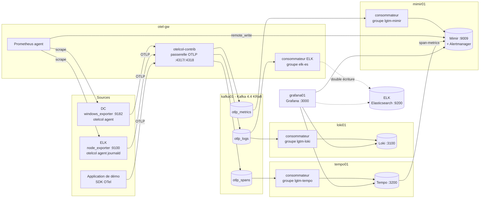
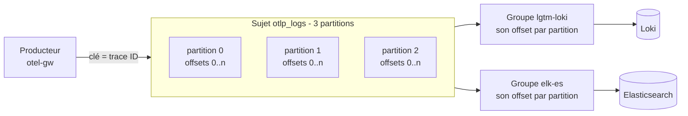
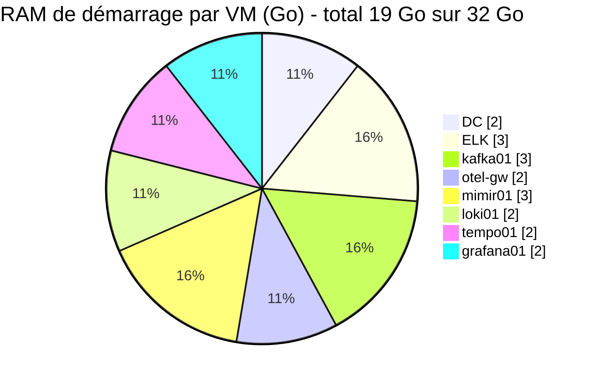
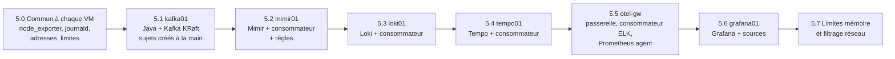
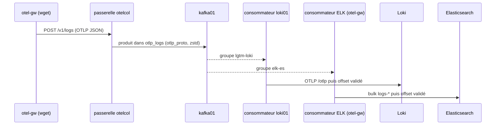
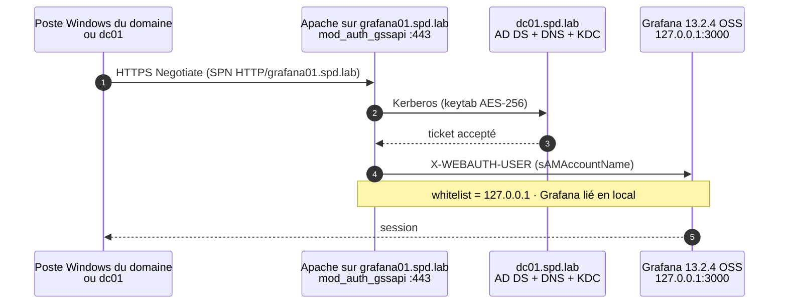

# Runbook – Pile LGTM + Apache Kafka hors ligne sur Debian 13, une VM par service (lab Hyper-V) – version DNS (DC)

**Cible :** six nouvelles VM Debian **13 « trixie »** amd64, **sans accès Internet**, une par service : **kafka01** (Apache Kafka en mode KRaft), **otel-gw** (passerelle OpenTelemetry Collector), **mimir01**, **loki01**, **tempo01** et **grafana01**. Elles s'ajoutent aux VM existantes **DC**, **ELK** et **AppDynamics** (éteinte). Tous les outils tournent en **services systemd natifs** (paquets `.deb`, archives officielles), **sans Docker**.
**Poste Windows connecté :** il **télécharge seulement** les fichiers officiels, produit un manifeste et une archive, puis les copie par SCP/SFTP. Les vérifications d'empreintes et de signatures, l'installation et la configuration se font **sur Linux**.
**Objectif :** une vraie pile LGTM (Grafana **Mimir** pour les métriques, Loki pour les journaux, Tempo pour les traces, Grafana pour la consultation) dont toute l'ingestion OTLP passe par **Kafka**. Kafka sert de **tampon** entre la passerelle et les stockages, et permet à **ELK et Loki de lire les mêmes journaux, chacun avec son groupe de consommateurs** : c'est le cœur de la migration Strangler Fig du plan `Plan_integration_observabilite_lab.md`.

Le runbook suit cet ordre :
- **Section 2 – Kafka en pratique** : initiation courte (sujets, partitions, offsets, groupes de consommateurs, rétention, KRaft), appliquée à ce lab.
- **Étape 1 – Téléchargement depuis Windows** (section 3) : script PowerShell (LGTM + Kafka + Java), manifeste SHA-256, archive, transfert, vérification sur Linux, distribution aux VM.
- **Étape 2 – Restructuration de l'infrastructure** (section 4) : vCPU, RAM, disque et adresse de chaque VM, commandes Hyper-V, **enregistrements DNS sur le DC**, installation de Debian.
- **Étape 3 – Installation VM par VM** (section 5) : kafka01, mimir01, loki01, tempo01, otel-gw, grafana01.
- **Étape 4 – Agents sur la VM ELK et le DC** (section 6).
- **Étape 5 – Tests de bout en bout** (section 7) : un journal, une métrique et une trace suivis dans Kafka, puis dans Grafana et Kibana ; panne simulée d'un consommateur.

Documents compagnons dans `architecture-lgtm/` : `README.md` (carte des documents, versions), **`GUARDRAILS.md` (garde-fous à lire avant toute intervention)** et les documents `01` à `08` (vue d'ensemble, flux, ports, ADR, dimensionnement, sécurité, migration, exploitation).

> **Hypothèses à valider :**
> - Hôte Hyper-V : **32 Go de RAM** (confirmé). Nombre de processeurs logiques **inconnu** : on suppose **8 ou plus** ; la section 4.1 donne la variante pour 4 processeurs logiques.
> - VM existantes : **DC** (Windows Server, AD DS + DNS), **ELK** (Debian 13, Elasticsearch 9 + Kibana, ElastAlert 2 en service systemd), **AppDynamics** (éteinte). **Leurs ressources ne changent pas** : DC 1 vCPU, 2 Go (1–2 Go) ; ELK 2 vCPU, 3 Go (2–4 Go), comme dans la section 2 du plan.
> - Réseau : un vSwitch Hyper-V du lab, **adresses IPv4 fixes**. **Le DC sert de DNS** : chaque VM a un enregistrement A (et PTR) dans la zone du domaine, et les configurations utilisent les **noms complets** (FQDN) au lieu des adresses.
> - Elasticsearch 9 a la sécurité activée (TLS sur 9200, authentification), avec le CA HTTP dans `/etc/elasticsearch/certs/http_ca.crt` sur la VM ELK.
> - Les ressources sont des valeurs de **démonstration**, pas de production. Kafka tourne avec **un seul broker** : aucune réplication.
> - Le plan d'intégration existant n'est **pas modifié** ; chaque écart est expliqué en section 4.2.

> **Version DNS simple.** Même contenu que le runbook « version IP » (`Runbook_LGTM_Kafka_Offline_Debian13.md`), avec le **DC comme DNS** : section 4.4 (enregistrements sur le DC), section 4.5 (DNS sur chaque VM), noms complets dans les configurations, dépannage DNS en 9.1. Pas de `/etc/hosts` à remplir, pas de fichier de paramètres.

### Valeurs d'exemple à remplacer

Les commandes utilisent directement ces valeurs d'exemple (`192.0.2.0/24` est une plage de documentation). Remplace-les par les tiennes **partout** (`grep -rn 'lab.example.test\|192.0.2' fichier` aide à les retrouver) :

| Élément | Valeur d'exemple | FQDN |
|---|---|---|
| Domaine AD (zone DNS) | `lab.example.test` | – |
| Réseau du lab / passerelle | `192.0.2.0/24` / `192.0.2.1` | – |
| DC (serveur DNS) | `192.0.2.10` | `dc.lab.example.test` |
| ELK | `192.0.2.11` | `elk.lab.example.test` |
| kafka01 | `192.0.2.21` | `kafka01.lab.example.test` |
| otel-gw | `192.0.2.22` | `otel-gw.lab.example.test` |
| mimir01 | `192.0.2.23` | `mimir01.lab.example.test` |
| loki01 | `192.0.2.24` | `loki01.lab.example.test` |
| tempo01 | `192.0.2.25` | `tempo01.lab.example.test` |
| grafana01 | `192.0.2.26` | `grafana01.lab.example.test` |

### Versions épinglées (vérifiées le 28 oct. 2026)

| Composant | Version | VM | Artefact | Vérification amont disponible |
|---|---|---|---|---|
| **Apache Kafka** | **4.4.0** (Scala 2.13, sortie le 22 oct. 2026) | kafka01 | `kafka_2.13-4.4.0.tgz` (`downloads.apache.org`, secours `archive.apache.org`) | `.sha512` publié + signature **`.asc`** (fichier `KEYS` du projet) |
| **Java** : Eclipse Temurin JRE | **25.0.5+8** (LTS) | kafka01 | `OpenJDK25U-jre_x64_linux_hotspot_25.0.5_8.tar.gz` (GitHub Adoptium) | `.sha256.txt` publié + signature **`.sig`** (clé Adoptium) |
| Grafana OSS | **13.2.4** (build 38252365904) | grafana01 | `.deb` sur `dl.grafana.com` | `.sha256` publié + index APT Grafana **signé GPG** |
| Grafana Mimir + mimirtool | **3.2.3** | mimir01 | `.deb` (GitHub) | `-sha-256` publié + index APT Grafana signé |
| Grafana Loki | **3.7.9** | loki01 | `.deb` (GitHub) | index APT Grafana signé |
| Grafana Tempo | **3.1.1** | tempo01 | `.deb` (GitHub) | `SHA256SUMS` + index APT Grafana signé |
| OpenTelemetry Collector contrib | **0.164.0** | otel-gw, mimir01, loki01, tempo01, ELK, DC | `.deb` + `.msi` | `.sha256` par fichier |
| Prometheus (mode agent) | **3.15.1** | otel-gw | `tar.gz` (GitHub) | `sha256sums.txt` |
| node_exporter | **1.12.1** | toutes les VM Linux | `tar.gz` (GitHub) | `sha256sums.txt` |
| windows_exporter | **0.32.0** | DC | `.msi` | `sha256sums.txt` |
| Debian (ISO) | **13.7.0** netinst amd64 | nouvelles VM | `.iso` | `SHA256SUMS` **signé GPG** |

> **Kafka 4.4.0 :** c'est la version la plus récente sur `downloads.apache.org` le 28 oct. 2026 (les branches 4.1 à 4.3 y sont aussi). La documentation de Kafka 4.4 indique que **Java 17, 21 et 25** sont pris en charge et recommande la dernière LTS (Java 25) ([version de Java](https://kafka.apache.org/44/operations/java-version/)). Kafka 4.x fonctionne **uniquement en mode KRaft** : ZooKeeper n'existe plus.
>
> **Pourquoi Temurin plutôt que le paquet Debian `openjdk-21-jre-headless` ?** Le paquet Debian (21.0.13 dans trixie) dépend de `ca-certificates-java`, `java-common`, `libnss3`, `libpcsclite1`, `libjpeg62-turbo`, `liblcms2-2` et d'autres paquets absents de l'ISO netinst : il faudrait télécharger et vérifier une dizaine de `.deb`. L'archive Temurin est **un seul fichier autonome**, avec une empreinte et une signature GPG vérifiables par `sqv`. C'est le chemin hors ligne le plus simple.
>
> **Grafana 13.2.4 et pas 13.3.0 :** la 13.3.0 (27 oct. 2026) n'était pas encore dans l'index signé du dépôt APT Grafana le 28 oct. ; la 13.2.4 y figure, sa signature est donc vérifiable hors ligne.

---

## 0. Démarrage rapide (résumé)

> Séquence condensée, détaillée plus bas. **Checkpoint Hyper-V** de chaque VM avant chaque changement (section 4.3, `architecture-lgtm/GUARDRAILS.md`).

**Poste Windows**

```powershell
powershell -ExecutionPolicy Bypass -File .\Telecharger-LGTM-Kafka.ps1   # §3.4 : C:\lgtm-telechargement + C:\lgtm-iso + C:\lgtm-bundle-AAAAMMJJ.tar
scp.exe -r C:\lgtm-iso admin@192.0.2.11:/var/tmp/                          # §3.8.1 : l'ISO est vérifiée sur la VM ELK
# §4.3 : création des 6 VM (Hyper-V), §4.4 : enregistrements A + PTR sur le DC, §4.5 : installation de Debian, adresse fixe, DNS = DC
scp.exe C:\lgtm-bundle-AAAAMMJJ.tar C:\lgtm-bundle-AAAAMMJJ.tar.sha256 admin@192.0.2.22:/var/tmp/
```

**otel-gw (root) : vérification complète puis distribution**

```bash
cd /var/tmp && sha256sum -c lgtm-bundle-*.tar.sha256 && tar xf lgtm-bundle-*.tar
cd /var/tmp/lgtm-telechargement && bash /var/tmp/verifier-lgtm.sh       # §3.8.2 : manifeste, empreintes, GPG (Grafana, Kafka, Temurin)
bash /var/tmp/distribuer-lot.sh                                         # §3.9 : chaque VM reçoit seulement ses fichiers
```

**Chaque VM (root), dans cet ordre :** kafka01 (§5.1, sujets créés à la main) → mimir01 (§5.2) → loki01 (§5.3) → tempo01 (§5.4) → otel-gw (§5.5) → grafana01 (§5.6) → agents ELK et DC (§6) → tests (§7) → test SSO Grafana contre dc01 (§8, **non testé**).

---

## 1. Architecture et choix techniques

### 1.1 Une VM par service, Kafka au centre



| VM | Rôle | Services systemd |
|---|---|---|
| **kafka01** | Tampon durable entre l'ingestion et les stockages | `kafka` (broker + contrôleur KRaft), `node_exporter` |
| **otel-gw** | Façade d'ingestion : reçoit l'OTLP, **produit** dans Kafka ; consommateur ELK ; collecte Prometheus ; supervision de Kafka | `otelcol-contrib`, `prometheus` (agent), `node_exporter` |
| **mimir01** | Métriques + règles + Alertmanager | `mimir`, `otelcol-contrib` (consommateur `otlp_metrics`), `node_exporter` |
| **loki01** | Journaux | `loki`, `otelcol-contrib` (consommateur `otlp_logs`), `node_exporter` |
| **tempo01** | Traces | `tempo`, `otelcol-contrib` (consommateur `otlp_spans`), `node_exporter` |
| **grafana01** | Façade de consultation | `grafana-server`, `node_exporter` |

### 1.2 Choix retenus (détail dans `architecture-lgtm/04_Decisions_architecture_ADR.md`)

- **Kafka en mode KRaft combiné, un seul nœud.** Un processus joue à la fois **broker** (il stocke les messages) et **contrôleur** (il gère les métadonnées du cluster, ce que faisait ZooKeeper). Un seul nœud suffit pour apprendre et pour un lab ; il n'y a **aucune réplication** (facteur 1). Les sujets sont **créés à la main** (`auto.create.topics.enable=false`).
- **Trois sujets, un par signal :** `otlp_logs`, `otlp_metrics`, `otlp_spans` (noms par défaut de l'exportateur et du récepteur Kafka d'OpenTelemetry), **3 partitions** chacun, messages au format `otlp_proto`. Trois partitions permettent de voir concrètement la répartition des messages et, plus tard, d'ajouter des consommateurs en parallèle.
- **Les consommateurs tournent sur chaque VM de stockage** (mimir01, loki01, tempo01), qui écrivent en local (`127.0.0.1`). Raisons : (1) chaque stockage a son propre groupe de consommateurs, son propre retard (*lag*) et son propre cycle de redémarrage, ce qui rend le fonctionnement de Kafka visible ; (2) une panne de Loki ne touche que le groupe `lgtm-loki` ; (3) les API d'écriture des stockages (`/otlp`, OTLP de Tempo) restent sur la boucle locale ; (4) la règle « une VM par service » est respectée : le consommateur est l'entrée du service. **Exception :** le consommateur **ELK** (groupe `elk-es`) tourne sur **otel-gw**, car les ressources de la VM ELK ne doivent pas augmenter ; il disparaît en phase 6.
- **Livraison « au moins une fois » :** les consommateurs valident leur offset **après** l'écriture réussie (`message_marking.after: true`), sans file d'envoi en mémoire (`sending_queue.enabled: false`) ni processeur `batch`, et réessaient sans limite (`error_backoff`). Si Loki est arrêté, ses messages attendent dans Kafka ; ils sont écrits au redémarrage (testé, section 7.3). Un doublon reste possible après un arrêt brutal.
- **Prometheus en mode agent sur otel-gw.** otel-gw est la VM de **collecte** : elle reçoit (OTLP) et va chercher (*scrape*). Prometheus agent écrit directement dans Mimir (`remote_write`), **sans passer par Kafka** : Prometheus ne sait pas produire dans Kafka, et son WAL local sert déjà de tampon si Mimir est indisponible. grafana01 reste dédiée à la consultation.
- **Supervision de Kafka par otel-gw :** le récepteur `kafka_metrics` d'otelcol-contrib lit les offsets et calcule le **retard de chaque groupe** (`kafka_consumer_group_lag`), envoyé directement à Mimir (pas via Kafka, pour rester visible même si Kafka est saturé).
- **Mimir en architecture classique.** Mimir 3 peut utiliser Kafka en interne (*ingest storage*), mais ce serait une deuxième utilisation de Kafka, plus complexe ; ici Kafka sert de tampon **devant** Mimir. Voir l'ADR-003.
- **Alloy non retenu** (doublon avec otelcol-contrib) ; **Alertmanager intégré à Mimir**.

### 1.3 Ports par VM

| VM | Service | Port | Écoute | Joignable depuis |
|---|---|---|---|---|
| kafka01 | Kafka (clients, `PLAINTEXT`) | **9092** | 0.0.0.0 | otel-gw, mimir01, loki01, tempo01 |
| kafka01 | Kafka (contrôleur KRaft) | **9093** | 127.0.0.1 | personne (un seul nœud) |
| otel-gw | otelcol-contrib (OTLP gRPC / HTTP) | 4317 / 4318 | 0.0.0.0 | DC, ELK, application de démo |
| otel-gw | otelcol-contrib (métriques internes) | 8888 | 127.0.0.1 | Prometheus local |
| otel-gw | Prometheus agent | 9090 | 127.0.0.1 | local |
| mimir01 | Mimir HTTP (`/prometheus`, `/otlp`, `/api/v1/push`, `/alertmanager`) | 9009 | 0.0.0.0 | grafana01, otel-gw, tempo01, loki01 |
| mimir01 | Mimir gRPC, memberlist | 9097, 7946 | 127.0.0.1 | – |
| loki01 | Loki HTTP | 3100 | 0.0.0.0 | grafana01, otel-gw |
| loki01 | Loki gRPC | 9096 | 127.0.0.1 | – |
| tempo01 | Tempo HTTP | 3200 | 0.0.0.0 | grafana01, otel-gw |
| tempo01 | Tempo gRPC, OTLP | 9095, 4417/4418 | 127.0.0.1 | consommateur local |
| mimir01, loki01, tempo01 | otelcol-contrib consommateur (métriques internes) | 8888 | 0.0.0.0 | otel-gw (Prometheus) |
| grafana01 | Grafana | 3000 | 0.0.0.0 | postes d'administration |
| toutes les VM Linux | node_exporter | 9100 | 0.0.0.0 | otel-gw (Prometheus) |

> Mimir, Loki et Tempo n'ont **aucune authentification** (`multitenancy_enabled: false`, `auth_enabled: false`). Leur port HTTP est désormais joignable sur le réseau du lab : limite-le aux VM listées avec `nftables` (`architecture-lgtm/03_Matrice_reseau_ports.md`, §5). Les ports gRPC restent distincts (9097, 9096, 9095), comme dans la version précédente : inutile sur des VM séparées, mais sans inconvénient, et cela permet de tester les trois sur une même machine.

---
## 2. Kafka en pratique : initiation appliquée au lab

> Lecture conseillée avant la section 5.1. Toutes les commandes se lancent **sur kafka01** (`sudo -i`), une fois Kafka installé ; `kafka-*.sh` est dans le `PATH` grâce à `/etc/profile.d/kafka.sh` (§5.1). Référence : [documentation Kafka 4.4](https://kafka.apache.org/44/), [démarrage rapide](https://kafka.apache.org/44/getting-started/quickstart/).

### 2.1 Les notions, dans ce lab

| Notion | Définition courte | Dans ce lab |
|---|---|---|
| **Broker** | Serveur Kafka qui reçoit, stocke sur disque et sert les messages. | Un seul : kafka01, port 9092. |
| **Contrôleur (KRaft)** | Gère les métadonnées (sujets, partitions, leaders) avec le protocole Raft. Remplace ZooKeeper, supprimé dans Kafka 4. | Le même processus que le broker (`process.roles=broker,controller`), port 9093 sur la boucle locale. |
| **Sujet** (*topic*) | Flux nommé de messages, comme une table qu'on ne fait qu'allonger. | `otlp_logs`, `otlp_metrics`, `otlp_spans`. |
| **Partition** | Morceau d'un sujet. Chaque partition est un fichier journal ordonné ; l'ordre n'est garanti **qu'à l'intérieur** d'une partition. | 3 par sujet. Les spans d'une même trace vont dans la même partition (`partition_traces_by_id`). |
| **Offset** | Numéro d'un message dans sa partition (0, 1, 2…). Il ne change jamais. | Visible avec `kafka-get-offsets.sh` et `kafka-consumer-groups.sh`. |
| **Producteur** | Programme qui écrit dans un sujet. | L'exportateur `kafka` d'otelcol-contrib sur otel-gw. |
| **Consommateur** | Programme qui lit un sujet. Il **ne supprime rien** : il mémorise seulement jusqu'où il a lu. | Le récepteur `kafka` d'otelcol-contrib sur mimir01, loki01, tempo01 et otel-gw (ELK). |
| **Groupe de consommateurs** | Ensemble de consommateurs qui se partagent les partitions d'un sujet. Chaque groupe a **ses propres offsets validés** (*committed offsets*). | `lgtm-mimir`, `lgtm-loki`, `lgtm-tempo`, `elk-es`. **`lgtm-loki` et `elk-es` lisent tous les deux `otlp_logs`, chacun à son rythme.** |
| **Retard** (*lag*) | Messages écrits mais pas encore lus par un groupe = offset de fin − offset validé. | Métrique `kafka_consumer_group_lag` dans Mimir, alerte `KafkaRetardConsommateur`. |
| **Rétention** | Durée ou taille au-delà de laquelle Kafka supprime les plus vieux segments, **lus ou non**. | 24 h **ou** 2 Gio (journaux) / 1 Gio (métriques, traces) **par partition**. |
| **Segment** | Fichier d'une partition sur disque ; la rétention supprime des segments entiers. | 256 Mio (`segment.bytes`). |
| **Facteur de réplication** | Nombre de copies de chaque partition sur des brokers différents. | 1 (un seul broker) : une panne disque de kafka01 perd les messages non encore consommés. |



### 2.2 Ce que Kafka apporte au lab

1. **Tampon :** si Loki, Mimir ou Tempo s'arrête, la passerelle continue d'écrire dans Kafka ; le consommateur rattrape son retard au redémarrage, sans perte tant que la rétention n'est pas dépassée.
2. **Lectures multiples indépendantes :** un nouveau groupe peut lire le même sujet sans rien changer aux autres. C'est ce qui permet la **double consommation ELK + Loki** du Strangler Fig, puis le retrait d'ELK en supprimant seulement le groupe `elk-es`.
3. **Relecture :** on peut remettre l'offset d'un groupe en arrière (§2.4) et réinjecter les dernières 24 h dans un stockage vidé ou reconstruit.
4. **Découplage :** la passerelle ne connaît plus les stockages, seulement Kafka. Ajouter une destination = ajouter un consommateur.

### 2.3 Commandes de base (sur kafka01)

```bash
B=127.0.0.1:9092
kafka-topics.sh --bootstrap-server $B --list                       # sujets
kafka-topics.sh --bootstrap-server $B --describe --topic otlp_logs # partitions, leader, réplicas, configuration
kafka-get-offsets.sh --bootstrap-server $B --topic otlp_logs       # offset de fin de chaque partition
kafka-consumer-groups.sh --bootstrap-server $B --list              # groupes
kafka-consumer-groups.sh --bootstrap-server $B --describe --group lgtm-loki   # CURRENT-OFFSET, LOG-END-OFFSET, LAG
kafka-configs.sh --bootstrap-server $B --describe --entity-type topics --entity-name otlp_logs   # rétention du sujet
du -sh /var/lib/kafka/data/otlp_logs-*                             # place occupée par partition
```

Lire les **derniers messages** sans toucher aux groupes du lab (un groupe temporaire `console-consumer-*` est créé) :

```bash
kafka-console-consumer.sh --bootstrap-server $B --topic otlp_logs --from-beginning --max-messages 3 \
  --formatter-property print.partition=true --formatter-property print.offset=true --formatter-property print.timestamp=true \
  2>/dev/null | tr -c '[:print:]\n' '.'
```

Extrait de sortie (test du 28 oct. 2026) :

```text
CreateTime:1793215925436.Partition:2.Offset:0.
o.M.IR....~...tJ.[........i.3.?..*.
.bonjour kafka bout-en-bout..INFO.+...b...
…
test-kafka
.service.name
CreateTime:1793216094935.Partition:2.Offset:1.
```

Les messages sont au format **protobuf** (binaire) : `tr` remplace les octets non imprimables par des points ; le texte des journaux et les noms d'attributs restent lisibles (testé : `bonjour kafka …`, `service.name`, `test-kafka`). Dans Kafka 4.4, `--property` est remplacé par `--formatter-property`. Sans `2>/dev/null`, les outils affichent aussi des avertissements sans gravité : `The consumer rebalance protocol (KIP-848) is production-ready!…` et, avec Java 25, `WARNING: A restricted method in java.lang.System has been called` (bibliothèque native de compression `zstd`).

### 2.4 Exercices guidés (lab)

1. **Voir la double consommation :** envoie un journal de test (§7.1), puis `kafka-consumer-groups.sh --describe --group lgtm-loki` et `--group elk-es` : les deux groupes ont avancé du même nombre d'offsets sur la même partition.
2. **Provoquer un retard :** `systemctl stop loki` sur loki01, envoie 5 journaux, puis regarde `LAG = 5` pour `lgtm-loki` et `LAG = 0` pour `elk-es`. `systemctl start loki` : le retard revient à 0 en moins d'une minute et les 5 journaux apparaissent dans Loki (testé, §7.3).
3. **Relire depuis le début (groupe arrêté obligatoire) :**

```bash
# Sur loki01 : arrêter le consommateur (le groupe doit être vide pour changer ses offsets)
systemctl stop otelcol-contrib
# Sur kafka01 : simulation, puis exécution
kafka-consumer-groups.sh --bootstrap-server $B --group lgtm-loki --topic otlp_logs --reset-offsets --to-earliest --dry-run
kafka-consumer-groups.sh --bootstrap-server $B --group lgtm-loki --topic otlp_logs --reset-offsets --to-earliest --execute
# Sur loki01 :
systemctl start otelcol-contrib
```

   Loki reçoit alors une deuxième fois les journaux encore présents dans Kafka (doublons possibles côté Loki). À faire seulement sur un stockage vidé ou pour l'exercice. L'option `--to-datetime 2026-10-28T12:00:00.000` relit à partir d'une heure donnée.
4. **Observer la rétention :** `kafka-get-offsets.sh --time -2` donne le plus vieil offset encore conservé, `--time -1` le dernier. Le lendemain, le plus vieil offset a avancé : les messages de plus de 24 h ont été supprimés.

### 2.5 Pièges à connaître

- **Kafka n'est pas une base de données :** au-delà de la rétention, les messages disparaissent même si un groupe ne les a pas lus. Un consommateur arrêté plus de 24 h **perd des données** : l'alerte `KafkaConsommateurAbsent` existe pour cela.
- **`retention.bytes` est par partition**, pas par sujet : 3 partitions × 2 Gio = 6 Gio pour `otlp_logs`.
- **Création automatique désactivée :** un producteur qui écrit dans un sujet inexistant reçoit une erreur (testé : `UnknownTopicOrPartitionException`), au lieu de créer un sujet mal dimensionné.
- **`advertised.listeners`** doit contenir le nom que les **clients** utilisent (`kafka01.lab.example.test:9092`, résolu par le DC) : le broker renvoie ce nom aux clients après la première connexion.
- **Ne jamais reformater le stockage** (`kafka-storage.sh format`) d'un broker en service : l'identifiant de cluster change et toutes les données sont perdues.

---
## 3. Étape 1 – Téléchargement depuis le poste Windows

```mermaid
flowchart LR
  A1[3.1 Poste Windows<br/>curl.exe, tar.exe, OpenSSH client] --> A2[3.2 Inventaire<br/>32 fichiers + 4 pour l'ISO]
  A2 --> A3[3.3 Motifs d'URL vérifiés]
  A3 --> A4[3.4 Telecharger-LGTM-Kafka.ps1<br/>versions épinglées en tête]
  A4 --> A5[3.5 Dépendances Debian<br/>adduser, systemd]
  A5 --> A6[3.6 Manifeste SHA-256<br/>+ archive .tar]
  A6 --> A7[3.7 Transfert scp / sftp / WinSCP]
  A7 --> A8[3.8 Sur otel-gw : sha256sum -c,<br/>empreintes amont, sqv GPG]
  A8 --> A9[3.9 Distribution aux VM<br/>+ recontrôle sur chaque VM]
```



Le poste Windows **ne fait que télécharger, empaqueter et copier**. Il ne vérifie rien : le manifeste qu'il produit sert seulement à prouver, côté Linux, que le transfert n'a rien altéré. Les vérifications d'authenticité (empreintes publiées par chaque projet, signatures GPG de Grafana, Kafka, Temurin et Debian) se font **sur Linux**, sur **otel-gw** (section 3.8), qui distribue ensuite à chaque VM ses fichiers (section 3.9).

### 3.1 Prérequis du poste Windows

- Windows 10 1809 ou plus récent, ou Windows 11 : `curl.exe` et `tar.exe` sont fournis avec le système ([curl et tar dans Windows](https://curl.se/windows/microsoft.html)), ainsi que le client OpenSSH (`scp.exe`, `sftp.exe`) ([OpenSSH pour Windows](https://learn.microsoft.com/en-us/windows-server/administration/openssh/openssh_install_firstuse)). WinSCP convient aussi pour le transfert.
- Accès HTTPS (proxy accepté) à : `github.com` et `objects.githubusercontent.com` / `release-assets.githubusercontent.com` (redirections des releases), `dl.grafana.com`, `apt.grafana.com`, `downloads.apache.org` (secours : `archive.apache.org`), `packages.adoptium.net`, `deb.debian.org`, `cdimage.debian.org` (et ses miroirs de redirection), `keyring.debian.org`.
- Espace disque : ≈ **1,1 Go** pour `C:\lgtm-telechargement`, ≈ **0,8 Go** pour `C:\lgtm-iso`, et ≈ **1,1 Go** pour l'archive `.tar`. Prévoir **4 Go** libres.
- Analyse antivirus des dossiers selon ta politique habituelle.

### 3.2 Inventaire des fichiers

**Lot des VM et des agents** (`C:\lgtm-telechargement`, 32 fichiers, ≈ 1,12 Go) :

| # | Dossier | Fichier | Taille | Rôle | Vérification sur Linux (§3.8) |
|---|---|---|---|---|---|
| 1 | `grafana` | `grafana_13.2.4_38252365904_linux_amd64.deb` | 381 Mo | Grafana OSS | empreinte runbook + `.sha256` + index APT signé |
| 2 | `grafana` | `grafana_13.2.4_38252365904_linux_amd64.deb.sha256` | 65 o | empreinte publiée | – |
| 3 | `grafana` | `gpg-full.key` | 8 Ko | clés publiques du dépôt APT Grafana | empreinte de clé `B53AE77BADB630A683046005963FA27710458545` |
| 4 | `grafana-apt` | `InRelease` | 8 Ko | index du dépôt, **signé** | `sqv` avec `gpg-full.key` |
| 5 | `grafana-apt` | `Packages.gz` | 428 Ko | liste des paquets et SHA-256 | empreinte lue dans `InRelease` |
| 6 | `mimir` | `mimir-3.2.3_amd64.deb` | 38 Mo | Mimir | empreinte runbook + `-sha-256` + index APT signé |
| 7 | `mimir` | `mimir-3.2.3_amd64.deb-sha-256` | 65 o | empreinte publiée | – |
| 8 | `mimir` | `mimirtool_3.2.3_amd64.deb` | 29 Mo | outil CLI (règles, contrôles) | empreinte runbook + `-sha-256` + index APT signé |
| 9 | `mimir` | `mimirtool_3.2.3_amd64.deb-sha-256` | 65 o | empreinte publiée | – |
| 10 | `loki` | `loki_3.7.9_amd64.deb` | 47 Mo | Loki | empreinte runbook + index APT signé |
| 11 | `loki` | `SHA256SUMS` | 3 Ko | empreintes de la release (zip seulement) | conservé pour traçabilité |
| 12 | `tempo` | `tempo_3.1.1_linux_amd64.deb` | 73 Mo | Tempo | empreinte runbook + `SHA256SUMS` + index APT signé |
| 13 | `tempo` | `SHA256SUMS` | 1 Ko | empreintes de la release | – |
| 14 | `prometheus` | `prometheus-3.15.1.linux-amd64.tar.gz` | 112 Mo | Prometheus (mode agent), `promtool` | empreinte runbook + `sha256sums.txt` |
| 15 | `prometheus` | `sha256sums.txt` | 4 Ko | empreintes de la release | – |
| 16 | `node_exporter` | `node_exporter-1.12.1.linux-amd64.tar.gz` | 12 Mo | métriques système Linux | empreinte runbook + `sha256sums.txt` |
| 17 | `node_exporter` | `sha256sums.txt` | 2 Ko | empreintes de la release | – |
| 18 | `otelcol-contrib` | `otelcol-contrib_0.164.0_linux_amd64.deb` | 116 Mo | collecteur (otel-gw, consommateurs, agent ELK) | empreinte runbook + `.sha256` |
| 19 | `otelcol-contrib` | `otelcol-contrib_0.164.0_linux_amd64.deb.sha256` | 64 o | empreinte publiée | – |
| 20 | `windows` | `otelcol-contrib_0.164.0_windows_x64.msi` | 103 Mo | agent du DC (service Windows) | empreinte runbook + `.sha256` |
| 21 | `windows` | `otelcol-contrib_0.164.0_windows_x64.msi.sha256` | 64 o | empreinte publiée | – |
| 22 | `windows` | `windows_exporter-0.32.0-amd64.msi` | 15 Mo | métriques du DC (service Windows) | empreinte runbook + `sha256sums.txt` |
| 23 | `windows` | `sha256sums.txt` | 404 o | empreintes de la release | – |
| 24 | `debian` | `adduser_3.152_all.deb` | 191 Ko | dépendance de secours (§3.5) | empreinte runbook (index Debian signé) |
| 25 | `kafka` | `kafka_2.13-4.4.0.tgz` | 135 Mo | Apache Kafka 4.4.0 (kafka01) | empreinte runbook + `.sha512` + signature `.asc` |
| 26 | `kafka` | `kafka_2.13-4.4.0.tgz.sha512` | 210 o | empreinte SHA-512 publiée (format `gpg --print-md`) | – |
| 27 | `kafka` | `kafka_2.13-4.4.0.tgz.asc` | 870 o | signature OpenPGP détachée | `sqv` avec `KEYS` ; signataire attendu `1817 905E 3B27 08B1 1A24 B88E 9AFA 6F66 CC8C 3534` |
| 28 | `kafka` | `KEYS` | 172 Ko | clés publiques des responsables de version Kafka | – |
| 29 | `java` | `OpenJDK25U-jre_x64_linux_hotspot_25.0.5_8.tar.gz` | 62 Mo | Java (Eclipse Temurin JRE 25) pour Kafka | empreinte runbook + `.sha256.txt` + signature `.sig` |
| 30 | `java` | `OpenJDK25U-jre_x64_linux_hotspot_25.0.5_8.tar.gz.sha256.txt` | 115 o | empreinte publiée | – |
| 31 | `java` | `OpenJDK25U-jre_x64_linux_hotspot_25.0.5_8.tar.gz.sig` | 310 o | signature OpenPGP détachée | `sqv` avec `adoptium-public.key` ; signataire attendu `3B04 D753 C905 0D9A 5D34 3F39 843C 48A5 65F8 F04B` |
| 32 | `java` | `adoptium-public.key` | 2 Ko | clé publique Adoptium | empreinte publiée sur [adoptium.net](https://adoptium.net/installation/gpg-verification) |

Le script ajoute `MANIFEST-SHA256.txt` à la racine du dossier (33ᵉ fichier).

**Lot ISO** (`C:\lgtm-iso`, 4 fichiers, ≈ 793 Mo) : `debian-13.7.0-amd64-netinst.iso` (793 Mo), `SHA256SUMS`, `SHA256SUMS.sign`, `debian-cd-signing-key.asc` (clé publique « Debian CD signing key », empreinte `DF9B 9C49 EAA9 2984 3258 9D76 DA87 E80D 6294 BE9B`, publiée sur [debian.org/CD/verify](https://www.debian.org/CD/verify)). Il est vérifié sur la VM ELK, qui existe déjà et tourne sous Debian 13 (§3.8.1), avant la création des nouvelles VM.

### 3.3 Motifs d'URL (vérifiés le 28 oct. 2026)

Chaque URL ci-dessous a répondu `200` et le fichier téléchargé correspond à l'empreinte publiée.

| Projet | Motif | Remarque |
|---|---|---|
| Grafana | `https://dl.grafana.com/grafana/release/<V>/grafana_<V>_<BUILD>_linux_amd64.deb` (+ `.sha256`) | Depuis Grafana 12.2.0 (constat sur l’API publique), le nom contient un **numéro de build**. Il se lit dans l'API publique `https://grafana.com/api/downloads/grafana/versions/<V>` (champ `url` du paquet `deb`/`amd64`), ou sur la page de téléchargement. L'ancien motif `dl.grafana.com/oss/release/grafana_<V>_amd64.deb` répond encore, mais n'est pas utilisé ici. |
| Dépôt APT Grafana | `https://apt.grafana.com/dists/stable/InRelease`, `.../main/binary-amd64/Packages.gz`, clé `https://apt.grafana.com/gpg-full.key` | `InRelease` est régénéré chaque jour : télécharge `InRelease` et `Packages.gz` **ensemble** (le script le fait). |
| Mimir | `https://github.com/grafana/mimir/releases/download/mimir-<V>/mimir-<V>_amd64.deb` (+ `-sha-256`), `.../mimirtool_<V>_amd64.deb` (+ `-sha-256`) | Le tag est `mimir-<V>` (pas `v<V>`) ; le paquet `mimir` utilise un tiret, `mimirtool` un souligné. |
| Loki | `https://github.com/grafana/loki/releases/download/v<V>/loki_<V>_amd64.deb`, `.../SHA256SUMS` | `SHA256SUMS` ne liste que les `.zip` : le `.deb` est vérifié par l'index APT signé et par l'empreinte du runbook. |
| Tempo | `https://github.com/grafana/tempo/releases/download/v<V>/tempo_<V>_linux_amd64.deb`, `.../SHA256SUMS` | |
| Prometheus | `https://github.com/prometheus/prometheus/releases/download/v<V>/prometheus-<V>.linux-amd64.tar.gz`, `.../sha256sums.txt` | |
| node_exporter | `https://github.com/prometheus/node_exporter/releases/download/v<V>/node_exporter-<V>.linux-amd64.tar.gz`, `.../sha256sums.txt` | |
| OTel Collector | `https://github.com/open-telemetry/opentelemetry-collector-releases/releases/download/v<V>/otelcol-contrib_<V>_linux_amd64.deb` et `..._windows_x64.msi` (+ `.sha256` chacun) | Les fichiers `.sigstore.json` (Sigstore/cosign) existent aussi ; ils exigent `cosign`, non disponible hors ligne ici. |
| windows_exporter | `https://github.com/prometheus-community/windows_exporter/releases/download/v<V>/windows_exporter-<V>-amd64.msi`, `.../sha256sums.txt` | |
| Debian (paquet) | `https://deb.debian.org/debian/pool/main/<initiale>/<source>/<paquet>_<version>_<arch>.deb` | Chemin exact et SHA-256 lisibles sur `https://packages.debian.org/trixie/amd64/<paquet>/download`. |
| Debian (ISO) | `https://cdimage.debian.org/cdimage/release/<V>/amd64/iso-cd/debian-<V>-amd64-netinst.iso`, `SHA256SUMS`, `SHA256SUMS.sign` | Le chemin `release/<V>` reste stable, contrairement à `current/`. |
| Apache Kafka | `https://downloads.apache.org/kafka/<V>/kafka_2.13-<V>.tgz` (+ `.sha512`, `.asc`), `https://downloads.apache.org/kafka/KEYS` | `downloads.apache.org` ne garde que les versions maintenues (4.1.2 à 4.4.0 le 28 oct. 2026) ; `https://archive.apache.org/dist/kafka/<V>/` les garde toutes, mais il est beaucoup plus lent (≈ 80 Ko/s observés). Le script essaie le premier, puis le second. |
| Eclipse Temurin | `https://github.com/adoptium/temurin25-binaries/releases/download/jdk-<V>/OpenJDK25U-jre_x64_linux_hotspot_<V_>.tar.gz` (+ `.sha256.txt`, `.sig`), clé `https://packages.adoptium.net/artifactory/api/gpg/key/public` | Dans le tag, `+` s'écrit `%2B` (`jdk-25.0.5%2B8`) ; dans le nom du fichier, `_` (`25.0.5_8`). La dernière version se lit dans l'API `https://api.adoptium.net/v3/assets/latest/25/hotspot?image_type=jre&os=linux&architecture=x64`. |

### 3.4 Script PowerShell `Telecharger-LGTM-Kafka.ps1`

Enregistre ce script dans un dossier de travail (par exemple `C:\lgtm-scripts\Telecharger-LGTM-Kafka.ps1`), puis lance-le **sans élévation** :

```powershell
cd C:\lgtm-scripts
powershell -ExecutionPolicy Bypass -File .\Telecharger-LGTM-Kafka.ps1
# Option : ne pas retélécharger l'ISO
powershell -ExecutionPolicy Bypass -File .\Telecharger-LGTM-Kafka.ps1 -SansIso
```

```powershell
<#
  Telecharger-LGTM-Kafka.ps1 - Étape 1 du runbook LGTM + Kafka hors ligne (Debian 13 amd64, une VM par service)
  Rôle : TÉLÉCHARGER SEULEMENT. Aucune installation, aucune configuration, aucune vérification de signature
         (elles se font sur Linux avec sqv et sha256sum).
  Sortie : C:\lgtm-telechargement (paquets des VM kafka01, otel-gw, mimir01, loki01, tempo01, grafana01 ; agents ELK et DC)
           C:\lgtm-iso            (ISO Debian 13 pour créer les nouvelles VM)
  Utilisation (PowerShell, utilisateur standard) :
    powershell -ExecutionPolicy Bypass -File .\Telecharger-LGTM-Kafka.ps1
#>
param(
  [string]$Racine   = 'C:\lgtm-telechargement',
  [string]$RacineIso = 'C:\lgtm-iso',
  [switch]$SansIso
)
$ErrorActionPreference = 'Stop'
$ProgressPreference    = 'SilentlyContinue'

# ---------- Versions épinglées (vérifiées le 28 oct. 2026) ----------
$GRAFANA_VERSION = '13.2.4'; $GRAFANA_BUILD = '38252365904'   # numéro de build inclus dans le nom du .deb
$MIMIR_VERSION   = '3.2.3'
$LOKI_VERSION    = '3.7.9'
$TEMPO_VERSION   = '3.1.1'
$PROM_VERSION    = '3.15.1'
$NODEEXP_VERSION = '1.12.1'
$OTELCOL_VERSION = '0.164.0'
$WINEXP_VERSION  = '0.32.0'
$DEBIAN_VERSION  = '13.7.0'
$ADDUSER_VERSION = '3.152'
$KAFKA_VERSION   = '4.4.0'; $KAFKA_SCALA = '2.13'               # binaire officiel Apache (Scala 2.13)
$JAVA_FEATURE    = '25';    $JAVA_VERSION = '25.0.5+8'          # Eclipse Temurin JRE 25 (LTS), archive .tar.gz

$GH   = 'https://github.com'
$OTEL = "$GH/open-telemetry/opentelemetry-collector-releases/releases/download/v$OTELCOL_VERSION"
# Kafka : downloads.apache.org ne garde que les versions courantes ; archive.apache.org les garde toutes (plus lent)
$KAFKA_TGZ = "kafka_${KAFKA_SCALA}-$KAFKA_VERSION.tgz"
$KAFKA_URLS = @("https://downloads.apache.org/kafka/$KAFKA_VERSION", "https://archive.apache.org/dist/kafka/$KAFKA_VERSION")
# Temurin : le « + » de la version s'écrit %2B dans l'URL, « _ » dans le nom du fichier
$JAVA_TAG  = 'jdk-' + $JAVA_VERSION.Replace('+','%2B')
$JAVA_TGZ  = "OpenJDK${JAVA_FEATURE}U-jre_x64_linux_hotspot_$($JAVA_VERSION.Replace('+','_')).tar.gz"
$JAVA_BASE = "$GH/adoptium/temurin${JAVA_FEATURE}-binaries/releases/download/$JAVA_TAG"

# D = sous-dossier, U = URL (ou liste d'URL essayées dans l'ordre), N = nom local (si l'URL ne se termine pas par le nom du fichier)
$Fichiers = @(
  # Grafana OSS (.deb + empreinte publiée + clé de signature du dépôt APT)
  @{ D='grafana'; U="https://dl.grafana.com/grafana/release/$GRAFANA_VERSION/grafana_${GRAFANA_VERSION}_${GRAFANA_BUILD}_linux_amd64.deb" }
  @{ D='grafana'; U="https://dl.grafana.com/grafana/release/$GRAFANA_VERSION/grafana_${GRAFANA_VERSION}_${GRAFANA_BUILD}_linux_amd64.deb.sha256" }
  @{ D='grafana'; U='https://apt.grafana.com/gpg-full.key' }
  # Index signé du dépôt APT Grafana : sert à la vérification GPG hors ligne (Grafana, Mimir, Loki, Tempo)
  @{ D='grafana-apt'; U='https://apt.grafana.com/dists/stable/InRelease' }
  @{ D='grafana-apt'; U='https://apt.grafana.com/dists/stable/main/binary-amd64/Packages.gz' }
  # Grafana Mimir (mode monolithique) + mimirtool
  @{ D='mimir'; U="$GH/grafana/mimir/releases/download/mimir-$MIMIR_VERSION/mimir-${MIMIR_VERSION}_amd64.deb" }
  @{ D='mimir'; U="$GH/grafana/mimir/releases/download/mimir-$MIMIR_VERSION/mimir-${MIMIR_VERSION}_amd64.deb-sha-256" }
  @{ D='mimir'; U="$GH/grafana/mimir/releases/download/mimir-$MIMIR_VERSION/mimirtool_${MIMIR_VERSION}_amd64.deb" }
  @{ D='mimir'; U="$GH/grafana/mimir/releases/download/mimir-$MIMIR_VERSION/mimirtool_${MIMIR_VERSION}_amd64.deb-sha-256" }
  # Loki
  @{ D='loki'; U="$GH/grafana/loki/releases/download/v$LOKI_VERSION/loki_${LOKI_VERSION}_amd64.deb" }
  @{ D='loki'; U="$GH/grafana/loki/releases/download/v$LOKI_VERSION/SHA256SUMS" }
  # Tempo
  @{ D='tempo'; U="$GH/grafana/tempo/releases/download/v$TEMPO_VERSION/tempo_${TEMPO_VERSION}_linux_amd64.deb" }
  @{ D='tempo'; U="$GH/grafana/tempo/releases/download/v$TEMPO_VERSION/SHA256SUMS" }
  # Prometheus (utilisé en mode agent : collecte + remote_write vers Mimir)
  @{ D='prometheus'; U="$GH/prometheus/prometheus/releases/download/v$PROM_VERSION/prometheus-$PROM_VERSION.linux-amd64.tar.gz" }
  @{ D='prometheus'; U="$GH/prometheus/prometheus/releases/download/v$PROM_VERSION/sha256sums.txt" }
  # node_exporter (toutes les VM Linux)
  @{ D='node_exporter'; U="$GH/prometheus/node_exporter/releases/download/v$NODEEXP_VERSION/node_exporter-$NODEEXP_VERSION.linux-amd64.tar.gz" }
  @{ D='node_exporter'; U="$GH/prometheus/node_exporter/releases/download/v$NODEEXP_VERSION/sha256sums.txt" }
  # OpenTelemetry Collector contrib (passerelle otel-gw, consommateurs mimir01/loki01/tempo01, agent ELK)
  @{ D='otelcol-contrib'; U="$OTEL/otelcol-contrib_${OTELCOL_VERSION}_linux_amd64.deb" }
  @{ D='otelcol-contrib'; U="$OTEL/otelcol-contrib_${OTELCOL_VERSION}_linux_amd64.deb.sha256" }
  # Agents Windows pour le DC
  @{ D='windows'; U="$OTEL/otelcol-contrib_${OTELCOL_VERSION}_windows_x64.msi" }
  @{ D='windows'; U="$OTEL/otelcol-contrib_${OTELCOL_VERSION}_windows_x64.msi.sha256" }
  @{ D='windows'; U="$GH/prometheus-community/windows_exporter/releases/download/v$WINEXP_VERSION/windows_exporter-$WINEXP_VERSION-amd64.msi" }
  @{ D='windows'; U="$GH/prometheus-community/windows_exporter/releases/download/v$WINEXP_VERSION/sha256sums.txt" }
  # Apache Kafka (kafka01) : archive binaire + empreinte SHA-512 + signature .asc + clés des responsables de version
  @{ D='kafka'; U=($KAFKA_URLS | ForEach-Object { "$_/$KAFKA_TGZ" }) }
  @{ D='kafka'; U=($KAFKA_URLS | ForEach-Object { "$_/$KAFKA_TGZ.sha512" }) }
  @{ D='kafka'; U=($KAFKA_URLS | ForEach-Object { "$_/$KAFKA_TGZ.asc" }) }
  @{ D='kafka'; U=@('https://downloads.apache.org/kafka/KEYS', 'https://archive.apache.org/dist/kafka/KEYS') }
  # Java pour Kafka (kafka01) : Eclipse Temurin JRE, archive autonome + SHA-256 + signature + clé publique Adoptium
  @{ D='java'; U="$JAVA_BASE/$JAVA_TGZ" }
  @{ D='java'; U="$JAVA_BASE/$JAVA_TGZ.sha256.txt" }
  @{ D='java'; U="$JAVA_BASE/$JAVA_TGZ.sig" }
  @{ D='java'; U='https://packages.adoptium.net/artifactory/api/gpg/key/public'; N='adoptium-public.key' }
  # Dépendance Debian de secours (normalement déjà installée : priorité « important »)
  @{ D='debian'; U="https://deb.debian.org/debian/pool/main/a/adduser/adduser_${ADDUSER_VERSION}_all.deb" }
)
$FichiersIso = @(
  @{ D=''; U="https://cdimage.debian.org/cdimage/release/$DEBIAN_VERSION/amd64/iso-cd/debian-$DEBIAN_VERSION-amd64-netinst.iso" }
  @{ D=''; U="https://cdimage.debian.org/cdimage/release/$DEBIAN_VERSION/amd64/iso-cd/SHA256SUMS" }
  @{ D=''; U="https://cdimage.debian.org/cdimage/release/$DEBIAN_VERSION/amd64/iso-cd/SHA256SUMS.sign" }
  @{ D=''; U='https://keyring.debian.org/pks/lookup?op=get&search=0xDA87E80D6294BE9B'; N='debian-cd-signing-key.asc' }
)

function Get-Lot([string]$Base, $Liste) {
  foreach ($f in $Liste) {
    $dir = if ($f.D) { Join-Path $Base $f.D } else { $Base }
    New-Item -ItemType Directory -Force -Path $dir | Out-Null
    $urls = @($f.U)
    $nom  = if ($f.N) { $f.N } else { [uri]::UnescapeDataString(($urls[0] -split '/')[-1]) }
    $dest = Join-Path $dir $nom
    if ((Test-Path $dest) -and ((Get-Item $dest).Length -gt 0)) { Write-Host "déjà présent : $nom"; continue }
    $reussi = $false
    foreach ($u in $urls) {
      Write-Host "téléchargement : $nom  <- $u"
      # curl.exe est fourni avec Windows 10 1809+ et Windows 11 ; plus rapide qu'Invoke-WebRequest pour les gros fichiers
      & curl.exe --fail --location --retry 3 --silent --show-error --output $dest $u
      if ($LASTEXITCODE -eq 0) { $reussi = $true; break }
      Remove-Item -Force -ErrorAction SilentlyContinue $dest
    }
    if (-not $reussi) { throw "Échec du téléchargement : $($urls -join ' | ')" }
  }
}

function Write-Manifeste([string]$Base) {
  # Manifeste au format sha256sum (minuscules, 2 espaces, chemin relatif avec /), fins de ligne LF
  $m = Join-Path $Base 'MANIFEST-SHA256.txt'
  $lignes = Get-ChildItem -Path $Base -Recurse -File |
    Where-Object { $_.Name -ne 'MANIFEST-SHA256.txt' } |
    Sort-Object FullName | ForEach-Object {
      $h   = (Get-FileHash -Algorithm SHA256 -Path $_.FullName).Hash.ToLower()
      $rel = $_.FullName.Substring((Resolve-Path $Base).Path.TrimEnd('\','/').Length + 1).Replace('\','/')
      "$h  $rel"
    }
  [IO.File]::WriteAllText($m, (($lignes -join "`n") + "`n"))
  Write-Host "manifeste : $m ($($lignes.Count) fichiers)"
}

Get-Lot $Racine $Fichiers
Write-Manifeste $Racine
if (-not $SansIso) { Get-Lot $RacineIso $FichiersIso; Write-Manifeste $RacineIso }

# Archive unique pour le transfert (tar.exe est fourni avec Windows 10 1803+) ; Linux l'ouvre avec tar, sans unzip
$Archive = Join-Path (Split-Path $Racine -Parent) ("lgtm-bundle-{0}.tar" -f (Get-Date -Format 'yyyyMMdd'))
& tar.exe -cf $Archive -C (Split-Path $Racine -Parent) (Split-Path $Racine -Leaf)
if ($LASTEXITCODE -ne 0) { throw "Échec de tar.exe" }
$hA = (Get-FileHash -Algorithm SHA256 -Path $Archive).Hash.ToLower()
[IO.File]::WriteAllText("$Archive.sha256", "$hA  $(Split-Path $Archive -Leaf)`n")
Write-Host "archive : $Archive"
Write-Host "SHA-256 : $hA   (à comparer sur Linux, transfert seulement)"

```

Comportement :
- les versions sont des **variables en tête** du script ; changer une version suffit à changer les URL ;
- un fichier déjà présent et non vide n'est pas retéléchargé (relance possible après une coupure) ;
- `curl.exe --fail` : si une URL ne répond pas `200`, le fichier partiel est supprimé et l'URL suivante de la liste est essayée (Kafka : `downloads.apache.org` puis `archive.apache.org`) ; le script s'arrête si toutes échouent ;
- `UnescapeDataString` redonne le vrai nom des fichiers dont l'URL contient `%2b` (`+`) ;
- le manifeste est écrit en UTF-8 sans BOM, avec des fins de ligne LF : `sha256sum -c` le lit directement sous Linux.

> **Test réalisé le 28 oct. 2026 :** le script a été exécuté avec PowerShell 7 sous Linux (avec `curl` et `tar` à la place de `curl.exe` et `tar.exe`). Il a produit 32 + 4 fichiers, le manifeste et l'archive (1 122 150 400 octets), et toutes les vérifications de la section 3.8 ont réussi. Le passage à l'URL de secours a été testé (URL principale volontairement fausse pour `KEYS` : fichier récupéré sur `archive.apache.org`, identique). Il n'a **pas** été exécuté sous Windows PowerShell 5.1 sur un vrai poste Windows (annexe A).

### 3.5 Dépendances Debian des paquets

Contrôle fait le 28 oct. 2026 en lisant le champ `Depends` de chaque `.deb` (`dpkg-deb -I`) :

| Paquet | `Depends` | Présent sur Debian 13 standard ? |
|---|---|---|
| `grafana` 13.2.4 | `adduser, systemd` | Oui : `adduser` (priorité *important*) et `systemd` sont installés par défaut et figurent sur l'ISO netinst 13.7.0. |
| `mimir`, `mimirtool`, `loki`, `tempo`, `otelcol-contrib` | aucun | – (binaires Go statiques). Les scripts `postinst` de Loki et Tempo appellent `adduser`. |
| Kafka 4.4.0 (archive) + Temurin JRE 25 (archive) | – (pas de paquet) | Temurin est autonome (bibliothèques incluses) ; il a été lancé sur le système de test sans aucune bibliothèque supplémentaire. Kafka n'a besoin que de Java et de `bash`. |

Les anciennes versions de Grafana dépendaient de `libfontconfig1` et `musl` ; ce n'est **plus le cas** pour la 13.2.4. Le lot contient tout de même `adduser_3.152_all.deb` (version de trixie, SHA-256 lu dans l'index Debian signé) en secours.

À faire **sur chaque VM** avant l'installation (section 5) :

```bash
dpkg-query -W -f='${Package} ${Version} ${Status}\n' adduser systemd sqv wget 2>/dev/null
# Contrôle préalable : dpkg simule l'installation et liste ce qui manquerait (aucune modification)
dpkg --dry-run -i /var/tmp/lgtm-lot/grafana/grafana_*.deb      # sur grafana01
```

Si un paquet manque (installation Debian minimale non standard), méthode hors ligne :
1. Sur Windows, ouvre `https://packages.debian.org/trixie/amd64/<paquet>/download` (ou `.../all/...` pour un paquet `Architecture: all`). La page donne le chemin `pool/main/...` et le **SHA-256** du fichier.
2. Ajoute l'URL `https://deb.debian.org/debian/pool/main/...` au tableau `$Fichiers` du script (dossier `debian`) et ajoute l'empreinte à `lgtm-sha256-attendus` (§3.8).
3. Répète pour chaque dépendance listée dans la section « dépendances » de la page du paquet, tant que `dpkg --dry-run -i` signale un manque.
4. Sur la VM concernée : `dpkg -i /var/tmp/lgtm-lot/debian/*.deb` **avant** les paquets LGTM (ajoute le fichier à la liste de la VM dans `distribuer-lot.sh`).

> `apt-get download` n'est pas utilisable ici : il faudrait une machine Debian connectée, et seul le poste Windows a Internet.

### 3.6 Manifeste et archive

Le script produit :
- `C:\lgtm-telechargement\MANIFEST-SHA256.txt` et `C:\lgtm-iso\MANIFEST-SHA256.txt` : une ligne `<sha256>  <chemin relatif>` par fichier, calculée avec `Get-FileHash -Algorithm SHA256` ([Get-FileHash](https://learn.microsoft.com/en-us/powershell/module/microsoft.powershell.utility/get-filehash)) ;
- `C:\lgtm-bundle-AAAAMMJJ.tar` : archive `tar` du dossier `lgtm-telechargement` (avec son manifeste), et `C:\lgtm-bundle-AAAAMMJJ.tar.sha256`.

Pourquoi `.tar` plutôt que `.zip` : `tar` est présent sur toute installation Debian, alors que `unzip` n'est pas installé par défaut. `Compress-Archive` n'est donc pas utilisé.

> Le manifeste **ne prouve pas l'authenticité** (il est calculé sur le poste Windows). Il prouve seulement que les fichiers reçus sous Linux sont identiques à ceux du poste Windows. L'authenticité vient des empreintes amont et des signatures (§3.8).

### 3.7 Transfert (OpenSSH, WinSCP)

**1) ISO Debian vers la VM ELK** (pour la vérifier sur Linux avant de créer les nouvelles VM) :

```powershell
scp.exe -r C:\lgtm-iso admin@192.0.2.11:/var/tmp/
```

**2) Archive vers otel-gw**, une fois la VM installée (section 4.5). otel-gw sert de **VM de réception** : elle vérifie tout le lot, puis le distribue (§3.9).

```powershell
scp.exe C:\lgtm-bundle-20261028.tar C:\lgtm-bundle-20261028.tar.sha256 admin@192.0.2.22:/var/tmp/
```

Équivalent `sftp.exe` :

```text
sftp.exe admin@192.0.2.22
sftp> put C:/lgtm-bundle-20261028.tar /var/tmp/
sftp> put C:/lgtm-bundle-20261028.tar.sha256 /var/tmp/
sftp> bye
```

**WinSCP :** glisse les fichiers vers `/var/tmp/`, en mode de transfert **binaire**. En script : `open sftp://admin@192.0.2.22/ -hostkey="<empreinte de la clé d'hôte>"`, `put -transfer=binary C:\lgtm-bundle-20261028.tar /var/tmp/`, `exit`.

- Le poste Windows n'utilise pas forcément le DC comme DNS : ces commandes gardent les **adresses IP**.
- Vérifie l'empreinte de la clé d'hôte SSH à la première connexion (`ssh-keygen -lf /etc/ssh/ssh_host_ed25519_key.pub` sur la VM, lu dans la console Hyper-V).
- `admin` est un compte non root créé à l'installation de Debian ; les commandes de la section 4 se font ensuite avec `sudo -i`.
- **3) Agents Windows vers le DC :** les deux `.msi` sont copiés du poste Windows vers le DC (partage administratif ou session RDP) **après** leur vérification sur otel-gw (§3.8), puis contrôlés sur le DC (§6.2).

### 3.8 Vérification sur Linux

#### 3.8.1 ISO Debian (sur la VM ELK)

```bash
cd /var/tmp/lgtm-iso
sha256sum -c --strict MANIFEST-SHA256.txt                     # copie identique au fichier du poste Windows
sqv --keyring=debian-cd-signing-key.asc --signature-file=SHA256SUMS.sign SHA256SUMS
# attendu : DF9B9C49EAA9298432589D76DA87E80D6294BE9B   (clé « Debian CD signing key »)
sha256sum --ignore-missing -c SHA256SUMS                      # attendu : debian-13.7.0-amd64-netinst.iso: OK
```

`sqv` (Sequoia) est installé sur toute Debian 13, car `apt` en dépend ; il lit directement la clé téléchargée depuis `keyring.debian.org`, même si elle est enveloppée dans une page HTML. Comme le manifeste est conforme, l'ISO **restée sur le poste Windows** est identique à celle qui vient d'être vérifiée : c'est elle qu'on monte dans Hyper-V pour les six nouvelles VM (section 4.5). Ensuite : `rm -rf /var/tmp/lgtm-iso`.

#### 3.8.2 Lot complet (sur otel-gw)

```bash
sudo -i
cd /var/tmp
sha256sum -c lgtm-bundle-*.tar.sha256          # transfert de l'archive
tar xf lgtm-bundle-*.tar                        # crée /var/tmp/lgtm-telechargement
```

Écris les **empreintes amont** à partir de ce runbook (elles ne voyagent pas avec les fichiers). Elles viennent des fichiers d'empreintes publiés, du champ `digest` des releases GitHub, de l'index APT Grafana signé et de l'index Debian signé, et ont été recalculées sur les fichiers téléchargés le 28 oct. 2026 :

```bash
cat > /var/tmp/lgtm-sha256-attendus <<'EOF2'
f32ba4e166e35a376f39cbeb8dd47c57f7bf608b09339cb41adf6d39082af3c5  grafana/grafana_13.2.4_38252365904_linux_amd64.deb
db81814dad58ca1e2aafba05fcaecfe678717546d886b8f5c31a4d73923ee521  mimir/mimir-3.2.3_amd64.deb
7f80c96bc2f1943c724348f9d8ad6e2d995a12a88ee40617a8284fe6aff90793  mimir/mimirtool_3.2.3_amd64.deb
9647b50011ea4eb6d44b82bf708b3eb4fa5d837b33a52741cdda5f912f6cd45d  loki/loki_3.7.9_amd64.deb
79f3f8385ec4cf83ca79979e5da3258994791781281ae3be9abff0968b64fb26  tempo/tempo_3.1.1_linux_amd64.deb
6a726885328ad9efebbf36e876ce2fb6225468a71fd1e7ce3ba666d5f4d97a84  prometheus/prometheus-3.15.1.linux-amd64.tar.gz
b51d8a76aa2a9156a55d501aca6276fae09e262259a5e4e831d2c2222f084e63  node_exporter/node_exporter-1.12.1.linux-amd64.tar.gz
1995260c54cf5d74964a85e5e7d27834bb9a252c87a2582a4fb6a6c34565a90d  otelcol-contrib/otelcol-contrib_0.164.0_linux_amd64.deb
dcdae63474a3bb0b9bb09d869e4f6ddb5a0e22d1ed5cf299454336d69a69292b  windows/otelcol-contrib_0.164.0_windows_x64.msi
d48ebad7999aac5603fe01007016a0ddbcecbc1aa0ecbc51867a2416b6c60a7d  windows/windows_exporter-0.32.0-amd64.msi
e50984d2e1ef6300e3fd51303839842189a077b10cb5cadff1923df10c61c493  debian/adduser_3.152_all.deb
5d46df16e8dbd228fed83c3e6fc4306916cf3d9156184a7fc2462e9ad9711a7d  kafka/kafka_2.13-4.4.0.tgz
6fac98f0c8202efc3135a9e9e42aa61963ec42d1c5cbb40caf231e7b14a24ef6  java/OpenJDK25U-jre_x64_linux_hotspot_25.0.5_8.tar.gz
EOF2
```

Puis le script de vérification (écrit lui aussi sur le serveur) :

```bash
cat > /var/tmp/verifier-lgtm.sh <<'EOF2'
#!/bin/bash
# verifier-lgtm.sh - vérification hors ligne du lot LGTM + Kafka (à lancer sur otel-gw, VM de réception du lot,
# dans le dossier lgtm-telechargement). Chaque VM recontrôle ensuite ses fichiers avec lgtm-sha256-attendus.
# Usage : cd /var/tmp/lgtm-telechargement && bash /var/tmp/verifier-lgtm.sh
set -u
ECHEC=0
ok(){ printf '  [OK]    %s\n' "$1"; }
ko(){ printf '  [ECHEC] %s\n' "$1"; ECHEC=1; }

echo "1) Intégrité du transfert (manifeste produit sous Windows)"
sha256sum -c --strict --quiet MANIFEST-SHA256.txt && ok "MANIFEST-SHA256.txt" || ko "MANIFEST-SHA256.txt"

echo "2) Empreintes amont épinglées dans le runbook (écrites sur le serveur, pas transférées)"
sha256sum -c --strict --quiet /var/tmp/lgtm-sha256-attendus && ok "lgtm-sha256-attendus" || ko "lgtm-sha256-attendus"

echo "3) Recoupement avec les fichiers d'empreintes publiés par chaque projet"
for d in prometheus node_exporter tempo windows; do
  f=$(ls "$d"/SHA256SUMS "$d"/sha256sums.txt 2>/dev/null | head -1)
  (cd "$d" && sha256sum --ignore-missing --strict --quiet -c "$(basename "$f")") && ok "$d/$(basename "$f")" || ko "$d/$(basename "$f")"
done
# Fichiers d'empreinte « valeur seule » (sans nom de fichier) : Grafana .sha256, Mimir -sha-256, OTel .sha256
for s in grafana/*.deb.sha256 mimir/*-sha-256 otelcol-contrib/*.sha256 windows/*.msi.sha256; do
  cible="${s%.sha256}"; cible="${cible%-sha-256}"
  echo "$(tr -d ' \r\n' < "$s")  $cible" | sha256sum -c --strict --quiet && ok "$s" || ko "$s"
done

echo "4) Chaîne GPG du dépôt APT Grafana (InRelease signé -> Packages.gz -> .deb)"
EMPREINTE_GRAFANA=B53AE77BADB630A683046005963FA27710458545
rm -f /tmp/InRelease.verifie   # sqv refuse d'écraser un fichier de sortie existant
signataire=$(sqv --keyring=grafana/gpg-full.key --cleartext --output=/tmp/InRelease.verifie grafana-apt/InRelease 2>/dev/null)
[ "$signataire" = "$EMPREINTE_GRAFANA" ] && ok "InRelease signé par $signataire" || ko "signature InRelease (obtenu : '${signataire}')"
attendu=$(awk '/^SHA256:/{f=1;next} /^[A-Za-z]/{f=0} f && $3=="main/binary-amd64/Packages.gz"{print $1}' /tmp/InRelease.verifie)
echo "$attendu  grafana-apt/Packages.gz" | sha256sum -c --strict --quiet && ok "Packages.gz conforme à InRelease" || ko "Packages.gz"
zcat grafana-apt/Packages.gz | awk 'BEGIN{RS="";FS="\n"} {fn="";sh=""; for(i=1;i<=NF;i++){if($i~/^Filename: /)fn=substr($i,11); if($i~/^SHA256: /)sh=substr($i,9)} n=split(fn,a,"/"); if(sh!="") print sh"  "a[n]}' > /tmp/grafana-apt-sha256
for deb in grafana/grafana_*.deb mimir/mimir-*.deb mimir/mimirtool_*.deb loki/loki_*.deb tempo/tempo_*.deb; do
  b=$(basename "$deb"); h=$(awk -v n="$b" '$2==n{print $1; exit}' /tmp/grafana-apt-sha256)
  [ -n "$h" ] && echo "$h  $deb" | sha256sum -c --strict --quiet && ok "$b (index APT signé)" || ko "$b absent ou différent dans l'index APT signé"
done

echo "5) Apache Kafka : SHA-512 publiée + signature .asc (fichier KEYS du projet)"
EMPREINTE_KAFKA=1817905E3B2708B11A24B88E9AFA6F66CC8C3534   # responsable de la version 4.4.0 (vérifié le 28 oct. 2026)
k=$(ls kafka/kafka_*.tgz | head -1)
# Le .sha512 d'Apache est au format « gpg --print-md » (majuscules, espaces, retours à la ligne) : on le normalise
publie=$(cut -d: -f2- "$k.sha512" | tr -d ' \r\n' | tr 'A-F' 'a-f')
calcule=$(sha512sum "$k" | cut -d' ' -f1)
[ -n "$publie" ] && [ "$publie" = "$calcule" ] && ok "$(basename "$k") SHA-512" || ko "$(basename "$k") SHA-512"
signataire=$(sqv --keyring=kafka/KEYS "$k.asc" "$k" 2>/dev/null)
[ "$signataire" = "$EMPREINTE_KAFKA" ] && ok "$(basename "$k") signé par $signataire" || ko "signature Kafka (obtenu : '${signataire}')"

echo "6) Java (Eclipse Temurin JRE) : SHA-256 publiée + signature (clé Adoptium)"
EMPREINTE_ADOPTIUM=3B04D753C9050D9A5D343F39843C48A565F8F04B
j=$(ls java/OpenJDK*.tar.gz | head -1)
(cd java && sha256sum -c --strict --quiet "$(basename "$j").sha256.txt") && ok "$(basename "$j") SHA-256" || ko "$(basename "$j") SHA-256"
signataire=$(sqv --keyring=java/adoptium-public.key "$j.sig" "$j" 2>/dev/null)
[ "$signataire" = "$EMPREINTE_ADOPTIUM" ] && ok "$(basename "$j") signé par $signataire" || ko "signature Temurin (obtenu : '${signataire}')"

echo
[ "$ECHEC" -eq 0 ] && echo "RÉSULTAT : tout est conforme, l'installation peut commencer." || { echo "RÉSULTAT : au moins une vérification a échoué. NE RIEN INSTALLER."; exit 1; }
EOF2
cd /var/tmp/lgtm-telechargement && bash /var/tmp/verifier-lgtm.sh
```

Résultat attendu (extrait, test du 28 oct. 2026) :

```text
4) Chaîne GPG du dépôt APT Grafana (InRelease signé -> Packages.gz -> .deb)
  [OK]    InRelease signé par B53AE77BADB630A683046005963FA27710458545
  [OK]    Packages.gz conforme à InRelease
  [OK]    grafana_13.2.4_38252365904_linux_amd64.deb (index APT signé)
  ...
5) Apache Kafka : SHA-512 publiée + signature .asc (fichier KEYS du projet)
  [OK]    kafka_2.13-4.4.0.tgz SHA-512
  [OK]    kafka_2.13-4.4.0.tgz signé par 1817905E3B2708B11A24B88E9AFA6F66CC8C3534
6) Java (Eclipse Temurin JRE) : SHA-256 publiée + signature (clé Adoptium)
  [OK]    OpenJDK25U-jre_x64_linux_hotspot_25.0.5_8.tar.gz SHA-256
  [OK]    OpenJDK25U-jre_x64_linux_hotspot_25.0.5_8.tar.gz signé par 3B04D753C9050D9A5D343F39843C48A565F8F04B

RÉSULTAT : tout est conforme, l'installation peut commencer.
```

- La **chaîne GPG** : `InRelease` est signé par la clé du dépôt Grafana ; il contient l'empreinte de `Packages.gz`, qui contient à son tour l'empreinte de chaque `.deb` (`grafana`, `mimir`, `mimirtool`, `loki`, `tempo`). Un `.deb` modifié casse la chaîne.
- **Contrôle de la clé :** l'empreinte `B53AE77BADB630A683046005963FA27710458545` (clé « Grafana Labs », créée le 2023-08-24, expire le 2027-08-22) est celle qui signait `InRelease` le 28 oct. 2026. Si `sqv` affiche une autre empreinte, arrête-toi et compare avec la [page d'installation Debian de Grafana](https://grafana.com/docs/grafana/latest/setup-grafana/installation/debian/).
- Un `[ECHEC]` : retélécharge le fichier concerné sous Windows ; ne corrige jamais une empreinte à la main. Le script a été testé aussi avec un `.deb` volontairement altéré : il signale l'échec à trois niveaux (manifeste, empreinte amont, index signé).
- Prometheus, node_exporter, otelcol-contrib et windows_exporter ne publient pas de signature GPG : leur vérification repose sur l'empreinte du runbook et sur le fichier d'empreintes de la release, tous deux obtenus en HTTPS.
- **Kafka :** le fichier `.sha512` d'Apache n'est pas au format `sha256sum` (il est en majuscules, découpé en blocs) ; le script le normalise avant de comparer. La signature est vérifiée avec le fichier `KEYS` du projet ; le signataire de la 4.4.0 est la clé `1817905E…3534` (Omnia Ibrahim, `omnia@apache.org`). `KEYS` vient du même serveur que l'archive : la vérification protège contre une archive modifiée sur un miroir, moins contre une compromission du serveur Apache lui-même. Pour une autre version, le signataire change : lis-le dans la sortie de `sqv` et compare-le avec la liste `KEYS` publiée.
- **Temurin :** signataire attendu `3B04D753C9050D9A5D343F39843C48A565F8F04B` (« Adoptium GPG Key »), empreinte publiée par Adoptium sur sa [page de vérification GPG](https://adoptium.net/installation/gpg-verification).
- Test avec une archive Kafka volontairement altérée (1 octet) : échec signalé à quatre niveaux (manifeste, empreinte du runbook, SHA-512, signature).

Rangement sur otel-gw (lot de référence, conservé pour les réinstallations et le retour arrière) :

```bash
test ! -e /opt/lgtm-bundle
install -d -o root -g root -m 0755 /opt/lgtm-bundle
cp -a /var/tmp/lgtm-telechargement/. /opt/lgtm-bundle/
cp /var/tmp/lgtm-sha256-attendus /var/tmp/verifier-lgtm.sh /opt/lgtm-bundle/
chmod -R go-w /opt/lgtm-bundle
```

### 3.9 Distribution aux VM (depuis otel-gw)

Chaque VM ne reçoit **que** ses fichiers, puis **recontrôle elle-même** leurs empreintes avec `lgtm-sha256-attendus` (copié avec les fichiers). Les VM doivent être installées (section 4.5) et joignables en SSH.

| VM | Fichiers reçus dans `/var/tmp/lgtm-lot` |
|---|---|
| kafka01 | `kafka_2.13-4.4.0.tgz`, `OpenJDK25U-jre_x64_linux_hotspot_25.0.5_8.tar.gz`, node_exporter |
| mimir01 | `mimir-3.2.3_amd64.deb`, `mimirtool_3.2.3_amd64.deb`, otelcol-contrib, node_exporter |
| loki01 | `loki_3.7.9_amd64.deb`, otelcol-contrib, node_exporter |
| tempo01 | `tempo_3.1.1_linux_amd64.deb`, otelcol-contrib, node_exporter |
| grafana01 | `grafana_13.2.4_…_linux_amd64.deb`, `adduser_3.152_all.deb` (secours), node_exporter |
| ELK | otelcol-contrib, node_exporter (agents, section 6.1) |
| otel-gw | tout reste dans `/opt/lgtm-bundle` (otelcol-contrib, Prometheus, node_exporter) |

```bash
cat > /var/tmp/distribuer-lot.sh <<'EOF2'
#!/bin/bash
# distribuer-lot.sh (VM otel-gw, root) - envoie à chaque VM seulement les fichiers qui la concernent,
# depuis le lot déjà VÉRIFIÉ (/opt/lgtm-bundle), puis recontrôle les empreintes SUR la VM de destination.
# Prérequis : compte « admin » (sudo) sur chaque VM, SSH joignable ; le mot de passe est demandé à chaque VM.
set -euo pipefail
LOT=${LOT:-/opt/lgtm-bundle}
SSH=${SSH:-ssh}
UTIL=${UTIL:-admin}
# Noms complets des VM, résolus par le DNS du DC (à adapter au domaine)
declare -A IP=( [kafka01]='kafka01.lab.example.test' [mimir01]='mimir01.lab.example.test' [loki01]='loki01.lab.example.test' \
                [tempo01]='tempo01.lab.example.test' [grafana01]='grafana01.lab.example.test' [elk]='elk.lab.example.test' )
NE=node_exporter/node_exporter-1.12.1.linux-amd64.tar.gz
OC=otelcol-contrib/otelcol-contrib_0.164.0_linux_amd64.deb
declare -A LISTE=(
  [kafka01]="$NE kafka/kafka_2.13-4.4.0.tgz java/OpenJDK25U-jre_x64_linux_hotspot_25.0.5_8.tar.gz"
  [mimir01]="$NE $OC mimir/mimir-3.2.3_amd64.deb mimir/mimirtool_3.2.3_amd64.deb"
  [loki01]="$NE $OC loki/loki_3.7.9_amd64.deb"
  [tempo01]="$NE $OC tempo/tempo_3.1.1_linux_amd64.deb"
  [grafana01]="$NE grafana/grafana_13.2.4_38252365904_linux_amd64.deb debian/adduser_3.152_all.deb"
  [elk]="$NE $OC"
)
cd "$LOT"
for vm in "${!LISTE[@]}"; do
  [ -n "${1:-}" ] && [ "$1" != "$vm" ] && continue          # option : ./distribuer-lot.sh loki01
  echo "== $vm (${IP[$vm]})"
  # shellcheck disable=SC2086
  tar -cf - ${LISTE[$vm]} lgtm-sha256-attendus | \
    $SSH "$UTIL@${IP[$vm]}" 'rm -rf /var/tmp/lgtm-lot && mkdir -p /var/tmp/lgtm-lot && tar -xf - -C /var/tmp/lgtm-lot && cd /var/tmp/lgtm-lot && sha256sum -c --ignore-missing --strict lgtm-sha256-attendus'
done
echo "Distribution terminée : chaque VM a recontrôlé ses fichiers (lignes « OK » ci-dessus)."
EOF2
bash /var/tmp/distribuer-lot.sh            # toutes les VM ; ou : bash /var/tmp/distribuer-lot.sh loki01
```

Résultat attendu pour chaque VM : une ligne `…: OK` par fichier reçu. `sha256sum --ignore-missing` ne contrôle que les fichiers présents et échoue si aucun ne l'est. Le script a été testé le 28 oct. 2026 avec un `ssh` simulé (copie locale) : les six listes sont arrivées complètes et conformes.

---
## 4. Étape 2 – Restructuration de l'infrastructure du lab (une VM par service)

### 4.1 Dimensionnement cible par VM

**Budget :** hôte de **32 Go** ; on garde **≈ 6 à 8 Go pour Windows** (hôte Hyper-V). DC et ELK **ne changent pas** ; les six nouvelles VM se partagent le reste.

| VM | OS | Rôle | vCPU | RAM démarrage | RAM min / max (mémoire dynamique) | Disque (VHDX dynamique) | IP (nom DNS) | État |
|---|---|---|---|---|---|---|---|---|
| **DC** | Windows Server (existant) | AD DS, DNS ; agents `windows_exporter`, `otelcol-contrib` | 1 | 2 Go | 1 Go / 2 Go | existant | `192.0.2.10` (`dc`) | **Inchangée** |
| **ELK** | Debian 13 (existante) | Elasticsearch 9, Kibana, ElastAlert 2 ; agents `node_exporter`, `otelcol-contrib` | 2 | 3 Go | 2 Go / 4 Go | existant | `192.0.2.11` (`elk`) | **Inchangée**, allumée jusqu'à la phase 6 |
| **AppDynamics** | existant | Contrôleur (retour arrière) | – | – | – | existant | – | **Éteinte** |
| **kafka01** | Debian 13.7 | Kafka 4.4.0 KRaft (broker + contrôleur), Temurin 25 | 2 | 3 Go | 2 Go / 4 Go | **40 Go** | `192.0.2.21` (`kafka01`) | Nouvelle |
| **otel-gw** | Debian 13.7 | otelcol-contrib (passerelle + consommateur ELK + `kafka_metrics`), Prometheus agent | 2 | 2 Go | 1,5 Go / 3 Go | **20 Go** | `192.0.2.22` (`otel-gw`) | Nouvelle |
| **mimir01** | Debian 13.7 | Mimir 3.2.3 (+ Alertmanager intégré), consommateur `otlp_metrics` | 2 | 3 Go | 2 Go / 4 Go | **40 Go** | `192.0.2.23` (`mimir01`) | Nouvelle |
| **loki01** | Debian 13.7 | Loki 3.7.9, consommateur `otlp_logs` | 2 | 2 Go | 1,5 Go / 3 Go | **40 Go** | `192.0.2.24` (`loki01`) | Nouvelle |
| **tempo01** | Debian 13.7 | Tempo 3.1.1, consommateur `otlp_spans` | 1 | 2 Go | 1,5 Go / 3 Go | **30 Go** | `192.0.2.25` (`tempo01`) | Nouvelle |
| **grafana01** | Debian 13.7 | Grafana 13.2.4 | 1 | 2 Go | 1 Go / 3 Go | **20 Go** | `192.0.2.26` (`grafana01`) | Nouvelle |
| **Nouvelles VM** | | | **10** | **14 Go** | **9,5 Go / 20 Go** | **190 Go** (maximum) | | |
| **Total actif** | | | **13** | **19 Go** | **12,5 Go / 26 Go** | | | |

- **Mémoire :** au démarrage, 19 Go sont réservés (13 Go restent à l'hôte). Si **toutes** les VM atteignent leur maximum en même temps, 26 Go sont utilisés et il reste **6 Go à Windows** : c'est la limite basse demandée. La mémoire dynamique redistribue la RAM selon la demande ([Dynamic Memory](https://learn.microsoft.com/en-us/windows-server/virtualization/hyper-v/dynamic-memory)).
- **Processeur :** 13 vCPU sur un hôte d'**au moins 8 processeurs logiques** (hypothèse non vérifiée) font un rapport d'environ **1,6 vCPU par processeur logique**. C'est raisonnable pour un lab peu chargé : la plupart du temps, les services attendent.
- **Disque :** les VHDX sont dynamiques ; ils ne grossissent qu'avec les données. Les plafonds de rétention (section 5) tiennent dans ces tailles : Kafka ≈ 12 Gio de messages au maximum + 9 segments actifs (≤ 2,25 Gio) + système ≈ 3 Go, sur 40 Go.
- **Plafonds dans les VM :** chaque service a une limite systemd (`MemoryMax`) et une limite Go (`GOMEMLIMIT`) ou Java (`-Xmx`) inférieure au minimum de sa VM, pour que la mémoire dynamique ne pousse jamais un service dans le *swap* (tableau §5.7).

**Relève d'abord les ressources réelles de l'hôte** (PowerShell admin) :

```powershell
Get-VMHost | Select-Object LogicalProcessorCount, @{n='RAM_Go';e={[math]::Round($_.MemoryCapacity/1GB,1)}}
Get-VM | Select-Object Name, State, ProcessorCount, @{n='Demarrage_Go';e={$_.MemoryStartup/1GB}}, DynamicMemoryEnabled
```

**Variante pour un hôte de 4 processeurs logiques :** mets les six nouvelles VM à **1 vCPU** (9 vCPU au total, ≈ 2,3 par processeur logique). Le lab fonctionne, mais les démarrages (Java, Grafana, Mimir) et les rattrapages de retard sont plus lents. Ne change pas DC ni ELK. Cette variante n'a **pas** été testée (annexe A).



### 4.2 Écarts avec le plan d'intégration (section 2 du plan) et justification

| Élément | Plan | Ce runbook | Raison |
|---|---|---|---|
| DC, ELK | DC 1 vCPU, 2 Go (1–2 Go) ; ELK 2 vCPU, 3 Go (2–4 Go) | **identiques** | Elles fonctionnent bien ainsi ; aucune commande ne les modifie. La version précédente de ce runbook (une seule VM obs-lgtm) proposait ELK à 4 Go : **abandonné**. |
| Observabilité | une VM obs-lgtm, 3 Go (2–4 Go), 40 Go | **six VM**, 14 Go (9,5–20 Go), 190 Go max | Une VM par service pour rendre Kafka utile : chaque stockage consomme à son rythme, se redémarre seul, et son retard est visible. |
| Ingestion | collecteur → stockages en direct | collecteur → **Kafka** → consommateurs → stockages | Tampon en cas de panne, double consommation ELK + Loki (Strangler Fig), relecture. |
| Métriques | Prometheus complet, rétention 3 jours | **Mimir** (15 jours) ; Prometheus en **mode agent** | Stockage et requêtes dans Mimir. |
| Alertmanager | service autonome | **intégré à Mimir** | Un service de moins. |
| Rétention | – | Loki 168 h, Tempo 72 h, Kafka 24 h | Disques séparés : on peut garder plus longtemps qu'avec une seule VM. |

**Point de vigilance (pas un changement) : mémoire de la VM ELK.** Les agents ajoutés sur ELK (`node_exporter` ≤ 64 Mo, `otelcol-contrib` ≤ 320 Mo par sa limite systemd) et ElastAlert 2 s'ajoutent à Elasticsearch et Kibana dans 2–4 Go. Surveille sur Grafana (tableau de bord node_exporter, `vm="elk"`) : `node_memory_MemAvailable_bytes` sous 300 Mo, ou de l'activité de *swap*, ou des redémarrages d'ElastAlert 2 (`systemctl list-units '*elast*'` donne le nom de son service, puis `journalctl -u <service>`). Si cela arrive, **signale-le** et décide plus tard ; ce runbook ne change pas la VM ELK. Le consommateur Kafka d'ELK tourne exprès **sur otel-gw** et non sur ELK.

### 4.3 Commandes Hyper-V (PowerShell en administrateur, sur l'hôte)

> Adapte le nom du vSwitch (`Get-VMSwitch`) et le dossier des VHDX. **Aucune commande ne modifie DC ni ELK** : seul un checkpoint (réversible) est pris. Références : [New-VM](https://learn.microsoft.com/en-us/powershell/module/hyper-v/new-vm), [Set-VMMemory](https://learn.microsoft.com/en-us/powershell/module/hyper-v/set-vmmemory), [Set-VMProcessor](https://learn.microsoft.com/en-us/powershell/module/hyper-v/set-vmprocessor), [Set-VMFirmware](https://learn.microsoft.com/en-us/powershell/module/hyper-v/set-vmfirmware), [Add-VMDvdDrive](https://learn.microsoft.com/en-us/powershell/module/hyper-v/add-vmdvddrive), [Checkpoint-VM](https://learn.microsoft.com/en-us/powershell/module/hyper-v/checkpoint-vm), [Set-VM](https://learn.microsoft.com/en-us/powershell/module/hyper-v/set-vm).

```powershell
# Creer-VM-LGTM-Kafka.ps1 - hôte Hyper-V, PowerShell en administrateur.
# Enregistrer en UTF-8 avec BOM pour Windows PowerShell 5.1 (les messages affichés sont en ASCII).
# Crée les 6 VM du lab (génération 2, mémoire dynamique, VHDX dynamique). Ne modifie PAS DC ni ELK.
$ErrorActionPreference = 'Stop'
$Switch  = '<vSwitch du lab>'                       # Get-VMSwitch
$Dossier = 'C:\Hyper-V'                             # dossier des VHDX
$Iso     = 'C:\lgtm-iso\debian-13.7.0-amd64-netinst.iso'

# Nom, vCPU, RAM démarrage / min / max, disque, délai de démarrage automatique (s)
$Vms = @(
  @{ Nom='kafka01';   Cpu=2; Dem=3GB; Min=2GB;   Max=4GB; Disque=40GB; Delai=0   }
  @{ Nom='mimir01';   Cpu=2; Dem=3GB; Min=2GB;   Max=4GB; Disque=40GB; Delai=60  }
  @{ Nom='loki01';    Cpu=2; Dem=2GB; Min=1.5GB; Max=3GB; Disque=40GB; Delai=60  }
  @{ Nom='tempo01';   Cpu=1; Dem=2GB; Min=1.5GB; Max=3GB; Disque=30GB; Delai=60  }
  @{ Nom='otel-gw';   Cpu=2; Dem=2GB; Min=1.5GB; Max=3GB; Disque=20GB; Delai=120 }
  @{ Nom='grafana01'; Cpu=1; Dem=2GB; Min=1GB;   Max=3GB; Disque=20GB; Delai=120 }
)

# 0. Checkpoint des VM existantes (aucune modification de leurs ressources)
Get-VM | Where-Object Name -in 'DC','ELK' | ForEach-Object {
  Checkpoint-VM -Name $_.Name -SnapshotName "avant-lgtm-kafka-$(Get-Date -Format yyyyMMdd)"
}

# 1. AppDynamics : reste éteinte et ne démarre pas avec l'hôte (adapter le nom)
$Appd = Get-VM -Name 'AppDynamics' -ErrorAction SilentlyContinue
if ($Appd) {
  if ($Appd.State -ne 'Off') { Stop-VM -Name $Appd.Name }
  Set-VM -Name $Appd.Name -AutomaticStartAction Nothing
}

# 2. Nouvelles VM
foreach ($v in $Vms) {
  if (Get-VM -Name $v.Nom -ErrorAction SilentlyContinue) { Write-Host "$($v.Nom) existe deja : ignoree"; continue }
  New-VM -Name $v.Nom -Generation 2 -MemoryStartupBytes $v.Dem -SwitchName $Switch `
         -NewVHDPath "$Dossier\$($v.Nom)\$($v.Nom).vhdx" -NewVHDSizeBytes $v.Disque | Out-Null
  Set-VMProcessor -VMName $v.Nom -Count $v.Cpu
  Set-VMMemory    -VMName $v.Nom -DynamicMemoryEnabled $true -StartupBytes $v.Dem -MinimumBytes $v.Min -MaximumBytes $v.Max
  Set-VMFirmware  -VMName $v.Nom -SecureBootTemplate MicrosoftUEFICertificateAuthority
  Add-VMDvdDrive  -VMName $v.Nom -Path $Iso
  Set-VMFirmware  -VMName $v.Nom -FirstBootDevice (Get-VMDvdDrive -VMName $v.Nom)
  Set-VM          -Name $v.Nom -AutomaticCheckpointsEnabled $false -AutomaticStartAction Start -AutomaticStartDelay $v.Delai
  Write-Host "$($v.Nom) creee"
}

# 3. Contrôle (DC et ELK doivent afficher leurs valeurs habituelles : 1 vCPU 2/1/2 Go et 2 vCPU 3/2/4 Go)
Get-VM | Select-Object Name, State, ProcessorCount,
  @{n='Demarrage_Go';e={$_.MemoryStartup/1GB}}, @{n='Min_Go';e={$_.MemoryMinimum/1GB}}, @{n='Max_Go';e={$_.MemoryMaximum/1GB}} |
  Format-Table -AutoSize
$Total = ($Vms | ForEach-Object { $_.Max } | Measure-Object -Sum).Sum / 1GB
Write-Host "Maximum cumule des nouvelles VM : $Total Go (attendu : 20)"

# 4. Installation : démarrer une VM à la fois et ouvrir sa console (section 4.5)
# Start-VM -Name kafka01 ; vmconnect.exe localhost kafka01
```

- **Démarrage sécurisé :** une VM Linux de génération 2 doit utiliser le modèle « Microsoft UEFI Certificate Authority ». Si l'installateur Debian ne démarre pas, la page Microsoft sur Debian indique de désactiver le démarrage sécurisé : `Set-VMFirmware -VMName "kafka01" -EnableSecureBoot Off` ([Debian sur Hyper-V](https://learn.microsoft.com/en-us/windows-server/virtualization/hyper-v/supported-debian-virtual-machines-on-hyper-v)). La même page indique que la mémoire dynamique est prise en charge pour Debian.
- **Ordre de démarrage : le DC d'abord.** Sans lui, aucun nom ne se résout : démarre le DC (et attends que le service DNS réponde) avant les autres VM. Si les VM démarrent avec l'hôte, donne au DC le plus petit délai (`Set-VM -Name DC -AutomaticStartDelay 0` ne change pas ses ressources) et ajoute 60 s aux délais du tableau `$Vms`. Ensuite, `AutomaticStartDelay` démarre kafka01 en premier, puis les stockages, puis otel-gw et grafana01. L'ordre n'est pas critique : les clients Kafka réessaient tant que le broker n'est pas prêt.
- Le script a été **vérifié syntaxiquement** (analyseur PowerShell 7) ; les cmdlets Hyper-V n'ont **pas** été exécutées (annexe A). Il crée chaque VM seulement si elle n'existe pas encore.

### 4.4 DNS sur le DC : un enregistrement A + PTR par VM

Sur le **DC**, PowerShell en administrateur (module `DnsServer`, déjà présent sur un DC avec le rôle DNS). Les noms sont ceux des VM, dans la zone du domaine AD.

**1) Zone inverse (une seule fois, si elle n'existe pas)** : elle porte les PTR (adresse → nom).

```powershell
Get-DnsServerZone | Format-Table ZoneName, IsReverseLookupZone, IsDsIntegrated
# Si « 2.0.192.in-addr.arpa » n'apparaît pas :
Add-DnsServerPrimaryZone -NetworkId "192.0.2.0/24" -ReplicationScope Domain
```

**2) Un enregistrement A + PTR par VM** (`-CreatePtr` crée le PTR dans la zone inverse) :

```powershell
Add-DnsServerResourceRecordA -ZoneName "lab.example.test" -Name "kafka01"   -IPv4Address "192.0.2.21" -CreatePtr
Add-DnsServerResourceRecordA -ZoneName "lab.example.test" -Name "otel-gw"   -IPv4Address "192.0.2.22" -CreatePtr
Add-DnsServerResourceRecordA -ZoneName "lab.example.test" -Name "mimir01"   -IPv4Address "192.0.2.23" -CreatePtr
Add-DnsServerResourceRecordA -ZoneName "lab.example.test" -Name "loki01"    -IPv4Address "192.0.2.24" -CreatePtr
Add-DnsServerResourceRecordA -ZoneName "lab.example.test" -Name "tempo01"   -IPv4Address "192.0.2.25" -CreatePtr
Add-DnsServerResourceRecordA -ZoneName "lab.example.test" -Name "grafana01" -IPv4Address "192.0.2.26" -CreatePtr
Add-DnsServerResourceRecordA -ZoneName "lab.example.test" -Name "elk"       -IPv4Address "192.0.2.11" -CreatePtr   # seulement si « elk » n'existe pas déjà
```

**3) Contrôle sur le DC :**

```powershell
Get-DnsServerResourceRecord -ZoneName "lab.example.test" -RRType A | Format-Table HostName, @{n='IP';e={$_.RecordData.IPv4Address}}
Resolve-DnsName kafka01.lab.example.test
Resolve-DnsName 192.0.2.21        # PTR : doit répondre kafka01.lab.example.test
```

- Si un nom existe déjà (par exemple `elk`), la commande échoue avec « already exists » : vérifie son adresse avec `Get-DnsServerResourceRecord -ZoneName "lab.example.test" -Name elk` au lieu de le recréer.
- Le lab est hors ligne : **aucun redirecteur** n'est nécessaire, le DC ne répond que pour sa zone.
- Références : [Add-DnsServerResourceRecordA](https://learn.microsoft.com/en-us/powershell/module/dnsserver/add-dnsserverresourcerecorda), [Add-DnsServerPrimaryZone](https://learn.microsoft.com/en-us/powershell/module/dnsserver/add-dnsserverprimaryzone).

### 4.5 Installation de Debian 13 sur chaque nouvelle VM (sans Internet)

Pour chaque VM, dans sa console (`vmconnect`) :
1. **Install** (mode texte), langue et clavier (par exemple Français / Canada).
2. Réseau : configuration **manuelle** avec l'adresse de la VM (tableau du début), le masque `255.255.255.0`, la passerelle `192.0.2.1` et **DNS = `192.0.2.10`** (le DC). Nom d'hôte = nom de la VM (`kafka01`…), nom de domaine = `lab.example.test`.
3. Mot de passe root **vide** (le compte créé ensuite reçoit `sudo`), puis le compte `admin`.
4. Partitionnement guidé, disque entier.
5. **Miroir réseau : Non** (aucun accès Internet). L'installateur termine avec les paquets de l'ISO.
6. Logiciels : **décoche** l'environnement de bureau ; coche **serveur SSH** et **utilitaires usuels du système**. L'ISO netinst 13.7.0 contient notamment `openssh-server`, `sqv`, `wget`, `adduser` et `systemd` (liste officielle `debian-13.7.0-amd64-netinst.list.gz`).
7. Après le redémarrage : `Set-VMDvdDrive -VMName "<vm>" -Path $null` sur l'hôte pour éjecter l'ISO.

**Adresse fixe et DNS.** En configuration manuelle, l'installateur écrit `/etc/network/interfaces` (paquet `ifupdown`) et `/etc/resolv.conf`. Contrôle-les (exemple pour kafka01) :

```text
# /etc/network/interfaces (Debian 13, ifupdown, écrit par l'installateur en configuration manuelle)
source /etc/network/interfaces.d/*

auto lo
iface lo inet loopback

# Carte réseau Hyper-V (nom réel : ip -br link ; souvent eth0)
allow-hotplug eth0
iface eth0 inet static
	address 192.0.2.21/24
	gateway 192.0.2.1
```

```text
# /etc/resolv.conf - le DC comme seul DNS, domaine de recherche du lab
search lab.example.test
nameserver 192.0.2.10
```

> Sans le paquet `resolvconf` (absent de l'ISO netinst), les lignes `dns-nameservers` de `/etc/network/interfaces` sont **ignorées** : c'est bien `/etc/resolv.conf` qui compte. Corrige-le à la main s'il ne contient pas ces deux lignes.

**`/etc/hosts` : ne rien ajouter.** Il garde seulement `localhost` et la ligne de la VM elle-même, écrite par l'installateur. **Les adresses des autres VM n'y sont pas ajoutées** : c'est le DNS du DC qui les fournit (une seule source de vérité ; une ligne oubliée dans `/etc/hosts` masquerait un changement fait dans le DNS).

```text
# /etc/hosts (kafka01) - tel qu'écrit par l'installateur
127.0.0.1	localhost
192.0.2.21	kafka01.lab.example.test	kafka01

# The following lines are desirable for IPv6 capable hosts
::1     localhost ip6-localhost ip6-loopback
ff02::1 ip6-allnodes
ff02::2 ip6-allrouters
```

Contrôles sur chaque VM, puis checkpoint :

```bash
cat /etc/debian_version                    # attendu : 13.7
ip -br addr ; ip route                     # adresse fixe et passerelle
hostname -f                                # attendu : kafka01.lab.example.test (nom de la VM)
getent hosts kafka01.lab.example.test mimir01.lab.example.test       # résolution par le DC
getent hosts mimir01                       # nom court : complété par « search lab.example.test »
getent hosts 192.0.2.23                 # PTR : attendu mimir01.lab.example.test
systemctl is-active ssh
timedatectl                                # l'heure doit être juste : Kafka, Mimir et Tempo horodatent tout
```

```powershell
"kafka01","otel-gw","mimir01","loki01","tempo01","grafana01" | ForEach-Object { Checkpoint-VM -Name $_ -SnapshotName "debian-13.7-installee" }
```

> `curl` n'est **pas** sur l'ISO netinst : les contrôles utilisent `wget`, présent avec les utilitaires usuels  ; `host` et `dig` (paquets `bind9-host`, `bind9-dnsutils`) n'y sont **pas** non plus : `getent hosts` suffit, il passe par le même résolveur que les services. Si aucun serveur NTP n'est joignable, configure `systemd-timesyncd` vers le DC (`NTP=dc.lab.example.test` dans `/etc/systemd/timesyncd.conf`). Une fois otel-gw installée, reviens aux sections 3.7 à 3.9 (transfert, vérification, distribution).

---
## 5. Étape 3 – Installation VM par VM (hors ligne, services systemd)



Toutes les commandes se font en `root` (`sudo -i`) sur la VM indiquée. Les fichiers reçus sont dans `/var/tmp/lgtm-lot` (§3.9). Règle commune : **valider chaque configuration avant de (re)démarrer** le service, et prendre un **checkpoint** de la VM avant chaque changement.

| Outil | Commande de validation |
|---|---|
| Kafka | `kafka-storage.sh info -c /etc/kafka/server.properties` (après le formatage) ; `kafka-topics.sh --describe` |
| Mimir | `mimir --config.file=/etc/mimir/config.yml -print.config >/dev/null && echo OK` |
| Alertmanager de Mimir | `mimirtool alertmanager verify /etc/mimir/alertmanager-fallback.yml` |
| Loki | `loki -config.file=/etc/loki/config.yml -verify-config` |
| Tempo | `tempo -config.file=/etc/tempo/config.yml -config.verify=true` |
| Prometheus | `promtool check config --agent /etc/prometheus/prometheus.yml` |
| otelcol-contrib | `otelcol-contrib validate --config=/etc/otelcol-contrib/config.yaml` |
| Règles Mimir | `mimirtool rules lint <fichier>` |
| Grafana | pas de validateur hors ligne : lire `journalctl -u grafana-server` après le démarrage (lignes `provisioning`) |

### 5.0 Commun à chaque VM Linux (kafka01, otel-gw, mimir01, loki01, tempo01, grafana01)

```bash
# 1. DNS : toutes les VM du lab se résolvent par le DC (§4.5) ; aucune ligne « inconnu » attendue
for h in dc elk kafka01 otel-gw mimir01 loki01 tempo01 grafana01; do getent hosts $h.lab.example.test || echo "INCONNU : $h"; done

# 2. node_exporter (toutes les VM)
id node_exporter >/dev/null 2>&1 || useradd --system --no-create-home --shell /usr/sbin/nologin node_exporter
cd /var/tmp && tar xzf /var/tmp/lgtm-lot/node_exporter/node_exporter-1.12.1.linux-amd64.tar.gz
install -m 0755 node_exporter-1.12.1.linux-amd64/node_exporter /usr/local/bin/ && rm -rf node_exporter-1.12.1.linux-amd64
cat > /etc/systemd/system/node_exporter.service <<'EOF2'
# /etc/systemd/system/node_exporter.service - node_exporter 1.12.1
[Unit]
Description=Prometheus node_exporter
Wants=network-online.target
After=network-online.target

[Service]
User=node_exporter
Group=node_exporter
ExecStart=/usr/local/bin/node_exporter --web.listen-address=:9100
Restart=on-failure
MemoryMax=64M
NoNewPrivileges=true
ProtectSystem=full
ProtectHome=true

[Install]
WantedBy=multi-user.target
EOF2

# 3. Journal systemd plafonné
mkdir -p /etc/systemd/journald.conf.d
printf '[Journal]\nSystemMaxUse=300M\n' > /etc/systemd/journald.conf.d/lab.conf
systemctl restart systemd-journald

# 4. Fonction de limites mémoire (valeurs : tableau §5.7)
set_limits() {  # $1=service  $2=MemoryHigh  $3=MemoryMax  $4=GOMEMLIMIT
  mkdir -p "/etc/systemd/system/$1.service.d"
  printf '[Service]\nMemoryHigh=%s\nMemoryMax=%s\nEnvironment=GOMEMLIMIT=%s\n' "$2" "$3" "$4" \
    > "/etc/systemd/system/$1.service.d/limits.conf"
}
systemctl daemon-reload && systemctl enable --now node_exporter && systemctl is-active node_exporter
```

> `set_limits` est une fonction du shell courant : redéfinis-la si tu ouvres une nouvelle session. Les fichiers de configuration ci-dessous contiennent déjà les noms complets d'exemple (`*.lab.example.test`) : remplace le domaine si le tien est différent.

**Paquet otelcol-contrib (mimir01, loki01, tempo01, otel-gw).** Son script `postinst` **active et démarre** le service avec la configuration d'exemple du paquet (qui ouvre 4317/4318) : arrête-le aussitôt.

```bash
dpkg -i /var/tmp/lgtm-lot/otelcol-contrib/otelcol-contrib_0.164.0_linux_amd64.deb
systemctl stop otelcol-contrib
```

### 5.1 kafka01 : Java Temurin 25 et Apache Kafka 4.4.0 (KRaft)

Sources : [démarrage rapide Kafka 4.4](https://kafka.apache.org/44/getting-started/quickstart/), [KRaft](https://kafka.apache.org/44/operations/kraft/), [configuration des brokers](https://kafka.apache.org/44/configuration/broker-configs/), [configuration des sujets](https://kafka.apache.org/44/configuration/topic-configs/), [version de Java](https://kafka.apache.org/44/operations/java-version/).

**1. Java et Kafka dans `/opt`, compte système :**

```bash
id kafka >/dev/null 2>&1 || useradd --system --home-dir /var/lib/kafka --no-create-home --shell /usr/sbin/nologin kafka
install -d -m 0755 /opt/java /opt/kafka
tar xzf /var/tmp/lgtm-lot/java/OpenJDK25U-jre_x64_linux_hotspot_25.0.5_8.tar.gz -C /opt/java     # crée /opt/java/jdk-25.0.5+8-jre
tar xzf /var/tmp/lgtm-lot/kafka/kafka_2.13-4.4.0.tgz -C /opt/kafka                                # crée /opt/kafka/kafka_2.13-4.4.0
chown -R root:root /opt/java /opt/kafka
ln -sfn /opt/java/jdk-25.0.5+8-jre      /opt/java/current
ln -sfn /opt/kafka/kafka_2.13-4.4.0     /opt/kafka/current
/opt/java/current/bin/java -version                 # attendu : openjdk version "25.0.5" 2026-10-20 LTS … Temurin-25.0.5+8

cat > /etc/profile.d/kafka.sh <<'EOF2'
export JAVA_HOME=/opt/java/current
export PATH="$PATH:/opt/kafka/current/bin"
EOF2
. /etc/profile.d/kafka.sh
kafka-topics.sh --version                           # attendu : 4.4.0
```

Les liens `current` permettent une mise à jour réversible : on décompresse la nouvelle version à côté, on change le lien, on redémarre ; pour revenir, on remet l'ancien lien.

**2. Dossiers, journaux, configuration :**

```bash
install -d -o kafka -g kafka -m 0750 /var/lib/kafka /var/lib/kafka/data
install -d -o root  -g kafka -m 0750 /etc/kafka
cat > /etc/tmpfiles.d/kafka.conf <<'EOF2'
# /etc/tmpfiles.d/kafka.conf (VM kafka01) - les journaux applicatifs de Kafka tournent toutes les heures
# sans suppression : systemd-tmpfiles-clean supprime les fichiers de plus de 7 jours.
d /var/log/kafka 0750 kafka kafka 7d
EOF2
systemd-tmpfiles --create /etc/tmpfiles.d/kafka.conf && ls -ld /var/log/kafka

cat > /etc/kafka/server.properties <<'EOF2'
# /etc/kafka/server.properties - Apache Kafka 4.4.0, mode KRaft combiné (broker + contrôleur), un seul nœud (lab)
# Référence : https://kafka.apache.org/44/configuration/broker-configs/

# --- Rôles KRaft (pas de ZooKeeper) ---
process.roles=broker,controller
node.id=1
controller.quorum.bootstrap.servers=127.0.0.1:9093
controller.listener.names=CONTROLLER

# --- Écouteurs ---
# 9092 : clients (otel-gw, consommateurs, outils) sur le réseau du lab ; 9093 : contrôleur, boucle locale seulement
listeners=PLAINTEXT://0.0.0.0:9092,CONTROLLER://127.0.0.1:9093
advertised.listeners=PLAINTEXT://kafka01.lab.example.test:9092,CONTROLLER://127.0.0.1:9093
inter.broker.listener.name=PLAINTEXT
listener.security.protocol.map=CONTROLLER:PLAINTEXT,PLAINTEXT:PLAINTEXT

# --- Stockage ---
log.dirs=/var/lib/kafka/data
num.recovery.threads.per.data.dir=1

# --- Un seul broker : facteur de réplication 1 partout ---
default.replication.factor=1
min.insync.replicas=1
offsets.topic.replication.factor=1
transaction.state.log.replication.factor=1
transaction.state.log.min.isr=1
share.coordinator.state.topic.replication.factor=1
share.coordinator.state.topic.min.isr=1

# --- Sujets : création explicite seulement (garde-fou) ---
auto.create.topics.enable=false
num.partitions=3

# --- Rétention par défaut (chaque sujet LGTM la redéfinit, voir kafka-topics.sh) ---
log.retention.hours=24
log.retention.bytes=1073741824
log.segment.bytes=268435456
log.retention.check.interval.ms=300000

# --- Threads (2 vCPU) ---
num.network.threads=2
num.io.threads=4
EOF2
chown root:kafka /etc/kafka/server.properties && chmod 0640 /etc/kafka/server.properties
```

Points clés de `server.properties` (tous vérifiés en exécutant Kafka 4.4.0 avec ce fichier) :
- `process.roles=broker,controller` et `controller.quorum.bootstrap.servers=127.0.0.1:9093` : un seul nœud qui est **son propre contrôleur** ; le port 9093 reste sur la boucle locale.
- `advertised.listeners=PLAINTEXT://kafka01.lab.example.test:9092` : le nom que les clients des autres VM utiliseront. **Pourquoi c'est important :** le client se connecte d'abord à `bootstrap`, puis Kafka lui renvoie ce nom et le client s'y reconnecte. Ce nom doit donc se résoudre **sur chaque VM cliente** (par le DC) ; un nom court ou `localhost` donnerait des `connection refused` après la première connexion.
- `auto.create.topics.enable=false` ; facteurs de réplication à **1** partout (y compris les sujets internes `__consumer_offsets` et `__transaction_state`), sinon Kafka attend des brokers qui n'existent pas.
- Valeurs par défaut de rétention (24 h, 1 Gio par partition) pour un sujet créé sans option ; les sujets OTLP ont leurs propres valeurs (étape 4).
- Le journal applicatif de Kafka (`log4j2.yaml` par défaut) crée **un fichier par heure sans jamais supprimer** : `tmpfiles.d` supprime ceux de plus de 7 jours (nettoyage quotidien de `systemd-tmpfiles-clean.timer`). Le journal GC est réduit à 5 × 10 Mo dans l'unité (100 Mo × 10 par défaut).

**3. Formatage du stockage KRaft (une seule fois) et service :**

```bash
test -z "$(ls -A /var/lib/kafka/data)" || { echo "STOP : /var/lib/kafka/data n'est pas vide, ne pas reformater"; false; }
KID=$(kafka-storage.sh random-uuid); echo "identifiant du cluster : $KID"
runuser -u kafka -- env JAVA_HOME=/opt/java/current \
  /opt/kafka/current/bin/kafka-storage.sh format --standalone -t "$KID" -c /etc/kafka/server.properties
# attendu (test) : Formatting dynamic metadata voter directory /var/lib/kafka/data with metadata.version 4.4-IV2.
echo "$KID" > /etc/kafka/cluster-id && chmod 0640 /etc/kafka/cluster-id && chown root:kafka /etc/kafka/cluster-id

cat > /etc/systemd/system/kafka.service <<'EOF2'
# /etc/systemd/system/kafka.service (VM kafka01) - Apache Kafka 4.4.0, KRaft combiné, Java Temurin 25
[Unit]
Description=Apache Kafka (KRaft, broker + contrôleur)
Documentation=https://kafka.apache.org/44/operations/kraft/
Wants=network-online.target
After=network-online.target

[Service]
Type=simple
User=kafka
Group=kafka
Environment=JAVA_HOME=/opt/java/current
Environment=LOG_DIR=/var/log/kafka
Environment="KAFKA_HEAP_OPTS=-Xms1g -Xmx1g"
# Journal GC borné : 5 fichiers de 10 Mo (par défaut : 10 x 100 Mo)
Environment=KAFKA_GC_LOG_OPTS=-Xlog:gc*:file=/var/log/kafka/kafkaServer-gc.log:time,tags:filecount=5,filesize=10M
ExecStart=/opt/kafka/current/bin/kafka-server-start.sh /etc/kafka/server.properties
# Kafka gère SIGTERM (arrêt propre : il ferme les segments et le journal KRaft)
KillSignal=SIGTERM
TimeoutStopSec=120
SuccessExitStatus=143
Restart=on-failure
RestartSec=10
LimitNOFILE=100000
NoNewPrivileges=true
ProtectSystem=full
ProtectHome=true

[Install]
WantedBy=multi-user.target
EOF2
mkdir -p /etc/systemd/system/kafka.service.d
printf '[Service]\nMemoryHigh=1536M\nMemoryMax=1792M\n' > /etc/systemd/system/kafka.service.d/limits.conf
systemctl daemon-reload && systemctl enable --now kafka
sleep 15; systemctl is-active kafka; ss -ltnp | grep -E ':(9092|9093)\b'
journalctl -u kafka --since "-2min" | grep -m1 "Kafka Server started"     # aussi dans /var/log/kafka/server.log
```

- `--standalone` crée un contrôleur KRaft à un seul votant (nouveau cluster). L'identifiant est conservé dans `/etc/kafka/cluster-id` pour la documentation ; il est aussi dans `/var/lib/kafka/data/meta.properties`.
- **Ne relance jamais `format`** sur un broker qui a déjà des données. Sans option, la commande refuse (testé : `Log directory … is already formatted. Use --ignore-formatted…`, code 1) ; vider le dossier pour reformater efface tous les messages et les offsets des groupes (`GUARDRAILS.md`).
- La mémoire : *heap* Java fixé à 1 Go (`-Xms1g -Xmx1g`) ; le reste de la RAM de la VM sert au **cache de pages** du noyau, que Kafka utilise pour lire et écrire les segments. `MemoryMax=1792M` compte aussi une partie de ce cache ; le noyau le libère avant d'atteindre la limite (point non mesuré sous charge, annexe A). Mesure en test : ≈ 540 Mo de RSS au repos.

**4. Création des sujets (création automatique désactivée) :**

```bash
cat > /usr/local/sbin/creer-sujets-kafka.sh <<'EOF2'
#!/bin/bash
# creer-sujets-kafka.sh (VM kafka01) - création EXPLICITE des sujets OTLP (auto.create.topics.enable=false)
# Rétention : 24 h OU la taille maximale par partition, la première limite atteinte l'emporte.
# Taille maximale théorique des données : (2 + 1 + 1) Gio x 3 partitions = 12 Gio (+ un segment actif par partition).
set -eu
export JAVA_HOME=${JAVA_HOME:-/opt/java/current}
K=${KAFKA_BIN:-/opt/kafka/current/bin}
B=127.0.0.1:9092
creer() {  # $1=sujet  $2=retention.bytes par partition
  if "$K/kafka-topics.sh" --bootstrap-server "$B" --list | grep -qx "$1"; then
    echo "existe déjà : $1"
  else
    "$K/kafka-topics.sh" --bootstrap-server "$B" --create --topic "$1" \
      --partitions 3 --replication-factor 1 \
      --config retention.ms=86400000 \
      --config retention.bytes="$2" \
      --config segment.bytes=268435456 \
      --config max.message.bytes=1048588
  fi
}
creer otlp_logs    2147483648   # 2 Gio par partition
creer otlp_metrics 1073741824   # 1 Gio par partition
creer otlp_spans   1073741824   # 1 Gio par partition
"$K/kafka-topics.sh" --bootstrap-server "$B" --describe --topic 'otlp_.*' | grep -v '^\s'
EOF2
chmod 0755 /usr/local/sbin/creer-sujets-kafka.sh
creer-sujets-kafka.sh
```

Résultat attendu (test du 28 oct. 2026, extrait) :

```text
WARNING: Due to limitations in metric names, topics with a period ('.') or underscore ('_') could collide. To avoid issues it is best to use either, but not both.
Created topic otlp_logs.
…
Topic: otlp_logs	TopicId: …	PartitionCount: 3	ReplicationFactor: 1	Configs: min.insync.replicas=1,segment.bytes=268435456,retention.ms=86400000,max.message.bytes=1048588,retention.bytes=2147483648
```

L'avertissement `WARNING: … period ('.') or underscore ('_')` est normal : il rappelle de ne pas mélanger `.` et `_` dans les noms de sujets ; les trois sujets n'utilisent que `_`.

| Sujet | Partitions | `retention.ms` | `retention.bytes` (par partition) | Maximum disque | Lu par (groupes) |
|---|---|---|---|---|---|
| `otlp_logs` | 3 | 24 h | 2 Gio | 6 Gio | `lgtm-loki`, `elk-es` |
| `otlp_metrics` | 3 | 24 h | 1 Gio | 3 Gio | `lgtm-mimir` |
| `otlp_spans` | 3 | 24 h | 1 Gio | 3 Gio | `lgtm-tempo` |

Le premier des deux seuils (24 h ou la taille) déclenche la suppression des plus vieux segments (256 Mio). Le segment actif n'est jamais supprimé : ajoute jusqu'à 256 Mio par partition. `max.message.bytes=1048588` (1 Mio + 12 octets, valeur par défaut de Kafka) est inscrit explicitement. Côté passerelle, l'exportateur `kafka` limite lui-même chaque message à `producer.max_message_bytes` = **1 000 000 octets avant compression** (valeur par défaut, README de la 0.164.0), donc sous la limite du broker. Le comportement face à un lot OTLP plus gros que cette limite n'a **pas** été testé (annexe A) : surveille les erreurs `kafka` dans `journalctl -u otelcol-contrib` sur otel-gw.

**5. Contrôles :**

```bash
kafka-topics.sh --bootstrap-server 127.0.0.1:9092 --list               # otlp_logs, otlp_metrics, otlp_spans
kafka-metadata-quorum.sh --bootstrap-server 127.0.0.1:9092 describe --status | head -n 8   # LeaderId: 1, CurrentVoters: [{"id": 1, …}]
kafka-storage.sh info -c /etc/kafka/server.properties             # cluster.id, node.id=1
du -sh /var/lib/kafka/data
```

```powershell
Checkpoint-VM -Name "kafka01" -SnapshotName "kafka-4.4.0-installe"
```

### 5.2 mimir01 : Grafana Mimir et son consommateur Kafka

Sources : [démarrage Mimir](https://grafana.com/docs/mimir/latest/get-started/), [paramètres de configuration](https://grafana.com/docs/mimir/latest/configure/configuration-parameters/), [OTLP vers Mimir](https://grafana.com/docs/mimir/latest/configure/configure-otel-collector/), [Alertmanager de Mimir](https://grafana.com/docs/mimir/latest/references/architecture/components/alertmanager/).

```bash
dpkg -i /var/tmp/lgtm-lot/mimir/mimir-3.2.3_amd64.deb /var/tmp/lgtm-lot/mimir/mimirtool_3.2.3_amd64.deb
systemctl stop mimir                                   # démarré par le postinst avec la config d'exemple

cat > /etc/mimir/config.yml <<'EOF2'
# /etc/mimir/config.yml (VM mimir01) - Mimir 3.2.3, mode monolithique (target: all,alertmanager), architecture classique
# (Mimir n'utilise pas Kafka lui-même : le consommateur otelcol de mimir01 lit Kafka et écrit en OTLP local).
# Lab de démonstration uniquement : un seul processus, stockage sur disque local.
target: all,alertmanager     # « all » n'inclut pas l'Alertmanager intégré (mimir -modules)
multitenancy_enabled: false

server:
  http_listen_address: 0.0.0.0     # joint par grafana01, otel-gw (Prometheus), tempo01, loki01 : filtrage nftables par source
  http_listen_port: 9009
  grpc_listen_address: 127.0.0.1
  grpc_listen_port: 9097          # 9095 = Tempo, 9096 = Loki
  log_level: warn

# gRPC écoute seulement sur la boucle locale : le query-frontend doit donc
# annoncer 127.0.0.1 (sinon les queriers internes ne le joignent pas).
frontend:
  address: 127.0.0.1

# Le module memberlist-kv démarre toujours (port 7946) : on le limite à la boucle locale.
memberlist:
  bind_addr: [127.0.0.1]

common:
  storage:
    backend: filesystem
    filesystem:
      dir: /var/lib/mimir/data

blocks_storage:
  backend: filesystem
  filesystem:
    dir: /var/lib/mimir/blocks
  bucket_store:
    sync_dir: /var/lib/mimir/tsdb-sync
  tsdb:
    dir: /var/lib/mimir/tsdb
    retention_period: 13h

compactor:
  data_dir: /var/lib/mimir/compactor
  sharding_ring:
    kvstore:
      store: inmemory

distributor:
  ring:
    instance_addr: 127.0.0.1
    kvstore:
      store: inmemory

ingester:
  ring:
    instance_addr: 127.0.0.1
    kvstore:
      store: inmemory
    replication_factor: 1

store_gateway:
  sharding_ring:
    instance_addr: 127.0.0.1
    kvstore:
      store: inmemory
    replication_factor: 1

ruler:
  alertmanager_url: http://127.0.0.1:9009/alertmanager
  ring:
    instance_addr: 127.0.0.1
    kvstore:
      store: inmemory

ruler_storage:
  backend: filesystem
  filesystem:
    dir: /var/lib/mimir/rules

alertmanager:
  data_dir: /var/lib/mimir/alertmanager
  fallback_config_file: /etc/mimir/alertmanager-fallback.yml
  external_url: http://127.0.0.1:9009/alertmanager
  sharding_ring:
    instance_addr: 127.0.0.1
    kvstore:
      store: inmemory
    replication_factor: 1

alertmanager_storage:
  backend: filesystem
  filesystem:
    dir: /var/lib/mimir/alertmanager-storage

limits:
  compactor_blocks_retention_period: 15d
  max_global_series_per_user: 150000
  ingestion_rate: 20000

usage_stats:
  enabled: false
EOF2
cat > /etc/mimir/alertmanager-fallback.yml <<'EOF2'
# /etc/mimir/alertmanager-fallback.yml - récepteur factice (à remplacer par le webhook ITSM)
route:
  receiver: lab-null
  group_by: [alertname]
receivers:
  - name: lab-null
EOF2
chown root:mimir /etc/mimir/config.yml /etc/mimir/alertmanager-fallback.yml
chmod 0640 /etc/mimir/config.yml /etc/mimir/alertmanager-fallback.yml
sed -i 's/^LOG_LEVEL=.*/LOG_LEVEL="warn"/' /etc/default/mimir      # l'unité passe --log.level $LOG_LEVEL
mimir --config.file=/etc/mimir/config.yml -print.config >/dev/null && echo "config Mimir OK"
mimirtool alertmanager verify /etc/mimir/alertmanager-fallback.yml && echo "fallback Alertmanager OK"
```

Points clés (vérifiés en exécutant Mimir 3.2.3 avec ce fichier) :
- `target: all,alertmanager` : la cible `all` **n'inclut pas** l'Alertmanager ; sans `alertmanager`, `/alertmanager` répond `404`.
- `kvstore: inmemory` partout : un seul processus ; `memberlist.bind_addr` limite le port 7946 à la boucle locale. `frontend.address: 127.0.0.1` est obligatoire quand le gRPC écoute seulement sur `127.0.0.1`, sinon les requêtes restent bloquées.
- HTTP sur `0.0.0.0:9009` : grafana01 (lecture), otel-gw (Prometheus `remote_write`, `kafka_metrics`), tempo01 (*metrics-generator*), loki01 (ruler → Alertmanager). Filtre-le (§5.7).
- Rétention **15 jours** (`compactor_blocks_retention_period: 15d`) ; limites d'ingestion basses (`max_global_series_per_user: 150000`, `ingestion_rate: 20000`) pour protéger la RAM.

**Consommateur Kafka → Mimir** (groupe `lgtm-mimir`, sujet `otlp_metrics`) :

```bash
dpkg -i /var/tmp/lgtm-lot/otelcol-contrib/otelcol-contrib_0.164.0_linux_amd64.deb && systemctl stop otelcol-contrib
cat > /etc/otelcol-contrib/config.yaml <<'EOF2'
# /etc/otelcol-contrib/config.yaml (VM mimir01) - otelcol-contrib 0.164.0
# CONSOMMATEUR Kafka : lit le sujet « otlp_metrics » (groupe « lgtm-mimir ») et écrit dans le service local.
# Aucun récepteur OTLP ouvert : ce collecteur ne reçoit rien du réseau, il lit seulement Kafka.
receivers:
  kafka:
    brokers: ["kafka01.lab.example.test:9092"]
    group_id: lgtm-mimir
    client_id: mimir01
    initial_offset: earliest     # premier démarrage : relit tout ce que Kafka conserve encore
    metrics:
      topics: [otlp_metrics]
      encoding: otlp_proto
    # Livraison « au moins une fois » : l'offset n'avance qu'après l'écriture réussie dans le service local.
    message_marking:
      after: true
      on_error: false
    error_backoff:               # en cas d'échec (service local arrêté), réessayer le même message indéfiniment
      enabled: true
      initial_interval: 1s
      max_interval: 30s
      max_elapsed_time: 0

processors:
  memory_limiter:
    check_interval: 1s
    limit_mib: 300               # ≈ 80 % de MemoryMax=384M
    spike_limit_mib: 60

exporters:
  otlp_http/mimir:
    endpoint: "http://127.0.0.1:9009/otlp"
    sending_queue:
      enabled: false             # erreur renvoyée au récepteur Kafka => offset non validé

service:
  telemetry:
    metrics:
      readers:
        - pull:
            exporter:
              prometheus:
                host: 0.0.0.0    # scrapé par Prometheus agent (otel-gw) ; filtrage nftables par source
                port: 8888
  pipelines:
    metrics:
      receivers: [kafka]
      processors: [memory_limiter]   # pas de « batch » : il acquitterait avant l'écriture
      exporters: [otlp_http/mimir]
EOF2
chown root:otelcol-contrib /etc/otelcol-contrib/config.yaml && chmod 0640 /etc/otelcol-contrib/config.yaml
otelcol-contrib validate --config=/etc/otelcol-contrib/config.yaml && echo "config consommateur OK"
set_limits mimir           1380M 1536M 1200MiB
set_limits otelcol-contrib 345M  384M  300MiB
systemctl daemon-reload
systemctl enable --now mimir; sleep 60; wget -qO- http://127.0.0.1:9009/ready; echo
systemctl enable --now otelcol-contrib; sleep 5; systemctl is-active otelcol-contrib
```

Mimir répond `503 Ingester not ready: waiting for 15s after being ready` pendant une à deux minutes après le démarrage (observé en test) : c'est normal ; le consommateur réessaie seul (`error_backoff`).

Pourquoi **pas de processeur `batch` ni de file d'envoi** dans un consommateur : avec `message_marking.after: true`, le récepteur Kafka ne valide l'offset que lorsque l'exportateur a **réellement** écrit. Un `batch` ou une `sending_queue` répondraient « OK » tout de suite, puis perdraient les données si Mimir refusait l'écriture. Les messages Kafka sont déjà des lots (formés par la passerelle).

**Règles d'alerte** (ruler → Alertmanager intégré), y compris les règles Kafka :

```bash
cat > /etc/mimir/regles-lab.yaml <<'EOF2'
namespace: lab
groups:
    - name: lab-sante
      interval: 1m
      rules:
        - alert: CibleInjoignable
          expr: up == 0
          for: 5m
          labels:
            severity: warning
          annotations:
            summary: '{{ $labels.job }} / {{ $labels.instance }} ne répond plus'
        - alert: LabWatchdog
          expr: vector(1)
          labels:
            severity: none
          annotations:
            summary: 'Alerte permanente : prouve que la chaîne ruler -> Alertmanager fonctionne'
    - name: lab-kafka
      interval: 1m
      rules:
        - alert: KafkaRetardConsommateur
          expr: sum by (group, topic) (kafka_consumer_group_lag) > 5000
          for: 10m
          labels:
            severity: warning
          annotations:
            summary: Groupe {{ $labels.group }} en retard de {{ $value }} messages sur {{ $labels.topic }}
        - alert: KafkaConsommateurAbsent
          expr: kafka_consumer_group_members{group=~"lgtm-.*|elk-es"} == 0
          for: 5m
          labels:
            severity: critical
          annotations:
            summary: Aucun consommateur actif dans le groupe {{ $labels.group }}
        - alert: KafkaMetriquesAbsentes
          expr: absent(kafka_brokers)
          for: 5m
          labels:
            severity: critical
          annotations:
            summary: Aucune métrique Kafka depuis 5 min (kafka01 ou otel-gw)
        - alert: KafkaDisqueFaible
          expr: node_filesystem_avail_bytes{mountpoint="/",vm="kafka01"} / node_filesystem_size_bytes{mountpoint="/",vm="kafka01"} < 0.2
          for: 10m
          labels:
            severity: warning
          annotations:
            summary: Moins de 20 % d'espace libre sur kafka01
EOF2
mimirtool rules lint /etc/mimir/regles-lab.yaml
mimirtool rules load --address=http://127.0.0.1:9009 --id=anonymous /etc/mimir/regles-lab.yaml
mimirtool rules list --address=http://127.0.0.1:9009 --id=anonymous
```

- `--id=anonymous` : avec `multitenancy_enabled: false`, Mimir utilise le locataire `anonymous`.
- Le récepteur `lab-null` ne transmet rien. En phase 5 du plan, remplace-le par un `webhook_configs` vers l'ITSM, puis `mimirtool alertmanager verify` et `load` ([mimirtool](https://grafana.com/docs/mimir/latest/manage/tools/mimirtool/)).
- Les alertes `KafkaRetardConsommateur` (retard > 5000 messages pendant 10 min), `KafkaConsommateurAbsent` (groupe sans membre pendant 5 min), `KafkaMetriquesAbsentes` et `KafkaDisqueFaible` (< 20 % libre sur kafka01) dépendent de `kafka_metrics` (otel-gw) et de node_exporter : elles deviennent utiles après la section 5.5.

### 5.3 loki01 : Grafana Loki et son consommateur Kafka

Sources : [configuration](https://grafana.com/docs/loki/latest/configure/), [rétention](https://grafana.com/docs/loki/latest/operations/storage/retention/), [réception OTLP](https://grafana.com/docs/loki/latest/send-data/otel/).

```bash
dpkg -i /var/tmp/lgtm-lot/loki/loki_3.7.9_amd64.deb
systemctl stop loki && rm -rf /tmp/loki                # données de la config d'exemple
install -d -o loki -g nogroup -m 0750 /var/lib/loki    # vérifie le groupe avec : id loki
cat > /etc/loki/config.yml <<'EOF2'
# /etc/loki/config.yml (VM loki01) - Loki 3.7.9, mode monolithique, stockage disque local
auth_enabled: false

server:
  http_listen_address: 0.0.0.0     # joint par grafana01 et otel-gw (Prometheus) : filtrage nftables par source
  http_listen_port: 3100
  grpc_listen_address: 127.0.0.1
  grpc_listen_port: 9096
  log_level: warn

common:
  instance_addr: 127.0.0.1
  path_prefix: /var/lib/loki
  storage:
    filesystem:
      chunks_directory: /var/lib/loki/chunks
      rules_directory: /var/lib/loki/rules
  replication_factor: 1
  ring:
    kvstore:
      store: inmemory

query_range:
  results_cache:
    cache:
      embedded_cache:
        enabled: true
        max_size_mb: 32

schema_config:
  configs:
    - from: 2026-01-01
      store: tsdb
      object_store: filesystem
      schema: v13
      index:
        prefix: index_
        period: 24h

limits_config:
  retention_period: 168h
  allow_structured_metadata: true

compactor:
  working_directory: /var/lib/loki/compactor
  retention_enabled: true
  delete_request_store: filesystem

ruler:
  alertmanager_url: http://mimir01.lab.example.test:9009/alertmanager
  storage:
    type: local
    local:
      directory: /var/lib/loki/rules

analytics:
  reporting_enabled: false
EOF2
chown root:root /etc/loki/config.yml && chmod 0644 /etc/loki/config.yml
loki -config.file=/etc/loki/config.yml -verify-config && echo "config Loki OK"

dpkg -i /var/tmp/lgtm-lot/otelcol-contrib/otelcol-contrib_0.164.0_linux_amd64.deb && systemctl stop otelcol-contrib
cat > /etc/otelcol-contrib/config.yaml <<'EOF2'
# /etc/otelcol-contrib/config.yaml (VM loki01) - otelcol-contrib 0.164.0
# CONSOMMATEUR Kafka : lit le sujet « otlp_logs » (groupe « lgtm-loki ») et écrit dans le service local.
# Aucun récepteur OTLP ouvert : ce collecteur ne reçoit rien du réseau, il lit seulement Kafka.
receivers:
  kafka:
    brokers: ["kafka01.lab.example.test:9092"]
    group_id: lgtm-loki
    client_id: loki01
    initial_offset: earliest     # premier démarrage : relit tout ce que Kafka conserve encore
    logs:
      topics: [otlp_logs]
      encoding: otlp_proto
    # Livraison « au moins une fois » : l'offset n'avance qu'après l'écriture réussie dans le service local.
    message_marking:
      after: true
      on_error: false
    error_backoff:               # en cas d'échec (service local arrêté), réessayer le même message indéfiniment
      enabled: true
      initial_interval: 1s
      max_interval: 30s
      max_elapsed_time: 0

processors:
  memory_limiter:
    check_interval: 1s
    limit_mib: 300               # ≈ 80 % de MemoryMax=384M
    spike_limit_mib: 60

exporters:
  otlp_http/loki:
    endpoint: "http://127.0.0.1:3100/otlp"
    sending_queue:
      enabled: false             # erreur renvoyée au récepteur Kafka => offset non validé

service:
  telemetry:
    metrics:
      readers:
        - pull:
            exporter:
              prometheus:
                host: 0.0.0.0    # scrapé par Prometheus agent (otel-gw) ; filtrage nftables par source
                port: 8888
  pipelines:
    logs:
      receivers: [kafka]
      processors: [memory_limiter]   # pas de « batch » : il acquitterait avant l'écriture
      exporters: [otlp_http/loki]
EOF2
chown root:otelcol-contrib /etc/otelcol-contrib/config.yaml && chmod 0640 /etc/otelcol-contrib/config.yaml
otelcol-contrib validate --config=/etc/otelcol-contrib/config.yaml && echo "config consommateur OK"
set_limits loki            920M 1024M 800MiB
set_limits otelcol-contrib 345M 384M  300MiB
systemctl daemon-reload
systemctl enable --now loki; sleep 30; wget -qO- http://127.0.0.1:3100/ready; echo
systemctl enable --now otelcol-contrib; sleep 5; systemctl is-active otelcol-contrib
```

- Rétention **168 h** (7 jours) par le *compactor* (`retention_enabled: true`).
- `ruler.alertmanager_url` pointe vers l'Alertmanager de Mimir (`mimir01.lab.example.test:9009`).

### 5.4 tempo01 : Grafana Tempo et son consommateur Kafka

Sources : [configuration Tempo](https://grafana.com/docs/tempo/latest/configuration/), [déploiement Linux](https://grafana.com/docs/tempo/latest/set-up-for-tracing/setup-tempo/deploy/locally/linux/).

```bash
dpkg -i /var/tmp/lgtm-lot/tempo/tempo_3.1.1_linux_amd64.deb
systemctl stop tempo
cat > /etc/tempo/config.yml <<'EOF2'
# /etc/tempo/config.yml (VM tempo01) - Tempo 3.1.1, mode monolithique, stockage disque local
stream_over_http_enabled: true

server:
  http_listen_address: 0.0.0.0     # joint par grafana01 et otel-gw (Prometheus) : filtrage nftables par source
  http_listen_port: 3200
  grpc_listen_address: 127.0.0.1
  grpc_listen_port: 9095
  log_level: warn

distributor:
  receivers:
    otlp:
      protocols:
        grpc:
          endpoint: "127.0.0.1:4417"   # seul client : le consommateur otelcol local (port distinct de 4317 par clarté)
        http:
          endpoint: "127.0.0.1:4418"

metrics_generator:
  registry:
    external_labels:
      source: tempo
      cluster: lab
  storage:
    path: /var/tempo/generator/wal
    remote_write:
      - url: http://mimir01.lab.example.test:9009/api/v1/push
        send_exemplars: true

storage:
  trace:
    backend: local
    wal:
      path: /var/tempo/wal
    local:
      path: /var/tempo/blocks

overrides:
  defaults:
    metrics_generator:
      processors: [service-graphs, span-metrics]
    compaction:
      block_retention: 72h          # rétention des traces (surcharge par défaut, tous locataires)

usage_report:
  reporting_enabled: false
EOF2
chown root:root /etc/tempo/config.yml && chmod 0644 /etc/tempo/config.yml
ls -ld /var/tempo                                      # créé par le paquet : tempo, 0700
tempo -config.file=/etc/tempo/config.yml -config.verify=true && echo "config Tempo OK"

dpkg -i /var/tmp/lgtm-lot/otelcol-contrib/otelcol-contrib_0.164.0_linux_amd64.deb && systemctl stop otelcol-contrib
cat > /etc/otelcol-contrib/config.yaml <<'EOF2'
# /etc/otelcol-contrib/config.yaml (VM tempo01) - otelcol-contrib 0.164.0
# CONSOMMATEUR Kafka : lit le sujet « otlp_spans » (groupe « lgtm-tempo ») et écrit dans le service local.
# Aucun récepteur OTLP ouvert : ce collecteur ne reçoit rien du réseau, il lit seulement Kafka.
receivers:
  kafka:
    brokers: ["kafka01.lab.example.test:9092"]
    group_id: lgtm-tempo
    client_id: tempo01
    initial_offset: earliest     # premier démarrage : relit tout ce que Kafka conserve encore
    traces:
      topics: [otlp_spans]
      encoding: otlp_proto
    # Livraison « au moins une fois » : l'offset n'avance qu'après l'écriture réussie dans le service local.
    message_marking:
      after: true
      on_error: false
    error_backoff:               # en cas d'échec (service local arrêté), réessayer le même message indéfiniment
      enabled: true
      initial_interval: 1s
      max_interval: 30s
      max_elapsed_time: 0

processors:
  memory_limiter:
    check_interval: 1s
    limit_mib: 300               # ≈ 80 % de MemoryMax=384M
    spike_limit_mib: 60

exporters:
  otlp_grpc/tempo:
    endpoint: "127.0.0.1:4417"
    tls:
      insecure: true
    sending_queue:
      enabled: false             # erreur renvoyée au récepteur Kafka => offset non validé

service:
  telemetry:
    metrics:
      readers:
        - pull:
            exporter:
              prometheus:
                host: 0.0.0.0    # scrapé par Prometheus agent (otel-gw) ; filtrage nftables par source
                port: 8888
  pipelines:
    traces:
      receivers: [kafka]
      processors: [memory_limiter]   # pas de « batch » : il acquitterait avant l'écriture
      exporters: [otlp_grpc/tempo]
EOF2
chown root:otelcol-contrib /etc/otelcol-contrib/config.yaml && chmod 0640 /etc/otelcol-contrib/config.yaml
otelcol-contrib validate --config=/etc/otelcol-contrib/config.yaml && echo "config consommateur OK"
set_limits tempo           920M 1024M 800MiB
set_limits otelcol-contrib 345M 384M  300MiB
systemctl daemon-reload
systemctl enable --now tempo; sleep 20; wget -qO- http://127.0.0.1:3200/ready; echo
systemctl enable --now otelcol-contrib; sleep 5; systemctl is-active otelcol-contrib
wget -qO- http://127.0.0.1:3200/status/config | grep block_retention          # attendu : 72h
```

- Tempo reçoit l'OTLP gRPC sur `127.0.0.1:4417` (seul client : le consommateur local). Les données restent sous `/var/tempo` : Tempo 3.x y place plusieurs composants internes, et pointer seulement le WAL ailleurs fait échouer le démarrage.
- Rétention **72 h** (`overrides.defaults.compaction.block_retention`). Le *metrics-generator* (`service-graphs`, `span-metrics`) écrit dans Mimir (`mimir01.lab.example.test:9009/api/v1/push`) ; Grafana s'en sert pour la carte des services.
- `partition_traces_by_id` (passerelle) place tous les spans d'une trace dans la **même partition** : un seul consommateur les reçoit, dans l'ordre.

### 5.5 otel-gw : passerelle OTLP → Kafka, consommateur ELK, Prometheus agent

Sources : [exportateur kafka](https://github.com/open-telemetry/opentelemetry-collector-contrib/blob/v0.164.0/exporter/kafkaexporter/README.md), [récepteur kafka](https://github.com/open-telemetry/opentelemetry-collector-contrib/blob/v0.164.0/receiver/kafkareceiver/README.md), [récepteur kafka_metrics](https://github.com/open-telemetry/opentelemetry-collector-contrib/blob/v0.164.0/receiver/kafkametricsreceiver/README.md), [exportateur elasticsearch](https://github.com/open-telemetry/opentelemetry-collector-contrib/blob/v0.164.0/exporter/elasticsearchexporter/README.md), [Prometheus en mode agent](https://prometheus.io/docs/prometheus/latest/prometheus_agent/).

**1. Certificat CA d'Elasticsearch** (public, pas un secret), depuis la VM ELK :

```bash
# Sur la VM ELK :
scp /etc/elasticsearch/certs/http_ca.crt admin@otel-gw.lab.example.test:/var/tmp/es-http-ca.crt
scp /etc/elasticsearch/certs/http_ca.crt admin@grafana01.lab.example.test:/var/tmp/es-http-ca.crt
# Sur otel-gw :
dpkg -i /opt/lgtm-bundle/otelcol-contrib/otelcol-contrib_0.164.0_linux_amd64.deb && systemctl stop otelcol-contrib
install -o root -g otelcol-contrib -m 0644 /var/tmp/es-http-ca.crt /etc/otelcol-contrib/es-http-ca.crt
```

**2. Clé API Elasticsearch d'écriture** (double écriture des phases 1 à 5). Dans Kibana > Dev Tools, avec un compte administrateur ; **ne fais pas de capture d'écran de la réponse** :

```json
POST /_security/api_key
{
  "name": "otelcol-otel-gw",
  "expiration": "90d",
  "role_descriptors": {
    "otel_writer": {
      "cluster": ["monitor"],
      "indices": [
        { "names": ["logs-*"], "privileges": ["auto_configure", "create_doc"] }
      ]
    }
  }
}
```

La réponse contient le champ `encoded` : c'est la valeur attendue par l'exportateur (`api_key`). Saisis-la **sans écho** sur otel-gw :

```bash
read -rsp "Valeur 'encoded' de la clé API ES (otelcol) : " K; echo
printf 'ES_OTEL_API_KEY=%s\n' "$K" >> /etc/otelcol-contrib/otelcol-contrib.conf; unset K
chown root:root /etc/otelcol-contrib/otelcol-contrib.conf && chmod 0600 /etc/otelcol-contrib/otelcol-contrib.conf
grep -c '^ES_OTEL_API_KEY=' /etc/otelcol-contrib/otelcol-contrib.conf      # attendu : 1 (n'affiche jamais la valeur)
```

**3. Configuration de la passerelle :**

```bash
cat > /etc/otelcol-contrib/config.yaml <<'EOF2'
# /etc/otelcol-contrib/config.yaml (VM otel-gw) - otelcol-contrib 0.164.0
# Rôle 1 : PASSERELLE (producteur). Reçoit l'OTLP des agents et des applications, écrit dans Kafka.
# Rôle 2 : CONSOMMATEUR ELK (groupe Kafka « elk-es »), double écriture des journaux vers Elasticsearch (phases 1 à 5).
# Rôle 3 : SUPERVISION KAFKA (récepteur kafka_metrics : retard des groupes de consommateurs) vers Mimir.
receivers:
  otlp:
    protocols:
      grpc:
        endpoint: "0.0.0.0:4317"
      http:
        endpoint: "0.0.0.0:4318"

  # Consommateur ELK : son propre groupe => il lit TOUS les messages d'otlp_logs, indépendamment de Loki.
  kafka/elk:
    brokers: ["kafka01.lab.example.test:9092"]
    group_id: elk-es
    client_id: otel-gw-elk
    initial_offset: earliest
    logs:
      topics: [otlp_logs]
      encoding: otlp_proto
    message_marking:       # « au moins une fois » : l'offset n'avance qu'après l'écriture réussie dans ES
      after: true
      on_error: false
    error_backoff:
      enabled: true
      initial_interval: 1s
      max_interval: 30s
      max_elapsed_time: 0

  # Métriques du cluster Kafka (dont le retard de chaque groupe de consommateurs)
  kafka_metrics:
    brokers: ["kafka01.lab.example.test:9092"]
    client_id: otel-gw-kafkametrics
    collection_interval: 30s
    scrapers: [brokers, topics, consumers]
    group_match: "^(lgtm-.*|elk-es)$"   # ignore les groupes temporaires des outils (console-consumer-*)

processors:
  memory_limiter:
    check_interval: 1s
    limit_mib: 600          # ≈ 80 % de MemoryMax=768M
    spike_limit_mib: 120
  batch: {}

exporters:
  kafka:
    brokers: ["kafka01.lab.example.test:9092"]
    client_id: otel-gw
    logs:
      topic: otlp_logs
      encoding: otlp_proto
    metrics:
      topic: otlp_metrics
      encoding: otlp_proto
    traces:
      topic: otlp_spans
      encoding: otlp_proto
    partition_traces_by_id: true                    # tous les spans d'une trace dans la même partition
    partition_logs_by_resource_attributes: true     # ordre conservé par source
    producer:
      required_acks: -1                             # « all » (un seul broker : équivaut à 1, mais bonne habitude)
      compression: zstd
      allow_auto_topic_creation: false              # les sujets sont créés à la main sur kafka01

  # Double écriture vers ELK (phases 1 à 5) - pipeline « logs/elk » à retirer en phase 6
  elasticsearch:
    endpoints: ["https://elk.lab.example.test:9200"]
    api_key: ${env:ES_OTEL_API_KEY}     # défini dans /etc/otelcol-contrib/otelcol-contrib.conf (0600, root), jamais dans ce fichier
    tls:
      ca_file: /etc/otelcol-contrib/es-http-ca.crt
    sending_queue:
      enabled: false        # l'erreur remonte au récepteur kafka/elk : offset non validé, message relu

  otlp_http/mimir:
    endpoint: "http://mimir01.lab.example.test:9009/otlp"

service:
  telemetry:
    metrics:
      readers:
        - pull:
            exporter:
              prometheus:
                host: 127.0.0.1
                port: 8888
  pipelines:
    logs:
      receivers: [otlp]
      processors: [memory_limiter, batch]
      exporters: [kafka]
    metrics:
      receivers: [otlp]
      processors: [memory_limiter, batch]
      exporters: [kafka]
    traces:
      receivers: [otlp]
      processors: [memory_limiter, batch]
      exporters: [kafka]
    logs/elk:
      receivers: [kafka/elk]
      processors: [memory_limiter]      # pas de « batch » dans un pipeline consommateur
      exporters: [elasticsearch]
    metrics/kafka:
      receivers: [kafka_metrics]
      processors: [memory_limiter, batch]
      exporters: [otlp_http/mimir]
EOF2
chown root:otelcol-contrib /etc/otelcol-contrib/config.yaml && chmod 0640 /etc/otelcol-contrib/config.yaml
set -a; . /etc/otelcol-contrib/otelcol-contrib.conf; set +a
otelcol-contrib validate --config=/etc/otelcol-contrib/config.yaml && echo "config passerelle OK"
unset ES_OTEL_API_KEY
set_limits otelcol-contrib 690M 768M 600MiB
```

- **Producteur :** les trois pipelines `logs`, `metrics`, `traces` reçoivent l'OTLP (4317/4318) et écrivent dans `otlp_logs`, `otlp_metrics`, `otlp_spans` (format `otlp_proto`, compression `zstd`, `required_acks: -1`). `allow_auto_topic_creation: false` : un sujet manquant produit une erreur au lieu d'un sujet mal dimensionné.
- **Consommateur ELK** (pipeline `logs/elk`, groupe `elk-es`) : lit `otlp_logs` **indépendamment** de Loki et écrit dans Elasticsearch. Tant que la clé n'existe pas, ou en **phase 6**, retire le pipeline `logs/elk`, le récepteur `kafka/elk` et l'exportateur `elasticsearch` (bascule Strangler Fig). Le groupe `elk-es` peut ensuite être supprimé (§7, `architecture-lgtm/07`).
- **Supervision Kafka** (pipeline `metrics/kafka`) : `kafka_metrics` publie toutes les 30 s `kafka_consumer_group_lag`, `kafka_consumer_group_members`, `kafka_partition_current_offset`, etc., directement vers Mimir. `group_match` ignore les groupes temporaires des outils (`console-consumer-…`).
- **Certificat d'ES :** le nom `elk.lab.example.test` doit figurer dans le certificat HTTP d'Elasticsearch, sinon TLS refuse la connexion. Contrôle sur la VM ELK : `openssl s_client -connect localhost:9200 </dev/null 2>/dev/null | openssl x509 -noout -ext subjectAltName`. S'il contient un autre nom (par exemple `elk.lab.local`), utilise ce nom-là ici et dans Grafana (§5.6), et crée-le sur le DC (enregistrement A, §4.4) : **pas** dans `/etc/hosts`.
- Les noms d'exportateurs `otlp_http` et `otlp_grpc` remplacent `otlphttp` et `otlp`, signalés comme obsolètes par otelcol-contrib 0.164.0 (constaté en test). La version précédente de ce runbook utilisait encore les anciens noms.

**4. Prometheus en mode agent** (collecte vers Mimir, sans Kafka) :

```bash
id prometheus >/dev/null 2>&1 || useradd --system --no-create-home --shell /usr/sbin/nologin prometheus
install -d -o prometheus -g prometheus -m 0750 /var/lib/prometheus
install -d -o root -g prometheus -m 0750 /etc/prometheus
cd /var/tmp && tar xzf /opt/lgtm-bundle/prometheus/prometheus-3.15.1.linux-amd64.tar.gz
install -m 0755 prometheus-3.15.1.linux-amd64/prometheus prometheus-3.15.1.linux-amd64/promtool /usr/local/bin/
rm -rf prometheus-3.15.1.linux-amd64
cat > /etc/prometheus/prometheus.yml <<'EOF2'
# /etc/prometheus/prometheus.yml (VM otel-gw) - Prometheus 3.15.1 en mode agent (--agent) :
# il collecte (scrape) les exporteurs et les services du lab et pousse tout vers Mimir (mimir01).
# Les métriques « pull » ne passent pas par Kafka : le WAL de l'agent sert de tampon si Mimir est indisponible.
global:
  scrape_interval: 30s
  # Noms de métriques et d'étiquettes « classiques » (sans points) : Mimir refuse par défaut
  # les étiquettes UTF-8 comme service.instance.id exposées par otelcol-contrib.
  metric_name_validation_scheme: legacy
  external_labels:
    lab: lgtm-kafka

remote_write:
  - url: http://mimir01.lab.example.test:9009/api/v1/push

scrape_configs:
  - job_name: prometheus-agent
    static_configs:
      - targets: ['127.0.0.1:9090']
  # Système de chaque VM Linux (node_exporter :9100)
  - job_name: node
    static_configs:
      - targets: ['127.0.0.1:9100']
        labels: { vm: otel-gw }
      - targets: ['kafka01.lab.example.test:9100']
        labels: { vm: kafka01 }
      - targets: ['mimir01.lab.example.test:9100']
        labels: { vm: mimir01 }
      - targets: ['loki01.lab.example.test:9100']
        labels: { vm: loki01 }
      - targets: ['tempo01.lab.example.test:9100']
        labels: { vm: tempo01 }
      - targets: ['grafana01.lab.example.test:9100']
        labels: { vm: grafana01 }
      - targets: ['elk.lab.example.test:9100']
        labels: { vm: elk }
  - job_name: windows
    static_configs:
      - targets: ['dc.lab.example.test:9182']
        labels: { vm: dc }
  # Métriques internes des services LGTM et des collecteurs
  - job_name: lgtm-self
    static_configs:
      - targets: ['mimir01.lab.example.test:9009']
        labels: { vm: mimir01, service: mimir }
      - targets: ['loki01.lab.example.test:3100']
        labels: { vm: loki01, service: loki }
      - targets: ['tempo01.lab.example.test:3200']
        labels: { vm: tempo01, service: tempo }
      - targets: ['grafana01.lab.example.test:3000']
        labels: { vm: grafana01, service: grafana }
      - targets: ['127.0.0.1:8888']
        labels: { vm: otel-gw, service: otelcol-gw }
      - targets: ['mimir01.lab.example.test:8888', 'loki01.lab.example.test:8888', 'tempo01.lab.example.test:8888']
        labels: { service: otelcol-consommateur }
EOF2
chown root:prometheus /etc/prometheus/prometheus.yml && chmod 0640 /etc/prometheus/prometheus.yml
promtool check config --agent /etc/prometheus/prometheus.yml
cat > /etc/systemd/system/prometheus.service <<'EOF2'
# /etc/systemd/system/prometheus.service - Prometheus 3.15.1 en mode agent
[Unit]
Description=Prometheus (mode agent) - collecte et remote_write vers Mimir
Wants=network-online.target
After=network-online.target mimir.service

[Service]
User=prometheus
Group=prometheus
ExecStart=/usr/local/bin/prometheus \
  --agent \
  --config.file=/etc/prometheus/prometheus.yml \
  --storage.agent.path=/var/lib/prometheus \
  --web.listen-address=127.0.0.1:9090
ExecReload=/bin/kill -HUP $MAINPID
Restart=on-failure
NoNewPrivileges=true
ProtectSystem=full
ProtectHome=true

[Install]
WantedBy=multi-user.target
EOF2
set_limits prometheus 230M 256M 200MiB
systemctl daemon-reload
systemctl enable --now otelcol-contrib prometheus
sleep 10; systemctl is-active otelcol-contrib prometheus
journalctl -u otelcol-contrib --since "-1min" | grep -iE 'error|warn' | head     # attendu : rien (ou l'attente de Kafka)
```

> `metric_name_validation_scheme: legacy` est nécessaire : Prometheus 3 accepte des noms d'étiquettes UTF-8 (par exemple `service.instance.id` exposé par otelcol-contrib), et **Mimir 3.2.3 rejette** alors tout le lot (`err-mimir-label-invalid`, HTTP 400). Constaté pendant les tests.

### 5.6 grafana01 : Grafana et sources de données

Sources : [provisioning](https://grafana.com/docs/grafana/latest/administration/provisioning/), [Prometheus/Mimir](https://grafana.com/docs/grafana/latest/datasources/prometheus/configure/), [Loki](https://grafana.com/docs/grafana/latest/datasources/loki/), [Tempo](https://grafana.com/docs/grafana/latest/datasources/tempo/configure-tempo-data-source/), [Alertmanager](https://grafana.com/docs/grafana/latest/datasources/alertmanager/), [Elasticsearch](https://grafana.com/docs/grafana/latest/datasources/elasticsearch/).

```bash
dpkg --dry-run -i /var/tmp/lgtm-lot/grafana/grafana_13.2.4_38252365904_linux_amd64.deb   # aucune dépendance manquante attendue
dpkg -i /var/tmp/lgtm-lot/grafana/grafana_13.2.4_38252365904_linux_amd64.deb             # ne démarre pas à l'installation
install -o root -g grafana -m 0644 /var/tmp/es-http-ca.crt /etc/grafana/es-http-ca.crt
install -d -m 0755 /etc/systemd/system/grafana-server.service.d
cat > /etc/systemd/system/grafana-server.service.d/offline.conf <<'EOF2'
# /etc/systemd/system/grafana-server.service.d/offline.conf
# Aucun appel sortant : pas de télémétrie, pas de vérification de mises à jour, pas de préinstallation de plugins.
[Service]
Environment=GF_ANALYTICS_REPORTING_ENABLED=false
Environment=GF_ANALYTICS_CHECK_FOR_UPDATES=false
Environment=GF_ANALYTICS_CHECK_FOR_PLUGIN_UPDATES=false
Environment=GF_NEWS_NEWS_FEED_ENABLED=false
Environment=GF_PLUGINS_PREINSTALL_DISABLED=true
EOF2
```

**Clé API Elasticsearch de lecture** pour la source transitoire (Kibana > Dev Tools, sans capture d'écran) :

```json
POST /_security/api_key
{
  "name": "grafana-grafana01",
  "expiration": "90d",
  "role_descriptors": {
    "grafana_reader": {
      "cluster": ["monitor"],
      "indices": [
        { "names": ["logs-*"], "privileges": ["read", "view_index_metadata"] }
      ]
    }
  }
}
```

```bash
read -rsp "Valeur 'encoded' de la clé API ES (Grafana) : " K; echo
printf '%s' "$K" > /etc/grafana/es-grafana-apikey; unset K
chown root:grafana /etc/grafana/es-grafana-apikey && chmod 0640 /etc/grafana/es-grafana-apikey

cat > /etc/grafana/provisioning/datasources/lgtm.yaml <<'EOF2'
# /etc/grafana/provisioning/datasources/lgtm.yaml  (VM grafana01)
apiVersion: 1
datasources:
  - name: Mimir
    uid: mimir
    type: prometheus
    access: proxy
    url: http://mimir01.lab.example.test:9009/prometheus
    isDefault: true
    jsonData:
      prometheusType: Mimir
      timeInterval: 30s
      exemplarTraceIdDestinations:
        - name: trace_id
          datasourceUid: tempo
  - name: Mimir Alertmanager
    uid: mimir-am
    type: alertmanager
    access: proxy
    url: http://mimir01.lab.example.test:9009
    jsonData:
      implementation: mimir
      handleGrafanaManagedAlerts: false
  - name: Loki
    uid: loki
    type: loki
    access: proxy
    url: http://loki01.lab.example.test:3100
    jsonData:
      derivedFields:
        - name: TraceID
          matcherType: label
          matcherRegex: trace_id
          datasourceUid: tempo
          url: '$${__value.raw}'
  - name: Tempo
    uid: tempo
    type: tempo
    access: proxy
    url: http://tempo01.lab.example.test:3200
    jsonData:
      tracesToLogsV2:
        datasourceUid: loki
        filterByTraceID: true
      tracesToMetrics:
        datasourceUid: mimir
      serviceMap:
        datasourceUid: mimir
      nodeGraph:
        enabled: true
  - name: Elasticsearch (ELK, transitoire)
    uid: elk
    type: elasticsearch
    access: proxy
    url: https://elk.lab.example.test:9200
    jsonData:
      index: 'logs-*'
      timeField: '@timestamp'
      tlsAuthWithCACert: true
      httpHeaderName1: Authorization
    secureJsonData:
      tlsCACert: $__file{/etc/grafana/es-http-ca.crt}
      httpHeaderValue1: ApiKey $__file{/etc/grafana/es-grafana-apikey}
EOF2
chown root:grafana /etc/grafana/provisioning/datasources/lgtm.yaml && chmod 0640 /etc/grafana/provisioning/datasources/lgtm.yaml
set_limits grafana-server 690M 768M 600MiB
systemctl daemon-reload && systemctl enable --now grafana-server
sleep 20; wget -qO- http://127.0.0.1:3000/api/health; echo                      # "database": "ok"
```

- `$__file{...}` lit le secret dans un fichier au démarrage : la clé n'apparaît ni dans le YAML ni dans l'interface. `$$` échappe le `$` de `${__value.raw}` (lien journaux → traces).
- Le mot de passe initial `admin` / `admin` doit être changé à la **première connexion**.
- Test (28 oct. 2026, Grafana 13.2.4, ce fichier avec des adresses locales) : contrôles de santé `OK` pour Mimir, Loki et Tempo ; l'Alertmanager de Mimir répond via `/api/alertmanager/mimir-am/api/v2/status`.

### 5.7 Limites mémoire et filtrage réseau (récapitulatif)

Source : [systemd.resource-control](https://www.freedesktop.org/software/systemd/man/latest/systemd.resource-control.html), [GOMEMLIMIT](https://pkg.go.dev/runtime#hdr-Environment_Variables).

| VM (RAM min) | Service | `MemoryHigh` / `MemoryMax` | Limite interne | Mesuré au repos (test) |
|---|---|---|---|---|
| kafka01 (2 Go) | `kafka` | 1536M / 1792M | *heap* `-Xms1g -Xmx1g` | ≈ 540 Mo |
| otel-gw (1,5 Go) | `otelcol-contrib` (passerelle) | 690M / 768M | `GOMEMLIMIT=600MiB`, `memory_limiter` 600/120 | ≈ 210 Mo |
| otel-gw | `prometheus` (agent) | 230M / 256M | `GOMEMLIMIT=200MiB` | 115–130 Mo |
| mimir01 (2 Go) | `mimir` | 1380M / 1536M | `GOMEMLIMIT=1200MiB` | 150–215 Mo |
| loki01 (1,5 Go) | `loki` | 920M / 1024M | `GOMEMLIMIT=800MiB` | ≈ 160 Mo |
| tempo01 (1,5 Go) | `tempo` | 920M / 1024M | `GOMEMLIMIT=800MiB` | 120–135 Mo |
| mimir01, loki01, tempo01 | `otelcol-contrib` (consommateur) | 345M / 384M | `GOMEMLIMIT=300MiB`, `memory_limiter` 300/60 | ≈ 205 Mo |
| grafana01 (1 Go) | `grafana-server` | 690M / 768M | `GOMEMLIMIT=600MiB` | 360–380 Mo |
| toutes | `node_exporter` | – / 64M (dans l'unité) | – | ≈ 20 Mo |

Sur chaque VM, la somme des `MemoryMax` (node_exporter compris) reste **sous le minimum** de la mémoire dynamique, avec une marge de 64 Mio (mimir01, loki01, tempo01) à 450 Mio (otel-gw), et sous le maximum avec au moins 1 Gio pour Debian et le cache. Ce sont des plafonds : au repos, les services en sont loin (dernière colonne). Contrôle : `systemctl show <service> -p MemoryMax -p MemoryCurrent`.

> **nftables garde les adresses IP :** un nom n'y est résolu qu'une fois, au chargement des règles ; si le DNS ne répond pas à ce moment (DC pas encore démarré), tout le jeu de règles est refusé.

**Filtrage réseau (recommandé) :** Mimir, Loki, Tempo et Kafka n'ont **pas d'authentification** dans ce lab. Limite chaque port aux VM qui en ont besoin avec `nftables` (présent dans Debian 13). Exemple pour loki01 :

```text
#!/usr/sbin/nft -f
# /etc/nftables.conf - EXEMPLE pour loki01 (adapter les ports et les sources pour chaque VM, cf. tableau du runbook §5.7)
# Test : nft -c -f /etc/nftables.conf   ; application : systemctl enable --now nftables
flush ruleset
table inet filtre {
  chain entree {
    type filter hook input priority filter; policy drop;
    iif lo accept
    ct state established,related accept
    ct state invalid drop
    meta l4proto { icmp, ipv6-icmp } accept
    tcp dport 22 accept                                               # SSH (restreindre aux postes d'administration si possible)
    ip saddr { 192.0.2.26, 192.0.2.22 } tcp dport 3100 accept  # Loki HTTP (grafana01, otel-gw)
    ip saddr 192.0.2.22 tcp dport { 8888, 9100 } accept            # Prometheus d'otel-gw (consommateur, node_exporter)
  }
}
```

| VM | Ports à ouvrir | Sources autorisées |
|---|---|---|
| kafka01 | 9092 | otel-gw, mimir01, loki01, tempo01 |
| otel-gw | 4317, 4318 | DC, ELK, application de démo |
| mimir01 | 9009 | grafana01, otel-gw, tempo01, loki01 |
| mimir01, loki01, tempo01 | 8888 (consommateur) | otel-gw |
| loki01 | 3100 | grafana01, otel-gw |
| tempo01 | 3200 | grafana01, otel-gw |
| grafana01 | 3000 | postes d'administration |
| toutes les VM Linux | 9100 | otel-gw |
| toutes | 22 | postes d'administration |

```bash
nft -c -f /etc/nftables.conf && systemctl enable --now nftables && nft list ruleset | head -n 20
```

> Le jeu de règles (adresses d'exemple) a été vérifié avec `nft -c` de nftables 1.1.3, la version de Debian 13, sur l'environnement de test ; il n'a pas été appliqué sur une VM réelle (annexe A). **Garde la console Hyper-V ouverte** avant d'appliquer : une erreur sur le port 22 coupe SSH.

### 5.8 Vérifications par VM

```bash
# kafka01
kafka-topics.sh --bootstrap-server 127.0.0.1:9092 --list
kafka-consumer-groups.sh --bootstrap-server 127.0.0.1:9092 --list               # lgtm-mimir, lgtm-loki, lgtm-tempo, elk-es
kafka-consumer-groups.sh --bootstrap-server 127.0.0.1:9092 --describe --all-groups # LAG proche de 0
# mimir01, loki01, tempo01
wget -qO- http://127.0.0.1:9009/ready ; wget -qO- http://127.0.0.1:3100/ready ; wget -qO- http://127.0.0.1:3200/ready
wget -qO- http://127.0.0.1:8888/metrics | grep -m3 '^otelcol_receiver_accepted'   # le consommateur reçoit
# mimir01 : cibles de Prometheus et métriques Kafka
wget -qO- 'http://127.0.0.1:9009/prometheus/api/v1/query?query=up' | tr ',' '\n' | grep -E '"vm"|"value"' | head -n 40
wget -qO- 'http://127.0.0.1:9009/prometheus/api/v1/query?query=sum%20by%20(group)(kafka_consumer_group_lag)'; echo
# toutes : limites et ports
systemctl show kafka mimir loki tempo otelcol-contrib prometheus grafana-server -p Id -p MemoryMax -p MemoryCurrent 2>/dev/null | grep -v '^$'
ss -ltnp | grep -E ':(3000|3100|3200|4317|4318|8888|9009|9090|9092|9093|9100)\b'
```

Attendu : quatre groupes de consommateurs, `up` à `1` pour chaque VM (`node`), pour `lgtm-self` et pour `windows` une fois les agents installés (section 6) ; `kafka_consumer_group_lag` présent pour chaque groupe.

```powershell
"kafka01","otel-gw","mimir01","loki01","tempo01","grafana01" | ForEach-Object { Checkpoint-VM -Name $_ -SnapshotName "lgtm-kafka-installe-$(Get-Date -Format yyyyMMdd)" }
```

---
## 6. Étape 4 – Agents sur la VM ELK et le DC

Les agents envoient en OTLP à **otel-gw** (`otel-gw.lab.example.test:4317`), qui écrit dans Kafka. Ils ne connaissent ni Kafka ni les stockages. Les ressources de la VM ELK et du DC **ne changent pas**.

### 6.1 VM ELK : node_exporter et otelcol-contrib (agent)

Les fichiers ont été envoyés et recontrôlés par `distribuer-lot.sh` (§3.9) dans `/var/tmp/lgtm-lot`. Sur la VM ELK (root), applique les étapes 1 et 2 de la section 5.0 (contrôle DNS, node_exporter), sans changer le journal ni les autres services d'ELK. La VM ELK doit elle aussi utiliser le DC comme DNS (`/etc/resolv.conf` : `search lab.example.test` et `nameserver 192.0.2.10`), puis :

```bash
wget -qO- http://127.0.0.1:9100/metrics | grep -m1 node_uname_info
dpkg -i /var/tmp/lgtm-lot/otelcol-contrib/otelcol-contrib_0.164.0_linux_amd64.deb && systemctl stop otelcol-contrib
usermod -aG systemd-journal otelcol-contrib          # lecture du journal via journalctl
cat > /etc/otelcol-contrib/config.yaml <<'EOF2'
# /etc/otelcol-contrib/config.yaml sur la VM ELK - agent : journal systemd -> otel-gw (OTLP) -> Kafka
receivers:
  journald:
    directory: /var/log/journal        # vérifier : ls /var/log/journal (sinon /run/log/journal)
    units: [elasticsearch, kibana, elastalert2, ssh]
    priority: info

processors:
  memory_limiter:
    check_interval: 1s
    limit_mib: 200
    spike_limit_mib: 40
  resource:
    attributes:
      - key: service.namespace
        value: elk
        action: upsert
  batch: {}

exporters:
  otlp_grpc/otel-gw:
    endpoint: "otel-gw.lab.example.test:4317"
    tls:
      insecure: true                   # lab : réseau Hyper-V interne ; TLS en annexe sécurité

service:
  telemetry:
    metrics:
      readers:
        - pull:
            exporter:
              prometheus:
                host: 127.0.0.1
                port: 8888
  pipelines:
    logs:
      receivers: [journald]
      processors: [memory_limiter, resource, batch]
      exporters: [otlp_grpc/otel-gw]
EOF2
chown root:otelcol-contrib /etc/otelcol-contrib/config.yaml && chmod 0640 /etc/otelcol-contrib/config.yaml
otelcol-contrib validate --config=/etc/otelcol-contrib/config.yaml
mkdir -p /etc/systemd/system/otelcol-contrib.service.d
printf '[Service]\nMemoryHigh=288M\nMemoryMax=320M\nEnvironment=GOMEMLIMIT=256MiB\n' > /etc/systemd/system/otelcol-contrib.service.d/limits.conf
systemctl daemon-reload && systemctl enable --now otelcol-contrib
journalctl -u otelcol-contrib -n 20 --no-pager
```

> Le récepteur [journald](https://github.com/open-telemetry/opentelemetry-collector-contrib/blob/v0.164.0/receiver/journaldreceiver/README.md) lit les journaux d'Elasticsearch, Kibana, ElastAlert 2 et SSH. Les noms d'unités (`elasticsearch`, `kibana`, `elastalert2`, `ssh`) sont des hypothèses : vérifie-les avec `systemctl list-units --type=service`. Le fichier a été validé (`otelcol-contrib validate`), mais **pas** exécuté sur la VM ELK. **Point de vigilance mémoire :** surveille la RAM disponible de la VM ELK après l'ajout des agents (§4.2) ; ne modifie pas la VM.

Contrôle : sur kafka01, `kafka-consumer-groups.sh --bootstrap-server 127.0.0.1:9092 --describe --group lgtm-loki` montre des offsets qui avancent ; sur loki01, `wget -qO- 'http://127.0.0.1:3100/loki/api/v1/label/service_namespace/values'` contient `elk` quelques minutes après.

### 6.2 DC : windows_exporter et otelcol-contrib (services Windows)

1. Copie `windows_exporter-0.32.0-amd64.msi` et `otelcol-contrib_0.164.0_windows_x64.msi` du poste Windows (`C:\lgtm-telechargement\windows`) vers `C:\lgtm` sur le DC, puis compare leurs empreintes aux valeurs **vérifiées sous Linux** (fichier `lgtm-sha256-attendus`, §3.8) :

```powershell
Get-FileHash C:\lgtm\*.msi -Algorithm SHA256 | Format-Table Hash, Path -AutoSize
# attendu :
#  D48EBAD7999AAC5603FE01007016A0DDBCECBC1AA0ECBC51867A2416B6C60A7D  windows_exporter-0.32.0-amd64.msi
#  DCDAE63474A3BB0B9BB09D869E4F6DDB5A0E22D1ED5CF299454336D69A69292B  otelcol-contrib_0.164.0_windows_x64.msi
```

2. **windows_exporter** (propriétés MSI documentées dans le [README de la 0.32.0](https://github.com/prometheus-community/windows_exporter/blob/v0.32.0/README.md)) :

```powershell
msiexec /i C:\lgtm\windows_exporter-0.32.0-amd64.msi --% ENABLED_COLLECTORS="cpu,logical_disk,memory,net,os,service,ad,dns" LISTEN_PORT=9182 ADDLOCAL=FirewallException /qn
Get-Service windows_exporter
(Invoke-WebRequest -UseBasicParsing http://localhost:9182/metrics).Content.Length
```

3. **otelcol-contrib** ([installation Windows](https://opentelemetry.io/docs/collector/install/binary/windows/) : service `otelcol-contrib`) :

```powershell
msiexec /i C:\lgtm\otelcol-contrib_0.164.0_windows_x64.msi /qn
Get-CimInstance Win32_Service -Filter "Name='otelcol-contrib'" | Select-Object Name, State, PathName
# Le chemin du config.yaml utilisé par le service figure dans PathName : remplace son contenu par le fichier ci-dessous
Set-ItemProperty -Path "HKLM:\SYSTEM\CurrentControlSet\Services\otelcol-contrib" -Name Environment -Type MultiString -Value "GOMEMLIMIT=200MiB"
& "C:\Program Files\OpenTelemetry Collector\otelcol-contrib.exe" validate --config="<chemin du config.yaml>"
Restart-Service otelcol-contrib
```

```yaml
# config.yaml de l'agent otelcol-contrib sur le DC (service Windows) - journaux d'événements -> otel-gw (OTLP) -> Kafka
receivers:
  windowseventlog/system:   { channel: System }
  windowseventlog/security: { channel: Security }
  windowseventlog/dirsvc:   { channel: "Directory Service" }

processors:
  memory_limiter: { check_interval: 1s, limit_mib: 200, spike_limit_mib: 40 }
  resource:
    attributes:
      - { key: service.namespace, value: dc, action: upsert }
  batch: {}

exporters:
  otlp_grpc/otel-gw:
    endpoint: "otel-gw.lab.example.test:4317"
    tls: { insecure: true }

service:
  pipelines:
    logs:
      receivers: [windowseventlog/system, windowseventlog/security, windowseventlog/dirsvc]
      processors: [memory_limiter, resource, batch]
      exporters: [otlp_grpc/otel-gw]
```

> Le DC résout lui-même `otel-gw.lab.example.test` (c'est son DNS). Adapte le domaine si besoin. Le chemin `C:\Program Files\OpenTelemetry Collector\` est une hypothèse : prends celui de `PathName`. Le récepteur `windowseventlog` n'existe que sous Windows : la configuration n'a **pas pu être validée** sur l'environnement de test (annexe A). `GOMEMLIMIT` et `memory_limiter` limitent la mémoire (pas d'équivalent de `MemoryMax` sous Windows).

Contrôle : `up{job="windows"}` à `1` dans Mimir, et `service_namespace="dc"` dans Loki.

---

## 7. Étape 5 – Tests de bout en bout



### 7.1 Envoyer un journal, une métrique et une trace (sur otel-gw)

```bash
NOW=$(date +%s%N); H='Content-Type: application/json'
TID=$(od -An -N16 -tx1 /dev/urandom | tr -d ' \n'); SID=$(od -An -N8 -tx1 /dev/urandom | tr -d ' \n'); echo "trace : $TID"   # identifiants neufs à chaque test
wget -qO- --header="$H" --post-data='{"resourceLogs":[{"resource":{"attributes":[{"key":"service.name","value":{"stringValue":"test-kafka"}}]},"scopeLogs":[{"logRecords":[{"timeUnixNano":"'$NOW'","severityText":"INFO","body":{"stringValue":"bonjour kafka bout-en-bout"},"traceId":"'$TID'","spanId":"'$SID'"}]}]}]}' http://127.0.0.1:4318/v1/logs; echo
wget -qO- --header="$H" --post-data='{"resourceMetrics":[{"resource":{"attributes":[{"key":"service.name","value":{"stringValue":"test-kafka"}}]},"scopeMetrics":[{"metrics":[{"name":"lab_test_kafka","gauge":{"dataPoints":[{"asDouble":42,"timeUnixNano":"'$NOW'"}]}}]}]}]}' http://127.0.0.1:4318/v1/metrics; echo
wget -qO- --header="$H" --post-data='{"resourceSpans":[{"resource":{"attributes":[{"key":"service.name","value":{"stringValue":"test-kafka"}}]},"scopeSpans":[{"spans":[{"traceId":"'$TID'","spanId":"'$SID'","name":"GET /kafka","kind":2,"startTimeUnixNano":"'$((NOW-50000000))'","endTimeUnixNano":"'$NOW'"}]}]}]}' http://127.0.0.1:4318/v1/traces; echo
```

Chaque appel renvoie `{"partialSuccess":{}}` (testé) : la passerelle a accepté les données ; elle les écrit dans Kafka juste après, par lots. Note l'identifiant de trace affiché. Réutiliser un même couple trace/span d'un test à l'autre fait fusionner les spans dans Tempo (constaté en test) : d'où les identifiants aléatoires.

### 7.2 Les voir dans Kafka, puis dans les stockages

**Sur kafka01 :**

```bash
B=127.0.0.1:9092
for t in otlp_logs otlp_metrics otlp_spans; do
  echo "== $t"; kafka-console-consumer.sh --bootstrap-server $B --topic $t --from-beginning --timeout-ms 10000 2>/dev/null \
    | tr -c '[:print:]\n' '.' | grep -E 'bonjour kafka|lab_test_kafka|GET /kafka' | tail -n 1 | cut -c1-160
done
kafka-consumer-groups.sh --bootstrap-server $B --describe --all-groups
```

Attendu (test du 28 oct. 2026) :

```text
== otlp_logs
.bonjour kafka bout-en-bout..INFO.+...b...
== otlp_metrics
.lab_test_kafka
== otlp_spans
GET /kafka"......~...t
GROUP           TOPIC           PARTITION  CURRENT-OFFSET  LOG-END-OFFSET  LAG   CONSUMER-ID          HOST        CLIENT-ID
elk-es          otlp_logs       2          1               1               0     otel-gw-elk-6c61…    /…          otel-gw-elk
lgtm-loki       otlp_logs       2          1               1               0     loki01-615d…         /…          loki01
```

- Le texte du test est lisible au milieu du message protobuf (le reste apparaît en points). La console crée un groupe temporaire `console-consumer-NNNNN` ; `--describe --all-groups` l'affiche ensuite avec `has no active members` : c'est normal, Kafka l'oublie après 7 jours (`offsets.retention.minutes` par défaut).
- Pour chaque groupe (`lgtm-mimir`, `lgtm-loki`, `lgtm-tempo`, `elk-es`) : `LAG` à `0`, et le **même** `CONSUMER-ID` sur les 3 partitions (un seul consommateur par groupe). Une partition encore vide affiche `-`.
- **`lgtm-loki` et `elk-es` ont le même `LOG-END-OFFSET` et chacun son `CURRENT-OFFSET` sur `otlp_logs` : ils lisent les mêmes messages, indépendamment.** Les journaux d'une même source vont dans la même partition (`partition_logs_by_resource_attributes`).

**Dans les stockages** (sur otel-gw, dans le même shell que le §7.1, après ≈ 20 s) :

```bash
wget -qO- 'http://mimir01.lab.example.test:9009/prometheus/api/v1/query?query=lab_test_kafka'; echo                     # valeur 42
wget -qO- 'http://loki01.lab.example.test:3100/loki/api/v1/query_range?query=%7Bservice_name%3D%22test-kafka%22%7D&limit=5' | head -c 300; echo
wget -qO- "http://tempo01.lab.example.test:3200/api/v2/traces/$TID" | grep -o '"name":"GET /kafka"'                    # Tempo (après ≈ 30 s)
```

**Dans Grafana** (Explore) : Mimir `lab_test_kafka` ; Loki `{service_name="test-kafka"}`, puis le lien `trace_id` vers Tempo ; Tempo, recherche par l'identifiant de trace affiché au §7.1.
**Dans Kibana** (Discover) : vue de données `logs-*`, recherche `bonjour kafka`. En mode de *mapping* `otel` (par défaut), un journal sans attribut de routage va dans le *data stream* `logs-generic.otel-default` ; les journaux de l'agent journald dans `logs-journaldreceiver.otel-default` (règles de routage du README de l'exportateur 0.164.0, non vérifiées sur un vrai ES 9, annexe A).

Résultats obtenus en test (28 oct. 2026, toutes les VM simulées sur une seule machine, configurations finales avec `127.0.0.1`) : le journal, la métrique (`lab_test_kafka 42`) et la trace (`GET /kafka`) sont arrivés dans Kafka, puis dans Loki, Mimir et Tempo ; le journal a été lu par `lgtm-loki` **et** par `elk-es` (Elasticsearch remplacé par l'exportateur `debug` : aucun ES 9 dans l'environnement de test).

### 7.3 Panne d'un consommateur : Kafka garde les messages

```bash
# loki01 : arrêter Loki (le consommateur reste actif et échoue)
systemctl stop loki
# otel-gw : envoyer 5 journaux (commande du §7.1, en boucle)
for i in 1 2 3 4 5; do NOW=$(date +%s%N); wget -qO- --header='Content-Type: application/json' --post-data='{"resourceLogs":[{"resource":{"attributes":[{"key":"service.name","value":{"stringValue":"test-kafka"}}]},"scopeLogs":[{"logRecords":[{"timeUnixNano":"'$NOW'","body":{"stringValue":"panne loki '$i'"}}]}]}]}' http://127.0.0.1:4318/v1/logs; done; echo
# kafka01 : lgtm-loki prend du retard, elk-es non
kafka-consumer-groups.sh --bootstrap-server 127.0.0.1:9092 --describe --group lgtm-loki
kafka-consumer-groups.sh --bootstrap-server 127.0.0.1:9092 --describe --group elk-es
# loki01 : redémarrer Loki ; le consommateur rattrape seul
systemctl start loki; sleep 60
wget -qO- 'http://127.0.0.1:3100/loki/api/v1/query_range?query=%7Bservice_name%3D%22test-kafka%22%7D%20%7C%3D%20%22panne%20loki%22&limit=10' | grep -o 'panne loki [0-9]' | sort -u
```

Résultat du test (fait deux fois, la seconde avec les configurations finales) : `LAG` **5** pour `lgtm-loki` pendant l'arrêt (aussi visible dans Mimir : `sum by (group) (kafka_consumer_group_lag)` = 5), **0** pour `elk-es` ; moins de 75 s après le redémarrage de Loki, le retard était revenu à 0 et les **5 journaux** étaient dans Loki (aucune perte). C'est la démonstration du rôle de tampon de Kafka et de l'indépendance des groupes.

### 7.4 Alertes

```bash
# mimir01 : les règles chargées, puis les alertes actives
mimirtool rules list --address=http://127.0.0.1:9009 --id=anonymous
sleep 90; wget -qO- http://127.0.0.1:9009/alertmanager/api/v2/alerts | grep -o '"alertname":"[^"]*"' | sort -u   # attendu : LabWatchdog
```

Pour voir `KafkaConsommateurAbsent`, arrête `otelcol-contrib` sur tempo01 pendant plus de 5 minutes, puis redémarre-le. Seuil de `KafkaRetardConsommateur` : 5000 messages pendant 10 minutes (à adapter au trafic réel).

```powershell
"kafka01","otel-gw","mimir01","loki01","tempo01","grafana01" | ForEach-Object { Checkpoint-VM -Name $_ -SnapshotName "lgtm-kafka-teste-$(Get-Date -Format yyyyMMdd)" }
```

---

## 8. Test SSO Grafana avec dc01 (AD/DNS)

> **Objectif :** ajouter une **étape de test** de l'authentification Grafana OSS **13.2.4** (service systemd sur **grafana01.spd.lab**, Debian 13, hors ligne) contre **dc01**, déjà serveur **AD DS et DNS** du domaine **`spd.lab`**. Cette section est autonome pour les noms : elle utilise exclusivement `spd.lab` (`dc01.spd.lab`, `grafana01.spd.lab`), pas les valeurs d'exemple d'autres chapitres.
>
> **État :** procédures rédigées, **non testées** sur le lab (aucune de ces commandes n'a été exécutée lors de la rédaction, 12 nov. 2026). Les vérifier une par une, sans copier un mot de passe sur la ligne de commande.
>
> **Découpage :** (8.1) LDAP Grafana OSS contre dc01 ; (8.2) SSO Kerberos via Apache `mod_auth_gssapi` et `[auth.proxy]` ; (8.3) OIDC via AD FS, **uniquement si AD FS est déjà installé** (dc01 est AD DS + DNS : le rôle AD FS n'est **pas** présumé) ; (8.4) dépannage ; (8.5) paquets Debian 13 hors ligne.
>
> Grafana OSS **ne fournit pas** SAML, Team Sync, les permissions fines de sources ni l'auditing natif (fonctions Enterprise — voir la documentation Grafana citée au §11). Cette étape teste l'authentification et le mapping de **rôles d'organisation** (Admin / Editor / Viewer).



Le flux LDAP du §8.1 (sans Apache) est plus simple : le navigateur envoie identifiant et mot de passe à Grafana, qui interroge dc01 en LDAPS 636.

### 8.1 Authentification LDAP Grafana OSS contre dc01

Documentation : [Configure LDAP authentication](https://grafana.com/docs/grafana/latest/setup-grafana/configure-access/configure-authentication/ldap/). Le `group_mappings` vers Org Admin / Editor / Viewer est une fonction **OSS**. Team Sync (inscription automatique dans les *équipes* Grafana) est **Enterprise** et n'est pas testé ici.

#### 8.1.1 Groupes et utilisateurs de test (PowerShell sur dc01)

Exécuter **sur dc01**, dans une session administrateur de domaine. Les mots de passe se saisissent à l'invite (`Read-Host -AsSecureString`), jamais en argument ni dans un fichier d'historique.

L'unité d'organisation ci-dessous est un **exemple** : l'adapter à l'arbre réel, ou utiliser le conteneur `CN=Users,DC=spd,DC=lab` si aucune OU dédiée n'existe.

```powershell
# Sur dc01 — NON TESTÉ. Documentation : cmdlets ActiveDirectory (Microsoft).
Import-Module ActiveDirectory

# OU optionnelle (échoue si le chemin parent est faux : corriger le -Path)
# New-ADOrganizationalUnit -Name "Grafana-Lab" -Path "DC=spd,DC=lab"

$chemin = "CN=Users,DC=spd,DC=lab"   # à adapter
foreach ($n in @('GG-Grafana-Admins','GG-Grafana-Editors','GG-Grafana-Viewers')) {
  if (-not (Get-ADGroup -Filter "Name -eq '$n'" -ErrorAction SilentlyContinue)) {
    New-ADGroup -Name $n -SamAccountName $n -GroupScope Global -GroupCategory Security -Path $chemin
  }
}

function New-LabUser($sam, $groupe) {
  $sec = Read-Host -AsSecureString -Prompt "Mot de passe pour $sam"
  if (-not (Get-ADUser -Filter "SamAccountName -eq '$sam'" -ErrorAction SilentlyContinue)) {
    New-ADUser -Name $sam -SamAccountName $sam -UserPrincipalName "$sam@spd.lab" `
      -AccountPassword $sec -Enabled $true -ChangePasswordAtLogon $false -Path $chemin
  }
  Add-ADGroupMember -Identity $groupe -Members $sam
}
New-LabUser 'gf-admin'  'GG-Grafana-Admins'
New-LabUser 'gf-editor' 'GG-Grafana-Editors'
New-LabUser 'gf-viewer' 'GG-Grafana-Viewers'

# Compte de liaison Grafana (lecture AD uniquement, pas de droit d'administration)
$bind = Read-Host -AsSecureString -Prompt 'Mot de passe pour svc-grafana-ldap'
if (-not (Get-ADUser -Filter "SamAccountName -eq 'svc-grafana-ldap'" -ErrorAction SilentlyContinue)) {
  New-ADUser -Name 'svc-grafana-ldap' -SamAccountName 'svc-grafana-ldap' -UserPrincipalName 'svc-grafana-ldap@spd.lab' `
    -AccountPassword $bind -Enabled $true -PasswordNeverExpires $true -ChangePasswordAtLogon $false -Path $chemin
}
# Contrôles
Get-ADGroupMember GG-Grafana-Admins | Select-Object SamAccountName
Get-ADUser svc-grafana-ldap
```

#### 8.1.2 Certificat de dc01 et LDAPS 636

Préférer **LDAPS 636** avec le CA de dc01 dans le magasin de grafana01. Alternative documentée par Grafana : port 389 et `start_tls = true` (StartTLS). Ne pas désactiver la vérification du certificat (`ssl_skip_verify = false`).

Sur dc01, exporter le certificat de l'autorité (ou de la chaîne que LDAPS présente) — par exemple via `certlm.msc`, ou `certutil` selon le déploiement des certificats AD CS. Transférer le fichier **par SFTP** vers grafana01 (pas de secret dans ce fichier, mais le traiter comme un artefact de confiance).

```bash
# Sur grafana01 — NON TESTÉ
# Après copie du certificat PEM (si le fichier Windows est DER : openssl x509 -inform DER -in dc01.cer -out dc01-ca.crt)
sudo mkdir -p /usr/local/share/ca-certificates
sudo install -m 0644 /var/tmp/dc01-ca.crt /usr/local/share/ca-certificates/dc01-spd-lab.crt
sudo update-ca-certificates
# Contrôle : le CN du CA apparaît, le SAN ou le CN de dc01.spd.lab est celui utilisé
echo | openssl s_client -connect dc01.spd.lab:636 -servername dc01.spd.lab 2>/dev/null \
  | openssl x509 -noout -subject -issuer -dates -ext subjectAltName
```

#### 8.1.3 Configuration Grafana (grafana01)

Saisir le mot de passe de `svc-grafana-ldap` dans un fichier `0600`, pas dans `ldap.toml` si l'on peut le passer autrement ; Grafana lit `bind_password` dans `ldap.toml` — protéger le fichier (`0640`, `root:grafana`) et ne pas coller le secret dans l'historique. Saisie : `read -rsp` puis redirection vers le fichier, ou éditeur.

```bash
# Sur grafana01 — NON TESTÉ
# Mot de passe de liaison :
install -d -m 0750 -o root -g grafana /etc/grafana
touch /etc/grafana/ldap-bind.pass
chown root:grafana /etc/grafana/ldap-bind.pass
chmod 0640 /etc/grafana/ldap-bind.pass
# Dans un éditeur (pas de echo 'secret' > fichier) : une seule ligne, le mot de passe, sans retour inutile.
```

Grafana OSS 13 documente `bind_password` dans `ldap.toml`. Si la version installée ne lit pas un fichier externe pour ce champ, le placer dans `ldap.toml` lui-même, toujours `0640 root:grafana`.

```bash
# /etc/grafana/ldap.toml — EXEMPLE à adapter aux DN réels (Get-ADUser ... | DistinguishedName)
# NON TESTÉ
sudo tee /etc/grafana/ldap.toml >/dev/null << 'EOF'
[[servers]]
host = "dc01.spd.lab"
port = 636
use_ssl = true
start_tls = false
ssl_skip_verify = false
# root_ca_cert = "/etc/ssl/certs/ca-certificates.crt"   # après update-ca-certificates
bind_dn = "CN=svc-grafana-ldap,CN=Users,DC=spd,DC=lab"
# bind_password : saisir dans ce fichier (0640) avec un éditeur, ou le mécanisme
# documenté par la version installée ; jamais sur la ligne de commande.
search_filter = "(sAMAccountName=%s)"
search_base_dns = ["DC=spd,DC=lab"]

[servers.attributes]
name = "displayName"
surname = "sn"
username = "sAMAccountName"
member_of = "memberOf"
email = "mail"

[[servers.group_mappings]]
group_dn = "CN=GG-Grafana-Admins,CN=Users,DC=spd,DC=lab"
org_role = "Admin"
grafana_admin = true

[[servers.group_mappings]]
group_dn = "CN=GG-Grafana-Editors,CN=Users,DC=spd,DC=lab"
org_role = "Editor"

[[servers.group_mappings]]
group_dn = "CN=GG-Grafana-Viewers,CN=Users,DC=spd,DC=lab"
org_role = "Viewer"
EOF
sudo chown root:grafana /etc/grafana/ldap.toml
sudo chmod 0640 /etc/grafana/ldap.toml
# Activer LDAP dans grafana.ini (ou GF_AUTH_LDAP_ENABLED=true dans un drop-in)
# [auth.ldap]
# enabled = true
# config_file = /etc/grafana/ldap.toml
# allow_sign_up = true
sudo systemctl restart grafana-server
sudo systemctl --no-pager --full status grafana-server
```

Ajuster chaque `group_dn` au DN **réel** (`Get-ADGroup GG-Grafana-Admins | Select DistinguishedName`). Le premier `group_mappings` correspondant l'emporte (documentation Grafana).

#### 8.1.4 Vérifications à exécuter soi-même

`grafana-cli` (ou `grafana cli`) sert aux **greffons** et à certaines tâches d'administration de l'installation ; ce n'est **pas** l'outil documenté pour tester LDAP. Utiliser `ldapsearch`, l'API HTTP et les journaux.

```bash
# 1) Annuaire — ldap-utils (paquet §8.5). -W ouvre une invite (pas de mot de passe en argument).
ldapsearch -H ldaps://dc01.spd.lab:636 -D "CN=svc-grafana-ldap,CN=Users,DC=spd,DC=lab" -W \
  -b "DC=spd,DC=lab" "(sAMAccountName=gf-admin)" sAMAccountName memberOf mail
# Attendu : le compte, memberOf contenant GG-Grafana-Admins. Code 0.
# En cas d'erreur de certificat : le CA n'est pas de confiance (§8.1.2).

# 2) API « test LDAP » (compte d'administration *local* Grafana déjà existant).
# Documentation de l'API d'administration Grafana : GET /api/admin/ldap/:username
#   https://grafana.com/docs/grafana/latest/developers/http-api/admin/
# S'authentifier d'abord (mot de passe admin local saisi au fichier 0600, pas en argument) :
#   fichier /tmp/gf-admin-login.json  (0600) : {"user":"admin","password":"..."}  puis :
curl -sS -c /tmp/gf-cookies -b /tmp/gf-cookies -H 'Content-Type: application/json' \
  --data-binary @/tmp/gf-admin-login.json http://127.0.0.1:3000/login
curl -sS -b /tmp/gf-cookies "http://127.0.0.1:3000/api/admin/ldap/gf-admin"
# Attendu : les attributs et le mapping de rôle, sans mot de passe affiché.
shred -u /tmp/gf-admin-login.json /tmp/gf-cookies 2>/dev/null || rm -f /tmp/gf-admin-login.json /tmp/gf-cookies

# 3) Connexion réelle d'un utilisateur de test — même principe (fichier 0600, pas -d "password=" en clair) :
# body : {"user":"gf-editor","password":"..."}
curl -sS -c /tmp/gf-t -b /tmp/gf-t -H 'Content-Type: application/json' \
  --data-binary @/tmp/gf-editor-login.json http://grafana01.spd.lab:3000/login
curl -sS -b /tmp/gf-t http://grafana01.spd.lab:3000/api/user
# Attendu : "login":"gf-editor", rôle Editor dans l'organisation. Répéter pour gf-admin et gf-viewer.
shred -u /tmp/gf-editor-login.json /tmp/gf-t 2>/dev/null || true

# 4) Journaux Grafana
journalctl -u grafana-server -n 80 --no-pager
# Chercher les erreurs LDAP (liaison, certificat, filtre, group_dn). Aucun mot de passe ne doit y figurer.
```

Contrôle visuel : ouvrir `http://grafana01.spd.lab:3000` (ou HTTPS s'il est déjà en place), se connecter avec `gf-admin` / `gf-editor` / `gf-viewer`, vérifier le rôle. Si le port 3000 a déjà été restreint par le §8.2, utiliser le front Apache ou un tunnel SSH.

### 8.2 SSO Kerberos via Apache `mod_auth_gssapi` sur grafana01

Documentation : [Auth proxy](https://grafana.com/docs/grafana/latest/setup-grafana/configure-access/configure-authentication/auth-proxy/), [ktpass](https://learn.microsoft.com/en-us/windows-server/administration/windows-commands/ktpass), module [mod_auth_gssapi](https://github.com/gssapi/mod_auth_gssapi). **Non testé.**

Le SPN doit être **`HTTP/grafana01.spd.lab`** — le FQDN que le navigateur demande (leçon du SAN, appliquée à Kerberos). Un SPN seulement sur le nom court `grafana01` échoue si l'URL est `https://grafana01.spd.lab`.

#### 8.2.1 Compte de service, SPN et keytab (PowerShell sur dc01)

```powershell
# Sur dc01 — NON TESTÉ. ktpass -pass * ouvre une invite (pas de mot de passe en argument).
# Attention documentée : ktpass RÉINITIALISE le mot de passe du compte.
Import-Module ActiveDirectory
$u = 'svc-grafana-http'
$sec = Read-Host -AsSecureString -Prompt "Mot de passe initial de $u (sera réinitialisé par ktpass)"
if (-not (Get-ADUser -Filter "SamAccountName -eq '$u'" -ErrorAction SilentlyContinue)) {
  New-ADUser -Name $u -SamAccountName $u -UserPrincipalName "$u@spd.lab" `
    -AccountPassword $sec -Enabled $true -PasswordNeverExpires $true -ChangePasswordAtLogon $false `
    -KerberosEncryptionType AES256 -Path 'CN=Users,DC=spd,DC=lab'
}
# Propriété « Cet compte prend en charge le chiffrement AES 256 bits » : -KerberosEncryptionType AES256
# ou l'onglet Compte dans ADUC. Éviter RC4.

setspn -S HTTP/grafana01.spd.lab $u
setspn -Q HTTP/grafana01.spd.lab     # un seul résultat attendu
setspn -X                            # signaler d'éventuels SPN en double

# Fichier de sortie = secret. Répertoire ACL restreinte.
ktpass -princ HTTP/grafana01.spd.lab@SPD.LAB -mapuser svc-grafana-http@SPD.LAB `
  -crypto AES256-SHA1 -ptype KRB5_NT_PRINCIPAL -pass * -out C:\Temp\grafana01.keytab
```

Transférer `grafana01.keytab` par **SFTP** (OpenSSH / WinSCP, comme au §3.7) vers grafana01, puis **effacer** le fichier sur dc01 une fois la copie vérifiée (`Remove-Item C:\Temp\grafana01.keytab` après confirmation).

#### 8.2.2 krb5.conf, Apache et Grafana sur grafana01

Paquets : §8.5. Utilisateur Debian du service HTTP : **`www-data`**.

```bash
# Sur grafana01 — NON TESTÉ
sudo install -o root -g www-data -m 0640 /var/tmp/grafana01.keytab /etc/apache2/grafana01.keytab

# /etc/krb5.conf
sudo tee /etc/krb5.conf >/dev/null << 'EOF'
[libdefaults]
    default_realm = SPD.LAB
    dns_lookup_kdc = true
    dns_lookup_realm = false
    rdns = true
    forwardable = true
    default_tkt_enctypes = aes256-cts-hmac-sha1-96
    default_tgs_enctypes = aes256-cts-hmac-sha1-96
    permitted_enctypes = aes256-cts-hmac-sha1-96

[realms]
    SPD.LAB = {
        kdc = dc01.spd.lab
        admin_server = dc01.spd.lab
    }

[domain_realm]
    .spd.lab = SPD.LAB
    spd.lab = SPD.LAB
EOF

# Modules Apache
sudo a2enmod proxy proxy_http ssl headers rewrite auth_gssapi
# Certificat HTTPS de grafana01.spd.lab : SAN = grafana01.spd.lab (même discipline que le § des certificats).
# En l'absence d'un certificat déjà émis, en produire un avec le CA interne / AD CS, SAN complet.

# /etc/apache2/sites-available/grafana-sso.conf — EXEMPLE, NON TESTÉ
# Adapter les chemins de certificat.
sudo tee /etc/apache2/sites-available/grafana-sso.conf >/dev/null << 'EOF'
<VirtualHost *:443>
    ServerName grafana01.spd.lab
    SSLEngine on
    SSLCertificateFile    /etc/ssl/certs/grafana01.spd.lab.crt
    SSLCertificateKeyFile /etc/ssl/private/grafana01.spd.lab.key
    SSLCertificateChainFile /etc/ssl/certs/spd-lab-ca.crt

    <Location />
        AuthType GSSAPI
        AuthName "Grafana"
        GssapiCredStore keytab:/etc/apache2/grafana01.keytab
        GssapiCredStore client_keytab:/etc/apache2/grafana01.keytab
        GssapiLocalName On
        GssapiSSLonly On
        Require valid-user
        RequestHeader set X-WEBAUTH-USER "%{REMOTE_USER}s"
        RequestHeader unset Authorization
    </Location>

    ProxyRequests Off
    ProxyPreserveHost On
    ProxyPass        / http://127.0.0.1:3000/
    ProxyPassReverse / http://127.0.0.1:3000/
</VirtualHost>
EOF
sudo a2ensite grafana-sso
sudo apache2ctl configtest
sudo systemctl enable --now apache2
sudo systemctl reload apache2
```

Grafana — écouter **uniquement** en local, activer Auth Proxy, **whitelist = 127.0.0.1** (IP source TCP d'Apache, pas celle du poste) :

```bash
# Dans grafana.ini (ou un fichier de conf.d), NON TESTÉ :
# [server]
# http_addr = 127.0.0.1
# http_port = 3000
# domain = grafana01.spd.lab
# root_url = https://grafana01.spd.lab
# [auth.proxy]
# enabled = true
# header_name = X-WEBAUTH-USER
# header_property = username
# auto_sign_up = true
# sync_ttl = 15
# whitelist = 127.0.0.1
# enable_login_token = false
# [auth]
# disable_signout_menu = true
sudo systemctl restart grafana-server
# Pare-feu (§5.7) : ouvrir 443 vers grafana01 ; le port 3000 ne doit plus être joint depuis le réseau utilisateur.
```

`GssapiLocalName On` vise à retrancher `@SPD.LAB` pour obtenir le `sAMAccountName`. À vérifier sur la version du module installée (**non testé**). LDAP du §8.1 peut rester actif : la documentation Auth Proxy mentionne un `sync_ttl` combiné à l'intégration LDAP — à observer sur cette version (**non testé**).

#### 8.2.3 Test depuis un poste Windows joint au domaine

Depuis **dc01 lui-même** (s'il a un navigateur et est dans le domaine, ce qui est le cas) ou depuis un poste joint à `spd.lab`, connecté avec un utilisateur de test (`gf-editor`, etc.) :

1. Ajouter `https://grafana01.spd.lab` à la **zone Intranet local** (Options Internet / Stratégie : « Authentification utilisateur — Connexion automatique »). Activer l'authentification Windows intégrée.
2. Ouvrir `https://grafana01.spd.lab` — **aucune** invite de mot de passe Grafana n'est attendue (SSO). L'utilisateur correspond au compte Windows.
3. Sur le poste : `klist` (ou `klist tickets`) — un ticket pour `HTTP/grafana01.spd.lab` (ou le service Grafana) doit apparaître après la visite.
4. Sur grafana01 : `journalctl -u apache2 -n 50 --no-pager` et `journalctl -u grafana-server -n 50 --no-pager` — authentification réussie, en-tête reçu, sans secret.
5. Contrôle négatif : depuis grafana01, `curl -sS -H 'X-WEBAUTH-USER: gf-admin' http://127.0.0.1:3000/api/user` peut réussir (c'est Apache en local qui est dans la whitelist). La **même** requête depuis une autre VM vers le port 3000 doit **échouer** (port fermé ou IP hors whitelist). Ne pas laisser le port 3000 ouvert sur l'interface publique.

### 8.3 OIDC via AD FS (optionnel)

**Ne suivre cette sous-section que si le rôle AD FS est déjà installé** sur un serveur du lab (ce n'est **pas** le rôle par défaut de dc01, décrit comme AD DS + DNS). N'installer pas AD FS « pour voir » dans le cadre de ce test, sauf décision d'exploitation explicite.

Si AD FS est présent : noter son FQDN, ouvrir `https://<fqdn-adfs>/adfs/.well-known/openid-configuration` pour lire les endpoints réels, enregistrer une application avec l'URL de rappel **`https://grafana01.spd.lab/login/generic_oauth`**, et configurer Grafana `[auth.generic_oauth]` (documentation [Generic OAuth](https://grafana.com/docs/grafana/latest/setup-grafana/configure-access/configure-authentication/generic-oauth/), [AD FS OIDC](https://learn.microsoft.com/en-us/windows-server/identity/ad-fs/development/ad-fs-openid-connect-oauth-concepts)). `role_attribute_path` et, depuis Grafana 11.2 (donc 13.2.4), `org_attribute_path` / `org_mapping` sont disponibles en **OSS**. Secret client : fichier `0600`, variable `GF_AUTH_GENERIC_OAUTH_CLIENT_SECRET`. **Non testé.**

### 8.4 Dépannage SSO

| Symptôme | Causes fréquentes | Contrôles |
|---|---|---|
| `Clock skew too great` / `KRB_AP_ERR_SKEW` | Horloge de grafana01 ou du poste décalée par rapport à dc01 (tolérance Kerberos typique : 5 minutes) | `timedatectl` sur grafana01 ; `w32tm /query /status` sur dc01 et le poste ; NTP / AD contre dc01 |
| `Server not found in Kerberos database` / `KRB5KDC_ERR_S_PRINCIPAL_UNKNOWN` | SPN absent ou FQDN demandé ≠ SPN | `setspn -L svc-grafana-http` ; `setspn -Q HTTP/grafana01.spd.lab` ; l'URL du navigateur doit être `https://grafana01.spd.lab` |
| SPN en double, authentification instable | Deux comptes portent le même SPN | `setspn -X` ; `setspn -Q HTTP/grafana01.spd.lab` ; ne laisser le SPN que sur `svc-grafana-http` |
| `Key version number (kvno) mismatch` / `Key table entry not found` | Keytab périmé (mot de passe du compte changé, `ktpass` relancé sans redéploiement) | Régénérer le keytab, le retransférer, `klist -k -t /etc/apache2/grafana01.keytab` (le kvno doit correspondre au compte) ; droits `0640 root:www-data` |
| Échec DNS, ticket pour le mauvais nom | Pas d'enregistrement A ou **PTR** pour grafana01 ; `rdns` Kerberos | `getent hosts grafana01.spd.lab` et `getent hosts <IP-de-grafana01>` sur grafana01 ; créer le PTR sur dc01 (§4.4, pour la zone `spd.lab`) |
| Invite de mot de passe au lieu du SSO ; ou échec après une invite NTLM | Le navigateur n'est pas en zone Intranet ; **repli NTLM** (Apache GSSAPI n'est pas un serveur NTLM) | Zone Intranet, authentification Windows intégrée ; ne pas proposer Basic comme secours si l'on veut du Kerberos pur ; tester `klist` |
| `x509` / `unknown authority` sur HTTPS Apache ou LDAPS | SAN incomplet ou CA manquant | `openssl s_client` (§8.1.2) ; SAN = `grafana01.spd.lab` |
| Grafana ignore l'en-tête ou ouvre un login | Auth Proxy off, mauvais `header_name`, `whitelist` trop étroite ou trop large, Grafana encore sur `0.0.0.0` | Relire `grafana.ini` ; `ss -ltnp | grep 3000` doit montrer `127.0.0.1:3000` ; tester l'usurpation depuis une autre machine (doit échouer) |
| Rôle Grafana incorrect après SSO | `GssapiLocalName` laisse `@SPD.LAB` ; `group_mappings` / DN faux | Comparer `REMOTE_USER` dans les journaux Apache au `sAMAccountName` ; répéter `ldapsearch` du §8.1.4 |

### 8.5 Paquets Debian 13 hors ligne (Windows → grafana01)

Même méthode que le §3.5 : **`apt-get download` n'est pas utilisable** (seul le poste Windows a Internet). Pour chaque paquet :

1. Ouvrir `https://packages.debian.org/trixie/amd64/<paquet>/download` (ou `…/trixie/all/<paquet>/download`).
2. Noter le chemin `pool/main/…` et le **SHA-256**.
3. Télécharger depuis Windows (même script / `curl.exe` que le §3.4, ou à la main), vérifier l'empreinte (`Get-FileHash -Algorithm SHA256`).
4. Télécharger **toutes** les dépendances encore absentes de l'ISO netinst, listées sur la page « dépendances », jusqu'à ce que `dpkg --dry-run -i` sur grafana01 ne signale plus de manque.
5. Transfert SFTP (§3.7), puis sur grafana01 : `dpkg -i` des dépendances **avant** les paquets demandés.

Paquets à prévoir pour cette section (noms officiels Debian 13 « trixie », versions **à lire sur la page du paquet au moment du téléchargement**, non inventées ici) :

| Paquet | Rôle |
|---|---|
| `apache2` | Serveur HTTP inverse (SSO Kerberos) |
| `libapache2-mod-auth-gssapi` | Authentification Negotiate / Kerberos |
| `krb5-user` | Outils Kerberos (`klist`, `kinit`) et client |
| `ldap-utils` | `ldapsearch` (contrôle §8.1.4) |

Les dépendances transitives (par ex. `apache2-bin`, bibliothèques Kerberos `libgssapi-krb5-2` si elles ne sont pas déjà sur l'ISO) se découvrent par `dpkg --dry-run -i` et par la page de chaque paquet. Ajouter les fichiers à la liste de grafana01 dans `distribuer-lot.sh` (§3.9) si l'on veut les redistribuer comme le reste du lot.

Pour un éventuel Apache client OIDC (non requis si Grafana est le client Generic OAuth) : le paquet Debian s'appelle `libapache2-mod-auth-openidc` — uniquement si l'on choisit cette variante, **non testée** et **non nécessaire** au §8.3 recommandé.

---

## 9. Dépannage (problèmes rencontrés pendant les tests)

| Symptôme | Cause | Correction |
|---|---|---|
| La passerelle n'arrive pas à écrire (erreurs `kafka` dans son journal) alors que Kafka tourne | Sujet absent : la création automatique est désactivée (voulu ; en test, un producteur vers un sujet inexistant échoue par expiration du délai). | `creer-sujets-kafka.sh` sur kafka01 (§5.1). |
| Clients : `connection refused` vers `127.0.0.1:9092` depuis une autre VM | `advertised.listeners` contient une mauvaise adresse ou un nom que les clients ne résolvent pas. | `kafka01.lab.example.test` dans `server.properties` (et `getent hosts kafka01.lab.example.test` sur le client), puis `systemctl restart kafka`. |
| `kafka-storage.sh format` : `Log directory … is already formatted` | Le stockage existe déjà. | Ne **pas** forcer. Ne reformater qu'une installation neuve (`GUARDRAILS.md`). |
| `kafka-console-consumer` : avertissement sur `--property` | Kafka 4.4 remplace l'option par `--formatter-property`. | Utiliser `--formatter-property print.offset=true`. |
| `LAG` qui monte sur un seul groupe | Le stockage correspondant est arrêté ou refuse les écritures. | `journalctl -u otelcol-contrib` sur la VM du stockage, puis `systemctl status <stockage>`. Le consommateur réessaie seul. |
| `KafkaConsommateurAbsent` alors que tout tourne | Groupe d'outil temporaire (`console-consumer-*`) compté. | `group_match` sur otel-gw et l'expression de la règle filtrent `lgtm-.*|elk-es` (déjà fait). |
| otelcol-contrib : avertissement d'alias obsolète pour `otlphttp` ou `otlp` | Noms d'exportateurs renommés dans la 0.164.0. | `otlp_http`, `otlp_grpc` (déjà fait). |
| Prometheus : `err-mimir-label-invalid` | Prometheus 3 transmet des étiquettes UTF-8 ; Mimir les refuse. | `metric_name_validation_scheme: legacy` (§5.5). |
| `/alertmanager/...` répond `404` | La cible `all` n'inclut pas l'Alertmanager. | `target: all,alertmanager` (§5.2). |
| Requêtes Mimir bloquées (`attempt to send initial message to query-frontend failed`) | gRPC sur `127.0.0.1`, mais le query-frontend annonce l'IP de la carte. | `frontend.address: 127.0.0.1` (§5.2). |
| `503 Ingester not ready: waiting for 15s after being ready` | Démarrage de l'anneau (Mimir, Loki). | Attendre 1 à 2 minutes ; les consommateurs réessaient. |
| Tempo : `mkdir /var/tempo: permission denied` | Tempo 3.x écrit sous `/var/tempo`. | Garder les données sous `/var/tempo`. |
| `bind: address already in use` | Service démarré par le `postinst` encore actif. | `systemctl stop <service>`, `ss -ltnp`, puis `systemctl start`. |
| Grafana ou otelcol-contrib tué (OOM) | Limite plus basse que le RSS au repos. | Valeurs du §5.7, pas moins. |
| `/var/log/kafka` grossit | Rotation horaire de Kafka sans suppression. | `/etc/tmpfiles.d/kafka.conf` (7 jours) ; contrôle : `systemctl list-timers systemd-tmpfiles-clean.timer`. |

Commandes utiles : `journalctl -u <service> -n 50 --no-pager`, `systemd-cgtop -m`, `journalctl -k | grep -i oom`, `kafka-consumer-groups.sh --describe --all-groups`, `kafka-log-dirs.sh --bootstrap-server 127.0.0.1:9092 --describe | tail -c 400`, `df -h /var/lib/kafka`.

### 9.1 Dépannage DNS (6 contrôles)

| # | Contrôle (sur la VM qui a le problème) | Attendu | Sinon |
|---|---|---|---|
| 1 | `cat /etc/resolv.conf` | `search lab.example.test` et `nameserver 192.0.2.10` | Corrige le fichier (§4.5). |
| 2 | `ping -c1 192.0.2.10` puis `getent hosts dc.lab.example.test` | Le DC répond, puis son nom se résout | DC éteint ou réseau : démarre le DC en premier (§4.3). |
| 3 | `getent hosts kafka01.lab.example.test` (le nom qui échoue) | L'adresse du tableau du début | Enregistrement absent ou faux : `Get-DnsServerResourceRecord -ZoneName "lab.example.test" -Name kafka01` sur le DC (§4.4). |
| 4 | `getent hosts kafka01` (nom court) | Même adresse | La ligne `search` manque dans `/etc/resolv.conf`. |
| 5 | `grep -v '^#' /etc/hosts` | Seulement `localhost` et la VM elle-même | Retire les lignes des autres VM : elles passent **avant** le DNS. |
| 6 | `getent hosts 192.0.2.21` (PTR) | `kafka01.lab.example.test` | Zone inverse ou PTR absent : crée la zone (§4.4), puis le PTR seul : `Add-DnsServerResourceRecordPtr -ZoneName "2.0.192.in-addr.arpa" -Name "21" -PtrDomainName "kafka01.lab.example.test"`. Sans PTR, le lab fonctionne, mais les journaux affichent des adresses au lieu des noms. |

Après une correction DNS, redémarre le service concerné (`systemctl restart <service>`) : Kafka et les collecteurs gardent en mémoire l'échec de résolution jusqu'à la prochaine tentative de connexion.

---

## 10. Retour arrière et désinstallation

```bash
# 1. Strangler Fig : revenir à ELK seul
#    - agents ELK et DC : remettre leur ancienne sortie, ou les arrêter (systemctl disable --now otelcol-contrib / Stop-Service otelcol-contrib)
#    - la VM ELK n'a pas été modifiée : rien à restaurer côté Elasticsearch
# 2. Arrêt réversible d'une VM de service
systemctl disable --now otelcol-contrib loki        # exemple loki01 : les messages attendent 24 h dans Kafka
# 3. Désinstallation (sur la VM concernée)
dpkg -P grafana mimir mimirtool loki tempo otelcol-contrib 2>/dev/null
systemctl disable --now kafka prometheus node_exporter 2>/dev/null
rm -rf /opt/kafka /opt/java /etc/kafka /var/lib/kafka /var/log/kafka /etc/tmpfiles.d/kafka.conf /etc/profile.d/kafka.sh
rm -f /usr/local/bin/{prometheus,promtool,node_exporter} /usr/local/sbin/creer-sujets-kafka.sh \
      /etc/systemd/system/{kafka,prometheus,node_exporter}.service
rm -rf /etc/systemd/system/{kafka,mimir,loki,tempo,otelcol-contrib,prometheus,grafana-server}.service.d
rm -rf /var/lib/mimir /var/lib/loki /var/tempo /var/lib/prometheus /var/lib/grafana /etc/prometheus
systemctl daemon-reload
# /opt/lgtm-bundle (otel-gw) : à conserver tant qu'une réinstallation de cette version est possible
```

- **Remise à zéro d'un seul groupe** (exemple : relire 24 h dans un Loki vidé) : §2.4, exercice 3. **Supprimer un groupe** (après la phase 6 pour `elk-es`) : consommateur arrêté, puis `kafka-consumer-groups.sh --bootstrap-server 127.0.0.1:9092 --delete --group elk-es`.
- **Clés API Elasticsearch :** les révoquer dans Kibana > Dev Tools : `DELETE /_security/api_key` avec `{ "name": "otelcol-otel-gw" }`, puis `{ "name": "grafana-grafana01" }`.
- **Retour arrière complet :** supprimer les six VM (`Remove-VM`, puis les VHDX) ou restaurer leurs checkpoints (`Restore-VMCheckpoint`) ; DC et ELK : restaurer le checkpoint `avant-lgtm-kafka-…` si les agents posent problème ; rallumer AppDynamics si nécessaire (`Start-VM -Name "AppDynamics"`).
- **DC :** `msiexec /x C:\lgtm\otelcol-contrib_0.164.0_windows_x64.msi /qn` et `msiexec /x C:\lgtm\windows_exporter-0.32.0-amd64.msi /qn`.

---
## 11. Sources

Toutes les adresses ont été consultées le 28 oct. 2026.

**Apache Kafka et Java**
- [Téléchargements Kafka](https://kafka.apache.org/downloads), [artefacts 4.4.0](https://downloads.apache.org/kafka/4.4.0/), [fichier KEYS](https://downloads.apache.org/kafka/KEYS), [archive Apache](https://archive.apache.org/dist/kafka/), [vérifier une version Apache](https://www.apache.org/info/verification.html)
- [Documentation Kafka 4.4](https://kafka.apache.org/44/) : [démarrage rapide](https://kafka.apache.org/44/getting-started/quickstart/), [KRaft](https://kafka.apache.org/44/operations/kraft/), [version de Java](https://kafka.apache.org/44/operations/java-version/), [configuration des brokers](https://kafka.apache.org/44/configuration/broker-configs/), [configuration des sujets](https://kafka.apache.org/44/configuration/topic-configs/), [opérations de base](https://kafka.apache.org/44/operations/basic-kafka-operations/), [supervision](https://kafka.apache.org/44/operations/monitoring/), [conception](https://kafka.apache.org/44/design/design/)
- [Eclipse Temurin 25.0.5+8](https://github.com/adoptium/temurin25-binaries/releases/tag/jdk-25.0.5%2B8), [API Adoptium](https://api.adoptium.net/v3/assets/latest/25/hotspot?image_type=jre&os=linux&architecture=x64), [vérification GPG Adoptium](https://adoptium.net/installation/gpg-verification), [paquet Debian openjdk-21-jre-headless (comparé)](https://packages.debian.org/trixie/openjdk-21-jre-headless)
- otelcol-contrib 0.164.0 : [exportateur kafka](https://github.com/open-telemetry/opentelemetry-collector-contrib/blob/v0.164.0/exporter/kafkaexporter/README.md), [récepteur kafka](https://github.com/open-telemetry/opentelemetry-collector-contrib/blob/v0.164.0/receiver/kafkareceiver/README.md), [récepteur kafka_metrics](https://github.com/open-telemetry/opentelemetry-collector-contrib/blob/v0.164.0/receiver/kafkametricsreceiver/README.md)
- [Strangler Fig (Martin Fowler)](https://martinfowler.com/bliki/StranglerFigApplication.html)

**Releases et artefacts**
- [Grafana – API de téléchargement 13.2.4](https://grafana.com/api/downloads/grafana/versions/13.2.4), [releases GitHub Grafana](https://github.com/grafana/grafana/releases)
- [Dépôt APT Grafana : InRelease](https://apt.grafana.com/dists/stable/InRelease), [clé gpg-full.key](https://apt.grafana.com/gpg-full.key)
- [Mimir – release 3.2.3](https://github.com/grafana/mimir/releases/tag/mimir-3.2.3), [Loki – release 3.7.9](https://github.com/grafana/loki/releases/tag/v3.7.9), [Tempo – release 3.1.1](https://github.com/grafana/tempo/releases/tag/v3.1.1)
- [Prometheus – release 3.15.1](https://github.com/prometheus/prometheus/releases/tag/v3.15.1), [node_exporter – release 1.12.1](https://github.com/prometheus/node_exporter/releases/tag/v1.12.1)
- [OpenTelemetry Collector – release 0.164.0](https://github.com/open-telemetry/opentelemetry-collector-releases/releases/tag/v0.164.0), [windows_exporter – release 0.32.0](https://github.com/prometheus-community/windows_exporter/releases/tag/v0.32.0)
- [Grafana Alloy – release 1.21.2](https://github.com/grafana/alloy/releases/tag/v1.21.2) (évalué, non retenu)
- [Debian – ISO 13.7.0](https://cdimage.debian.org/cdimage/release/13.7.0/amd64/iso-cd/), [liste des paquets de l'ISO netinst](https://cdimage.debian.org/cdimage/release/13.7.0/amd64/list-cd/), [vérifier une image Debian](https://www.debian.org/CD/verify)
- [Debian – adduser (trixie)](https://packages.debian.org/trixie/all/adduser/download), [index trixie](https://deb.debian.org/debian/dists/trixie/InRelease)

**Grafana Mimir**
- [Démarrage (mode monolithique, remote_write)](https://grafana.com/docs/mimir/latest/get-started/)
- [Modes de déploiement](https://grafana.com/docs/mimir/latest/references/architecture/deployment-modes/)
- [Architecture classique](https://grafana.com/docs/mimir/latest/get-started/about-grafana-mimir-architecture/about-classic-architecture/) et [ingest storage](https://grafana.com/docs/mimir/latest/get-started/about-grafana-mimir-architecture/about-ingest-storage-architecture/)
- [Notes de version 3.0](https://grafana.com/docs/mimir/v3.0.x/release-notes/v3.0/)
- [Paramètres de configuration](https://grafana.com/docs/mimir/latest/configure/configuration-parameters/), [API HTTP](https://grafana.com/docs/mimir/latest/references/http-api/)
- [Alertmanager](https://grafana.com/docs/mimir/latest/references/architecture/components/alertmanager/), [mimirtool](https://grafana.com/docs/mimir/latest/manage/tools/mimirtool/)
- [Envoyer des données OTLP à Mimir avec le Collector](https://grafana.com/docs/mimir/latest/configure/configure-otel-collector/)

**Loki, Tempo, Grafana**
- [Loki – configuration](https://grafana.com/docs/loki/latest/configure/), [rétention](https://grafana.com/docs/loki/latest/operations/storage/retention/), [ingestion OTLP](https://grafana.com/docs/loki/latest/send-data/otel/)
- [Tempo – configuration (3.x)](https://grafana.com/docs/tempo/latest/configuration/), [déploiement Linux](https://grafana.com/docs/tempo/latest/set-up-for-tracing/setup-tempo/deploy/locally/linux/)
- [Grafana – installation Debian](https://grafana.com/docs/grafana/latest/setup-grafana/installation/debian/), [provisioning](https://grafana.com/docs/grafana/latest/administration/provisioning/)
- SSO / LDAP (section 8, **non testé**) : [LDAP](https://grafana.com/docs/grafana/latest/setup-grafana/configure-access/configure-authentication/ldap/), [Auth proxy](https://grafana.com/docs/grafana/latest/setup-grafana/configure-access/configure-authentication/auth-proxy/), [Generic OAuth](https://grafana.com/docs/grafana/latest/setup-grafana/configure-access/configure-authentication/generic-oauth/) (`org_mapping` OSS depuis [Grafana 11.2](https://grafana.com/whats-new/map-org-specific-user-roles-from-your-oauth-provider/)), [API admin LDAP](https://grafana.com/docs/grafana/latest/developers/http-api/admin/), [Team Sync (Enterprise)](https://grafana.com/docs/grafana/latest/setup-grafana/configure-access/configure-team-sync/), [Auditing (Enterprise)](https://grafana.com/docs/grafana/latest/setup-grafana/configure-security/audit-grafana/)
- Microsoft : [ktpass](https://learn.microsoft.com/en-us/windows-server/administration/windows-commands/ktpass), [AD FS OIDC](https://learn.microsoft.com/en-us/windows-server/identity/ad-fs/development/ad-fs-openid-connect-oauth-concepts), [New-ADUser](https://learn.microsoft.com/en-us/powershell/module/activedirectory/new-aduser), [New-ADGroup](https://learn.microsoft.com/en-us/powershell/module/activedirectory/new-adgroup)
- Debian trixie : [apache2](https://packages.debian.org/trixie/apache2), [libapache2-mod-auth-gssapi](https://packages.debian.org/trixie/libapache2-mod-auth-gssapi), [krb5-user](https://packages.debian.org/trixie/krb5-user), [ldap-utils](https://packages.debian.org/trixie/ldap-utils)
- [Datasources : Prometheus/Mimir](https://grafana.com/docs/grafana/latest/datasources/prometheus/configure/), [Loki](https://grafana.com/docs/grafana/latest/datasources/loki/), [Tempo](https://grafana.com/docs/grafana/latest/datasources/tempo/configure-tempo-data-source/), [Alertmanager](https://grafana.com/docs/grafana/latest/datasources/alertmanager/), [Elasticsearch](https://grafana.com/docs/grafana/latest/datasources/elasticsearch/)
- [Grafana Alloy – documentation](https://grafana.com/docs/alloy/latest/)

**Prometheus et OpenTelemetry**
- [Prometheus – mode agent](https://prometheus.io/docs/prometheus/latest/prometheus_agent/), [configuration](https://prometheus.io/docs/prometheus/latest/configuration/configuration/), [feature flags](https://prometheus.io/docs/prometheus/latest/feature_flags/)
- [node_exporter – guide](https://prometheus.io/docs/guides/node-exporter/), [windows_exporter – README 0.32.0](https://github.com/prometheus-community/windows_exporter/blob/v0.32.0/README.md)
- [Collector – installation Linux](https://opentelemetry.io/docs/collector/install/binary/linux/), [Windows](https://opentelemetry.io/docs/collector/install/binary/windows/), [configuration](https://opentelemetry.io/docs/collector/configuration/)
- [Exportateur elasticsearch](https://github.com/open-telemetry/opentelemetry-collector-contrib/blob/v0.164.0/exporter/elasticsearchexporter/README.md), [receveur journald](https://github.com/open-telemetry/opentelemetry-collector-contrib/blob/v0.164.0/receiver/journaldreceiver/README.md), [receveur windowseventlog](https://github.com/open-telemetry/opentelemetry-collector-contrib/blob/main/receiver/windowseventlogreceiver/README.md), [memory_limiter](https://github.com/open-telemetry/opentelemetry-collector/blob/main/processor/memorylimiterprocessor/README.md)

**Windows, Hyper-V, systemd**
- [curl et tar fournis avec Windows](https://curl.se/windows/microsoft.html), [OpenSSH pour Windows](https://learn.microsoft.com/en-us/windows-server/administration/openssh/openssh_install_firstuse), [Get-FileHash](https://learn.microsoft.com/en-us/powershell/module/microsoft.powershell.utility/get-filehash)
- [Debian sur Hyper-V](https://learn.microsoft.com/en-us/windows-server/virtualization/hyper-v/supported-debian-virtual-machines-on-hyper-v), [Dynamic Memory](https://learn.microsoft.com/en-us/windows-server/virtualization/hyper-v/dynamic-memory)
- [New-VM](https://learn.microsoft.com/en-us/powershell/module/hyper-v/new-vm), [Set-VMProcessor](https://learn.microsoft.com/en-us/powershell/module/hyper-v/set-vmprocessor), [Set-VMMemory](https://learn.microsoft.com/en-us/powershell/module/hyper-v/set-vmmemory), [Set-VMFirmware](https://learn.microsoft.com/en-us/powershell/module/hyper-v/set-vmfirmware), [Add-VMDvdDrive](https://learn.microsoft.com/en-us/powershell/module/hyper-v/add-vmdvddrive), [Checkpoint-VM](https://learn.microsoft.com/en-us/powershell/module/hyper-v/checkpoint-vm), [Set-VM](https://learn.microsoft.com/en-us/powershell/module/hyper-v/set-vm)
- [systemd.resource-control](https://www.freedesktop.org/software/systemd/man/latest/systemd.resource-control.html), [GOMEMLIMIT](https://pkg.go.dev/runtime#hdr-Environment_Variables), [nftables (wiki Debian)](https://wiki.debian.org/nftables)

**Documents du lab**
- `Plan_integration_observabilite_lab.md` (plan Strangler Fig, non modifié)
- `Runbook_ElastAlert2_Jinja2_Debian.md` (modèle de la chaîne hors ligne Windows → Linux)
- `architecture-lgtm/` (dossier d'architecture qui accompagne ce runbook)
- `Runbook_LGTM_Kafka_Offline_Debian13.md` (version IP, même contenu sans DNS)
- Microsoft : [Add-DnsServerResourceRecordA](https://learn.microsoft.com/en-us/powershell/module/dnsserver/add-dnsserverresourcerecorda), [Add-DnsServerPrimaryZone](https://learn.microsoft.com/en-us/powershell/module/dnsserver/add-dnsserverprimaryzone)
- `Runbook_LGTM_Offline_Debian13.v1-obs-lgtm.md.bak` (version précédente : une seule VM obs-lgtm, sans Kafka ; conservée pour comparaison)

---

## Annexe A – Points non vérifiés et limites des tests

| # | Point | État | Action |
|---|---|---|---|
| 1 | Script `Telecharger-LGTM-Kafka.ps1` sous **Windows PowerShell 5.1**, avec les vrais `curl.exe` / `tar.exe` (dont le passage à l'URL de secours) | Testé seulement avec PowerShell 7 sous Linux | Premier lancement : `(Get-ChildItem C:\lgtm-telechargement -Recurse -File).Count` = 33 (32 + manifeste). |
| 2 | Script `Creer-VM-LGTM-Kafka.ps1` (cmdlets Hyper-V) | Syntaxe vérifiée (analyseur PowerShell 7) ; jamais exécuté sur Hyper-V | Lancer, puis comparer la sortie de `Get-VM` au tableau §4.1. |
| 3 | Hôte : **nombre de processeurs logiques** ; variante 4 processeurs logiques | Inconnu ; variante non testée | `Get-VMHost` (§4.1). |
| 4 | Services lancés **par systemd** sur Debian 13 (unités, drop-ins, `Type=notify` de Mimir, `ProtectSystem`, `runuser`) | Unités vérifiées avec `systemd-analyze verify` (systemd 257, Debian 13) ; services lancés **sans systemd**, sur une seule machine | Suivre §5.8 et lire `journalctl -u <service>`. |
| 5 | Six VM distinctes et vrai réseau Hyper-V (`advertised.listeners`, filtrage, latence) | Tout a tourné sur une seule machine avec `127.0.0.1` | Tests du §7 sur le vrai lab. |
| 6 | Kafka : `MemoryMax=1792M` qui inclut une partie du **cache de pages** | Non mesuré sous charge | Observer `systemctl show kafka -p MemoryCurrent` et `memory.stat` ; relever `MemoryMax` si le débit chute. |
| 7 | Nettoyage `tmpfiles.d` de `/var/log/kafka` (7 jours) | Mécanisme testé avec `systemd-tmpfiles --clean` et un âge de 2 s ; timer réel non observé | `systemctl list-timers systemd-tmpfiles-clean.timer`, puis `ls /var/log/kafka` après 8 jours. |
| 8 | Lot OTLP plus gros que `producer.max_message_bytes` (1 000 000 octets) | Non testé (trafic de test faible) | Surveiller les erreurs de l'exportateur `kafka` sur otel-gw. |
| 9 | Confiance dans `KEYS` (Kafka) | `KEYS` vient du même serveur que l'archive | Optionnel : comparer l'empreinte du signataire avec une autre source (annuaire des clés Apache). |
| 10 | Consommateur ELK (`elasticsearch`) contre un vrai **Elasticsearch 9** ; privilèges des clés API (`auto_configure`, `create_doc`, `read`, `view_index_metadata`, `monitor`) ; noms des *data streams* (`logs-generic.otel-default`…) | Remplacé par `debug` en test ; aucun ES 9 disponible | Vérifier `LAG` du groupe `elk-es` et Kibana (§7.2) ; ajuster le rôle si ES renvoie `403`. |
| 11 | Datasource Elasticsearch de Grafana 13.2 avec ES 9 | Provisioning testé ; connexion non testée | « Save & test » dans Grafana. |
| 12 | Configuration de l'agent du DC (`windowseventlog`) ; chemin du MSI otelcol-contrib | Ne peut pas être validée hors Windows | `otelcol-contrib.exe validate` sur le DC ; lire `PathName` (§6.2). |
| 13 | Agent `journald` sur la VM ELK (noms d'unités) ; **RAM de la VM ELK** avec les agents et ElastAlert 2 | Configuration validée, non exécutée sur ELK | §6.1 ; point de vigilance §4.2 (pas de changement de la VM). |
| 14 | `nftables` | Syntaxe vérifiée (`nft -c`, nftables 1.1.3) ; jamais appliqué | Appliquer VM par VM, console Hyper-V ouverte (§5.7). |
| 15 | Installation de Debian 13.7 sans miroir réseau ; `/etc/network/interfaces` écrit par l'installateur | Contenu de l'ISO vérifié (liste officielle) ; installation non jouée | Contrôles du §4.5. |
| 16 | Règles du *ruler* de Loki vers l'Alertmanager de Mimir | `alertmanager_url` configuré, aucune règle Loki testée | Phase 5 du plan. |
| 17 | `distribuer-lot.sh` avec un vrai `ssh` | Testé avec un `ssh` simulé (copie locale) | Premier lancement : une ligne `OK` par fichier et par VM. |
| 18 | Kafka à un seul broker (facteur de réplication 1) | Choix assumé pour le lab | Une panne disque de kafka01 perd les messages non consommés (24 h au plus). |
| 19 | **Version DNS** : commandes `DnsServer` sur le DC (zone inverse, `-CreatePtr`) | Non exécutées (pas de DC dans l'environnement de test) | Contrôles du §4.4. |
| 20 | **Version DNS** : configurations avec noms complets (`advertised.listeners`, collecteurs, Prometheus, Grafana) | Fichiers avec noms validés le 29 oct. 2026 (`otelcol-contrib validate` sur les 5 configurations, `promtool check config --agent`) ; jamais exécutés avec un vrai DNS | Contrôles du §9.1, puis tests du §7. |
| 21 | **Version DNS** : nom `elk.lab.example.test` dans le certificat HTTP d'ES | Inconnu | Contrôle `openssl` du §5.5. |
| 22 | **SSO lab §8** : LDAP contre dc01, Kerberos Apache/`mod_auth_gssapi`, OIDC AD FS optionnel | Procédures rédigées le 12 nov. 2026, **non exécutées** | Suivre le §8 ; ne pas considérer cette étape comme un test déjà réussi. |

## Annexe B – Tests réalisés le 28 oct. 2026 (environnement de test Debian 13, hors Hyper-V)

> Ces tests ont été faits pour la version IP ; la version DNS reprend les mêmes fichiers, avec des noms à la place des adresses (annexe A, points 19 à 21).

- **Téléchargement et vérification :** tous les artefacts (dont Kafka 4.4.0 et Temurin 25.0.5+8) téléchargés et comparés aux empreintes publiées ; signatures vérifiées avec `sqv` : index APT Grafana (`B53A…8545`), ISO Debian (`DF9B…BE9B`), **Kafka** (`1817 905E…3534`, fichier `KEYS`), **Temurin** (`3B04 D753…F04B`, clé Adoptium). Script PowerShell exécuté (PowerShell 7) : 32 fichiers + manifeste, ISO, archive ; URL de secours testée. `verifier-lgtm.sh` : tout conforme ; archive Kafka altérée : 4 échecs détectés. `distribuer-lot.sh` : 6 VM simulées, tous les fichiers `OK`.
- **Kafka 4.4.0 (KRaft) avec Temurin 25.0.5+8**, `server.properties` et variables de l'unité du runbook : formatage `--standalone` (et refus d'un second formatage), démarrage, `creer-sujets-kafka.sh` (création puis « existe déjà »), sujets à 3 partitions et configurations attendues ; création automatique refusée ; `kafka-consumer-groups.sh --reset-offsets --dry-run/--execute`, `kafka-get-offsets.sh`, `kafka-metadata-quorum.sh`, `kafka-storage.sh info`. RSS au repos ≈ 540 Mo.
- **Chaîne complète** avec les configurations finales du runbook (adresses remplacées par `127.0.0.1`, Elasticsearch remplacé par `debug`) : journal, métrique et trace OTLP → passerelle → Kafka → consommateurs → Loki, Mimir (`lab_test_kafka 42`) et Tempo (`GET /kafka`) ; double consommation `lgtm-loki` + `elk-es` ; **panne de Loki** : retard 5 pour `lgtm-loki` seulement, rattrapé sans perte au redémarrage ; `kafka_consumer_group_lag` et `kafka_consumer_group_members` présents dans Mimir pour les 4 groupes.
- **Règles :** `mimirtool rules lint` et `load` (groupes `lab-sante` et `lab-kafka`), alerte `LabWatchdog` dans l'Alertmanager de Mimir.
- **Validation des configurations :** `otelcol-contrib validate` (passerelle, 3 consommateurs, agent ELK), `promtool check config --agent`, `loki -verify-config`, `tempo -config.verify=true`, `mimir -print.config`, `mimirtool alertmanager verify` ; `systemd-analyze verify` pour `kafka.service` (avec son drop-in), `node_exporter.service`, `prometheus.service` ; `nft -c` pour l'exemple nftables ; analyseur PowerShell pour `Creer-VM-LGTM-Kafka.ps1`.
- Phase précédente (toujours valable) : Mimir 3.2.3, Loki 3.7.9, Tempo 3.1.1, Prometheus 3.15.1 (agent), node_exporter 1.12.1 et Grafana 13.2.4 lancés avec ces fichiers ; sources de données Grafana Mimir, Loki et Tempo `OK` (même fichier de sources, adresses locales).
