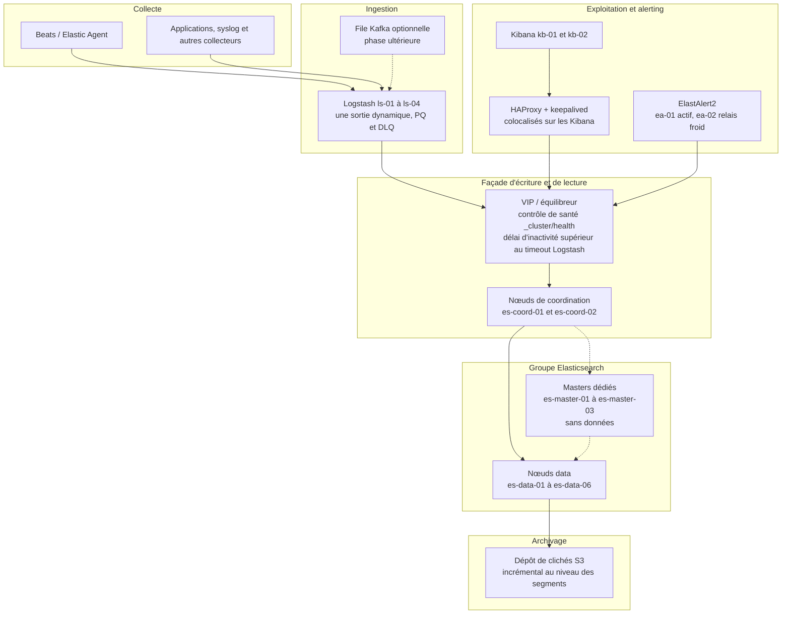

# Architecture cible de la plateforme ELK 8.x

**Revenu Québec** — Document d’architecture technologique  
**Périmètre :** production et paliers de préproduction (Unit, Accp, Simulation)  
**Version :** 1.0 — 19 novembre 2026 (heure de l’Est, America/Toronto)  
**Statut :** proposition d’architecture, à valider avec l’infrastructure et les exploitants

---

## Table des matières

1. [Contexte, objectifs et leçons de l’incident actuel](#1-contexte-objectifs-et-leçons-de-lincident-actuel)
2. [Architecture logique](#2-architecture-logique)
3. [Revue critique du dimensionnement proposé en production](#3-revue-critique-du-dimensionnement-proposé-en-production)
4. [Méthode de dimensionnement de la capacité](#4-méthode-de-dimensionnement-de-la-capacité)
5. [Dimensionnement des paliers de préproduction](#5-dimensionnement-des-paliers-de-préproduction)
6. [Standards communs à tous les paliers](#6-standards-communs-à-tous-les-paliers)
7. [Risques, questions ouvertes et prochaines étapes](#7-risques-questions-ouvertes-et-prochaines-étapes)

---

## 1. Contexte, objectifs et leçons de l’incident actuel

### 1.1 Contexte

La plateforme actuelle d’ingestion (Logstash 8.19 vers un agrégat Elasticsearch exposé par la VIP `es-prod.gestion`) subit des interruptions de plus en plus fréquentes. Les événements s’accumulent dans la file persistante (persistent queue, PQ) de Logstash jusqu’à ce qu’une vidange manuelle rétablisse le service, au prix d’une perte de données. Ces incidents surviennent alors que les ressources de Logstash (processeur, tas JVM) ne sont pas au pic : le goulot se trouve en aval, du côté de la VIP ou du groupe Elasticsearch.

Une nouvelle architecture Elasticsearch / Logstash / Kibana 8.x est en conception. Le présent document :

- formalise l’architecture logique cible ;
- passe en revue, ligne par ligne, le besoin d’infrastructure déjà formulé pour la **production** ;
- expose une méthode de calcul de capacité dont les volumes réels restent à mesurer (aucune donnée d’ingestion n’est inventée ici) ;
- propose un **dimensionnement distinct** pour les paliers de préproduction **Unit**, **Accp** (acceptation) et **Simulation** ;
- fixe les standards communs (modèle d’indexation, file persistante, dead letter queue, sécurité, supervision) que la conception doit intégrer dès le départ, précisément pour ne pas reproduire les causes de l’incident actuel.

### 1.2 Objectifs

| Objectif | Résultat attendu |
| --- | --- |
| Disponibilité de l’ingestion | Résistance à la perte d’un nœud Logstash, d’un nœud data, d’un nœud de coordination ou d’un serveur Kibana, sans vidange de file |
| Intégrité | Plus de perte silencieuse d’événements (dead letter queue, alertes, politique de rétention de la PQ) |
| Performance prévisible | Les requêtes `_bulk` se terminent largement sous le délai d’attente du client Logstash, y compris au pic nominal |
| Maîtrise des shards | Budget et cycle de vie (ILM, data streams) qui empêchent l’explosion d’index quotidiens par client |
| Parité contrôlée des paliers | Unit pour valider la configuration à faible coût, Accp pour la parité fonctionnelle, Simulation pour extrapoler la charge avant la bascule en production |
| Exploitabilité | Supervision, alertes, clichés (snapshots) S3, durcissement (TLS, RBAC, coffre de secrets) |

### 1.3 Leçons de l’incident que cette architecture doit traiter

Les constats suivants, établis sur l’environnement actuel, sont des exigences de conception et non de simples pistes d’amélioration.

1. **Timeouts des requêtes `_bulk` (cause directe du remplissage de la PQ).** Les journaux Logstash du 16 novembre 2026, vers 2 h (heure de l’Est), montrent des `Manticore::SocketTimeout` vers `es-prod.gestion:9200`, puis le marquage de l’URL comme morte (`Marking url as dead`) et l’erreur `no living connections in the pool`. Logstash renvoie le même lot en boucle ; la file grossit (jusqu’à `queue.max_bytes: 4096mb`). Vider la file « règle » le symptôme en jetant le retard ou le lot trop lent. **Exigence :** chemin d’écriture dimensionné et supervisé, délai d’inactivité de la VIP supérieur au `timeout` Logstash, nœuds de coordination en façade, tests de charge avant la production.

2. **Multiplication des sorties Elasticsearch (~25 blocs `elasticsearch { }` dans un même pipeline).** Chaque sortie ouvre son propre bassin de connexions vers la même VIP, ce qui multiplie les petites requêtes `_bulk` et la pression sur le groupe et sur l’équilibreur. **Exigence :** une seule sortie dynamique (plus, au besoin, une sortie distincte uniquement pour les documents qui exigent un `document_id`).

3. **Explosion de shards.** Le modèle `rq-…-%{[indexname]}-%{+YYYY.MM.dd}` crée un index par client, par source et par jour. Un groupe trop fragmenté ralentit les écritures et alourdit l’état de cluster — cause classique de `_bulk` qui expirant. **Exigence :** data streams, modèles d’index et politiques ILM, avec une taille de shard cible de 10 à 50 Go.

4. **Absence de dead letter queue (DLQ).** Des erreurs `status=>400` ont été observées (index `rq-gv-graph-tech-intg-gv_graph-2026-11-16`). Sans DLQ, ces documents sont perdus et n’ont pas d’alerte dédiée. La DLQ ne couvre pas les 429, les 5xx ni la saturation disque : ces cas exigent une alerte sur la taille de la PQ. **Exigence :** DLQ + alerte PQ dès le premier palier utile.

5. **Un seul point d’entrée (`hosts` = VIP unique) mal caractérisé.** La VIP apporte de la redondance, mais un `SocketTimeout` peut venir de l’équilibreur (délai d’inactivité trop court, persistance de session qui concentre le trafic sur un nœud, contrôle de santé trop superficiel, limite de connexions). **Exigence :** contrôles de santé applicatifs, délai d’inactivité supérieur à 120 s, répartition sans affinité collante inadéquate, supervision par nœud et non seulement via la VIP.

6. **Flood applicatif (AppDynamics).** Une mauvaise configuration produit en rafale des messages du type `Loading profiler failed during CoCreateInstance, Profiler CLSID: 'AppDynamics.AgentProfiler'`. **Exigence :** filtre `drop` temporaire en tête du pipeline, à retirer une fois la source corrigée ; ce n’est pas un substitut au dimensionnement.

7. **Remédiation actuelle destructrice.** La vidange de la file n’est pas une procédure de rétablissement acceptable. **Exigence :** sauvegarde de `path.queue`, `pqcheck` / `pqrepair`, DLQ et alertes, plutôt que le vidage systématique.

---

## 2. Architecture logique

Le flux d’écriture de production est le suivant : les collecteurs envoient à Logstash ; Logstash écrit exclusivement vers la VIP des **nœuds de coordination** ; ces nœuds répartissent vers les nœuds data ; les masters dédiés ne portent aucun shard de données ; Kibana et ElastAlert2 passent aussi par la façade de coordination ; les clichés partent vers S3.



**Notes d’architecture :**

- Les nœuds master n’ont pas le rôle `data` et ne reçoivent pas le trafic client.
- Le rôle `ingest` n’est pas déployé sur des nœuds dédiés (choix retenu). Il doit toutefois être attribué explicitement, typiquement aux nœuds data, ou aux nœuds de coordination si l’on veut décharger les data. Il ne doit pas être activé sur les masters.
- Kafka n’est pas requis pour le premier déploiement. Il devient pertinent si l’on veut découpler durablement la collecte de l’écriture Elasticsearch (rejeu, lissage des pics, isolation des producteurs). La file persistante de Logstash couvre déjà un tampon local, qui a montré ses limites lorsque le `_bulk` reste bloqué longtemps.
- Un groupe de **supervision distinct** (Stack Monitoring ou Metricbeat vers un petit groupe dédié) est recommandé en production, pour que la supervision survive à un incident sur le groupe métier.

---

## 3. Revue critique du dimensionnement proposé en production

Le tableau ci-dessous reprend le besoin d’infrastructure déjà formulé, inchangé, afin de le commenter ensuite ligne par ligne.

### 3.1 Tableau proposé (production)

| Rôle | Nombre et noms | vCPU | RAM | Tas JVM (heap) | Disque système | Stockage de données | Remarques déjà formulées |
| --- | --- | --- | --- | --- | --- | --- | --- |
| Masters dédiés | 3 — `es-master-01` à `03` | 4 | 16 Go | Environ 50 % de la RAM (8 Go), dimensionnement automatique ES | 100 Go | 50 Go / 100 Go SSD (état de cluster, journaux) | Aucun shard de données ; augmenter la RAM si le nombre de shards devient élevé ; hôtes physiques distincts |
| Nœuds data | 6 — `es-data-01` à `06` | 16 | 64 Go | ≤ 50 % et < 31 Go (31 Go), le reste pour le cache de fichiers | 100 Go | 2 To SSD/NVMe local, ≥ 3 000 IOPS soutenus par nœud | Occupation ≤ 70 % ; processeur et E/S ≤ 75 % au pic nominal ; volumes identiques sur les 6 nœuds |
| Nœuds de coordination | 2 — `es-coord-01` / `02` | 8 | 32 Go | 50 % (16 Go) | 100 Go | Aucune donnée | Utilisation ≤ 45 % (N = 2). Nœuds ingest dédiés non retenus ; s’ils l’étaient, mêmes valeurs |
| Logstash | 4 — `ls-01` à `04` | 8 | 16 Go | 4 Go (`-Xms` = `-Xmx`, selon la documentation Logstash) | 50 Go | File persistante = somme des pipelines × 4 Go × 1,2, SSD | `pipeline.workers` = vCPU (défaut) ; utilisation ≤ 60 % (≤ 67,5 % avec 3 nœuds sur 4) |
| Kibana + HAProxy + keepalived | 2 — `kb-01` / `02` | 8 | 16 Go | Processus Node.js Kibana ; HAProxy / keepalived, moins de 1 Go suggéré | 50 Go | Aucune donnée | HAProxy et keepalived colocalisés, pas de VM supplémentaire ; utilisation ≤ 45 % |
| ElastAlert2 | `ea-01` (actif), `ea-02` (relais froid) | 2 | 8 Go | Processus Python | 50 Go | Aucune donnée (état dans l’index `elastalert_status`) | `ea-02` identique, sur un hôte physique distinct |
| Dépôt de clichés (archivage S3) | 1 | S. O. | S. O. | S. O. | S. O. | Capacité S3 selon la rétention des clichés | Les clichés ne copient que les shards primaires et sont incrémentaux au niveau des segments |

**Totaux de ce tableau (pour comparaison avec les paliers) :** 19 serveurs, **176 vCPU**, **608 Go** de RAM, **1,5 To** de disques système et applicatifs, **12,3 To** de volumes de données Elasticsearch (12 To sur les nœuds data et 0,3 To sur les masters, en retenant 100 Go par master).

### 3.2 Hypothèses et éléments à valider avec l’infrastructure

Les points suivants sont des **hypothèses** ou des **données manquantes**. Ils doivent être tranchés avant de figer l’achat ou le provisionnement. Ils sont clairement marqués « À VALIDER ».

| Élément | Statut | Pourquoi c’est bloquant |
| --- | --- | --- |
| Volume d’ingestion quotidien moyen et au pic (Go/jour, événements par seconde) | **À VALIDER** | Seule donnée qui permet de vérifier si 6 × 2 To suffisent (voir section 4) |
| Rétention par typologie de données (chaud, tiède, froid / clichés recherchables) | **À VALIDER** | Détermine le besoin de paliers hot/warm/frozen et la capacité S3 |
| Facteur de réplication en production (hypothèse de travail : 1 réplique, soit 2 exemplaires) | **À VALIDER** | Multiplie le stockage et le coût d’écriture |
| Nombre réel de pipelines Logstash et valeur retenue de `queue.max_bytes` par pipeline | **À VALIDER** | Détermine si 50 Go de disque Logstash suffisent |
| Nombre de nœuds data derrière la VIP actuelle, réglages de la VIP (délais, persistance, health check, plafond de connexions) | **À VALIDER** | Cause possible des `SocketTimeout` |
| Utilisation prévue des ingest pipelines (Elastic Agent, modules Beats, enrichissements) | **À VALIDER** | Décide du rôle `ingest` |
| Exigences de chiffrement, d’audit et d’hébergement S3 (région, immuabilité, séparation des rôles) | **À VALIDER** | Sécurité et conformité |
| Existence ou non d’un groupe de supervision distinct | **À VALIDER** | Résilience de l’observabilité |
| Fenêtres de maintenance, RPO/RTO des clichés | **À VALIDER** | Politique de snapshot |

Tant que le volume quotidien et la rétention ne sont pas mesurés, **le dimensionnement disque des nœuds data reste une enveloppe**, pas une capacité démontrée.

### 3.3 Ce qui est solide dans la proposition

- **Trois masters dédiés, sans données, sur des hôtes physiques distincts.** C’est le schéma de référence Elastic pour un groupe de production. Un nombre impair évite l’égalité lors d’une élection. 16 Go de RAM et un tas d’environ 8 Go sont largement suffisants au départ : la documentation 8.x indique qu’un master doit disposer d’**au moins 1 Go de tas par 3 000 index** (soit, pour 8 Go, un plafond indicatif de l’ordre de 24 000 index, qui reste un maximum de tenue et non un objectif).
- **Tas des nœuds data plafonné sous le seuil des *compressed ordinary object pointers*.** La documentation Elastic 8.19 demande de ne pas dépasser 50 % de la RAM et de rester sous le seuil *compressed oops*. Ce seuil varie : **26 Go est sûr sur la plupart des systèmes, jusqu’à environ 30 Go sur certains**. Le dimensionnement automatique d’Elasticsearch plafonne à 31 Go. Retenir « 31 Go » est donc cohérent avec le plafond automatique, **à condition de vérifier** au démarrage que `jvm.using_compressed_ordinary_object_pointers` vaut `true` (journal de nœud ou `GET _nodes/_all/jvm`). Si le drapeau passe à `false`, abaisser le tas (30 Go, voire 26 Go). Le reste de la RAM (environ 33 Go) doit rester au cache de fichiers du système, sans autre processus lourd sur le nœud.
- **Nœuds data identiques, occupation cible ≤ 70 %, processeur et E/S ≤ 75 % au pic.** L’occupation à 70 % est alignée sur une exploitation saine (les seuils par défaut d’Elasticsearch sont 85 % / 90 % / 95 % pour *low*, *high* et *flood_stage*). Garder une marge sous le *watermark* bas évite les réallocations surprises.
- **Deux nœuds de coordination, utilisation cible ≤ 45 %.** C’est la bonne façade : le trafic client (Logstash, Kibana, ElastAlert2) ne doit pas atterrir sur les masters ni, de préférence, directement sur les data. La marge à 45 % avec N = 2 permet de tenir le pic sur un seul nœud en cas de perte.
- **Quatre Logstash avec marge N+1** (cible ≤ 60 %, et ≤ 67,5 % s’il n’en reste que trois). Tas à 4 Go avec `-Xms` = `-Xmx`, conformément au guide Logstash. `pipeline.workers` égal au nombre de vCPU (défaut) est un bon point de départ.
- **Kibana en haute disponibilité, HAProxy et keepalived colocalisés.** Pas de VM supplémentaire, choix raisonnable à cette échelle.
- **ElastAlert2 en actif / relais froid**, état dans `elastalert_status`, machines sur des hôtes physiques distincts. Correct, à condition de documenter la bascule (n’avoir **qu’une** instance active, pour éviter les alertes en double).
- **Clichés S3 incrémentaux au niveau des segments, shards primaires seulement.** C’est exactement le comportement des snapshots Elasticsearch. Prévoir le chiffrement côté compartiment et des tests de restauration périodiques.

### 3.4 Ajustements recommandés

#### 3.4.1 IOPS des nœuds data : 3 000 est trop bas pour du NVMe « chaud »

Un plancher de **3 000 IOPS soutenus** par nœud est faible pour de l’ingestion soutenue sur du NVMe, et risquerait de reproduire des `_bulk` lents. Sur du NVMe local, on vise plutôt **au moins 10 000 IOPS soutenus** par nœud, avec une latence d’écriture maîtrisée (p99 à mesurer), ou, à défaut, une mesure réelle avant l’achat.

**Recommandation :** inscrire au cahier des charges un essai `fio` (écritures aléatoires 4 Ko, écritures séquentielles, mélange lecture/écriture représentatif) sur le volume de données, avant acceptation des machines, et retenir le résultat mesuré plutôt qu’une valeur catalogue en IOPS en rafale. Si le stockage ne peut pas livrer cette classe de performance, il faudra soit réduire le débit d’ingestion visé, soit augmenter le nombre de nœuds data.

#### 3.4.2 Disque Logstash de 50 Go face à la file persistante

La formule déjà inscrite au tableau est la bonne :

```text
espace PQ ≈ (somme sur les pipelines de queue.max_bytes) × 1,2
```

Le facteur 1,2 couvre le surcoût des pages et points de contrôle. Il faut y ajouter le système, les journaux Logstash, la **DLQ** (souvent 1 à 4 Go, à fixer), et une marge pour une éventuelle vidange diagnostique (`cp -a` de `path.queue`).

**Exemple de calcul (valeurs d’illustration, à remplacer par le nombre réel de pipelines) :**

| Scénario | Calcul | Espace files | Verdict sur un disque de 50 Go |
| --- | --- | --- | --- |
| 1 pipeline à 4 Go | 4 × 1,2 = 4,8 Go, plus DLQ 2 Go, journaux et OS | ~15 à 20 Go utilisés | Suffisant |
| 6 pipelines à 4 Go | 6 × 4 × 1,2 = 28,8 Go, plus DLQ, journaux, copie de diagnostic | facilement 40 Go et plus | Juste, voire insuffisant |
| 10 pipelines à 4 Go | 10 × 4 × 1,2 = 48 Go avant même la DLQ | ≥ 48 Go | Insuffisant |

**Recommandation :** figer le nombre de pipelines, puis dimensionner le disque. Si le découpage en plusieurs pipelines est probable, porter le disque Logstash à **100 Go SSD** dès la production, plutôt que de revenir à la charge ensuite. La file doit être sur SSD, ce qui est déjà prévu.

#### 3.4.3 Paliers hot / warm / frozen et ILM

Les six nœuds data sont identiques (tout « chaud »). C’est simple à exploiter et adapté si la rétention chaude est courte. Si la rétention globale est longue, ce choix est coûteux : des données rarement interrogeées occupent du NVMe de production.

**Recommandation :** concevoir dès maintenant les **politiques ILM** (rotation par taille et par âge, passage tiède, clichés recherchables / frozen vers S3). On peut démarrer avec six nœuds hot homogènes, puis ajouter un palier warm (disques plus denses, moins d’IOPS) ou s’appuyer sur les *searchable snapshots* en frozen, sans reconcevoir les modèles d’index. Ne pas attendre d’avoir « trop » d’index quotidiens pour introduire l’ILM : c’est précisément l’échec du modèle actuel.

#### 3.4.4 Rôle ingest

Le tableau écarte à juste titre des nœuds *ingest* dédiés pour le premier déploiement. En 8.x, le rôle n’est toutefois pas implicite sur un nœud de coordination pur (toutes les rôles à `false`). **À prévoir dans la configuration :** rôle `ingest` sur les nœuds **data** (choix par défaut recommandé), ou sur les nœuds de coordination si les pipelines d’ingestion sont lourds et qu’on veut protéger le processeur des data. Jamais sur les masters.

#### 3.4.5 Budget de shards (guidance 8.3 et suivantes)

La règle ancienne « au plus 20 shards par Go de tas » **ne s’applique plus à partir d’Elasticsearch 8.3** (elle a été retirée, le coût mémoire par shard ayant beaucoup baissé). Pour un groupe 8.19, retenir plutôt la guidance officielle en vigueur :

| Règle | Valeur de conception |
| --- | --- |
| Taille cible d’un shard primaire | **10 à 50 Go** ; sous ILM, `min_primary_shard_size` à 10 Go et `max_primary_shard_size` à 50 Go |
| Documents par shard | Moins de **200 millions** |
| Masters | Moins de **3 000 index par Go de tas** (indicateur de tenue, pas un objectif) |
| Filet de sécurité du groupe | `cluster.max_shards_per_node` vaut **1 000** par défaut (shards primaires et répliques des index ouverts, hors frozen). Ce n’est **pas** une cible de dimensionnement, c’est un cran d’arrêt |
| Tas des nœuds data et champs | Compter de l’ordre de **1 Ko de tas par champ mappé, par index présent sur le nœud**, plus environ 0,5 Go pour la charge de travail |

Le modèle actuel (un index par client, par `indexname` et par jour, souvent avec plusieurs shards primaires et une réplique) est incompatible avec ce budget dès que le nombre de sources augmente. **C’est un des correctifs les plus rentables** de la nouvelle architecture (voir section 6).

À titre d’ordre de grandeur seulement : six nœuds data, filet à 1 000 shards par nœud, donnent un maximum théorique de 6 000 shards ouverts dans le groupe. Avec 1 réplique et des shards de 30 Go, cela représente une capacité bien supérieure à 12 To — le vrai risque n’est donc pas le filet à 1 000, c’est le **sous-dimensionnement des shards** (des milliers de petits index quotidiens).

#### 3.4.6 Une seule sortie Logstash et une DLQ

Reprendre le pipeline unique avec une vingtaine de sorties `elasticsearch { }` reproduirait l’incident. **Recommandation ferme :**

- calculer le nom du data stream (ou de l’index) dans la section `filter`, par exemple `@metadata[index]` ;
- n’avoir **qu’un** bloc `elasticsearch { }` avec `data_stream => true` ou `index => "%{[@metadata][index]}"` ;
- conserver une deuxième sortie seulement pour les flux qui exigent un `document_id` (mises à jour / traces) ;
- activer `dead_letter_queue.enable: true` (Logstash 8.19) et un petit pipeline de lecture de la DLQ, avec courriel résumé (relais SMTP interne), plutôt qu’un courriel par événement.

La DLQ capte les rejets 400/404 ; elle **ne** capte **pas** les 429, les 5xx, ni un disque plein. Une alerte sur la profondeur et le taux de remplissage de la PQ reste obligatoire.

#### 3.4.7 Chemin Logstash → équilibreur → nœuds de coordination

Conserver une VIP, mais la placer **devant les nœuds de coordination**, pas devant un mélange de rôles, et la régler pour du `_bulk` long :

- **Contrôle de santé** sur `GET /_cluster/health` (ou un équivalent HTTP authentifié), et non un simple test TCP du port 9200. Un nœud en longue pause GC ou saturé peut encore accepter une connexion TCP.
- **Délai d’inactivité / de réponse de la VIP supérieur au `timeout` de Logstash.** Si Logstash est à 120 s, viser **180 s** côté équilibreur, afin que ce soit le client qui abandonne proprement, et non l’équilibreur qui coupe la connexion.
- **Pas de persistance de session (sticky)** qui enverrait toutes les connexions d’un Logstash vers un seul nœud de coordination ou data.
- Répartition de type *least connections*, avec un plafond de connexions cohérent avec 4 Logstash (et non plus 25 bassins).
- En diagnostic, comparer la latence d’un `_bulk` ou d’un `_cluster/health` **via la VIP** et **directement sur un nœud**, pour distinguer un problème d’équilibreur d’un problème Elasticsearch.

#### 3.4.8 File Kafka (optionnelle)

Kafka (ou un équivalent) n’est pas nécessaire pour corriger l’incident si l’on fait en même temps : une sortie unique, un budget de shards, une VIP bien réglée, une DLQ et une capacité disque/IOPS suffisante. Il devient intéressant :

- si les producteurs ne peuvent pas tolérer de contre-pression ;
- si l’on doit rejouer une fenêtre de logs indépendamment de la PQ locale ;
- si plusieurs consommateurs doivent lire le même flux.

**Recommandation :** le noter comme évolution optionnelle (phase ultérieure), pas comme prérequis du premier déploiement, afin de ne pas élargir le périmètre avant d’avoir stabilisé l’écriture Elasticsearch.

#### 3.4.9 Sécurité

À inscrire au socle, sur tous les paliers sauf éventuellement Unit au minimum viable, et en tout point identique en Accp / Simulation / production :

- TLS sur les couches *transport* (inter-nœuds) et HTTP ;
- RBAC : comptes de service distincts pour Logstash, Kibana, ElastAlert2, les clichés et la supervision ; ne plus utiliser l’utilisateur `elastic` dans les pipelines ;
- secrets Logstash dans le **keystore** (`${ES_PWD}`), jamais en clair dans `pipeline.global.conf` ;
- chiffrement des clichés dans le compartiment S3 ;
- journalisation d’audit si le cadre de sécurité de l’organisation l’exige.

#### 3.4.10 Supervision

Prévoir, en production, un **groupe de supervision distinct** (petit groupe Elasticsearch + Kibana, ou Metricbeat / Elastic Agent vers ce groupe). Superviser le groupe métier par lui-même laisse l’observabilité muette précisément pendant l’incident. Alertes minimales : santé du groupe, *watermarks* disque, tas et pauses GC, rejets du *thread pool* `write`, latence `_bulk`, profondeur et taux de remplissage de la PQ, taille de la DLQ, écart entre événements `in` et `out` Logstash, disponibilité de la VIP.

#### 3.4.11 Masters 16 Go / tas 8 Go et ElastAlert2 en relais froid

Aucun changement demandé sur ces deux lignes, hormis : (a) suivre le nombre d’index à mesure que les data streams se multiplient, et n’augmenter la RAM des masters que si l’on s’approche de la guidance « 3 000 index par Go de tas » ; (b) documenter et tester la procédure de bascule ElastAlert2 (`ea-02`), avec interverrouillage pour n’avoir qu’une instance qui évalue les règles.

---

## 4. Méthode de dimensionnement de la capacité

### 4.1 Formule de stockage des données

Pour un palier de rétention donné (par exemple le palier « chaud » sur les nœuds data) :

```text
Stockage nécessaire =
    Volume_quotidien
  × (1 + Nombre_de_répliques)
  × Jours_de_rétention
  × 1,1          (surcharge : segments, translog, fusion, marge de cartographie)
  / 0,7          (cible d’occupation, alignée sur le plafond d’exploitation de 70 %)
```

| Symbole | Signification | Valeur à retenir |
| --- | --- | --- |
| `Volume_quotidien` | Volume **déjà indexé** par jour (après parse et, le cas échéant, après dilatation `_source` / champs) | **À VALIDER** — ne pas confondre avec le volume brut en entrée de Logstash |
| `Nombre_de_répliques` | Répliques par shard primaire (1 réplique ⇒ facteur 2) | **À VALIDER** (hypothèse de travail production : 1) |
| `Jours_de_rétention` | Jours passés sur ce palier de stockage | **À VALIDER** par typologie |
| `1,1` | Surcharge forfaitaire 10 % | Hypothèse de conception, à recaler après les premiers cycles ILM |
| `0,7` | Inverse de la cible 70 % | Cohérent avec le tableau d’infrastructure |

Capacité brute actuellement proposée en production (nœuds data seulement) :

```text
Capacité brute  = 6 × 2 To = 12 To
Capacité utile  = 12 To × 0,7 = 8,4 To
```

Forme inverse, utile pour un arbitrage rétention / volume :

```text
Volume_quotidien_maximal ≈
    Capacité_utile  /  ( (1 + Nombre_de_répliques) × Jours_de_rétention × 1,1 )
```

Les clichés S3 se calculent à part : ils portent les **primaires** seulement et sont incrémentaux. Prévoir néanmoins une rétention de clichés (nombre de points de restauration × une estimation du delta quotidien), plus une marge pour une restauration complète.

Cette formule **ne remplace pas** un essai de charge : elle dimensionne le disque, pas le processeur, les IOPS, ni le tas.

### 4.2 Exemple travaillé (données fictives, non mesurées)

> **Attention :** les volumes et rétentions de cette sous-section sont un **exemple entièrement fictif**, destiné uniquement à illustrer la méthode. Ils ne représentent pas le trafic de Revenu Québec et ne doivent pas servir à justifier un achat.

**Exemple A** — 100 Go indexés par jour, 1 réplique, 30 jours uniquement sur le palier chaud :

```text
100 Go × (1 + 1) × 30 × 1,1 / 0,7
  = 6 000 × 1,1 / 0,7
  = 9 428 Go ≈ 9,4 To
```

9,2 To > 8,4 To de capacité utile : l’enveloppe de 6 × 2 To **ne suffirait pas** à 30 jours chauds pour cet exemple. Il faudrait réduire la rétention chaude, ajouter des nœuds, grossir les volumes, ou basculer une partie de la rétention vers un palier tiède / frozen (S3).

**Exemple B** — mêmes 100 Go par jour, 1 réplique, 21 jours chauds :

```text
100 Go × 2 × 21 × 1,1 / 0,7
  = 4 620 / 0,7
  = 6 600 Go ≈ 6,4 To
```

6,4 To < 8,4 To : l’enveloppe passe, avec une marge d’environ 2 To utiles.

**Exemple C** — lecture inverse : avec 8,4 To utiles, 1 réplique et 30 jours chauds, le volume quotidien maximal théorique est :

```text
8,4 To / (2 × 30 × 1,1) ≈ 127 Go/jour
```

Dès que les vrais chiffres (`Volume_quotidien`, rétention, répliques) seront connus, on recollera ces trois lectures sur le tableau d’achat. Si le volume réel dépasse le plafond de l’exemple C pour la rétention visée, le tableau production devra être révisé **avant** le provisionnement.

---

## 5. Dimensionnement des paliers de préproduction

Trois paliers distincts, avec des objectifs différents, évitent le piège classique « une préproduction au rabais qui ne prouve rien » et celui, inverse, « une copie conforme de la production pour y faire des essais unitaires ».

| Palier | Objectif | Ce qu’il doit prouver | Ce qu’il n’a pas à prouver |
| --- | --- | --- | --- |
| **Unit** | Intégration et mise au point à faible coût | Syntaxe des pipelines, modèles, ILM, DLQ, droits, playbooks | Haute disponibilité, performance, rétention longue |
| **Accp** (acceptation) | Parité fonctionnelle à échelle réduite | Les mêmes rôles, les mêmes flux, la bascule Kibana, les répliques, les routines d’exploitation | Le débit nominal de production |
| **Simulation** | Performance et tenue de charge | Que la *spécification unitaire* d’un nœud data (et le chemin Logstash → coordination) tient le débit visé, afin d’extrapoler à 6 nœuds | La capacité de rétention complète de la production |

Les noms d’hôtes ci-dessous sont indicatifs (`es-unit-…`, `es-accp-…`, `es-sim-…`).

### 5.1 Palier Unit — minimal et optimisé pour le coût

**Parti pris :** trois nœuds Elasticsearch **combinés** (rôles `master` + `data` + `ingest` + coordination implicite), un Logstash, un Kibana, pas de haute disponibilité, **répliques à 0**, rétention courte (quelques jours). Trois nœuds, plutôt qu’un seul, permettent de valider élection, modèles de cluster et politiques ILM, tout en restant économiques. Un nœud unique n’est acceptable que pour un poste de développement local, pas pour le palier Unit partagé.

| Rôle | Nombre | vCPU | RAM | Tas JVM | Disque système | Stockage de données | Remarques |
| --- | --- | --- | --- | --- | --- | --- | --- |
| Elasticsearch combiné (`master` + `data` + `ingest`) | 3 — `es-unit-01` à `03` | 4 | 16 Go | 8 Go (dimensionnement automatique, 50 %) | 100 Go | 250 Go SSD | Répliques à 0 ; pas de contrainte d’hôtes physiques distincts, souhaitable tout de même ; occupation cible ≤ 70 % |
| Logstash | 1 — `ls-unit-01` | 4 | 8 Go | 2 Go (`-Xms` = `-Xmx`) | 50 Go | PQ réduite (1 à 2 Go) + DLQ, SSD | Un seul pipeline ; même *logique* de sortie unique qu’en production |
| Kibana | 1 — `kb-unit-01` | 4 | 8 Go | Processus Node.js | 50 Go | Aucune donnée | Pas de HAProxy / keepalived |
| ElastAlert2 | 1 — `ea-unit-01` | 2 | 8 Go | Processus Python | 50 Go | État dans `elastalert_status` | Instance unique, pour valider les règles à petite échelle ; omise seulement si l’alerting est testé dès Accp |

**Totaux Unit :** 6 serveurs, **22 vCPU**, **72 Go** de RAM, **450 Go** de disques système et applicatifs, **750 Go** de données Elasticsearch.

**Justifications :** répliques à 0 et rétention courte (proposition : 3 à 7 jours, **À VALIDER**) divisent le besoin disque. Le tas à 8 Go suffit largement pour un petit nombre d’index de test. On y déploie déjà les *mêmes* modèles, politiques ILM, sortie unique, DLQ et filtre temporaire AppDynamics, afin que les écarts de configuration ne se découvrent pas en acceptation.

### 5.2 Palier Accp — parité fonctionnelle à échelle réduite

**Parti pris :** même *topologie de rôles* qu’en production (masters dédiés, nœuds data, un nœud de coordination, deux Logstash, Kibana en HA, ElastAlert2), mais machines plus petites, **répliques à 1**, rétention courte. C’est le palier où l’on certifie un changement (pipeline, modèle, certificat, règle d’alerte) avant la production.

| Rôle | Nombre | vCPU | RAM | Tas JVM | Disque système | Stockage de données | Remarques |
| --- | --- | --- | --- | --- | --- | --- | --- |
| Masters dédiés | 3 — `es-accp-master-01` à `03` | 2 | 8 Go | 4 Go (50 %, automatique) | 50 Go | 50 Go SSD (état de cluster, journaux) | Sans données métier ; hôtes distincts souhaitables |
| Nœuds data | 3 — `es-accp-data-01` à `03` | 8 | 32 Go | 16 Go (50 %) | 100 Go | 500 Go SSD | Répliques à 1 ; occupation ≤ 70 % ; volumes identiques ; le 500 Go suppose une rétention courte et un échantillon de données — **À VALIDER** selon le jeu de tests |
| Nœud de coordination | 1 — `es-accp-coord-01` | 4 | 16 Go | 8 Go | 100 Go | Aucune donnée | Un seul nœud : pas de HA de la façade (acceptable en acceptation) ; le rôle et le chemin d’écriture restent ceux de la production |
| Logstash | 2 — `ls-accp-01` / `02` | 4 | 8 Go | 2 Go (`-Xms` = `-Xmx`) | 50 Go | PQ selon le nombre de pipelines × `queue.max_bytes` × 1,2, SSD | Deux instances pour valider le comportement à plusieurs producteurs ; pas une marge de débit de production |
| Kibana + HAProxy + keepalived | 2 — `kb-accp-01` / `02` | 4 | 8 Go | Processus Node.js + HAProxy / keepalived | 50 Go | Aucune donnée | Parité fonctionnelle de la HA d’exploitation, à échelle réduite |
| ElastAlert2 | 1 — `ea-accp-01` | 2 | 8 Go | Processus Python | 50 Go | État dans `elastalert_status` | Instance unique ; le relais froid se teste en Simulation ou via un exercice documenté, pas nécessairement en permanence |

**Totaux Accp :** 12 serveurs, **52 vCPU**, **176 Go** de RAM, **800 Go** de disques système et applicatifs, **1,65 To** de données Elasticsearch (1,5 To data + 0,15 To masters).

**Justifications :** trois data avec une réplique permettent de tester la perte d’un nœud data, l’allocation et un redémarrage roulant, ce que Unit ne couvre pas. Deux Kibana avec HAProxy / keepalived valident le même schéma d’accès que la production. On ne cherche pas la performance : un jeu de données réduit et une rétention courte (proposition : 7 à 14 jours, **À VALIDER**) suffisent. Si le jeu d’acceptation doit recopier une fenêtre de production plus large, porter les volumes data de 500 Go à 1 To sans changer le reste de la fiche.

### 5.3 Palier Simulation — performance et tests de charge

**Parti pris :** la **fiche d’un nœud data est identique à la production** (16 vCPU, 64 Go de RAM, même classe de disque et d’IOPS, 2 To NVMe), mais le *nombre* de nœuds data est réduit à **3**. Les masters dédiés, les deux nœuds de coordination et deux Logstash reprennent les spécifications de production, pour que le chemin d’écriture (Logstash → VIP → coordination → data) soit représentatif. On extrapole ensuite linéairement, avec prudence, vers six nœuds data.

| Rôle | Nombre | vCPU | RAM | Tas JVM | Disque système | Stockage de données | Remarques |
| --- | --- | --- | --- | --- | --- | --- | --- |
| Masters dédiés | 3 — `es-sim-master-01` à `03` | 4 | 16 Go | 8 Go (automatique) | 100 Go | 100 Go SSD | Même fiche que la production ; hôtes physiques distincts |
| Nœuds data | 3 — `es-sim-data-01` à `03` | 16 | 64 Go | ≤ 50 % et sous le seuil *compressed oops* (plafond auto 31 Go, à vérifier) | 100 Go | 2 To SSD/NVMe local, **même classe IOPS que la production** (cible recommandée ≥ 10 000 IOPS soutenus) | Fiche unitaire identique à la production ; occupation ≤ 70 % ; processeur et E/S ≤ 75 % au palier de charge retenu |
| Nœuds de coordination | 2 — `es-sim-coord-01` / `02` | 8 | 32 Go | 16 Go | 100 Go | Aucune donnée | Même chemin et mêmes cibles d’utilisation (≤ 45 % à N = 2) qu’en production, pour ne pas fausser le test |
| Logstash | 2 — `ls-sim-01` / `02` | 8 | 16 Go | 4 Go (`-Xms` = `-Xmx`) | 50 Go, porter à 100 Go si la PQ de test est large | PQ + DLQ sur SSD, même logique qu’en production | Même fiche unitaire que la production ; deux nœuds suffisent à générer et à mesurer, quatre n’apporteraient pas d’information unitaire supplémentaire |
| Kibana | 1 — `kb-sim-01` | 8 | 16 Go | Processus Node.js | 50 Go | Aucune donnée | Suffisant pour le suivi des tests ; HA Kibana déjà prouvée en Accp |
| ElastAlert2 | 1 — `ea-sim-01` | 2 | 8 Go | Processus Python | 50 Go | État dans `elastalert_status` | Hors chemin critique du test de charge ; utile si l’on veut valider le coût des règles sur un groupe chargé |

**Totaux Simulation :** 12 serveurs, **102 vCPU**, **360 Go** de RAM, **1,0 To** de disques système et applicatifs, **6,3 To** de données Elasticsearch (6 To data + 0,3 To masters).

**Limite de l’extrapolation :** le débit d’écriture et la capacité disque scalent à peu près linéairement lorsqu’on passe de 3 à 6 nœuds data **si** les masters, les nœuds de coordination, l’équilibreur et Logstash ne sont pas saturés, et **si** le nombre de shards reste dans le budget. L’état de cluster, les fusions, les *refresh* et certaines agrégations ne scalent pas toujours linéairement. On appliquera un **facteur de prudence** (ne pas viser plus de ~80 % du débit extrapolé comme engagement de production) et on vérifiera, pendant les essais, que la coordination et les masters restent largement sous leurs cibles.

#### 5.3.1 Plan de tests (Simulation)

1. **Préparation.** Déployer les mêmes modèles d’index, data streams, politiques ILM, pipeline Logstash (sortie unique, DLQ, filtre AppDynamics retiré ou isolé selon le scénario) et réglages d’équilibreur que ceux visés en production. Mesurer d’abord les IOPS et la latence disque au `fio`, à froid.
2. **Générateur Elasticsearch : Rally (`esrally`).** Utiliser une piste (track) dont le mapping se rapproche des événements réels (champs, volume typique d’un document, nombre de data streams). Si aucune piste standard n’est représentative, construire une piste interne à partir d’un échantillon anonymisé. Mesurer l’indexation, la recherche et un mélange des deux.
3. **Générateur Logstash.** Rejouer un corpus représentatif (Filebeat en rejeu, producteur dédié, ou `input { generator { } }` paramétré avec un gabarit réel) vers les deux Logstash de Simulation, à travers la VIP de coordination, pour tester **le chemin complet** (et non seulement Elasticsearch). Inclure un pourcentage de documents volontairement invalides pour valider la DLQ sans bloquer la PQ.
4. **Montée en charge.** Palier à 25 %, 50 %, 75 % et 100 % du **débit cible imputable à trois nœuds data** (soit environ la moitié du débit de production visé, **À VALIDER** une fois le volume connu), puis un essai de surcharge (par exemple 125 %) pour trouver le point de rupture.
5. **Résilience pendant la charge.** Perte d’un nœud data, perte d’un nœud de coordination, redémarrage roulant d’un master, arrêt d’un Logstash, bascule simulée de la VIP. Mesurer le temps de rétablissement et l’évolution de la PQ.
6. **Clichés.** Déclencher un snapshot S3 pendant une charge nominale ; mesurer l’impact sur la latence `_bulk` ; faire une restauration de contrôle sur un data stream témoin.

#### 5.3.2 Métriques à capturer

| Domaine | Métriques |
| --- | --- |
| Indexation | Débit d’indexation (documents/s et Go/s), latence `_bulk` (p50, p95, p99), rejets `429`, rejets du *thread pool* `write` |
| Logstash | `in` / `filtered` / `out`, profondeur et octets de la PQ, octets et nombre d’événements en DLQ, durée des lots, erreurs `SocketTimeout`, état du bassin de connexions |
| Ressources nœuds data | Processeur, IOPS et latence disque (p99), occupation disque, tas, pauses GC, fusions (*merge*), *refresh* |
| Coordination et masters | Processeur, tas, latence des mises à jour d’état de cluster, file d’attente |
| Recherche (échantillon) | Latence p95/p99 des requêtes typiques Kibana, pendant l’indexation |
| Résilience | Temps de rétablissement après perte d’un nœud, durée de réallocation, éventuelle perte d’événements |

#### 5.3.3 Critères de go / no-go

Tous les critères ci-dessous doivent être satisfaits sur le palier Simulation avant de confirmer l’enveloppe de production. Les seuils numériques de débit sont volontairement exprimés **en proportion de la cible**, la cible elle-même étant **À VALIDER**.

| Décision | Critères (cumulatifs) |
| --- | --- |
| **Go** | Trois nœuds data soutiennent **au moins 50 %** du débit d’ingestion visé en production, pendant une durée représentative (plusieurs heures, pas seulement quelques minutes), avec processeur et E/S ≤ 75 %, tas < 75 %, aucune réjection d’écriture persistante, latence `_bulk` p99 **largement inférieure** au `timeout` Logstash (objectif : p99 < 30 s si le timeout reste à 120 s), occupation disque projetée ≤ 70 % sur la rétention chaude, PQ stable (ne diverge pas), DLQ limitée aux documents volontairement invalides, perte d’un nœud data ou de coordination sans vidange de file, cliché S3 et restauration de contrôle réussis, *compressed oops* actif sur les nœuds data |
| **Go conditionnel** | Les critères de tenue sont atteints, mais un réglage reste à corriger (VIP, taille de lot, politique ILM, nombre de shards primaires) et un essai de confirmation est planifié |
| **No-go** | Timeouts `_bulk` ou remplissage de PQ au débit cible de trois nœuds ; IOPS ou latence disque insuffisantes au `fio` ou sous charge ; besoin de vider une file pour rétablir le service ; extrapolation vers six nœuds qui ne passe pas la formule de stockage (section 4) pour la rétention demandée ; *compressed oops* inactif à 31 Go sans plan d’abaissement du tas |

Si le go est obtenu, l’engagement de production recommandé est de l’ordre de **80 % du débit extrapolé** (résultat sur 3 nœuds × 2 × 0,8), tant qu’un essai de confirmation à six nœuds n’a pas eu lieu.

### 5.4 Tableau comparatif des quatre paliers

Les totaux sont calculés à partir des tableaux proposés ci-dessus (production = tableau d’origine, préproduction = propositions de la section 5). Le stockage « données ES » inclut les petits volumes des masters lorsqu’ils existent.

| Palier | Serveurs | vCPU | RAM | Disques système et applicatifs | Volumes de données ES | Nœuds data (fiche) | Répliques | Haute disponibilité |
| --- | --- | --- | --- | --- | --- | --- | --- | --- |
| **Unit** | 6 | 22 | 72 Go | 450 Go | 750 Go | 3 combinés, 4 vCPU / 16 Go / 250 Go | 0 | Non |
| **Accp** | 12 | 52 | 176 Go | 800 Go | 1,65 To | 3, 8 vCPU / 32 Go / 500 Go | 1 | Partielle (Kibana HA, un seul coord) |
| **Simulation** | 12 | 102 | 360 Go | 1,0 To | 6,3 To | 3, **même fiche que la prod** (16 vCPU / 64 Go / 2 To) | 1 | Chemin d’écriture représentatif (2 coord, 2 Logstash) |
| **Production** | 19 | 176 | 608 Go | 1,5 To | 12,3 To | 6, 16 vCPU / 64 Go / 2 To | 1 (hypothèse) | Oui (N+1 Logstash, 2 coord, 2 Kibana, 3 masters, relais froid ElastAlert2) |

---

## 6. Standards communs à tous les paliers

Ces standards s’appliquent à Unit, Accp, Simulation et à la production. Seuls changent la taille des machines, le nombre de répliques (0 en Unit) et la durée de rétention.

### 6.1 Conventions de nommage et data streams

Abandonner l’index quotidien par client du type `rq-…-%{[indexname]}-%{+YYYY.MM.dd}`. Adopter les **data streams** Elastic, alignés sur la convention ECS :

```text
<type>-<dataset>-<namespace>
```

Exemples (à trancher avec les équipes métier) :

```text
logs-gv_graph-prod
logs-gv_graph-accp
logs-sdf_cit-<application>
```

Le `namespace` distingue les paliers (`unit`, `accp`, `sim`, `prod`) et évite qu’un essai d’acceptation écrase un flux de production, même si un mauvais hôte était visé. Un seul modèle d’index (index template) et une seule politique ILM par typologie suffisent ; le rollover, et non la date dans le nom, crée les *backing indices*.

### 6.2 Politiques ILM et modèles d’index

- Un modèle par typologie, avec nombre de shards primaires calculé pour viser **10 à 50 Go par shard**, typiquement **1 shard primaire** pour les flux modestes.
- Rollover sur `max_primary_shard_size` (50 Go) et `max_age` (par exemple 1 à 7 jours selon le débit — **À VALIDER**), avec un plancher `min_primary_shard_size` (10 Go) pour éviter les tout petits shards lorsque le volume est faible.
- Phases : *hot* (écriture) → *warm* ou réduction de répliques si pertinent → *cold* / *frozen* (clichés recherchables sur S3) → suppression, selon la rétention officielle.
- En Unit : même politique, durées raccourcies, répliques à 0 (priorité `priority` / `index.number_of_replicas` adaptée au palier, idéalement via le `namespace` ou un paramètre de modèle).

### 6.3 Pipeline Logstash : une sortie, PQ, DLQ

- **Une** sortie `elasticsearch` dynamique ; le nom du data stream est posé en `filter` dans `[@metadata][index]` (ou équivalent). Une deuxième sortie seulement pour les flux à `document_id`.
- `hosts` pointant vers la VIP des nœuds de coordination (en Unit : directement les trois nœuds combinés).
- `timeout` à 120 s, délai d’inactivité de la VIP supérieur (180 s recommandé).
- File persistante activée, `queue.max_bytes` dimensionné par pipeline, disque SSD, alerte de remplissage (la DLQ ne couvre pas ce cas).
- `dead_letter_queue.enable: true` dès Unit, avec un pipeline de relecture qui envoie un **courriel résumé** via le relais SMTP interne (pas un courriel par événement).
- Secrets dans le keystore Logstash.
- `config.reload.automatic` déjà en place aujourd’hui : à conserver, en validant toujours la syntaxe (`logstash -t`) avant de s’appuyer sur le rechargement.

Filtre temporaire anti-flood AppDynamics, à placer **en tête** de la section `filter`, et à retirer après correction de la source :

```text
filter {
  # TEMPORAIRE : flood AppDynamics mal configuré — à retirer après les travaux
  if "AppDynamics.AgentProfiler" in [message] and "Loading profiler failed" in [message] {
    drop { }
  }
}
```

Vérification : le compteur `filtered` / `out` du pipeline doit baisser relativement à `in` tant que le flood n’est pas corrigé (`GET` sur l’API `_node/stats` de Logstash).

### 6.4 Sécurité, supervision et alerting

- TLS inter-nœuds et HTTP, RBAC, comptes de service, keystore, chiffrement S3 : voir 3.4.9. En Unit, on peut assouplir le raccordement des collecteurs, pas le principe (pas de mot de passe en clair).
- Supervision : Metricbeat ou Elastic Agent ; en production, groupe de supervision **distinct** recommandé. Alertes minimales rappelées en 3.4.10, plus une alerte « file persistante en croissance pendant N minutes » et « événements en DLQ depuis moins d’une heure ».
- ElastAlert2 : mêmes règles déployées via le dépôt de configuration, avec des destinataires et des seuils adaptés au palier (pour ne pas réveiller la production depuis Accp).
- Clichés : dépôt S3 (ou équivalent compatible) par palier, ou préfixes nettement séparés ; test de restauration au moins en Accp et en Simulation.

---

## 7. Risques, questions ouvertes et prochaines étapes

### 7.1 Risques

| Risque | Impact | Mitigation |
| --- | --- | --- |
| Provisionner 6 × 2 To avant d’avoir mesuré le volume quotidien et la rétention | Surdimensionnement coûteux, ou sous-dimensionnement découvert trop tard | Appliquer la formule de la section 4 dès que les chiffres sont connus ; ne pas passer la commande disque sans cette validation |
| Reproduire le pipeline à ~25 sorties ou les index quotidiens par client | Retour des `SocketTimeout` et de la PQ qui s’emballe | Sortie unique et data streams imposés dès Unit (revue de code / revue de pipeline) |
| IOPS catalogue à 3 000, insuffisants au pic | Mêmes symptômes qu’aujourd’hui, malgré des machines « plus grosses » | Clause `fio` et cible ≥ 10 000 IOPS soutenus ; no-go Simulation si la latence disque s’effondre |
| Délai d’inactivité de la VIP inférieur au timeout Logstash, ou session collante | Faux « nœud mort », concentration sur un seul backend | Réglages d’équilibreur dans les standards ; essai comparatif VIP vs nœud direct |
| Extrapolation trop optimiste de 3 vers 6 nœuds data | Engagement de débit non tenu en production | Facteur de prudence 0,8 ; surveillance des nœuds de coordination et des masters pendant la Simulation |
| Les deux ElastAlert2 actifs en même temps | Doublons d’alertes, voire actions en double | Procédure de bascule écrite et testée ; interverrouillage |
| Flood applicatif non maîtrisé (AppDynamics ou autre) | Saturation de la PQ malgré un groupe sain | Filtre temporaire + correction à la source + alerte sur le taux d’un `dataset` |
| Vidange de PQ comme réflexe d’exploitation | Perte de données | Playbook `pqcheck` / `pqrepair` et interdiction de la vidange hors décision expresse |

### 7.2 Questions ouvertes

1. Quels sont le volume quotidien indexé, le débit de pointe (événements par seconde) et la rétention officielle par typologie ? (**bloquant** pour figer les 2 To)
2. Combien de pipelines Logstash en cible, et quelle valeur de `queue.max_bytes` par pipeline ?
3. Confirme-t-on 1 réplique en production sur le palier chaud ?
4. Veut-on un palier *warm* physique dès le premier déploiement, ou uniquement de l’ILM + clichés recherchables sur S3 ?
5. Où s’exécutent les ingest pipelines, et a-t-on des Elastic Agent en plus de Logstash ?
6. Quels sont les réglages actuels et cibles de la VIP (délais, persistance, health check, limites) ?
7. Un groupe de supervision distinct est-il accepté en production ?
8. Le relais SMTP interne, les listes de diffusion et le cadre de sécurité (audit, durée de conservation des clichés) sont-ils déjà désignés ?
9. Kafka est-il un objectif d’architecture à moyen terme, ou explicitement hors périmètre de la première vague ?

### 7.3 Prochaines étapes

1. Faire mesurer, sur l’existant, le volume quotidien, le débit de pointe et le nombre d’index / de shards actuels (`_cat/indices`, `_cat/shards`, `_cluster/health`, `_cat/nodes`). Recalculer la section 4 avec ces chiffres.
2. Trancher avec l’infrastructure les ajustements du tableau production : cible IOPS, disque Logstash 50 Go ou 100 Go, rôle `ingest`, réglages de la VIP, groupe de supervision, S3.
3. Valider les trois fiches de préproduction (Unit, Accp, Simulation) et leur budget (totaux de la section 5.4).
4. Spécifier les modèles, data streams, politiques ILM et le pipeline à sortie unique (y compris DLQ, alerte PQ et filtre AppDynamics temporaire), puis les déployer d’abord en Unit.
5. Rédiger les playbooks : rétablissement sans vidange de file, bascule ElastAlert2, restauration d’un cliché, ajout d’un nœud data.
6. Exécuter le plan de tests de la section 5.3 en Simulation et appliquer les critères de go / no-go avant d’engager la bascule de production.
7. Revoir ce document (version 1.1) une fois les volumes réels et les décisions d’infrastructure consignés.

---

*Document d’architecture technologique — Revenu Québec — version 1.0 du 19 novembre 2026. Les exemples chiffrés de la section 4.2 sont fictifs et clairement identifiés comme tels. Les capacités des tableaux de préproduction sont des propositions, à arrêter avec l’infrastructure.*
